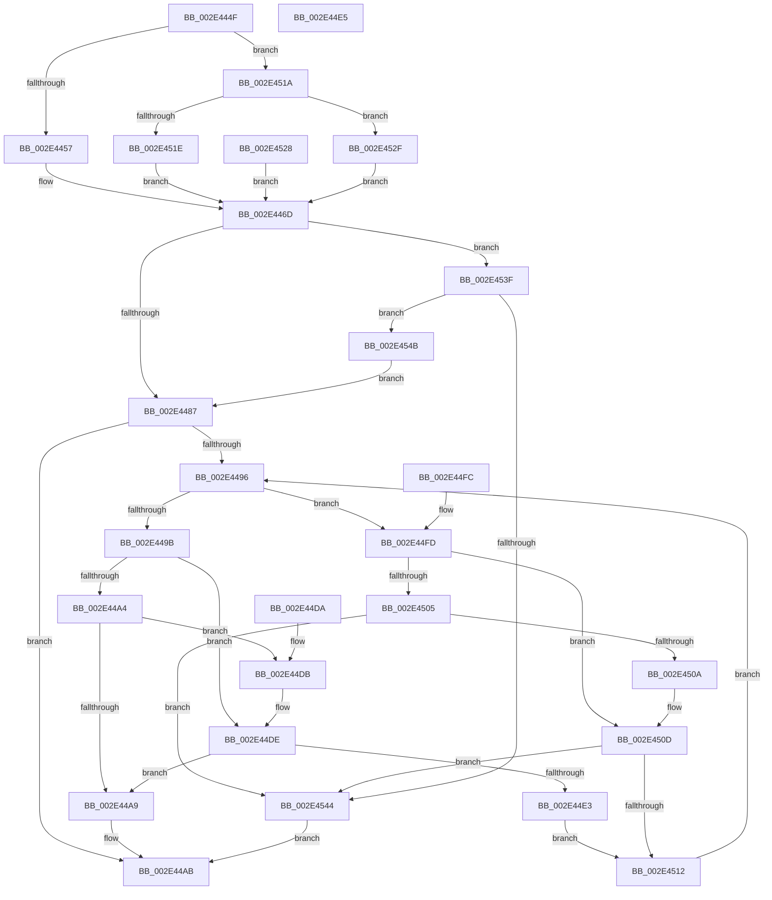

# sub_002E444F

- RVA: `0x002E444F`–`0x002E4553` (길이 `260` bytes)
- VA: `0x00000001402E444F`
- 실행 섹션: `.text`
- PDB 이름 있음: `아니요`; PDB Function 태그: `아니요`
- unwind 정보 RVA: `0x00070F1C`
- 디코드: `82`개 명령, `260/260` bytes 표시
- 미해석 바이트: `0` (있으면 어셈블리에 `.byte`로 보존)

> 이 문서는 커널 이미지의 기계어와 PDB 기호를 분석해 생성했습니다. 4번과 5번은 함수 원형과 자료형을 바이너리 사용 방식에서 추정한 C 해석이며 원본 소스 복구 결과는 아닙니다.

## 1. Dependencies

- 직접 호출 지점: **1**; 고유 호출 대상: **1**
- 직접 호출자로 확인된 함수: **0**
- RIP 상대 이미지 참조: **0**

### Outgoing calls
- `0x002E44B5` → [RtlRbInsertNodeEx](RtlRbInsertNodeEx_function_002E4570.md) (function, `0x002E4570`)

### Direct callers
- 이 함수 시작 RVA로 연결되는 직접 call은 확인되지 않았습니다. 간접 호출은 완전히 역산할 수 없습니다.

### Static image references
- 디코드된 RIP-relative 메모리 참조가 없습니다.

## 2. Other-region calls and transfers

- 다른 실행 섹션으로 향하는 call: **0**
- 별도 외부 분기/꼬리 이동을 확인하지 못했습니다.

## 3. Assembly (complete function range)

```asm
002E444F  3B C2                           cmp eax, edx
002E4451  0F 85 C3 00 00 00               jne 0x1402e451a
002E4457  8B C2                           mov eax, edx
002E4459  41 8B CA                        mov ecx, r10d
002E445C  48 81 C1 FF FF 1F 00            add rcx, 0x1fffff
002E4463  48 C1 E9 15                     shr rcx, 0x15
002E4467  48 3B C1                        cmp rax, rcx
002E446A  0F 97 C2                        seta dl
002E446D  88 57 1E                        mov byte ptr [rdi + 0x1e], dl
002E4470  4C 8D 53 60                     lea r10, [rbx + 0x60]
002E4474  49 8B 4A 08                     mov rcx, qword ptr [r10 + 8]
002E4478  8B 47 1C                        mov eax, dword ptr [rdi + 0x1c]
002E447B  49 8B 12                        mov rdx, qword ptr [r10]
002E447E  F6 C1 01                        test cl, 1
002E4481  0F 85 B8 00 00 00               jne 0x1402e453f
002E4487  44 0F B6 C1                     movzx r8d, cl
002E448B  32 C9                           xor cl, cl
002E448D  41 83 E0 01                     and r8d, 1
002E4491  48 85 D2                        test rdx, rdx
002E4494  74 15                           je 0x1402e44ab
002E4496  3B 42 1C                        cmp eax, dword ptr [rdx + 0x1c]
002E4499  72 62                           jb 0x1402e44fd
002E449B  48 8B 4A 08                     mov rcx, qword ptr [rdx + 8]
002E449F  45 85 C0                        test r8d, r8d
002E44A2  74 3A                           je 0x1402e44de
002E44A4  48 85 C9                        test rcx, rcx
002E44A7  75 32                           jne 0x1402e44db
002E44A9  B1 01                           mov cl, 1
002E44AB  44 0F B6 C1                     movzx r8d, cl
002E44AF  4C 8B CF                        mov r9, rdi
002E44B2  49 8B CA                        mov rcx, r10
002E44B5  E8 B6 00 00 00                  call 0x1402e4570
002E44BA  8B 4F 1C                        mov ecx, dword ptr [rdi + 0x1c]
002E44BD  F7 D1                           not ecx
002E44BF  0F B7 D1                        movzx edx, cx
002E44C2  48 0F BF 4B 16                  movsx rcx, word ptr [rbx + 0x16]
002E44C7  F0 48 01 54 19 10               lock add qword ptr [rcx + rbx + 0x10], rdx
002E44CD  33 C0                           xor eax, eax
002E44CF  48 8B 5C 24 38                  mov rbx, qword ptr [rsp + 0x38]
002E44D4  48 83 C4 20                     add rsp, 0x20
002E44D8  5F                              pop rdi
002E44D9  C3                              ret
002E44DA  CC                              int3
002E44DB  48 33 CA                        xor rcx, rdx
002E44DE  48 85 C9                        test rcx, rcx
002E44E1  74 C6                           je 0x1402e44a9
002E44E3  EB 2D                           jmp 0x1402e4512
002E44E5  48 8B 01                        mov rax, qword ptr [rcx]
002E44E8  48 8B 5C 24 38                  mov rbx, qword ptr [rsp + 0x38]
002E44ED  48 23 C7                        and rax, rdi
002E44F0  C7 02 FF CC DD CC               mov dword ptr [rdx], 0xccddccff
002E44F6  48 83 C4 20                     add rsp, 0x20
002E44FA  5F                              pop rdi
002E44FB  C3                              ret
002E44FC  CC                              int3
002E44FD  48 8B 0A                        mov rcx, qword ptr [rdx]
002E4500  45 85 C0                        test r8d, r8d
002E4503  74 08                           je 0x1402e450d
002E4505  48 85 C9                        test rcx, rcx
002E4508  74 3A                           je 0x1402e4544
002E450A  48 33 CA                        xor rcx, rdx
002E450D  48 85 C9                        test rcx, rcx
002E4510  74 32                           je 0x1402e4544
002E4512  48 8B D1                        mov rdx, rcx
002E4515  E9 7C FF FF FF                  jmp 0x1402e4496
002E451A  85 C0                           test eax, eax
002E451C  74 11                           je 0x1402e452f
002E451E  BA 02 00 00 00                  mov edx, 2
002E4523  E9 45 FF FF FF                  jmp 0x1402e446d
002E4528  B2 04                           mov dl, 4
002E452A  E9 3E FF FF FF                  jmp 0x1402e446d
002E452F  33 D2                           xor edx, edx
002E4531  45 85 DB                        test r11d, r11d
002E4534  0F 94 C2                        sete dl
002E4537  83 C2 03                        add edx, 3
002E453A  E9 2E FF FF FF                  jmp 0x1402e446d
002E453F  48 85 D2                        test rdx, rdx
002E4542  75 07                           jne 0x1402e454b
002E4544  32 C9                           xor cl, cl
002E4546  E9 60 FF FF FF                  jmp 0x1402e44ab
002E454B  49 33 D2                        xor rdx, r10
002E454E  E9 34 FF FF FF                  jmp 0x1402e4487
```

## 4. C-style interpretation (structured pseudocode)

```c
__int64 __fastcall sub_002E444F(__int64 a1, int a2, __int64 a3, __int64 a4, __int64 a5, __int64 a6, __int64 a7)
{
    __int64 result;
    __int64 v_rsp;
    unsigned __int64 v_stack_p60;

    if (((unsigned int)(result)) != a2) goto loc_002E451A;
    a1 = ((unsigned int)((unsigned int)(v_r10))) + (0x1FFFFFULL);
    a1 = (a1) >> (21);
    a2 = (((unsigned int)(a2)) > a1) ? 1 : 0;
loc_002E446D:
    *(unsigned __int8 *)(v_rdi + 30) = (unsigned __int8)(a2);
    if ((((unsigned __int8)(*(unsigned __int64 *)(v_rbx + 96 + 8))) & (1)) != 0) goto loc_002E453F;
loc_002E4487:
    a1 = 0;
    a3 = (unsigned int)(((unsigned __int8)(*(unsigned __int64 *)(v_rbx + 96 + 8))) & (1));
    if (*(unsigned __int64 *)(v_rbx + 96) == 0) goto loc_002E44AB;
loc_002E4496:
    if (((unsigned int)((unsigned int)(*(unsigned int *)(v_rdi + 28)))) < (*(unsigned int *)(*(unsigned __int64 *)(v_rbx + 96) + 28))) goto loc_002E44FD;
    if ((unsigned int)(a3) == 0) goto loc_002E44DE;
    if (*(unsigned __int64 *)(*(unsigned __int64 *)(v_rbx + 96) + 8) != 0) goto loc_002E44DB;
loc_002E44A9:
loc_002E44AB:
    result = RtlRbInsertNodeEx(v_rbx + 96, *(unsigned __int64 *)(v_rbx + 96), 1, v_rdi);
    a1 = (unsigned int)(~((unsigned int)(*(unsigned int *)(v_rdi + 28))));
    result = 0;
    v_rsp = (v_rsp) + (32);
    return result;
loc_002E44DB:
    a1 = ((__int16)(*(unsigned __int16 *)(v_rbx + 22))) ^ ((unsigned __int16)(a1));
loc_002E44DE:
    if (a1 == 0) goto loc_002E44A9;
    goto loc_002E4512;
loc_002E44FD:
    if (1 == 0) goto loc_002E450D;
    if (*(unsigned __int64 *)((unsigned __int16)(a1)) == 0) goto loc_002E4544;
    a1 = (*(unsigned __int64 *)((unsigned __int16)(a1))) ^ ((unsigned __int16)(a1));
loc_002E450D:
    if (a1 == 0) goto loc_002E4544;
loc_002E4512:
    goto loc_002E4496;
loc_002E451A:
    if (0 == 0) goto loc_002E452F;
    goto loc_002E446D;
loc_002E452F:
    a2 = 0;
    a2 = ((unsigned int)(v_r11) == 0) ? 1 : 0;
    a2 = (unsigned int)((a2) + (3));
    goto loc_002E446D;
loc_002E453F:
    if (a2 != 0) goto loc_002E454B;
loc_002E4544:
    a1 = 0;
    goto loc_002E44AB;
loc_002E454B:
    a2 = (a2) ^ (v_rbx + 96);
    goto loc_002E4487;
}
```

## 5. (Beta) C Style

```c
int64_t sub_002E444F(int64_t Arg1, int32_t Arg2, int64_t Arg3, int64_t Arg4, uint64_t Arg5, uint64_t Arg6, int64_t Arg7)
{
    int64_t result;
    int64_t local_rsp;
    uint64_t v_stack_p60;

    if (((uint32_t)(result)) != Arg2) goto loc_002E451A;
    Arg1 = ((uint32_t)((uint32_t)(local_r10))) + (0x1FFFFFULL);
    Arg1 = (Arg1) >> (21);
    Arg2 = (((uint32_t)(Arg2)) > Arg1) ? 1 : 0;
loc_002E446D:
    *(uint8_t *)(local_rdi + 0x1E) = (uint8_t)(Arg2);
    if ((((uint8_t)(*(uint64_t *)(local_rbx + 0x60 + 0x8))) & (1)) != 0) goto loc_002E453F;
loc_002E4487:
    Arg1 = 0;
    Arg3 = (uint32_t)(((uint8_t)(*(uint64_t *)(local_rbx + 0x60 + 0x8))) & (1));
    if (*(uint64_t *)(local_rbx + 0x60) == 0) goto loc_002E44AB;
loc_002E4496:
    if (((uint32_t)((uint32_t)(*(uint32_t *)(local_rdi + 0x1C)))) < (*(uint32_t *)(*(uint64_t *)(local_rbx + 0x60) + 0x1C))) goto loc_002E44FD;
    if ((uint32_t)(Arg3) == 0) goto loc_002E44DE;
    if (*(uint64_t *)(*(uint64_t *)(local_rbx + 0x60) + 0x8) != 0) goto loc_002E44DB;
loc_002E44A9:
loc_002E44AB:
    result = RtlRbInsertNodeEx(local_rbx + 96, *(uint64_t *)(local_rbx + 0x60), 1, local_rdi);
    Arg1 = (uint32_t)(~((uint32_t)(*(uint32_t *)(local_rdi + 0x1C))));
    result = 0;
    local_rsp = (local_rsp) + (32);
    return result;
loc_002E44DB:
    Arg1 = ((int16_t)(*(uint16_t *)(local_rbx + 0x16))) ^ ((uint16_t)(Arg1));
loc_002E44DE:
    if (Arg1 == 0) goto loc_002E44A9;
    goto loc_002E4512;
loc_002E44FD:
    if (1 == 0) goto loc_002E450D;
    if (*(uint64_t *)((uint16_t)(Arg1)) == 0) goto loc_002E4544;
    Arg1 = (*(uint64_t *)((uint16_t)(Arg1))) ^ ((uint16_t)(Arg1));
loc_002E450D:
    if (Arg1 == 0) goto loc_002E4544;
loc_002E4512:
    goto loc_002E4496;
loc_002E451A:
    if (0 == 0) goto loc_002E452F;
    goto loc_002E446D;
loc_002E452F:
    Arg2 = 0;
    Arg2 = ((uint32_t)(local_r11) == 0) ? 1 : 0;
    Arg2 = (uint32_t)((Arg2) + (3));
    goto loc_002E446D;
loc_002E453F:
    if (Arg2 != 0) goto loc_002E454B;
loc_002E4544:
    Arg1 = 0;
    goto loc_002E44AB;
loc_002E454B:
    Arg2 = (Arg2) ^ (local_rbx + 96);
    goto loc_002E4487;
}
```

## 6. Execution-region graph

[열기: 2D/3D 그래프와 함수 탐색 컨트롤 패널](../../../control-panel.html?section=text&rva=0x002E444F&view=graph)

- 2D 그래프는 위에서 아래로 흐르고, 3D 그래프는 빈 공간을 드래그해 회전합니다. Shift+드래그는 이동, 휠은 확대·축소, 함수 노드 선택은 대상 보고서 이동입니다.

### Static fallback


