# sub_002E459D

- RVA: `0x002E459D`–`0x002E46D4` (길이 `311` bytes)
- VA: `0x00000001402E459D`
- 실행 섹션: `.text`
- PDB 이름 있음: `아니요`; PDB Function 태그: `아니요`
- unwind 정보 RVA: `0x00070F54`
- 디코드: `82`개 명령, `311/311` bytes 표시
- 미해석 바이트: `0` (있으면 어셈블리에 `.byte`로 보존)

> 이 문서는 커널 이미지의 기계어와 PDB 기호를 분석해 생성했습니다. 4번과 5번은 함수 원형과 자료형을 바이너리 사용 방식에서 추정한 C 해석이며 원본 소스 복구 결과는 아닙니다.

## 1. Dependencies

- 직접 호출 지점: **0**; 고유 호출 대상: **0**
- 직접 호출자로 확인된 함수: **0**
- RIP 상대 이미지 참조: **0**

### Outgoing calls
- 직접 디코드된 call 명령이 없습니다.

### Direct callers
- 이 함수 시작 RVA로 연결되는 직접 call은 확인되지 않았습니다. 간접 호출은 완전히 역산할 수 없습니다.

### Static image references
- 디코드된 RIP-relative 메모리 참조가 없습니다.

## 2. Other-region calls and transfers

- 다른 실행 섹션으로 향하는 call: **0**
- call이 아닌 외부 분기/꼬리 이동: **10**
  - `0x002E45C8` → [sub_002E49CB](Unknown_function_002E49CB.md) (`tail-transfer`)
  - `0x002E45EA` → [sub_002E4705 + 0xC5](Unknown_function_002E4705.md) (`tail-transfer`)
  - `0x002E4608` → [sub_002E4AF0](Unknown_function_002E4AF0.md) (`tail-transfer`)
  - `0x002E461F` → [sub_002E4AF0 + 0x12](Unknown_function_002E4AF0.md) (`tail-transfer`)
  - `0x002E465E` → [sub_002E47EE](Unknown_function_002E47EE.md) (`tail-transfer`)
  - `0x002E466A` → [sub_002E47EE](Unknown_function_002E47EE.md) (`tail-transfer`)
  - `0x002E4674` → [sub_002E47EE](Unknown_function_002E47EE.md) (`tail-transfer`)
  - `0x002E469D` → [sub_002E4705 + 0xC5](Unknown_function_002E4705.md) (`tail-transfer`)
  - `0x002E46A9` → [sub_002E4705 + 0xC5](Unknown_function_002E4705.md) (`tail-transfer`)
  - `0x002E46C2` → [sub_002E4AF0 + 0x4C](Unknown_function_002E4AF0.md) (`tail-transfer`)

## 3. Assembly (complete function range)

```asm
002E459D  48 89 74 24 30                  mov qword ptr [rsp + 0x30], rsi
002E45A2  4C 33 C2                        xor r8, rdx
002E45A5  84 C0                           test al, al
002E45A7  49 8B C8                        mov rcx, r8
002E45AA  48 8B C2                        mov rax, rdx
002E45AD  49 0F 44 C9                     cmove rcx, r9
002E45B1  4A 89 0C F2                     mov qword ptr [rdx + r14*8], rcx
002E45B5  F6 47 08 01                     test byte ptr [rdi + 8], 1
002E45B9  49 0F 45 C0                     cmovne rax, r8
002E45BD  48 83 C8 01                     or rax, 1
002E45C1  49 89 41 10                     mov qword ptr [r9 + 0x10], rax
002E45C5  45 84 F6                        test r14b, r14b
002E45C8  0F 84 FD 03 00 00               je 0x1402e49cb
002E45CE  48 89 5C 24 60                  mov qword ptr [rsp + 0x60], rbx
002E45D3  48 89 6C 24 38                  mov qword ptr [rsp + 0x38], rbp
002E45D8  4C 89 64 24 28                  mov qword ptr [rsp + 0x28], r12
002E45DD  4C 89 6C 24 20                  mov qword ptr [rsp + 0x20], r13
002E45E2  0F B6 72 10                     movzx esi, byte ptr [rdx + 0x10]
002E45E6  40 F6 C6 01                     test sil, 1
002E45EA  0F 84 DA 01 00 00               je 0x1402e47ca
002E45F0  4C 8B 5A 10                     mov r11, qword ptr [rdx + 0x10]
002E45F4  0F B6 6F 08                     movzx ebp, byte ptr [rdi + 8]
002E45F8  49 83 E3 FC                     and r11, 0xfffffffffffffffc
002E45FC  40 0F B6 CD                     movzx ecx, bpl
002E4600  80 E1 01                        and cl, 1
002E4603  74 09                           je 0x1402e460e
002E4605  4D 85 DB                        test r11, r11
002E4608  0F 85 E2 04 00 00               jne 0x1402e4af0
002E460E  49 8B 1B                        mov rbx, qword ptr [r11]
002E4611  4D 8B C3                        mov r8, r11
002E4614  4C 89 1C 24                     mov qword ptr [rsp], r11
002E4618  84 C9                           test cl, cl
002E461A  74 09                           je 0x1402e4625
002E461C  48 85 DB                        test rbx, rbx
002E461F  0F 85 DD 04 00 00               jne 0x1402e4b02
002E4625  48 3B DA                        cmp rbx, rdx
002E4628  41 8B C7                        mov eax, r15d
002E462B  0F 95 C0                        setne al
002E462E  8B C0                           mov eax, eax
002E4630  44 8B E0                        mov r12d, eax
002E4633  48 89 44 24 08                  mov qword ptr [rsp + 8], rax
002E4638  49 83 F4 01                     xor r12, 1
002E463C  89 44 24 78                     mov dword ptr [rsp + 0x78], eax
002E4640  84 C9                           test cl, cl
002E4642  89 44 24 68                     mov dword ptr [rsp + 0x68], eax
002E4646  44 8B E8                        mov r13d, eax
002E4649  48 89 44 24 18                  mov qword ptr [rsp + 0x18], rax
002E464E  48 89 44 24 10                  mov qword ptr [rsp + 0x10], rax
002E4653  8B C8                           mov ecx, eax
002E4655  4B 8B 1C E0                     mov rbx, qword ptr [r8 + r12*8]
002E4659  74 0C                           je 0x1402e4667
002E465B  48 85 DB                        test rbx, rbx
002E465E  0F 84 8A 01 00 00               je 0x1402e47ee
002E4664  49 33 D8                        xor rbx, r8
002E4667  48 85 DB                        test rbx, rbx
002E466A  0F 84 7E 01 00 00               je 0x1402e47ee
002E4670  F6 43 10 01                     test byte ptr [rbx + 0x10], 1
002E4674  0F 84 74 01 00 00               je 0x1402e47ee
002E467A  40 80 E6 FE                     and sil, 0xfe
002E467E  4D 8B C8                        mov r9, r8
002E4681  40 88 72 10                     mov byte ptr [rdx + 0x10], sil
002E4685  80 63 10 FE                     and byte ptr [rbx + 0x10], 0xfe
002E4689  49 8B 48 10                     mov rcx, qword ptr [r8 + 0x10]
002E468D  48 8B D1                        mov rdx, rcx
002E4690  48 83 E2 FC                     and rdx, 0xfffffffffffffffc
002E4694  F6 47 08 01                     test byte ptr [rdi + 8], 1
002E4698  74 0C                           je 0x1402e46a6
002E469A  48 85 D2                        test rdx, rdx
002E469D  0F 84 27 01 00 00               je 0x1402e47ca
002E46A3  49 33 D0                        xor rdx, r8
002E46A6  48 85 D2                        test rdx, rdx
002E46A9  0F 84 1B 01 00 00               je 0x1402e47ca
002E46AF  80 C9 01                        or cl, 1
002E46B2  41 88 48 10                     mov byte ptr [r8 + 0x10], cl
002E46B6  F6 47 08 01                     test byte ptr [rdi + 8], 1
002E46BA  48 8B 0A                        mov rcx, qword ptr [rdx]
002E46BD  74 09                           je 0x1402e46c8
002E46BF  48 85 C9                        test rcx, rcx
002E46C2  0F 85 74 04 00 00               jne 0x1402e4b3c
002E46C8  4C 3B C1                        cmp r8, rcx
002E46CB  41 0F 95 C6                     setne r14b
002E46CF  E9 0E FF FF FF                  jmp 0x1402e45e2
```

## 4. C-style interpretation (structured pseudocode)

```c
__int64 __fastcall sub_002E459D(__int64 a1, __int64 a2, __int64 a3, __int64 a4)
{
    __int64 result;
    __int64 v_r11;
    __int64 v_r12;
    __int64 v_r14;
    __int64 v_rbx;
    __int64 v_rsi;
    unsigned __int64 v_stack_p0;
    unsigned __int64 v_stack_p10;
    unsigned __int64 v_stack_p18;
    unsigned __int64 v_stack_p20;
    unsigned __int64 v_stack_p28;
    unsigned __int64 v_stack_p30;
    unsigned __int64 v_stack_p38;
    unsigned __int64 v_stack_p60;
    unsigned int v_stack_p68;
    unsigned int v_stack_p78;
    unsigned __int64 v_stack_p8;

    v_stack_p30 = v_rsi;
    a3 = (a3) ^ (a2);
    if ((unsigned __int8)(result) == 0) { a3 = a4; }
    *(unsigned __int64 *)(a2 + v_r14 * 8) = a3;
    if (((*(unsigned __int8 *)(v_rdi + 8)) & (1)) != 0) { a2 = a3; }
    result = (a2) | (1);
    *(unsigned __int64 *)(a4 + 16) = result;
    v_stack_p60 = v_rbx;
    v_stack_p38 = v_rbp;
    v_stack_p28 = v_r12;
    v_stack_p20 = v_r13;
loc_002E45E2:
    v_r11 = (*(unsigned __int64 *)(a2 + 16)) & (-4);
    a1 = (unsigned __int8)(((unsigned __int8)(*(unsigned __int8 *)(v_rdi + 8))) & (1));
    if (condition_is_equal) goto loc_002E460E;
loc_002E460E:
    v_stack_p0 = v_r11;
    if ((unsigned __int8)(a1) == 0) goto loc_002E4625;
loc_002E4625:
    result = ((*(unsigned __int64 *)(v_r11)) != a2) ? 1 : 0;
    v_stack_p8 = (unsigned int)((unsigned int)(result));
    v_r12 = ((unsigned int)((unsigned int)((unsigned int)((unsigned int)(result))))) ^ (1);
    v_stack_p78 = (unsigned int)((unsigned int)((unsigned int)(result)));
    v_stack_p68 = (unsigned int)((unsigned int)((unsigned int)(result)));
    v_stack_p18 = (unsigned int)((unsigned int)(result));
    v_stack_p10 = (unsigned int)((unsigned int)(result));
    if ((unsigned __int8)(a1) == 0) goto loc_002E4667;
    v_rbx = (*(unsigned __int64 *)(v_r11 + v_r12 * 8)) ^ (v_r11);
loc_002E4667:
    v_rsi = (unsigned __int8)((*(unsigned __int8 *)(a2 + 16)) & (254));
    *(unsigned __int8 *)(a2 + 16) = (unsigned __int8)(v_rsi);
    a2 = (*(unsigned __int64 *)(v_r11 + 16)) & (-4);
    if (((*(unsigned __int8 *)(v_rdi + 8)) & (1)) == 0) goto loc_002E46A6;
    a2 = (a2) ^ (v_r11);
loc_002E46A6:
    a1 = (unsigned __int8)((*(unsigned __int64 *)(v_r11 + 16)) | (1));
    *(unsigned __int8 *)(v_r11 + 16) = (unsigned __int8)(a1);
    if (((*(unsigned __int8 *)(v_rdi + 8)) & (1)) == 0) goto loc_002E46C8;
loc_002E46C8:
    v_r14 = (v_r11 != (*(unsigned __int64 *)(a2))) ? 1 : 0;
    goto loc_002E45E2;
}
```

## 5. (Beta) C Style

```c
int64_t sub_002E459D(int64_t Arg1, void *Arg2, int64_t Arg3, void *Arg4)
{
    uint8_t *arg2 = (uint8_t *)Arg2;
    uint8_t *arg4 = (uint8_t *)Arg4;

    int64_t result;
    int64_t local_r11;
    int64_t local_r12;
    int64_t local_r14;
    int64_t local_rbx;
    int64_t local_rsi;
    uint64_t v_stack_p0;
    uint64_t v_stack_p10;
    uint64_t v_stack_p18;
    uint64_t v_stack_p20;
    uint64_t v_stack_p28;
    uint64_t v_stack_p30;
    uint64_t v_stack_p38;
    uint64_t v_stack_p60;
    uint32_t v_stack_p68;
    uint32_t v_stack_p78;
    uint64_t v_stack_p8;

    v_stack_p30 = local_rsi;
    Arg3 = (Arg3) ^ (Arg2);
    if ((uint8_t)(result) == 0) { Arg3 = Arg4; }
    *(uint64_t *)(arg2 + local_r14 * 8) = Arg3;
    if (((*(uint8_t *)(local_rdi + 0x8)) & (1)) != 0) { Arg2 = Arg3; }
    result = (Arg2) | (1);
    *(uint64_t *)(arg4 + 0x10) = result;
    v_stack_p60 = local_rbx;
    v_stack_p38 = local_rbp;
    v_stack_p28 = local_r12;
    v_stack_p20 = local_r13;
loc_002E45E2:
    local_r11 = (*(uint64_t *)(arg2 + 0x10)) & (-4);
    Arg1 = (uint8_t)(((uint8_t)(*(uint8_t *)(local_rdi + 0x8))) & (1));
    if (condition_is_equal) goto loc_002E460E;
loc_002E460E:
    v_stack_p0 = local_r11;
    if ((uint8_t)(Arg1) == 0) goto loc_002E4625;
loc_002E4625:
    result = ((*(uint64_t *)(local_r11)) != Arg2) ? 1 : 0;
    v_stack_p8 = (uint32_t)((uint32_t)(result));
    local_r12 = ((uint32_t)((uint32_t)((uint32_t)((uint32_t)(result))))) ^ (1);
    v_stack_p78 = (uint32_t)((uint32_t)((uint32_t)(result)));
    v_stack_p68 = (uint32_t)((uint32_t)((uint32_t)(result)));
    v_stack_p18 = (uint32_t)((uint32_t)(result));
    v_stack_p10 = (uint32_t)((uint32_t)(result));
    if ((uint8_t)(Arg1) == 0) goto loc_002E4667;
    local_rbx = (*(uint64_t *)(local_r11 + local_r12 * 8)) ^ (local_r11);
loc_002E4667:
    local_rsi = (uint8_t)((*(uint8_t *)(arg2 + 0x10)) & (254));
    *(uint8_t *)(arg2 + 0x10) = (uint8_t)(local_rsi);
    Arg2 = (*(uint64_t *)(local_r11 + 0x10)) & (-4);
    if (((*(uint8_t *)(local_rdi + 0x8)) & (1)) == 0) goto loc_002E46A6;
    Arg2 = (Arg2) ^ (local_r11);
loc_002E46A6:
    Arg1 = (uint8_t)((*(uint64_t *)(local_r11 + 0x10)) | (1));
    *(uint8_t *)(local_r11 + 0x10) = (uint8_t)(Arg1);
    if (((*(uint8_t *)(local_rdi + 0x8)) & (1)) == 0) goto loc_002E46C8;
loc_002E46C8:
    local_r14 = (local_r11 != (*(uint64_t *)(arg2))) ? 1 : 0;
    goto loc_002E45E2;
}
```

### 관측된 메모리 오프셋

구조체 형식이 확인되지 않은 접근은 인자 기준의 오프셋으로만 기록했습니다.

| 기준 인자 | 오프셋 표현 | 폭 (bit) | 접근 |
|---|---:|---:|---|
| `Arg2` | `+ 0x0 + r14*8` | `64` | `W` |
| `Arg4` | `+ 0x10` | `64` | `W` |

## 6. Execution-region graph

[열기: 2D/3D 그래프와 함수 탐색 컨트롤 패널](../../../control-panel.html?section=text&rva=0x002E459D&view=graph)

- 2D 그래프는 위에서 아래로 흐르고, 3D 그래프는 빈 공간을 드래그해 회전합니다. Shift+드래그는 이동, 휠은 확대·축소, 함수 노드 선택은 대상 보고서 이동입니다.

### Static fallback

```mermaid
flowchart TD
  bb_002E459D[BB_002E459D]
  bb_002E45CE[BB_002E45CE]
  bb_002E45E2[BB_002E45E2]
  bb_002E45F0[BB_002E45F0]
  bb_002E4605[BB_002E4605]
  bb_002E460E[BB_002E460E]
  bb_002E461C[BB_002E461C]
  bb_002E4625[BB_002E4625]
  bb_002E465B[BB_002E465B]
  bb_002E4664[BB_002E4664]
  bb_002E4667[BB_002E4667]
  bb_002E4670[BB_002E4670]
  bb_002E467A[BB_002E467A]
  bb_002E469A[BB_002E469A]
  bb_002E46A3[BB_002E46A3]
  bb_002E46A6[BB_002E46A6]
  bb_002E46AF[BB_002E46AF]
  bb_002E46BF[BB_002E46BF]
  bb_002E46C8[BB_002E46C8]
  bb_002E459D -->|fallthrough| bb_002E45CE
  bb_002E45CE -->|flow| bb_002E45E2
  bb_002E45E2 -->|fallthrough| bb_002E45F0
  bb_002E45F0 -->|branch| bb_002E460E
  bb_002E45F0 -->|fallthrough| bb_002E4605
  bb_002E4605 -->|fallthrough| bb_002E460E
  bb_002E460E -->|branch| bb_002E4625
  bb_002E460E -->|fallthrough| bb_002E461C
  bb_002E461C -->|fallthrough| bb_002E4625
  bb_002E4625 -->|branch| bb_002E4667
  bb_002E4625 -->|fallthrough| bb_002E465B
  bb_002E465B -->|fallthrough| bb_002E4664
  bb_002E4664 -->|flow| bb_002E4667
  bb_002E4667 -->|fallthrough| bb_002E4670
  bb_002E4670 -->|fallthrough| bb_002E467A
  bb_002E467A -->|branch| bb_002E46A6
  bb_002E467A -->|fallthrough| bb_002E469A
  bb_002E469A -->|fallthrough| bb_002E46A3
  bb_002E46A3 -->|flow| bb_002E46A6
  bb_002E46A6 -->|fallthrough| bb_002E46AF
  bb_002E46AF -->|branch| bb_002E46C8
  bb_002E46AF -->|fallthrough| bb_002E46BF
  bb_002E46BF -->|fallthrough| bb_002E46C8
  bb_002E46C8 -->|branch| bb_002E45E2
```


