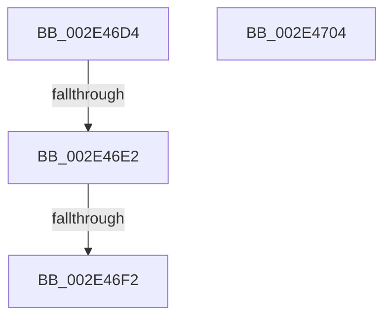

# sub_002E46D4

- RVA: `0x002E46D4`–`0x002E4705` (길이 `49` bytes)
- VA: `0x00000001402E46D4`
- 실행 섹션: `.text`
- PDB 이름 있음: `아니요`; PDB Function 태그: `아니요`
- unwind 정보 RVA: `0x00070F78`
- 디코드: `16`개 명령, `49/49` bytes 표시
- 미해석 바이트: `0` (있으면 어셈블리에 `.byte`로 보존)

> 이 문서는 커널 이미지의 기계어와 PDB 기호를 분석해 생성했습니다. 4번과 5번은 함수 원형과 자료형을 바이너리 사용 방식에서 추정한 C 해석이며 원본 소스 복구 결과는 아닙니다.

## 1. Dependencies

- 직접 호출 지점: **0**; 고유 호출 대상: **0**
- 직접 호출자로 확인된 함수: **0**
- RIP 상대 이미지 참조: **0**

### Outgoing calls
- 직접 디코드된 call 명령이 없습니다.

### Direct callers
- 이 함수 시작 RVA로 연결되는 직접 call은 확인되지 않았습니다. 간접 호출은 완전히 역산할 수 없습니다.

### Static image references
- 디코드된 RIP-relative 메모리 참조가 없습니다.

## 2. Other-region calls and transfers

- 다른 실행 섹션으로 향하는 call: **0**
- call이 아닌 외부 분기/꼬리 이동: **2**
  - `0x002E46DC` → [sub_002E4A85](Unknown_function_002E4A85.md) (`tail-transfer`)
  - `0x002E46EC` → [sub_002E4AA6](Unknown_function_002E4AA6.md) (`tail-transfer`)

## 3. Assembly (complete function range)

```asm
002E46D4  49 8B C9                        mov rcx, r9
002E46D7  48 33 CF                        xor rcx, rdi
002E46DA  84 C0                           test al, al
002E46DC  0F 85 A3 03 00 00               jne 0x1402e4a85
002E46E2  49 8B C1                        mov rax, r9
002E46E5  48 89 07                        mov qword ptr [rdi], rax
002E46E8  F6 47 08 01                     test byte ptr [rdi + 8], 1
002E46EC  0F 85 B4 03 00 00               jne 0x1402e4aa6
002E46F2  4C 89 4F 08                     mov qword ptr [rdi + 8], r9
002E46F6  4D 89 79 10                     mov qword ptr [r9 + 0x10], r15
002E46FA  48 83 C4 40                     add rsp, 0x40
002E46FE  41 5F                           pop r15
002E4700  41 5E                           pop r14
002E4702  5F                              pop rdi
002E4703  C3                              ret
002E4704  CC                              int3
```

## 4. C-style interpretation (structured pseudocode)

```c
__int64 __fastcall sub_002E46D4(__int64 a1, __int64 a2, __int64 a3, __int64 a4)
{
    __int64 v_rsp;

    a1 = (a4) ^ (v_rdi);
    *(unsigned __int64 *)(v_rdi) = a4;
    *(unsigned __int64 *)(v_rdi + 8) = a4;
    *(unsigned __int64 *)(a4 + 16) = v_r15;
    v_rsp = (v_rsp) + (64);
    return a4;
}
```

## 5. (Beta) C Style

```c
void *sub_002E46D4(int64_t Arg1, int64_t Arg2, int64_t Arg3, void *Arg4)
{
    uint8_t *arg4 = (uint8_t *)Arg4;

    int64_t local_rsp;

    Arg1 = (Arg4) ^ (local_rdi);
    *(void **)(local_rdi) = Arg4;
    *(void **)(local_rdi + 0x8) = Arg4;
    *(uint64_t *)(arg4 + 0x10) = local_r15;
    local_rsp = (local_rsp) + (64);
    return Arg4;
}
```

### 관측된 메모리 오프셋

구조체 형식이 확인되지 않은 접근은 인자 기준의 오프셋으로만 기록했습니다.

| 기준 인자 | 오프셋 표현 | 폭 (bit) | 접근 |
|---|---:|---:|---|
| `Arg4` | `+ 0x10` | `64` | `W` |

## 6. Execution-region graph

[열기: 2D/3D 그래프와 함수 탐색 컨트롤 패널](../../../control-panel.html?section=text&rva=0x002E46D4&view=graph)

- 2D 그래프는 위에서 아래로 흐르고, 3D 그래프는 빈 공간을 드래그해 회전합니다. Shift+드래그는 이동, 휠은 확대·축소, 함수 노드 선택은 대상 보고서 이동입니다.

### Static fallback


