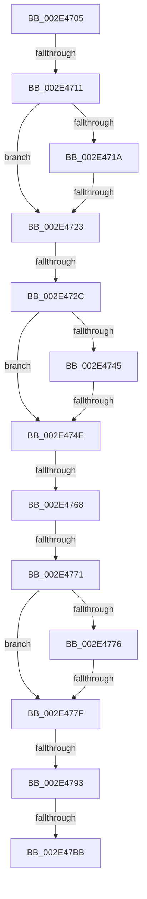

# sub_002E4705

- RVA: `0x002E4705`–`0x002E47ED` (길이 `232` bytes)
- VA: `0x00000001402E4705`
- 실행 섹션: `.text`
- PDB 이름 있음: `아니요`; PDB Function 태그: `아니요`
- unwind 정보 RVA: `0x00070F8C`
- 디코드: `63`개 명령, `232/232` bytes 표시
- 미해석 바이트: `0` (있으면 어셈블리에 `.byte`로 보존)

> 이 문서는 커널 이미지의 기계어와 PDB 기호를 분석해 생성했습니다. 4번과 5번은 함수 원형과 자료형을 바이너리 사용 방식에서 추정한 C 해석이며 원본 소스 복구 결과는 아닙니다.

## 1. Dependencies

- 직접 호출 지점: **0**; 고유 호출 대상: **0**
- 직접 호출자로 확인된 함수: **0**
- RIP 상대 이미지 참조: **0**

### Outgoing calls
- 직접 디코드된 call 명령이 없습니다.

### Direct callers
- 이 함수 시작 RVA로 연결되는 직접 call은 확인되지 않았습니다. 간접 호출은 완전히 역산할 수 없습니다.

### Static image references
- 디코드된 RIP-relative 메모리 참조가 없습니다.

## 2. Other-region calls and transfers

- 다른 실행 섹션으로 향하는 call: **0**
- call이 아닌 외부 분기/꼬리 이동: **9**
  - `0x002E470B` → [sub_002E4AF0 + 0xCB](Unknown_function_002E4AF0.md) (`tail-transfer`)
  - `0x002E471D` → [sub_002E4AF0 + 0x99](Unknown_function_002E4AF0.md) (`tail-transfer`)
  - `0x002E4726` → [sub_002E49F4](Unknown_function_002E49F4.md) (`tail-transfer`)
  - `0x002E4748` → [sub_002E4AF0 + 0xA1](Unknown_function_002E4AF0.md) (`tail-transfer`)
  - `0x002E4762` → [sub_002E47EE + 0x14B](Unknown_function_002E47EE.md) (`tail-transfer`)
  - `0x002E476B` → [sub_002E47EE + 0x148](Unknown_function_002E47EE.md) (`tail-transfer`)
  - `0x002E4779` → [sub_002E4AF0 + 0x74](Unknown_function_002E4AF0.md) (`tail-transfer`)
  - `0x002E478D` → [sub_002E49F4 + 0x32](Unknown_function_002E49F4.md) (`tail-transfer`)
  - `0x002E47B5` → [sub_002E4A94](Unknown_function_002E4A94.md) (`tail-transfer`)

## 3. Assembly (complete function range)

```asm
002E4705  4D 33 C8                        xor r9, r8
002E4708  4D 85 C9                        test r9, r9
002E470B  0F 84 AA 04 00 00               je 0x1402e4bbb
002E4711  49 8B 41 08                     mov rax, qword ptr [r9 + 8]
002E4715  45 85 D2                        test r10d, r10d
002E4718  74 09                           je 0x1402e4723
002E471A  48 85 C0                        test rax, rax
002E471D  0F 85 66 04 00 00               jne 0x1402e4b89
002E4723  49 3B C0                        cmp rax, r8
002E4726  0F 85 C8 02 00 00               jne 0x1402e49f4
002E472C  49 8B C9                        mov rcx, r9
002E472F  48 8B C2                        mov rax, rdx
002E4732  48 33 CA                        xor rcx, rdx
002E4735  45 85 D2                        test r10d, r10d
002E4738  48 0F 45 C1                     cmovne rax, rcx
002E473C  49 89 41 08                     mov qword ptr [r9 + 8], rax
002E4740  45 85 D2                        test r10d, r10d
002E4743  74 09                           je 0x1402e474e
002E4745  4D 85 C9                        test r9, r9
002E4748  0F 85 43 04 00 00               jne 0x1402e4b91
002E474E  8B 42 10                        mov eax, dword ptr [rdx + 0x10]
002E4751  83 E0 03                        and eax, 3
002E4754  49 0B C1                        or rax, r9
002E4757  48 89 42 10                     mov qword ptr [rdx + 0x10], rax
002E475B  4E 8B 0C DA                     mov r9, qword ptr [rdx + r11*8]
002E475F  45 85 D2                        test r10d, r10d
002E4762  0F 84 D1 01 00 00               je 0x1402e4939
002E4768  4D 85 C9                        test r9, r9
002E476B  0F 85 C5 01 00 00               jne 0x1402e4936
002E4771  45 85 D2                        test r10d, r10d
002E4774  74 09                           je 0x1402e477f
002E4776  4D 85 C9                        test r9, r9
002E4779  0F 85 E5 03 00 00               jne 0x1402e4b64
002E477F  41 8B C3                        mov eax, r11d
002E4782  48 83 F0 01                     xor rax, 1
002E4786  4D 89 0C C0                     mov qword ptr [r8 + rax*8], r9
002E478A  45 85 D2                        test r10d, r10d
002E478D  0F 84 93 02 00 00               je 0x1402e4a26
002E4793  49 8B C8                        mov rcx, r8
002E4796  48 33 CA                        xor rcx, rdx
002E4799  4A 89 0C DA                     mov qword ptr [rdx + r11*8], rcx
002E479D  49 8B C8                        mov rcx, r8
002E47A0  48 33 CA                        xor rcx, rdx
002E47A3  49 8B 40 10                     mov rax, qword ptr [r8 + 0x10]
002E47A7  83 E0 03                        and eax, 3
002E47AA  48 0B C8                        or rcx, rax
002E47AD  49 89 48 10                     mov qword ptr [r8 + 0x10], rcx
002E47B1  F6 47 08 01                     test byte ptr [rdi + 8], 1
002E47B5  0F 85 D9 02 00 00               jne 0x1402e4a94
002E47BB  4C 8B FE                        mov r15, rsi
002E47BE  4C 89 3F                        mov qword ptr [rdi], r15
002E47C1  41 80 48 10 01                  or byte ptr [r8 + 0x10], 1
002E47C6  80 62 10 FE                     and byte ptr [rdx + 0x10], 0xfe
002E47CA  4C 8B 64 24 28                  mov r12, qword ptr [rsp + 0x28]
002E47CF  48 8B 5C 24 60                  mov rbx, qword ptr [rsp + 0x60]
002E47D4  48 8B 6C 24 38                  mov rbp, qword ptr [rsp + 0x38]
002E47D9  4C 8B 6C 24 20                  mov r13, qword ptr [rsp + 0x20]
002E47DE  48 8B 74 24 30                  mov rsi, qword ptr [rsp + 0x30]
002E47E3  48 83 C4 40                     add rsp, 0x40
002E47E7  41 5F                           pop r15
002E47E9  41 5E                           pop r14
002E47EB  5F                              pop rdi
002E47EC  C3                              ret
```

## 4. C-style interpretation (structured pseudocode)

```c
__int64 __fastcall sub_002E4705(__int64 a1, __int64 a2, __int64 a3, __int64 a4, __int64 a5, __int64 a6, __int64 a7, __int64 a8, __int64 a9, __int64 a10, __int64 a11, __int64 a12)
{
    __int64 result;
    __int64 v_rsp;
    unsigned __int64 v_stack_p20;

    a4 = (a4) ^ (a3);
    if ((unsigned int)(v_r10) == 0) goto loc_002E4723;
loc_002E4723:
    a1 = (a4) ^ (a2);
    if ((unsigned int)(v_r10) != 0) { a2 = a1; }
    *(unsigned __int64 *)(a4 + 8) = a2;
    if ((unsigned int)(v_r10) == 0) goto loc_002E474E;
loc_002E474E:
    result = (unsigned int)(((unsigned int)(*(unsigned int *)(a2 + 16))) & (3));
    result = (result) | (a4);
    *(unsigned __int64 *)(a2 + 16) = result;
    if ((unsigned int)(v_r10) == 0) goto loc_002E477F;
loc_002E477F:
    result = ((unsigned int)((unsigned int)(v_r11))) ^ (1);
    *(unsigned __int64 *)(a3 + result * 8) = *(unsigned __int64 *)(a2 + v_r11 * 8);
    a1 = (a3) ^ (a2);
    *(unsigned __int64 *)(a2 + v_r11 * 8) = a1;
    a1 = (a3) ^ (a2);
    result = (unsigned int)((*(unsigned __int64 *)(a3 + 16)) & (3));
    a1 = (a1) | (result);
    *(unsigned __int64 *)(a3 + 16) = a1;
    *(unsigned __int64 *)(v_rdi) = v_rsi;
    v_rsp = (v_rsp) + (64);
    return result;
}
```

## 5. (Beta) C Style

```c
int64_t sub_002E4705(int64_t Arg1, void *Arg2, void *Arg3, int64_t Arg4, int64_t Arg5, int64_t Arg6, int64_t Arg7, uint64_t Arg8, uint64_t Arg9, uint64_t Arg10, uint64_t Arg11, int64_t Arg12)
{
    uint8_t *arg2 = (uint8_t *)Arg2;
    uint8_t *arg3 = (uint8_t *)Arg3;

    int64_t result;
    int64_t local_rsp;
    uint64_t v_stack_p20;

    Arg4 = (Arg4) ^ (Arg3);
    if ((uint32_t)(local_r10) == 0) goto loc_002E4723;
loc_002E4723:
    Arg1 = (Arg4) ^ (Arg2);
    if ((uint32_t)(local_r10) != 0) { Arg2 = Arg1; }
    *(void **)(Arg4 + 0x8) = Arg2;
    if ((uint32_t)(local_r10) == 0) goto loc_002E474E;
loc_002E474E:
    result = (uint32_t)(((uint32_t)(*(uint32_t *)(arg2 + 0x10))) & (3));
    result = (result) | (Arg4);
    *(uint64_t *)(arg2 + 0x10) = result;
    if ((uint32_t)(local_r10) == 0) goto loc_002E477F;
loc_002E477F:
    result = ((uint32_t)((uint32_t)(local_r11))) ^ (1);
    *(uint64_t *)(arg3 + result * 8) = *(uint64_t *)(arg2 + local_r11 * 8);
    Arg1 = (Arg3) ^ (Arg2);
    *(uint64_t *)(arg2 + local_r11 * 8) = Arg1;
    Arg1 = (Arg3) ^ (Arg2);
    result = (uint32_t)((*(uint64_t *)(arg3 + 0x10)) & (3));
    Arg1 = (Arg1) | (result);
    *(uint64_t *)(arg3 + 0x10) = Arg1;
    *(uint64_t *)(local_rdi) = local_rsi;
    local_rsp = (local_rsp) + (64);
    return result;
}
```

### 관측된 메모리 오프셋

구조체 형식이 확인되지 않은 접근은 인자 기준의 오프셋으로만 기록했습니다.

| 기준 인자 | 오프셋 표현 | 폭 (bit) | 접근 |
|---|---:|---:|---|
| `Arg2` | `+ 0x0 + r11*8` | `64` | `R` |
| `Arg2` | `+ 0x0 + r11*8` | `64` | `W` |
| `Arg2` | `+ 0x10` | `8` | `R/W` |
| `Arg2` | `+ 0x10` | `32` | `R` |
| `Arg2` | `+ 0x10` | `64` | `W` |
| `Arg3` | `+ 0x0 + rax*8` | `64` | `W` |
| `Arg3` | `+ 0x10` | `8` | `R/W` |
| `Arg3` | `+ 0x10` | `64` | `R` |
| `Arg3` | `+ 0x10` | `64` | `W` |

## 6. Execution-region graph

[열기: 2D/3D 그래프와 함수 탐색 컨트롤 패널](../../../control-panel.html?section=text&rva=0x002E4705&view=graph)

- 2D 그래프는 위에서 아래로 흐르고, 3D 그래프는 빈 공간을 드래그해 회전합니다. Shift+드래그는 이동, 휠은 확대·축소, 함수 노드 선택은 대상 보고서 이동입니다.

### Static fallback


