# sub_002E47EE

- RVA: `0x002E47EE`–`0x002E49CB` (길이 `477` bytes)
- VA: `0x00000001402E47EE`
- 실행 섹션: `.text`
- PDB 이름 있음: `아니요`; PDB Function 태그: `아니요`
- unwind 정보 RVA: `0x00070FC4`
- 디코드: `131`개 명령, `477/477` bytes 표시
- 미해석 바이트: `0` (있으면 어셈블리에 `.byte`로 보존)

> 이 문서는 커널 이미지의 기계어와 PDB 기호를 분석해 생성했습니다. 4번과 5번은 함수 원형과 자료형을 바이너리 사용 방식에서 추정한 C 해석이며 원본 소스 복구 결과는 아닙니다.

## 1. Dependencies

- 직접 호출 지점: **0**; 고유 호출 대상: **0**
- 직접 호출자로 확인된 함수: **0**
- RIP 상대 이미지 참조: **0**

### Outgoing calls
- 직접 디코드된 call 명령이 없습니다.

### Direct callers
- 이 함수 시작 RVA로 연결되는 직접 call은 확인되지 않았습니다. 간접 호출은 완전히 역산할 수 없습니다.

### Static image references
- 디코드된 RIP-relative 메모리 참조가 없습니다.

## 2. Other-region calls and transfers

- 다른 실행 섹션으로 향하는 call: **0**
- call이 아닌 외부 분기/꼬리 이동: **15**
  - `0x002E47F4` → [sub_002E4AC8](Unknown_function_002E4AC8.md) (`tail-transfer`)
  - `0x002E480A` → [sub_002E4AF0 + 0x6C](Unknown_function_002E4AF0.md) (`tail-transfer`)
  - `0x002E4824` → [sub_002E4AF0 + 0x111](Unknown_function_002E4AF0.md) (`tail-transfer`)
  - `0x002E483E` → [sub_002E4AF0 + 0xE4](Unknown_function_002E4AF0.md) (`tail-transfer`)
  - `0x002E4854` → [sub_002E4AF0 + 0xDC](Unknown_function_002E4AF0.md) (`tail-transfer`)
  - `0x002E4880` → [sub_002E49F4 + 0x51](Unknown_function_002E49F4.md) (`tail-transfer`)
  - `0x002E48B9` → [sub_002E4AF0 + 0x87](Unknown_function_002E4AF0.md) (`tail-transfer`)
  - `0x002E48CB` → [sub_002E49F4 + 0x3E](Unknown_function_002E49F4.md) (`tail-transfer`)
  - `0x002E48FC` → [sub_002E4A74](Unknown_function_002E4A74.md) (`tail-transfer`)
  - `0x002E4920` → [sub_002E4AF0 + 0x64](Unknown_function_002E4AF0.md) (`tail-transfer`)
  - `0x002E4929` → [sub_002E4AF0 + 0xEC](Unknown_function_002E4AF0.md) (`tail-transfer`)
  - `0x002E493C` → [sub_002E4705 + 0x6C](Unknown_function_002E4705.md) (`tail-transfer`)
  - `0x002E4955` → [sub_002E4AF0 + 0x54](Unknown_function_002E4AF0.md) (`tail-transfer`)
  - `0x002E497A` → [sub_002E4705 + 0x6C](Unknown_function_002E4705.md) (`tail-transfer`)
  - `0x002E499D` → [sub_002E4AF0 + 0x5C](Unknown_function_002E4AF0.md) (`tail-transfer`)

## 3. Assembly (complete function range)

```asm
002E47EE  41 0F B6 C6                     movzx eax, r14b
002E47F2  3B C1                           cmp eax, ecx
002E47F4  0F 84 CE 02 00 00               je 0x1402e4ac8
002E47FA  49 8B 41 10                     mov rax, qword ptr [r9 + 0x10]
002E47FE  48 83 E0 FC                     and rax, 0xfffffffffffffffc
002E4802  83 E5 01                        and ebp, 1
002E4805  74 09                           je 0x1402e4810
002E4807  48 85 C0                        test rax, rax
002E480A  0F 85 4C 03 00 00               jne 0x1402e4b5c
002E4810  48 3B C2                        cmp rax, rdx
002E4813  0F 85 16 01 00 00               jne 0x1402e492f
002E4819  4A 8B 04 E2                     mov rax, qword ptr [rdx + r12*8]
002E481D  85 ED                           test ebp, ebp
002E481F  74 09                           je 0x1402e482a
002E4821  48 85 C0                        test rax, rax
002E4824  0F 85 D7 03 00 00               jne 0x1402e4c01
002E482A  49 3B C1                        cmp rax, r9
002E482D  0F 85 FC 00 00 00               jne 0x1402e492f
002E4833  4B 8B 04 E8                     mov rax, qword ptr [r8 + r13*8]
002E4837  85 ED                           test ebp, ebp
002E4839  74 09                           je 0x1402e4844
002E483B  48 85 C0                        test rax, rax
002E483E  0F 85 90 03 00 00               jne 0x1402e4bd4
002E4844  48 3B C2                        cmp rax, rdx
002E4847  0F 85 E2 00 00 00               jne 0x1402e492f
002E484D  85 ED                           test ebp, ebp
002E484F  74 09                           je 0x1402e485a
002E4851  4D 85 DB                        test r11, r11
002E4854  0F 85 72 03 00 00               jne 0x1402e4bcc
002E485A  4D 3B D8                        cmp r11, r8
002E485D  0F 85 CC 00 00 00               jne 0x1402e492f
002E4863  4C 8B 34 24                     mov r14, qword ptr [rsp]
002E4867  8B F1                           mov esi, ecx
002E4869  44 8B 5C 24 68                  mov r11d, dword ptr [rsp + 0x68]
002E486E  4D 8B D6                        mov r10, r14
002E4871  48 8B 5C 24 78                  mov rbx, qword ptr [rsp + 0x78]
002E4876  4D 33 D1                        xor r10, r9
002E4879  44 89 5C 24 68                  mov dword ptr [rsp + 0x68], r11d
002E487E  85 ED                           test ebp, ebp
002E4880  0F 84 BF 01 00 00               je 0x1402e4a45
002E4886  48 8B 44 24 10                  mov rax, qword ptr [rsp + 0x10]
002E488B  4D 89 14 C6                     mov qword ptr [r14 + rax*8], r10
002E488F  41 8B 41 10                     mov eax, dword ptr [r9 + 0x10]
002E4893  83 E0 03                        and eax, 3
002E4896  49 0B C2                        or rax, r10
002E4899  49 89 41 10                     mov qword ptr [r9 + 0x10], rax
002E489D  4F 8B 14 E9                     mov r10, qword ptr [r9 + r13*8]
002E48A1  85 ED                           test ebp, ebp
002E48A3  0F 84 D9 00 00 00               je 0x1402e4982
002E48A9  4D 85 D2                        test r10, r10
002E48AC  0F 85 CD 00 00 00               jne 0x1402e497f
002E48B2  85 ED                           test ebp, ebp
002E48B4  74 09                           je 0x1402e48bf
002E48B6  4D 85 D2                        test r10, r10
002E48B9  0F 85 B8 02 00 00               jne 0x1402e4b77
002E48BF  8B C6                           mov eax, esi
002E48C1  48 83 F0 01                     xor rax, 1
002E48C5  4C 89 14 C2                     mov qword ptr [rdx + rax*8], r10
002E48C9  85 ED                           test ebp, ebp
002E48CB  0F 84 61 01 00 00               je 0x1402e4a32
002E48D1  8B C3                           mov eax, ebx
002E48D3  48 8B CA                        mov rcx, rdx
002E48D6  49 33 C9                        xor rcx, r9
002E48D9  49 89 0C C1                     mov qword ptr [r9 + rax*8], rcx
002E48DD  48 8B CA                        mov rcx, rdx
002E48E0  49 33 C9                        xor rcx, r9
002E48E3  8B 42 10                        mov eax, dword ptr [rdx + 0x10]
002E48E6  83 E0 03                        and eax, 3
002E48E9  48 0B C1                        or rax, rcx
002E48EC  48 89 42 10                     mov qword ptr [rdx + 0x10], rax
002E48F0  49 8B D1                        mov rdx, r9
002E48F3  48 8B 47 08                     mov rax, qword ptr [rdi + 8]
002E48F7  48 8B 37                        mov rsi, qword ptr [rdi]
002E48FA  A8 01                           test al, 1
002E48FC  0F 85 72 01 00 00               jne 0x1402e4a74
002E4902  44 8B 5C 24 68                  mov r11d, dword ptr [rsp + 0x68]
002E4907  44 0F B6 D0                     movzx r10d, al
002E490B  41 83 F3 01                     xor r11d, 1
002E490F  48 8B 42 10                     mov rax, qword ptr [rdx + 0x10]
002E4913  48 83 E0 FC                     and rax, 0xfffffffffffffffc
002E4917  41 83 E2 01                     and r10d, 1
002E491B  74 09                           je 0x1402e4926
002E491D  48 85 C0                        test rax, rax
002E4920  0F 85 2E 02 00 00               jne 0x1402e4b54
002E4926  49 3B C0                        cmp rax, r8
002E4929  0F 84 AD 02 00 00               je 0x1402e4bdc
002E492F  B9 1D 00 00 00                  mov ecx, 0x1d
002E4934  CD 29                           int 0x29
002E4936  4C 33 CA                        xor r9, rdx
002E4939  4D 85 C9                        test r9, r9
002E493C  0F 84 2F FE FF FF               je 0x1402e4771
002E4942  49 8B 59 10                     mov rbx, qword ptr [r9 + 0x10]
002E4946  48 8B C3                        mov rax, rbx
002E4949  48 83 E0 FC                     and rax, 0xfffffffffffffffc
002E494D  45 85 D2                        test r10d, r10d
002E4950  74 09                           je 0x1402e495b
002E4952  48 85 C0                        test rax, rax
002E4955  0F 85 E9 01 00 00               jne 0x1402e4b44
002E495B  48 3B C2                        cmp rax, rdx
002E495E  75 CF                           jne 0x1402e492f
002E4960  49 8B C9                        mov rcx, r9
002E4963  49 8B C0                        mov rax, r8
002E4966  49 33 C8                        xor rcx, r8
002E4969  45 85 D2                        test r10d, r10d
002E496C  48 0F 45 C1                     cmovne rax, rcx
002E4970  83 E3 03                        and ebx, 3
002E4973  48 0B D8                        or rbx, rax
002E4976  49 89 59 10                     mov qword ptr [r9 + 0x10], rbx
002E497A  E9 F2 FD FF FF                  jmp 0x1402e4771
002E497F  4D 33 D1                        xor r10, r9
002E4982  4D 85 D2                        test r10, r10
002E4985  0F 84 27 FF FF FF               je 0x1402e48b2
002E498B  49 8B 5A 10                     mov rbx, qword ptr [r10 + 0x10]
002E498F  48 8B C3                        mov rax, rbx
002E4992  48 83 E0 FC                     and rax, 0xfffffffffffffffc
002E4996  85 ED                           test ebp, ebp
002E4998  74 09                           je 0x1402e49a3
002E499A  48 85 C0                        test rax, rax
002E499D  0F 85 A9 01 00 00               jne 0x1402e4b4c
002E49A3  49 3B C1                        cmp rax, r9
002E49A6  75 87                           jne 0x1402e492f
002E49A8  49 8B CA                        mov rcx, r10
002E49AB  48 8B C2                        mov rax, rdx
002E49AE  48 33 CA                        xor rcx, rdx
002E49B1  85 ED                           test ebp, ebp
002E49B3  48 0F 45 C1                     cmovne rax, rcx
002E49B7  83 E3 03                        and ebx, 3
002E49BA  48 0B D8                        or rbx, rax
002E49BD  49 89 5A 10                     mov qword ptr [r10 + 0x10], rbx
002E49C1  48 8B 5C 24 78                  mov rbx, qword ptr [rsp + 0x78]
002E49C6  E9 E7 FE FF FF                  jmp 0x1402e48b2
```

## 4. C-style interpretation (structured pseudocode)

```c
__int64 __fastcall sub_002E47EE(int a1, __int64 a2, __int64 a3, __int64 a4, __int64 a5, __int64 a6, __int64 a7, __int64 a8, __int64 a9, __int64 a10, __int64 a11, __int64 a12, unsigned int a13, __int64 a14, __int64 a15)
{
    __int64 result;
    __int64 v_r10;
    __int64 v_r11;
    __int64 v_rbp;
    __int64 v_rbx;
    unsigned __int64 v_stack_p0;
    unsigned __int64 v_stack_p10;
    unsigned int v_stack_p68;

    result = (*(unsigned __int64 *)(a4 + 16)) & (-4);
    v_rbp = (unsigned int)((v_rbp) & (1));
    if (condition_is_equal) goto loc_002E4810;
loc_002E4810:
    if (result != a2) goto loc_002E492F;
    if ((unsigned int)(v_rbp) == 0) goto loc_002E482A;
loc_002E482A:
    if ((*(unsigned __int64 *)(a2 + v_r12 * 8)) != a4) goto loc_002E492F;
    if ((unsigned int)(v_rbp) == 0) goto loc_002E4844;
loc_002E4844:
    if ((*(unsigned __int64 *)(a3 + v_r13 * 8)) != a2) goto loc_002E492F;
    if ((unsigned int)(v_rbp) == 0) goto loc_002E485A;
loc_002E485A:
    if (v_r11 != a3) goto loc_002E492F;
    v_r10 = (v_stack_p0) ^ (a4);
    v_stack_p68 = (unsigned int)((unsigned int)(a13));
    *(unsigned __int64 *)(v_stack_p0 + v_stack_p10 * 8) = v_r10;
    result = (unsigned int)(((unsigned int)(*(unsigned int *)(a4 + 16))) & (3));
    result = (result) | (v_r10);
    *(unsigned __int64 *)(a4 + 16) = result;
    if ((unsigned int)(v_rbp) == 0) goto loc_002E4982;
    if (*(unsigned __int64 *)(a4 + v_r13 * 8) != 0) goto loc_002E497F;
loc_002E48B2:
    if ((unsigned int)(v_rbp) == 0) goto loc_002E48BF;
loc_002E48BF:
    result = ((unsigned int)((unsigned int)((unsigned int)(a1)))) ^ (1);
    *(unsigned __int64 *)(a2 + result * 8) = *(unsigned __int64 *)(a4 + v_r13 * 8);
    a1 = (a2) ^ (a4);
    *(unsigned __int64 *)(a4 + (unsigned int)((unsigned int)(a15)) * 8) = a1;
    a1 = (a2) ^ (a4);
    result = (unsigned int)(((unsigned int)(*(unsigned int *)(a2 + 16))) & (3));
    result = (result) | (a1);
    *(unsigned __int64 *)(a2 + 16) = result;
    v_r11 = (unsigned int)(((unsigned int)(a13)) ^ (1));
    result = (*(unsigned __int64 *)(a4 + 16)) & (-4);
    v_r10 = (unsigned int)(((unsigned __int8)(*(unsigned __int64 *)(v_rdi + 8))) & (1));
    if (condition_is_equal) goto loc_002E4926;
loc_002E4926:
loc_002E492F:
    a4 = (a4) ^ (a4);
    result = (*(unsigned __int64 *)(a4 + 16)) & (-4);
    if ((unsigned int)(v_r10) == 0) goto loc_002E495B;
loc_002E495B:
    if (result != a4) goto loc_002E492F;
    a1 = (a4) ^ (a3);
    if ((unsigned int)(v_r10) != 0) { a3 = a1; }
    v_rbx = (unsigned int)((*(unsigned __int64 *)(a4 + 16)) & (3));
    v_rbx = (v_rbx) | (a3);
    *(unsigned __int64 *)(a4 + 16) = v_rbx;
loc_002E497F:
    v_r10 = (v_r10) ^ (a4);
loc_002E4982:
    if (v_r10 == 0) goto loc_002E48B2;
    result = (*(unsigned __int64 *)(v_r10 + 16)) & (-4);
    if ((unsigned int)(v_rbp) == 0) goto loc_002E49A3;
loc_002E49A3:
    if (result != a4) goto loc_002E492F;
    a1 = (v_r10) ^ (a4);
    if ((unsigned int)(v_rbp) != 0) { a4 = a1; }
    v_rbx = (unsigned int)((*(unsigned __int64 *)(v_r10 + 16)) & (3));
    v_rbx = (v_rbx) | (a4);
    *(unsigned __int64 *)(v_r10 + 16) = v_rbx;
    goto loc_002E48B2;
}
```

## 5. (Beta) C Style

```c
int64_t sub_002E47EE(int32_t Arg1, void *Arg2, void *Arg3, void *Arg4, uint64_t Arg5, uint64_t Arg6, uint64_t Arg7, uint64_t Arg8, uint64_t Arg9, uint64_t Arg10, uint64_t Arg11, uint64_t Arg12, uint32_t Arg13, uint64_t Arg14, int64_t Arg15)
{
    uint8_t *arg2 = (uint8_t *)Arg2;
    uint8_t *arg3 = (uint8_t *)Arg3;
    uint8_t *arg4 = (uint8_t *)Arg4;

    int64_t result;
    int64_t local_r10;
    int64_t local_r11;
    int64_t local_rbp;
    int64_t local_rbx;
    uint64_t v_stack_p0;
    uint64_t v_stack_p10;
    uint32_t v_stack_p68;

    result = (*(uint64_t *)(arg4 + 0x10)) & (-4);
    local_rbp = (uint32_t)((local_rbp) & (1));
    if (condition_is_equal) goto loc_002E4810;
loc_002E4810:
    if (result != Arg2) goto loc_002E492F;
    if ((uint32_t)(local_rbp) == 0) goto loc_002E482A;
loc_002E482A:
    if ((*(uint64_t *)(arg2 + local_r12 * 8)) != Arg4) goto loc_002E492F;
    if ((uint32_t)(local_rbp) == 0) goto loc_002E4844;
loc_002E4844:
    if ((*(uint64_t *)(arg3 + local_r13 * 8)) != Arg2) goto loc_002E492F;
    if ((uint32_t)(local_rbp) == 0) goto loc_002E485A;
loc_002E485A:
    if (local_r11 != Arg3) goto loc_002E492F;
    local_r10 = (v_stack_p0) ^ (Arg4);
    v_stack_p68 = (uint32_t)((uint32_t)(Arg13));
    *(uint64_t *)(v_stack_p0 + v_stack_p10 * 8) = local_r10;
    result = (uint32_t)(((uint32_t)(*(uint32_t *)(arg4 + 0x10))) & (3));
    result = (result) | (local_r10);
    *(uint64_t *)(arg4 + 0x10) = result;
    if ((uint32_t)(local_rbp) == 0) goto loc_002E4982;
    if (*(uint64_t *)(arg4 + local_r13 * 8) != 0) goto loc_002E497F;
loc_002E48B2:
    if ((uint32_t)(local_rbp) == 0) goto loc_002E48BF;
loc_002E48BF:
    result = ((uint32_t)((uint32_t)((uint32_t)(Arg1)))) ^ (1);
    *(uint64_t *)(arg2 + result * 8) = *(uint64_t *)(arg4 + local_r13 * 8);
    Arg1 = (Arg2) ^ (Arg4);
    *(uint64_t *)(arg4 + (uint32_t)((uint32_t)(Arg15)) * 8) = Arg1;
    Arg1 = (Arg2) ^ (Arg4);
    result = (uint32_t)(((uint32_t)(*(uint32_t *)(arg2 + 0x10))) & (3));
    result = (result) | (Arg1);
    *(uint64_t *)(arg2 + 0x10) = result;
    local_r11 = (uint32_t)(((uint32_t)(Arg13)) ^ (1));
    result = (*(uint64_t *)(arg4 + 0x10)) & (-4);
    local_r10 = (uint32_t)(((uint8_t)(*(uint64_t *)(local_rdi + 0x8))) & (1));
    if (condition_is_equal) goto loc_002E4926;
loc_002E4926:
loc_002E492F:
    Arg4 = (Arg4) ^ (Arg4);
    result = (*(uint64_t *)(arg4 + 0x10)) & (-4);
    if ((uint32_t)(local_r10) == 0) goto loc_002E495B;
loc_002E495B:
    if (result != Arg4) goto loc_002E492F;
    Arg1 = (Arg4) ^ (Arg3);
    if ((uint32_t)(local_r10) != 0) { Arg3 = Arg1; }
    local_rbx = (uint32_t)((*(uint64_t *)(arg4 + 0x10)) & (3));
    local_rbx = (local_rbx) | (Arg3);
    *(uint64_t *)(arg4 + 0x10) = local_rbx;
loc_002E497F:
    local_r10 = (local_r10) ^ (Arg4);
loc_002E4982:
    if (local_r10 == 0) goto loc_002E48B2;
    result = (*(uint64_t *)(local_r10 + 0x10)) & (-4);
    if ((uint32_t)(local_rbp) == 0) goto loc_002E49A3;
loc_002E49A3:
    if (result != Arg4) goto loc_002E492F;
    Arg1 = (local_r10) ^ (Arg4);
    if ((uint32_t)(local_rbp) != 0) { Arg4 = Arg1; }
    local_rbx = (uint32_t)((*(uint64_t *)(local_r10 + 0x10)) & (3));
    local_rbx = (local_rbx) | (Arg4);
    *(uint64_t *)(local_r10 + 0x10) = local_rbx;
    goto loc_002E48B2;
}
```

### 관측된 메모리 오프셋

구조체 형식이 확인되지 않은 접근은 인자 기준의 오프셋으로만 기록했습니다.

| 기준 인자 | 오프셋 표현 | 폭 (bit) | 접근 |
|---|---:|---:|---|
| `Arg2` | `+ 0x0 + r12*8` | `64` | `R` |
| `Arg2` | `+ 0x0 + rax*8` | `64` | `W` |
| `Arg2` | `+ 0x10` | `32` | `R` |
| `Arg2` | `+ 0x10` | `64` | `W` |
| `Arg3` | `+ 0x0 + r13*8` | `64` | `R` |
| `Arg4` | `+ 0x0 + r13*8` | `64` | `R` |
| `Arg4` | `+ 0x0 + rax*8` | `64` | `W` |
| `Arg4` | `+ 0x10` | `32` | `R` |
| `Arg4` | `+ 0x10` | `64` | `R` |
| `Arg4` | `+ 0x10` | `64` | `W` |

## 6. Execution-region graph

[열기: 2D/3D 그래프와 함수 탐색 컨트롤 패널](../../../control-panel.html?section=text&rva=0x002E47EE&view=graph)

- 2D 그래프는 위에서 아래로 흐르고, 3D 그래프는 빈 공간을 드래그해 회전합니다. Shift+드래그는 이동, 휠은 확대·축소, 함수 노드 선택은 대상 보고서 이동입니다.

### Static fallback

```mermaid
flowchart TD
  bb_002E47EE[BB_002E47EE]
  bb_002E47FA[BB_002E47FA]
  bb_002E4807[BB_002E4807]
  bb_002E4810[BB_002E4810]
  bb_002E4819[BB_002E4819]
  bb_002E4821[BB_002E4821]
  bb_002E482A[BB_002E482A]
  bb_002E4833[BB_002E4833]
  bb_002E483B[BB_002E483B]
  bb_002E4844[BB_002E4844]
  bb_002E484D[BB_002E484D]
  bb_002E4851[BB_002E4851]
  bb_002E485A[BB_002E485A]
  bb_002E4863[BB_002E4863]
  bb_002E4886[BB_002E4886]
  bb_002E48A9[BB_002E48A9]
  bb_002E48B2[BB_002E48B2]
  bb_002E48B6[BB_002E48B6]
  bb_002E48BF[BB_002E48BF]
  bb_002E48D1[BB_002E48D1]
  bb_002E4902[BB_002E4902]
  bb_002E491D[BB_002E491D]
  bb_002E4926[BB_002E4926]
  bb_002E492F[BB_002E492F]
  bb_002E4942[BB_002E4942]
  bb_002E4952[BB_002E4952]
  bb_002E495B[BB_002E495B]
  bb_002E4960[BB_002E4960]
  bb_002E497F[BB_002E497F]
  bb_002E4982[BB_002E4982]
  bb_002E498B[BB_002E498B]
  bb_002E499A[BB_002E499A]
  bb_002E49A3[BB_002E49A3]
  bb_002E49A8[BB_002E49A8]
  bb_002E47EE -->|fallthrough| bb_002E47FA
  bb_002E47FA -->|branch| bb_002E4810
  bb_002E47FA -->|fallthrough| bb_002E4807
  bb_002E4807 -->|fallthrough| bb_002E4810
  bb_002E4810 -->|branch| bb_002E492F
  bb_002E4810 -->|fallthrough| bb_002E4819
  bb_002E4819 -->|branch| bb_002E482A
  bb_002E4819 -->|fallthrough| bb_002E4821
  bb_002E4821 -->|fallthrough| bb_002E482A
  bb_002E482A -->|branch| bb_002E492F
  bb_002E482A -->|fallthrough| bb_002E4833
  bb_002E4833 -->|branch| bb_002E4844
  bb_002E4833 -->|fallthrough| bb_002E483B
  bb_002E483B -->|fallthrough| bb_002E4844
  bb_002E4844 -->|branch| bb_002E492F
  bb_002E4844 -->|fallthrough| bb_002E484D
  bb_002E484D -->|branch| bb_002E485A
  bb_002E484D -->|fallthrough| bb_002E4851
  bb_002E4851 -->|fallthrough| bb_002E485A
  bb_002E485A -->|branch| bb_002E492F
  bb_002E485A -->|fallthrough| bb_002E4863
  bb_002E4863 -->|fallthrough| bb_002E4886
  bb_002E4886 -->|branch| bb_002E4982
  bb_002E4886 -->|fallthrough| bb_002E48A9
  bb_002E48A9 -->|branch| bb_002E497F
  bb_002E48A9 -->|fallthrough| bb_002E48B2
  bb_002E48B2 -->|branch| bb_002E48BF
  bb_002E48B2 -->|fallthrough| bb_002E48B6
  bb_002E48B6 -->|fallthrough| bb_002E48BF
  bb_002E48BF -->|fallthrough| bb_002E48D1
  bb_002E48D1 -->|fallthrough| bb_002E4902
  bb_002E4902 -->|branch| bb_002E4926
  bb_002E4902 -->|fallthrough| bb_002E491D
  bb_002E491D -->|fallthrough| bb_002E4926
  bb_002E4926 -->|fallthrough| bb_002E492F
  bb_002E492F -->|fallthrough| bb_002E4942
  bb_002E4942 -->|branch| bb_002E495B
  bb_002E4942 -->|fallthrough| bb_002E4952
  bb_002E4952 -->|fallthrough| bb_002E495B
  bb_002E495B -->|branch| bb_002E492F
  bb_002E495B -->|fallthrough| bb_002E4960
  bb_002E497F -->|flow| bb_002E4982
  bb_002E4982 -->|branch| bb_002E48B2
  bb_002E4982 -->|fallthrough| bb_002E498B
  bb_002E498B -->|branch| bb_002E49A3
  bb_002E498B -->|fallthrough| bb_002E499A
  bb_002E499A -->|fallthrough| bb_002E49A3
  bb_002E49A3 -->|branch| bb_002E492F
  bb_002E49A3 -->|fallthrough| bb_002E49A8
  bb_002E49A8 -->|branch| bb_002E48B2
```


