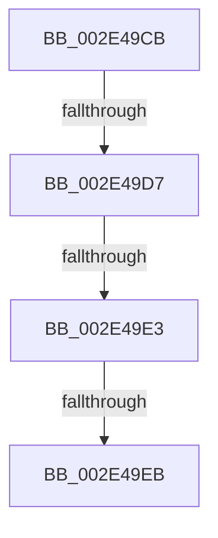

# sub_002E49CB

- RVA: `0x002E49CB`–`0x002E49F4` (길이 `41` bytes)
- VA: `0x00000001402E49CB`
- 실행 섹션: `.text`
- PDB 이름 있음: `아니요`; PDB Function 태그: `아니요`
- unwind 정보 RVA: `0x00070FE8`
- 디코드: `10`개 명령, `41/41` bytes 표시
- 미해석 바이트: `0` (있으면 어셈블리에 `.byte`로 보존)

> 이 문서는 커널 이미지의 기계어와 PDB 기호를 분석해 생성했습니다. 4번과 5번은 함수 원형과 자료형을 바이너리 사용 방식에서 추정한 C 해석이며 원본 소스 복구 결과는 아닙니다.

## 1. Dependencies

- 직접 호출 지점: **0**; 고유 호출 대상: **0**
- 직접 호출자로 확인된 함수: **0**
- RIP 상대 이미지 참조: **0**

### Outgoing calls
- 직접 디코드된 call 명령이 없습니다.

### Direct callers
- 이 함수 시작 RVA로 연결되는 직접 call은 확인되지 않았습니다. 간접 호출은 완전히 역산할 수 없습니다.

### Static image references
- 디코드된 RIP-relative 메모리 참조가 없습니다.

## 2. Other-region calls and transfers

- 다른 실행 섹션으로 향하는 call: **0**
- call이 아닌 외부 분기/꼬리 이동: **4**
  - `0x002E49D1` → [sub_002E4A5B](Unknown_function_002E4A5B.md) (`tail-transfer`)
  - `0x002E49DD` → [sub_002E459D + 0x31](Unknown_function_002E459D.md) (`tail-transfer`)
  - `0x002E49E5` → [sub_002E4AD1](Unknown_function_002E4AD1.md) (`tail-transfer`)
  - `0x002E49EF` → [sub_002E459D + 0x31](Unknown_function_002E459D.md) (`tail-transfer`)

## 3. Assembly (complete function range)

```asm
002E49CB  48 8B 47 08                     mov rax, qword ptr [rdi + 8]
002E49CF  A8 01                           test al, 1
002E49D1  0F 85 84 00 00 00               jne 0x1402e4a5b
002E49D7  48 8B C8                        mov rcx, rax
002E49DA  48 3B D1                        cmp rdx, rcx
002E49DD  0F 85 EB FB FF FF               jne 0x1402e45ce
002E49E3  A8 01                           test al, 1
002E49E5  0F 85 E6 00 00 00               jne 0x1402e4ad1
002E49EB  4C 89 4F 08                     mov qword ptr [rdi + 8], r9
002E49EF  E9 DA FB FF FF                  jmp 0x1402e45ce
```

## 4. C-style interpretation (structured pseudocode)

```c
__int64 __fastcall sub_002E49CB(__int64 a1, __int64 a2, __int64 a3, __int64 a4)
{
    *(unsigned __int64 *)(v_rdi + 8) = a4;
}
```

## 5. (Beta) C Style

```c
int64_t sub_002E49CB(int64_t Arg1, int64_t Arg2, int64_t Arg3, int64_t Arg4)
{
    *(uint64_t *)(local_rdi + 0x8) = Arg4;
}
```

## 6. Execution-region graph

[열기: 2D/3D 그래프와 함수 탐색 컨트롤 패널](../../../control-panel.html?section=text&rva=0x002E49CB&view=graph)

- 2D 그래프는 위에서 아래로 흐르고, 3D 그래프는 빈 공간을 드래그해 회전합니다. Shift+드래그는 이동, 휠은 확대·축소, 함수 노드 선택은 대상 보고서 이동입니다.

### Static fallback


