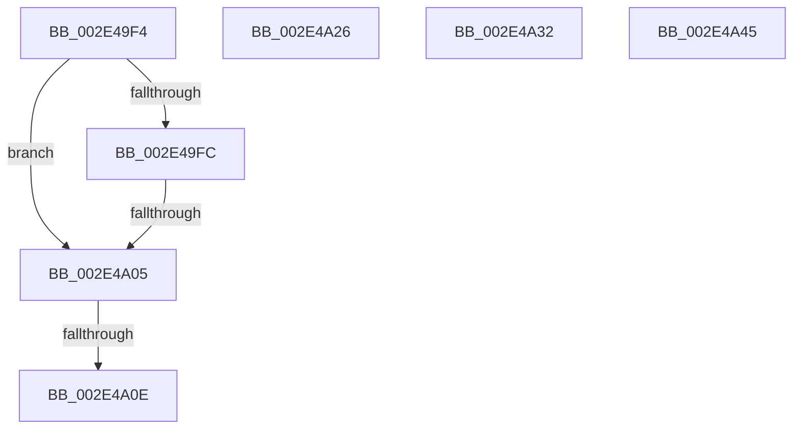

# sub_002E49F4

- RVA: `0x002E49F4`–`0x002E4A5B` (길이 `103` bytes)
- VA: `0x00000001402E49F4`
- 실행 섹션: `.text`
- PDB 이름 있음: `아니요`; PDB Function 태그: `아니요`
- unwind 정보 RVA: `0x00070FFC`
- 디코드: `27`개 명령, `103/103` bytes 표시
- 미해석 바이트: `0` (있으면 어셈블리에 `.byte`로 보존)

> 이 문서는 커널 이미지의 기계어와 PDB 기호를 분석해 생성했습니다. 4번과 5번은 함수 원형과 자료형을 바이너리 사용 방식에서 추정한 C 해석이며 원본 소스 복구 결과는 아닙니다.

## 1. Dependencies

- 직접 호출 지점: **0**; 고유 호출 대상: **0**
- 직접 호출자로 확인된 함수: **0**
- RIP 상대 이미지 참조: **0**

### Outgoing calls
- 직접 디코드된 call 명령이 없습니다.

### Direct callers
- 이 함수 시작 RVA로 연결되는 직접 call은 확인되지 않았습니다. 간접 호출은 완전히 역산할 수 없습니다.

### Static image references
- 디코드된 RIP-relative 메모리 참조가 없습니다.

## 2. Other-region calls and transfers

- 다른 실행 섹션으로 향하는 call: **0**
- call이 아닌 외부 분기/꼬리 이동: **6**
  - `0x002E49FF` → [sub_002E4AF0 + 0xA9](Unknown_function_002E4AF0.md) (`tail-transfer`)
  - `0x002E4A08` → [sub_002E47EE + 0x141](Unknown_function_002E47EE.md) (`tail-transfer`)
  - `0x002E4A21` → [sub_002E4705 + 0x3B](Unknown_function_002E4705.md) (`tail-transfer`)
  - `0x002E4A2D` → [sub_002E4705 + 0x9E](Unknown_function_002E4705.md) (`tail-transfer`)
  - `0x002E4A40` → [sub_002E47EE + 0xF5](Unknown_function_002E47EE.md) (`tail-transfer`)
  - `0x002E4A56` → [sub_002E47EE + 0xA1](Unknown_function_002E47EE.md) (`tail-transfer`)

## 3. Assembly (complete function range)

```asm
002E49F4  49 8B 01                        mov rax, qword ptr [r9]
002E49F7  45 85 D2                        test r10d, r10d
002E49FA  74 09                           je 0x1402e4a05
002E49FC  48 85 C0                        test rax, rax
002E49FF  0F 85 94 01 00 00               jne 0x1402e4b99
002E4A05  49 3B C0                        cmp rax, r8
002E4A08  0F 85 21 FF FF FF               jne 0x1402e492f
002E4A0E  49 8B C9                        mov rcx, r9
002E4A11  48 8B C2                        mov rax, rdx
002E4A14  48 33 CA                        xor rcx, rdx
002E4A17  45 85 D2                        test r10d, r10d
002E4A1A  48 0F 45 C1                     cmovne rax, rcx
002E4A1E  49 89 01                        mov qword ptr [r9], rax
002E4A21  E9 1A FD FF FF                  jmp 0x1402e4740
002E4A26  4E 89 04 DA                     mov qword ptr [rdx + r11*8], r8
002E4A2A  48 8B CA                        mov rcx, rdx
002E4A2D  E9 71 FD FF FF                  jmp 0x1402e47a3
002E4A32  8B C3                           mov eax, ebx
002E4A34  49 8B C9                        mov rcx, r9
002E4A37  44 89 5C 24 68                  mov dword ptr [rsp + 0x68], r11d
002E4A3C  49 89 14 C1                     mov qword ptr [r9 + rax*8], rdx
002E4A40  E9 9E FE FF FF                  jmp 0x1402e48e3
002E4A45  48 8B 44 24 18                  mov rax, qword ptr [rsp + 0x18]
002E4A4A  4D 8B D0                        mov r10, r8
002E4A4D  48 89 5C 24 78                  mov qword ptr [rsp + 0x78], rbx
002E4A52  4D 89 0C C6                     mov qword ptr [r14 + rax*8], r9
002E4A56  E9 34 FE FF FF                  jmp 0x1402e488f
```

## 4. C-style interpretation (structured pseudocode)

```c
__int64 __fastcall sub_002E49F4(__int64 a1, __int64 a2, __int64 a3, __int64 a4)
{
    unsigned __int64 v_stack_p18;
    unsigned int v_stack_p68;
    unsigned __int64 v_stack_p78;

    if ((unsigned int)(v_r10) == 0) goto loc_002E4A05;
loc_002E4A05:
    a1 = (a4) ^ (a2);
    if ((unsigned int)(v_r10) != 0) { a2 = a1; }
    *(unsigned __int64 *)(a4) = a2;
}
```

## 5. (Beta) C Style

```c
int64_t sub_002E49F4(int64_t Arg1, int64_t Arg2, int64_t Arg3, void *Arg4)
{
    uint8_t *arg4 = (uint8_t *)Arg4;

    uint64_t v_stack_p18;
    uint32_t v_stack_p68;
    uint64_t v_stack_p78;

    if ((uint32_t)(local_r10) == 0) goto loc_002E4A05;
loc_002E4A05:
    Arg1 = (Arg4) ^ (Arg2);
    if ((uint32_t)(local_r10) != 0) { Arg2 = Arg1; }
    *(uint64_t *)(arg4) = Arg2;
}
```

### 관측된 메모리 오프셋

구조체 형식이 확인되지 않은 접근은 인자 기준의 오프셋으로만 기록했습니다.

| 기준 인자 | 오프셋 표현 | 폭 (bit) | 접근 |
|---|---:|---:|---|
| `Arg4` | `+ 0x0` | `64` | `R` |
| `Arg4` | `+ 0x0` | `64` | `W` |

## 6. Execution-region graph

[열기: 2D/3D 그래프와 함수 탐색 컨트롤 패널](../../../control-panel.html?section=text&rva=0x002E49F4&view=graph)

- 2D 그래프는 위에서 아래로 흐르고, 3D 그래프는 빈 공간을 드래그해 회전합니다. Shift+드래그는 이동, 휠은 확대·축소, 함수 노드 선택은 대상 보고서 이동입니다.

### Static fallback


