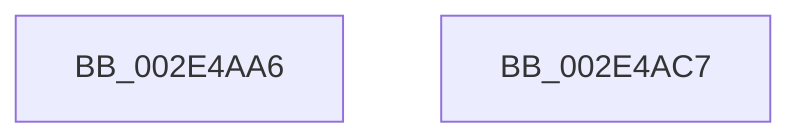

# sub_002E4AA6

- RVA: `0x002E4AA6`–`0x002E4AC8` (길이 `34` bytes)
- VA: `0x00000001402E4AA6`
- 실행 섹션: `.text`
- PDB 이름 있음: `아니요`; PDB Function 태그: `아니요`
- unwind 정보 RVA: `0x0007108C`
- 디코드: `13`개 명령, `34/34` bytes 표시
- 미해석 바이트: `0` (있으면 어셈블리에 `.byte`로 보존)

> 이 문서는 커널 이미지의 기계어와 PDB 기호를 분석해 생성했습니다. 4번과 5번은 함수 원형과 자료형을 바이너리 사용 방식에서 추정한 C 해석이며 원본 소스 복구 결과는 아닙니다.

## 1. Dependencies

- 직접 호출 지점: **0**; 고유 호출 대상: **0**
- 직접 호출자로 확인된 함수: **0**
- RIP 상대 이미지 참조: **0**

### Outgoing calls
- 직접 디코드된 call 명령이 없습니다.

### Direct callers
- 이 함수 시작 RVA로 연결되는 직접 call은 확인되지 않았습니다. 간접 호출은 완전히 역산할 수 없습니다.

### Static image references
- 디코드된 RIP-relative 메모리 참조가 없습니다.

## 2. Other-region calls and transfers

- 다른 실행 섹션으로 향하는 call: **0**
- 별도 외부 분기/꼬리 이동을 확인하지 못했습니다.

## 3. Assembly (complete function range)

```asm
002E4AA6  4D 85 C9                        test r9, r9
002E4AA9  49 8B C7                        mov rax, r15
002E4AAC  48 0F 45 C1                     cmovne rax, rcx
002E4AB0  48 89 47 08                     mov qword ptr [rdi + 8], rax
002E4AB4  0C 01                           or al, 1
002E4AB6  88 47 08                        mov byte ptr [rdi + 8], al
002E4AB9  4D 89 79 10                     mov qword ptr [r9 + 0x10], r15
002E4ABD  48 83 C4 40                     add rsp, 0x40
002E4AC1  41 5F                           pop r15
002E4AC3  41 5E                           pop r14
002E4AC5  5F                              pop rdi
002E4AC6  C3                              ret
002E4AC7  CC                              int3
```

## 4. C-style interpretation (structured pseudocode)

```c
__int64 __fastcall sub_002E4AA6(__int64 a1, __int64 a2, __int64 a3, __int64 a4)
{
    __int64 result;
    __int64 v_rsp;

    result = v_r15;
    if (a4 != 0) { result = a1; }
    *(unsigned __int64 *)(v_rdi + 8) = result;
    result = (unsigned __int8)((result) | (1));
    *(unsigned __int8 *)(v_rdi + 8) = (unsigned __int8)(result);
    *(unsigned __int64 *)(a4 + 16) = v_r15;
    v_rsp = (v_rsp) + (64);
    return result;
}
```

## 5. (Beta) C Style

```c
int64_t sub_002E4AA6(int64_t Arg1, int64_t Arg2, int64_t Arg3, int64_t Arg4)
{
    int64_t result;
    int64_t local_rsp;

    result = local_r15;
    if (Arg4 != 0) { result = Arg1; }
    *(uint64_t *)(local_rdi + 0x8) = result;
    result = (uint8_t)((result) | (1));
    *(uint8_t *)(local_rdi + 0x8) = (uint8_t)(result);
    *(uint64_t *)(Arg4 + 0x10) = local_r15;
    local_rsp = (local_rsp) + (64);
    return result;
}
```

## 6. Execution-region graph

[열기: 2D/3D 그래프와 함수 탐색 컨트롤 패널](../../../control-panel.html?section=text&rva=0x002E4AA6&view=graph)

- 2D 그래프는 위에서 아래로 흐르고, 3D 그래프는 빈 공간을 드래그해 회전합니다. Shift+드래그는 이동, 휠은 확대·축소, 함수 노드 선택은 대상 보고서 이동입니다.

### Static fallback


