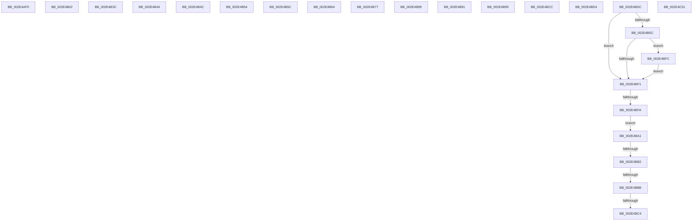

# sub_002E4AF0

- RVA: `0x002E4AF0`–`0x002E4C09` (길이 `281` bytes)
- VA: `0x00000001402E4AF0`
- 실행 섹션: `.text`
- PDB 이름 있음: `아니요`; PDB Function 태그: `아니요`
- unwind 정보 RVA: `0x000710D8`
- 디코드: `75`개 명령, `281/281` bytes 표시
- 미해석 바이트: `0` (있으면 어셈블리에 `.byte`로 보존)

> 이 문서는 커널 이미지의 기계어와 PDB 기호를 분석해 생성했습니다. 4번과 5번은 함수 원형과 자료형을 바이너리 사용 방식에서 추정한 C 해석이며 원본 소스 복구 결과는 아닙니다.

## 1. Dependencies

- 직접 호출 지점: **0**; 고유 호출 대상: **0**
- 직접 호출자로 확인된 함수: **0**
- RIP 상대 이미지 참조: **0**

### Outgoing calls
- 직접 디코드된 call 명령이 없습니다.

### Direct callers
- 이 함수 시작 RVA로 연결되는 직접 call은 확인되지 않았습니다. 간접 호출은 완전히 역산할 수 없습니다.

### Static image references
- 디코드된 RIP-relative 메모리 참조가 없습니다.

## 2. Other-region calls and transfers

- 다른 실행 섹션으로 향하는 call: **0**
- call이 아닌 외부 분기/꼬리 이동: **20**
  - `0x002E4AFD` → [sub_002E459D + 0x7F](Unknown_function_002E459D.md) (`tail-transfer`)
  - `0x002E4B37` → [sub_002E459D + 0xBE](Unknown_function_002E459D.md) (`tail-transfer`)
  - `0x002E4B3F` → [sub_002E459D + 0x12B](Unknown_function_002E459D.md) (`tail-transfer`)
  - `0x002E4B47` → [sub_002E47EE + 0x16D](Unknown_function_002E47EE.md) (`tail-transfer`)
  - `0x002E4B4F` → [sub_002E47EE + 0x1B5](Unknown_function_002E47EE.md) (`tail-transfer`)
  - `0x002E4B57` → [sub_002E47EE + 0x138](Unknown_function_002E47EE.md) (`tail-transfer`)
  - `0x002E4B5F` → [sub_002E47EE + 0x22](Unknown_function_002E47EE.md) (`tail-transfer`)
  - `0x002E4B72` → [sub_002E4705 + 0x8E](Unknown_function_002E4705.md) (`tail-transfer`)
  - `0x002E4B84` → [sub_002E47EE + 0xE3](Unknown_function_002E47EE.md) (`tail-transfer`)
  - `0x002E4B8C` → [sub_002E4705 + 0x1E](Unknown_function_002E4705.md) (`tail-transfer`)
  - `0x002E4B94` → [sub_002E4705 + 0x49](Unknown_function_002E4705.md) (`tail-transfer`)
  - `0x002E4B9C` → [sub_002E49F4 + 0x11](Unknown_function_002E49F4.md) (`tail-transfer`)
  - `0x002E4BAC` → [sub_002E4705 + 0x3](Unknown_function_002E4705.md) (`tail-transfer`)
  - `0x002E4BB5` → [sub_002E4705](Unknown_function_002E4705.md) (`tail-transfer`)
  - `0x002E4BBE` → [sub_002E47EE + 0x141](Unknown_function_002E47EE.md) (`tail-transfer`)
  - `0x002E4BC7` → [sub_002E4705 + 0x3B](Unknown_function_002E4705.md) (`tail-transfer`)
  - `0x002E4BCF` → [sub_002E47EE + 0x6C](Unknown_function_002E47EE.md) (`tail-transfer`)
  - `0x002E4BD7` → [sub_002E47EE + 0x56](Unknown_function_002E47EE.md) (`tail-transfer`)
  - `0x002E4BF4` → [sub_002E47EE + 0x141](Unknown_function_002E47EE.md) (`tail-transfer`)
  - `0x002E4C04` → [sub_002E47EE + 0x3C](Unknown_function_002E47EE.md) (`tail-transfer`)

## 3. Assembly (complete function range)

```asm
002E4AF0  4D 8B C3                        mov r8, r11
002E4AF3  4C 33 C2                        xor r8, rdx
002E4AF6  4C 89 04 24                     mov qword ptr [rsp], r8
002E4AFA  49 8B 18                        mov rbx, qword ptr [r8]
002E4AFD  E9 1A FB FF FF                  jmp 0x1402e461c
002E4B02  49 33 D8                        xor rbx, r8
002E4B05  41 8B C7                        mov eax, r15d
002E4B08  48 3B DA                        cmp rbx, rdx
002E4B0B  48 8B 1C 24                     mov rbx, qword ptr [rsp]
002E4B0F  0F 95 C0                        setne al
002E4B12  8B C0                           mov eax, eax
002E4B14  44 8B E0                        mov r12d, eax
002E4B17  48 89 44 24 78                  mov qword ptr [rsp + 0x78], rax
002E4B1C  49 83 F4 01                     xor r12, 1
002E4B20  89 44 24 68                     mov dword ptr [rsp + 0x68], eax
002E4B24  8B C8                           mov ecx, eax
002E4B26  48 89 44 24 18                  mov qword ptr [rsp + 0x18], rax
002E4B2B  44 8B E8                        mov r13d, eax
002E4B2E  48 89 44 24 10                  mov qword ptr [rsp + 0x10], rax
002E4B33  4A 8B 1C E3                     mov rbx, qword ptr [rbx + r12*8]
002E4B37  E9 1F FB FF FF                  jmp 0x1402e465b
002E4B3C  48 33 CA                        xor rcx, rdx
002E4B3F  E9 84 FB FF FF                  jmp 0x1402e46c8
002E4B44  49 33 C1                        xor rax, r9
002E4B47  E9 0F FE FF FF                  jmp 0x1402e495b
002E4B4C  49 33 C2                        xor rax, r10
002E4B4F  E9 4F FE FF FF                  jmp 0x1402e49a3
002E4B54  48 33 C2                        xor rax, rdx
002E4B57  E9 CA FD FF FF                  jmp 0x1402e4926
002E4B5C  49 33 C1                        xor rax, r9
002E4B5F  E9 AC FC FF FF                  jmp 0x1402e4810
002E4B64  4D 33 C8                        xor r9, r8
002E4B67  41 8B C3                        mov eax, r11d
002E4B6A  48 83 F0 01                     xor rax, 1
002E4B6E  4D 89 0C C6                     mov qword ptr [r14 + rax*8], r9
002E4B72  E9 1C FC FF FF                  jmp 0x1402e4793
002E4B77  4C 33 D2                        xor r10, rdx
002E4B7A  8B C3                           mov eax, ebx
002E4B7C  48 83 F0 01                     xor rax, 1
002E4B80  4C 89 14 C2                     mov qword ptr [rdx + rax*8], r10
002E4B84  E9 48 FD FF FF                  jmp 0x1402e48d1
002E4B89  49 33 C1                        xor rax, r9
002E4B8C  E9 92 FB FF FF                  jmp 0x1402e4723
002E4B91  4C 33 CA                        xor r9, rdx
002E4B94  E9 B5 FB FF FF                  jmp 0x1402e474e
002E4B99  49 33 C1                        xor rax, r9
002E4B9C  E9 64 FE FF FF                  jmp 0x1402e4a05
002E4BA1  4D 8B 48 10                     mov r9, qword ptr [r8 + 0x10]
002E4BA5  49 83 E1 FC                     and r9, 0xfffffffffffffffc
002E4BA9  45 85 D2                        test r10d, r10d
002E4BAC  0F 84 56 FB FF FF               je 0x1402e4708
002E4BB2  4D 85 C9                        test r9, r9
002E4BB5  0F 85 4A FB FF FF               jne 0x1402e4705
002E4BBB  49 3B F0                        cmp rsi, r8
002E4BBE  0F 85 6B FD FF FF               jne 0x1402e492f
002E4BC4  48 8B F2                        mov rsi, rdx
002E4BC7  E9 74 FB FF FF                  jmp 0x1402e4740
002E4BCC  4C 33 DA                        xor r11, rdx
002E4BCF  E9 86 FC FF FF                  jmp 0x1402e485a
002E4BD4  49 33 C0                        xor rax, r8
002E4BD7  E9 68 FC FF FF                  jmp 0x1402e4844
002E4BDC  41 8B C3                        mov eax, r11d
002E4BDF  48 83 F0 01                     xor rax, 1
002E4BE3  49 8B 0C C0                     mov rcx, qword ptr [r8 + rax*8]
002E4BE7  45 85 D2                        test r10d, r10d
002E4BEA  74 05                           je 0x1402e4bf1
002E4BEC  48 85 C9                        test rcx, rcx
002E4BEF  75 0B                           jne 0x1402e4bfc
002E4BF1  48 3B CA                        cmp rcx, rdx
002E4BF4  0F 85 35 FD FF FF               jne 0x1402e492f
002E4BFA  EB A5                           jmp 0x1402e4ba1
002E4BFC  49 33 C8                        xor rcx, r8
002E4BFF  EB F0                           jmp 0x1402e4bf1
002E4C01  48 33 C2                        xor rax, rdx
002E4C04  E9 21 FC FF FF                  jmp 0x1402e482a
```

## 4. C-style interpretation (structured pseudocode)

```c
__int64 __fastcall sub_002E4AF0(__int64 a1, __int64 a2, __int64 a3, __int64 a4)
{
    unsigned __int64 v_stack_p0;
    unsigned __int64 v_stack_p10;
    unsigned __int64 v_stack_p18;
    unsigned int v_stack_p68;
    unsigned __int64 v_stack_p78;

    a3 = (v_r11) ^ (a2);
    v_stack_p0 = a3;
}
```

## 5. (Beta) C Style

```c
int64_t sub_002E4AF0(int64_t Arg1, int64_t Arg2, int64_t Arg3, int64_t Arg4)
{
    uint64_t v_stack_p0;
    uint64_t v_stack_p10;
    uint64_t v_stack_p18;
    uint32_t v_stack_p68;
    uint64_t v_stack_p78;

    Arg3 = (local_r11) ^ (Arg2);
    v_stack_p0 = Arg3;
}
```

## 6. Execution-region graph

[열기: 2D/3D 그래프와 함수 탐색 컨트롤 패널](../../../control-panel.html?section=text&rva=0x002E4AF0&view=graph)

- 2D 그래프는 위에서 아래로 흐르고, 3D 그래프는 빈 공간을 드래그해 회전합니다. Shift+드래그는 이동, 휠은 확대·축소, 함수 노드 선택은 대상 보고서 이동입니다.

### Static fallback


