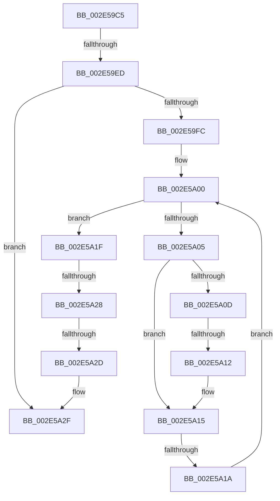

# sub_002E59C5

- RVA: `0x002E59C5`–`0x002E5A44` (길이 `127` bytes)
- VA: `0x00000001402E59C5`
- 실행 섹션: `.text`
- PDB 이름 있음: `아니요`; PDB Function 태그: `아니요`
- unwind 정보 RVA: `0x00071180`
- 디코드: `40`개 명령, `127/127` bytes 표시
- 미해석 바이트: `0` (있으면 어셈블리에 `.byte`로 보존)

> 이 문서는 커널 이미지의 기계어와 PDB 기호를 분석해 생성했습니다. 4번과 5번은 함수 원형과 자료형을 바이너리 사용 방식에서 추정한 C 해석이며 원본 소스 복구 결과는 아닙니다.

## 1. Dependencies

- 직접 호출 지점: **2**; 고유 호출 대상: **2**
- 직접 호출자로 확인된 함수: **0**
- RIP 상대 이미지 참조: **0**

### Outgoing calls
- `0x002E59D9` → [RtlRbRemoveNode](RtlRbRemoveNode_function_002E4C10.md) (function, `0x002E4C10`)
- `0x002E5A3A` → [RtlRbInsertNodeEx](RtlRbInsertNodeEx_function_002E4570.md) (function, `0x002E4570`)

### Direct callers
- 이 함수 시작 RVA로 연결되는 직접 call은 확인되지 않았습니다. 간접 호출은 완전히 역산할 수 없습니다.

### Static image references
- 디코드된 RIP-relative 메모리 참조가 없습니다.

## 2. Other-region calls and transfers

- 다른 실행 섹션으로 향하는 call: **0**
- call이 아닌 외부 분기/꼬리 이동: **5**
  - `0x002E59EB` → [sub_002E5A61](Unknown_function_002E5A61.md) (`tail-transfer`)
  - `0x002E5A10` → [sub_002E5A61 + 0x5](Unknown_function_002E5A61.md) (`tail-transfer`)
  - `0x002E5A18` → [sub_002E5A61 + 0x5](Unknown_function_002E5A61.md) (`tail-transfer`)
  - `0x002E5A26` → [sub_002E5A4B + 0x3](Unknown_function_002E5A4B.md) (`tail-transfer`)
  - `0x002E5A2B` → [sub_002E5A4B](Unknown_function_002E5A4B.md) (`tail-transfer`)

## 3. Assembly (complete function range)

```asm
002E59C5  48 89 7C 24 38                  mov qword ptr [rsp + 0x38], rdi
002E59CA  48 8D 7A 28                     lea rdi, [rdx + 0x28]
002E59CE  48 8B CF                        mov rcx, rdi
002E59D1  44 88 43 28                     mov byte ptr [rbx + 0x28], r8b
002E59D5  48 8D 53 10                     lea rdx, [rbx + 0x10]
002E59D9  E8 32 F2 FF FF                  call 0x1402e4c10
002E59DE  48 8B 47 08                     mov rax, qword ptr [rdi + 8]
002E59E2  0F B6 4B 28                     movzx ecx, byte ptr [rbx + 0x28]
002E59E6  48 8B 17                        mov rdx, qword ptr [rdi]
002E59E9  A8 01                           test al, 1
002E59EB  75 74                           jne 0x1402e5a61
002E59ED  44 0F B6 C0                     movzx r8d, al
002E59F1  32 C0                           xor al, al
002E59F3  41 83 E0 01                     and r8d, 1
002E59F7  48 85 D2                        test rdx, rdx
002E59FA  74 33                           je 0x1402e5a2f
002E59FC  0F 1F 40 00                     nop dword ptr [rax]
002E5A00  38 4A 18                        cmp byte ptr [rdx + 0x18], cl
002E5A03  7E 1A                           jle 0x1402e5a1f
002E5A05  48 8B 02                        mov rax, qword ptr [rdx]
002E5A08  45 85 C0                        test r8d, r8d
002E5A0B  74 08                           je 0x1402e5a15
002E5A0D  48 85 C0                        test rax, rax
002E5A10  74 54                           je 0x1402e5a66
002E5A12  48 33 C2                        xor rax, rdx
002E5A15  48 85 C0                        test rax, rax
002E5A18  74 4C                           je 0x1402e5a66
002E5A1A  48 8B D0                        mov rdx, rax
002E5A1D  EB E1                           jmp 0x1402e5a00
002E5A1F  48 8B 42 08                     mov rax, qword ptr [rdx + 8]
002E5A23  45 85 C0                        test r8d, r8d
002E5A26  74 26                           je 0x1402e5a4e
002E5A28  48 85 C0                        test rax, rax
002E5A2B  75 1E                           jne 0x1402e5a4b
002E5A2D  B0 01                           mov al, 1
002E5A2F  4C 8D 4B 10                     lea r9, [rbx + 0x10]
002E5A33  44 0F B6 C0                     movzx r8d, al
002E5A37  48 8B CF                        mov rcx, rdi
002E5A3A  E8 31 EB FF FF                  call 0x1402e4570
002E5A3F  48 8B 7C 24 38                  mov rdi, qword ptr [rsp + 0x38]
```

## 4. C-style interpretation (structured pseudocode)

```c
__int64 __fastcall sub_002E59C5(__int64 a1, __int64 a2, unsigned __int8 a3, __int64 a4, __int64 a5, __int64 a6, __int64 a7)
{
    __int64 result;
    unsigned __int64 v_stack_p38;

    v_stack_p38 = v_rdi;
    *(unsigned __int8 *)(v_rbx + 40) = a3;
    result = RtlRbRemoveNode(a2 + 40, v_rbx + 16, a3, a4);
    result = 0;
    a3 = (unsigned int)(((unsigned __int8)(*(unsigned __int64 *)(a2 + 40 + 8))) & (1));
    if (*(unsigned __int64 *)(a2 + 40) == 0) goto loc_002E5A2F;
loc_002E5A00:
    if ((*(unsigned __int8 *)(*(unsigned __int64 *)(a2 + 40) + 24)) <= ((unsigned __int8)(*(unsigned __int8 *)(v_rbx + 40)))) goto loc_002E5A1F;
    if (a3 == 0) goto loc_002E5A15;
    result = (*(unsigned __int64 *)(*(unsigned __int64 *)(a2 + 40))) ^ (*(unsigned __int64 *)(a2 + 40));
loc_002E5A15:
    goto loc_002E5A00;
loc_002E5A1F:
loc_002E5A2F:
    result = RtlRbInsertNodeEx(a2 + 40, result, 1, v_rbx + 16);
    return result;
}
```

## 5. (Beta) C Style

```c
int64_t sub_002E59C5(int64_t Arg1, void *Arg2, uint8_t Arg3, int64_t Arg4, uint64_t Arg5, uint64_t Arg6, int64_t Arg7)
{
    uint8_t *arg2 = (uint8_t *)Arg2;

    int64_t result;
    uint64_t v_stack_p38;

    v_stack_p38 = local_rdi;
    *(uint8_t *)(local_rbx + 0x28) = Arg3;
    result = RtlRbRemoveNode(Arg2 + 40, local_rbx + 16, Arg3, Arg4);
    result = 0;
    Arg3 = (uint32_t)(((uint8_t)(*(uint64_t *)(arg2 + 0x28 + 0x8))) & (1));
    if (*(uint64_t *)(arg2 + 0x28) == 0) goto loc_002E5A2F;
loc_002E5A00:
    if ((*(uint8_t *)(*(uint64_t *)(arg2 + 0x28) + 0x18)) <= ((uint8_t)(*(uint8_t *)(local_rbx + 0x28)))) goto loc_002E5A1F;
    if (Arg3 == 0) goto loc_002E5A15;
    result = (*(uint64_t *)(*(uint64_t *)(arg2 + 0x28))) ^ (*(uint64_t *)(arg2 + 0x28));
loc_002E5A15:
    goto loc_002E5A00;
loc_002E5A1F:
loc_002E5A2F:
    result = RtlRbInsertNodeEx(Arg2 + 40, result, 1, local_rbx + 16);
    return result;
}
```

### 관측된 메모리 오프셋

구조체 형식이 확인되지 않은 접근은 인자 기준의 오프셋으로만 기록했습니다.

| 기준 인자 | 오프셋 표현 | 폭 (bit) | 접근 |
|---|---:|---:|---|
| `Arg2` | `+ 0x0` | `64` | `R` |
| `Arg2` | `+ 0x8` | `64` | `R` |
| `Arg2` | `+ 0x28` | `64` | `R` |

## 6. Execution-region graph

[열기: 2D/3D 그래프와 함수 탐색 컨트롤 패널](../../../control-panel.html?section=text&rva=0x002E59C5&view=graph)

- 2D 그래프는 위에서 아래로 흐르고, 3D 그래프는 빈 공간을 드래그해 회전합니다. Shift+드래그는 이동, 휠은 확대·축소, 함수 노드 선택은 대상 보고서 이동입니다.

### Static fallback


