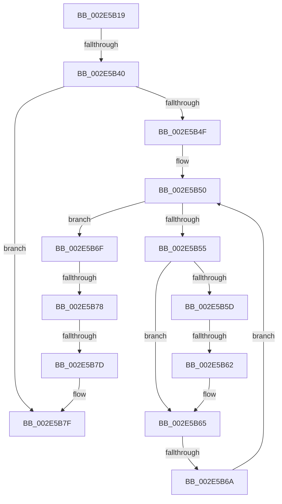

# sub_002E5B19

- RVA: `0x002E5B19`–`0x002E5B94` (길이 `123` bytes)
- VA: `0x00000001402E5B19`
- 실행 섹션: `.text`
- PDB 이름 있음: `아니요`; PDB Function 태그: `아니요`
- unwind 정보 RVA: `0x000711E8`
- 디코드: `40`개 명령, `123/123` bytes 표시
- 미해석 바이트: `0` (있으면 어셈블리에 `.byte`로 보존)

> 이 문서는 커널 이미지의 기계어와 PDB 기호를 분석해 생성했습니다. 4번과 5번은 함수 원형과 자료형을 바이너리 사용 방식에서 추정한 C 해석이며 원본 소스 복구 결과는 아닙니다.

## 1. Dependencies

- 직접 호출 지점: **2**; 고유 호출 대상: **2**
- 직접 호출자로 확인된 함수: **0**
- RIP 상대 이미지 참조: **0**

### Outgoing calls
- `0x002E5B2C` → [RtlRbRemoveNode](RtlRbRemoveNode_function_002E4C10.md) (function, `0x002E4C10`)
- `0x002E5B8A` → [RtlRbInsertNodeEx](RtlRbInsertNodeEx_function_002E4570.md) (function, `0x002E4570`)

### Direct callers
- 이 함수 시작 RVA로 연결되는 직접 call은 확인되지 않았습니다. 간접 호출은 완전히 역산할 수 없습니다.

### Static image references
- 디코드된 RIP-relative 메모리 참조가 없습니다.

## 2. Other-region calls and transfers

- 다른 실행 섹션으로 향하는 call: **0**
- call이 아닌 외부 분기/꼬리 이동: **5**
  - `0x002E5B3E` → [sub_002E5B9B + 0xA](Unknown_function_002E5B9B.md) (`tail-transfer`)
  - `0x002E5B60` → [sub_002E5B9B + 0xF](Unknown_function_002E5B9B.md) (`tail-transfer`)
  - `0x002E5B68` → [sub_002E5B9B + 0xF](Unknown_function_002E5B9B.md) (`tail-transfer`)
  - `0x002E5B76` → [sub_002E5B9B + 0x3](Unknown_function_002E5B9B.md) (`tail-transfer`)
  - `0x002E5B7B` → [sub_002E5B9B](Unknown_function_002E5B9B.md) (`tail-transfer`)

## 3. Assembly (complete function range)

```asm
002E5B19  48 89 7C 24 30                  mov qword ptr [rsp + 0x30], rdi
002E5B1E  48 8D 7A 38                     lea rdi, [rdx + 0x38]
002E5B22  48 8B CF                        mov rcx, rdi
002E5B25  88 43 28                        mov byte ptr [rbx + 0x28], al
002E5B28  48 8D 53 10                     lea rdx, [rbx + 0x10]
002E5B2C  E8 DF F0 FF FF                  call 0x1402e4c10
002E5B31  48 8B 47 08                     mov rax, qword ptr [rdi + 8]
002E5B35  0F B6 4B 28                     movzx ecx, byte ptr [rbx + 0x28]
002E5B39  48 8B 17                        mov rdx, qword ptr [rdi]
002E5B3C  A8 01                           test al, 1
002E5B3E  75 65                           jne 0x1402e5ba5
002E5B40  44 0F B6 C0                     movzx r8d, al
002E5B44  32 C0                           xor al, al
002E5B46  41 83 E0 01                     and r8d, 1
002E5B4A  48 85 D2                        test rdx, rdx
002E5B4D  74 30                           je 0x1402e5b7f
002E5B4F  90                              nop
002E5B50  38 4A 18                        cmp byte ptr [rdx + 0x18], cl
002E5B53  7D 1A                           jge 0x1402e5b6f
002E5B55  48 8B 02                        mov rax, qword ptr [rdx]
002E5B58  45 85 C0                        test r8d, r8d
002E5B5B  74 08                           je 0x1402e5b65
002E5B5D  48 85 C0                        test rax, rax
002E5B60  74 48                           je 0x1402e5baa
002E5B62  48 33 C2                        xor rax, rdx
002E5B65  48 85 C0                        test rax, rax
002E5B68  74 40                           je 0x1402e5baa
002E5B6A  48 8B D0                        mov rdx, rax
002E5B6D  EB E1                           jmp 0x1402e5b50
002E5B6F  48 8B 42 08                     mov rax, qword ptr [rdx + 8]
002E5B73  45 85 C0                        test r8d, r8d
002E5B76  74 26                           je 0x1402e5b9e
002E5B78  48 85 C0                        test rax, rax
002E5B7B  75 1E                           jne 0x1402e5b9b
002E5B7D  B0 01                           mov al, 1
002E5B7F  4C 8D 4B 10                     lea r9, [rbx + 0x10]
002E5B83  44 0F B6 C0                     movzx r8d, al
002E5B87  48 8B CF                        mov rcx, rdi
002E5B8A  E8 E1 E9 FF FF                  call 0x1402e4570
002E5B8F  48 8B 7C 24 30                  mov rdi, qword ptr [rsp + 0x30]
```

## 4. C-style interpretation (structured pseudocode)

```c
__int64 __fastcall sub_002E5B19(__int64 a1, __int64 a2, __int64 a3, __int64 a4, __int64 a5, __int64 a6)
{
    __int64 result;
    unsigned __int64 v_stack_p30;

    v_stack_p30 = v_rdi;
    *(unsigned __int8 *)(v_rbx + 40) = (unsigned __int8)(result);
    result = RtlRbRemoveNode(a2 + 56, v_rbx + 16, a3, a4);
    result = 0;
    a3 = (unsigned int)(((unsigned __int8)(*(unsigned __int64 *)(a2 + 56 + 8))) & (1));
    if (*(unsigned __int64 *)(a2 + 56) == 0) goto loc_002E5B7F;
loc_002E5B50:
    if ((*(unsigned __int8 *)(*(unsigned __int64 *)(a2 + 56) + 24)) >= ((unsigned __int8)(*(unsigned __int8 *)(v_rbx + 40)))) goto loc_002E5B6F;
    if ((unsigned int)(a3) == 0) goto loc_002E5B65;
    result = (*(unsigned __int64 *)(*(unsigned __int64 *)(a2 + 56))) ^ (*(unsigned __int64 *)(a2 + 56));
loc_002E5B65:
    goto loc_002E5B50;
loc_002E5B6F:
loc_002E5B7F:
    result = RtlRbInsertNodeEx(a2 + 56, result, 1, v_rbx + 16);
    return result;
}
```

## 5. (Beta) C Style

```c
int64_t sub_002E5B19(int64_t Arg1, void *Arg2, int64_t Arg3, int64_t Arg4, uint64_t Arg5, int64_t Arg6)
{
    uint8_t *arg2 = (uint8_t *)Arg2;

    int64_t result;
    uint64_t v_stack_p30;

    v_stack_p30 = local_rdi;
    *(uint8_t *)(local_rbx + 0x28) = (uint8_t)(result);
    result = RtlRbRemoveNode(Arg2 + 56, local_rbx + 16, Arg3, Arg4);
    result = 0;
    Arg3 = (uint32_t)(((uint8_t)(*(uint64_t *)(arg2 + 0x38 + 0x8))) & (1));
    if (*(uint64_t *)(arg2 + 0x38) == 0) goto loc_002E5B7F;
loc_002E5B50:
    if ((*(uint8_t *)(*(uint64_t *)(arg2 + 0x38) + 0x18)) >= ((uint8_t)(*(uint8_t *)(local_rbx + 0x28)))) goto loc_002E5B6F;
    if ((uint32_t)(Arg3) == 0) goto loc_002E5B65;
    result = (*(uint64_t *)(*(uint64_t *)(arg2 + 0x38))) ^ (*(uint64_t *)(arg2 + 0x38));
loc_002E5B65:
    goto loc_002E5B50;
loc_002E5B6F:
loc_002E5B7F:
    result = RtlRbInsertNodeEx(Arg2 + 56, result, 1, local_rbx + 16);
    return result;
}
```

### 관측된 메모리 오프셋

구조체 형식이 확인되지 않은 접근은 인자 기준의 오프셋으로만 기록했습니다.

| 기준 인자 | 오프셋 표현 | 폭 (bit) | 접근 |
|---|---:|---:|---|
| `Arg2` | `+ 0x0` | `64` | `R` |
| `Arg2` | `+ 0x8` | `64` | `R` |
| `Arg2` | `+ 0x38` | `64` | `R` |

## 6. Execution-region graph

[열기: 2D/3D 그래프와 함수 탐색 컨트롤 패널](../../../control-panel.html?section=text&rva=0x002E5B19&view=graph)

- 2D 그래프는 위에서 아래로 흐르고, 3D 그래프는 빈 공간을 드래그해 회전합니다. Shift+드래그는 이동, 휠은 확대·축소, 함수 노드 선택은 대상 보고서 이동입니다.

### Static fallback


