# sub_002E98D9

- RVA: `0x002E98D9`–`0x002E9BEB` (길이 `786` bytes)
- VA: `0x00000001402E98D9`
- 실행 섹션: `.text`
- PDB 이름 있음: `아니요`; PDB Function 태그: `아니요`
- unwind 정보 RVA: `0x000714F4`
- 디코드: `184`개 명령, `786/786` bytes 표시
- 미해석 바이트: `0` (있으면 어셈블리에 `.byte`로 보존)

> 이 문서는 커널 이미지의 기계어와 PDB 기호를 분석해 생성했습니다. 4번과 5번은 함수 원형과 자료형을 바이너리 사용 방식에서 추정한 C 해석이며 원본 소스 복구 결과는 아닙니다.

## 1. Dependencies

- 직접 호출 지점: **2**; 고유 호출 대상: **2**
- 직접 호출자로 확인된 함수: **0**
- RIP 상대 이미지 참조: **3**

### Outgoing calls
- `0x002E9B5A` → [RtlpHpLfhSubsegmentCommitBlock](RtlpHpLfhSubsegmentCommitBlock_function_002EA630.md) (function, `0x002EA630`)
- `0x002E9B8F` → [RtlHeapZero](../6B/RtlHeapZero_function_006BBC10.md) (function, `0x006BBC10`)

### Direct callers
- 이 함수 시작 RVA로 연결되는 직접 call은 확인되지 않았습니다. 간접 호출은 완전히 역산할 수 없습니다.

### Static image references
- `0x002E9921` → RVA `0x00010B80` (`.rdata`; read)
- `0x002E9A19` → RVA `0x00E28308` (`.data`; read)
- `0x002E9AB0` → RVA `0x00E28328` (`.data`; read)

## 2. Other-region calls and transfers

- 다른 실행 섹션으로 향하는 call: **0**
- call이 아닌 외부 분기/꼬리 이동: **16**
  - `0x002E9906` → [sub_002E9C01 + 0x25](Unknown_function_002E9C01.md) (`tail-transfer`)
  - `0x002E997E` → [sub_002E9C01 + 0x1BF](Unknown_function_002E9C01.md) (`tail-transfer`)
  - `0x002E99A1` → [sub_002E9C01 + 0xD](Unknown_function_002E9C01.md) (`tail-transfer`)
  - `0x002E99B6` → [sub_006DE430](../6D/Unknown_function_006DE430.md) (`tail-transfer`)
  - `0x002E99D6` → [sub_002E9C01 + 0x103](Unknown_function_002E9C01.md) (`tail-transfer`)
  - `0x002E99E9` → [sub_002E9C01](Unknown_function_002E9C01.md) (`tail-transfer`)
  - `0x002E9AAA` → [sub_002E9C01 + 0x11E](Unknown_function_002E9C01.md) (`tail-transfer`)
  - `0x002E9AB8` → [sub_002E9C01 + 0x77](Unknown_function_002E9C01.md) (`tail-transfer`)
  - `0x002E9AC6` → [sub_002E9C01 + 0x154](Unknown_function_002E9C01.md) (`tail-transfer`)
  - `0x002E9AD0` → [sub_002E9C01 + 0x154](Unknown_function_002E9C01.md) (`tail-transfer`)
  - `0x002E9B0F` → [sub_002E9C01 + 0x50](Unknown_function_002E9C01.md) (`tail-transfer`)
  - `0x002E9B4E` → [sub_002E9C01 + 0x134](Unknown_function_002E9C01.md) (`tail-transfer`)
  - `0x002E9B66` → [sub_002E9C01 + 0x9D](Unknown_function_002E9C01.md) (`tail-transfer`)
  - `0x002E9BA4` → [sub_002E9C01 + 0xC5](Unknown_function_002E9C01.md) (`tail-transfer`)
  - `0x002E9BAF` → [sub_002E9C01 + 0x1CC](Unknown_function_002E9C01.md) (`tail-transfer`)
  - `0x002E9BBE` → [sub_002E9C01 + 0x2A](Unknown_function_002E9C01.md) (`tail-transfer`)

## 3. Assembly (complete function range)

```asm
002E98D9  48 89 58 08                     mov qword ptr [rax + 8], rbx
002E98DD  48 89 68 E0                     mov qword ptr [rax - 0x20], rbp
002E98E1  4C 89 60 D8                     mov qword ptr [rax - 0x28], r12
002E98E5  4C 89 68 D0                     mov qword ptr [rax - 0x30], r13
002E98E9  4C 89 78 C8                     mov qword ptr [rax - 0x38], r15
002E98ED  4C 8B FA                        mov r15, rdx
002E98F0  0F B7 81 84 03 00 00            movzx eax, word ptr [rcx + 0x384]
002E98F7  BA 01 00 00 00                  mov edx, 1
002E98FC  4C 3B FA                        cmp r15, rdx
002E98FF  4C 0F 46 FA                     cmovbe r15, rdx
002E9903  4C 3B F8                        cmp r15, rax
002E9906  0F 83 1A 03 00 00               jae 0x1402e9c26
002E990C  4C 8D A9 40 03 00 00            lea r13, [rcx + 0x340]
002E9913  45 33 E4                        xor r12d, r12d
002E9916  45 8B 55 4C                     mov r10d, dword ptr [r13 + 0x4c]
002E991A  41 8D 47 0F                     lea eax, [r15 + 0xf]
002E991E  C1 E8 04                        shr eax, 4
002E9921  48 8D 0D 58 72 D2 FF            lea rcx, [rip - 0x2d8da8]
002E9928  45 8B C2                        mov r8d, r10d
002E992B  49 C1 EA 04                     shr r10, 4
002E992F  41 C1 E8 0D                     shr r8d, 0xd
002E9933  41 81 E2 FF 01 00 00            and r10d, 0x1ff
002E993A  41 81 E0 FF FF 03 00            and r8d, 0x3ffff
002E9941  0F B6 2C 08                     movzx ebp, byte ptr [rax + rcx]
002E9945  65 48 8B 04 25 20 00 00 00      mov rax, qword ptr gs:[0x20]
002E994E  FF CD                           dec ebp
002E9950  41 0F BD C8                     bsr ecx, r8d
002E9954  4C 8B 88 B0 8B 00 00            mov r9, qword ptr [rax + 0x8bb0]
002E995B  D3 E2                           shl edx, cl
002E995D  83 C1 FE                        add ecx, -2
002E9960  41 33 D0                        xor edx, r8d
002E9963  89 4C 24 50                     mov dword ptr [rsp + 0x50], ecx
002E9967  89 AC 24 B0 00 00 00            mov dword ptr [rsp + 0xb0], ebp
002E996E  49 8B 0C C9                     mov rcx, qword ptr [r9 + rcx*8]
002E9972  48 8B 44 D1 08                  mov rax, qword ptr [rcx + rdx*8 + 8]
002E9977  4A 8B 04 D0                     mov rax, qword ptr [rax + r10*8]
002E997B  48 85 C0                        test rax, rax
002E997E  0F 84 3C 04 00 00               je 0x1402e9dc0
002E9984  0F B7 D8                        movzx ebx, ax
002E9987  48 03 ED                        add rbp, rbp
002E998A  C1 E3 06                        shl ebx, 6
002E998D  49 03 DD                        add rbx, r13
002E9990  48 89 84 24 B8 00 00 00         mov qword ptr [rsp + 0xb8], rax
002E9998  0F B7 04 2B                     movzx eax, word ptr [rbx + rbp]
002E999C  44 8B C0                        mov r8d, eax
002E999F  85 C0                           test eax, eax
002E99A1  0F 84 67 02 00 00               je 0x1402e9c0e
002E99A7  41 C1 E0 06                     shl r8d, 6
002E99AB  41 8B E8                        mov ebp, r8d
002E99AE  49 03 ED                        add rbp, r13
002E99B1  66 44 39 65 04                  cmp word ptr [rbp + 4], r12w
002E99B6  0F 85 74 4A 3F 00               jne 0x1406de430
002E99BC  44 89 64 24 38                  mov dword ptr [rsp + 0x38], r12d
002E99C1  0F 0D 4D 38                     prefetchw byte ptr [rbp + 0x38]
002E99C5  48 8B 5D 38                     mov rbx, qword ptr [rbp + 0x38]
002E99C9  41 BA 01 00 00 00               mov r10d, 1
002E99CF  48 F7 C3 FF 0F 00 00            test rbx, 0xfff
002E99D6  0F 84 28 03 00 00               je 0x1402e9d04
002E99DC  48 8D 4B FF                     lea rcx, [rbx - 1]
002E99E0  48 8B C3                        mov rax, rbx
002E99E3  F0 48 0F B1 4D 38               lock cmpxchg qword ptr [rbp + 0x38], rcx
002E99E9  0F 85 12 02 00 00               jne 0x1402e9c01
002E99EF  65 4C 8B 0C 25 88 01 00 00      mov r9, qword ptr gs:[0x188]
002E99F8  4C 8B DB                        mov r11, rbx
002E99FB  49 81 E3 00 F0 FF FF            and r11, 0xfffffffffffff000
002E9A02  49 8B C3                        mov rax, r11
002E9A05  4C 89 5C 24 30                  mov qword ptr [rsp + 0x30], r11
002E9A0A  48 C1 E8 0C                     shr rax, 0xc
002E9A0E  49 8B 89 60 07 00 00            mov rcx, qword ptr [r9 + 0x760]
002E9A15  41 33 43 28                     xor eax, dword ptr [r11 + 0x28]
002E9A19  33 05 E9 E8 B3 00               xor eax, dword ptr [rip + 0xb3e8e9]
002E9A1F  49 8B 91 68 07 00 00            mov rdx, qword ptr [r9 + 0x768]
002E9A26  45 0F B6 53 18                  movzx r10d, byte ptr [r11 + 0x18]
002E9A2B  89 44 24 28                     mov dword ptr [rsp + 0x28], eax
002E9A2F  41 83 C2 F8                     add r10d, -8
002E9A33  0F B7 C0                        movzx eax, ax
002E9A36  4C 8D 04 0A                     lea r8, [rdx + rcx]
002E9A3A  89 44 24 40                     mov dword ptr [rsp + 0x40], eax
002E9A3E  48 33 D1                        xor rdx, rcx
002E9A41  49 C1 E8 20                     shr r8, 0x20
002E9A45  48 C1 C1 18                     rol rcx, 0x18
002E9A49  48 8B C2                        mov rax, rdx
002E9A4C  48 C1 E0 10                     shl rax, 0x10
002E9A50  48 33 C8                        xor rcx, rax
002E9A53  41 0F B6 C0                     movzx eax, r8b
002E9A57  48 33 CA                        xor rcx, rdx
002E9A5A  89 44 24 20                     mov dword ptr [rsp + 0x20], eax
002E9A5E  49 89 89 60 07 00 00            mov qword ptr [r9 + 0x760], rcx
002E9A65  49 8D 4B 40                     lea rcx, [r11 + 0x40]
002E9A69  48 C1 C2 25                     rol rdx, 0x25
002E9A6D  49 89 91 68 07 00 00            mov qword ptr [r9 + 0x768], rdx
002E9A74  41 0F B6 43 32                  movzx eax, byte ptr [r11 + 0x32]
002E9A79  89 44 24 24                     mov dword ptr [rsp + 0x24], eax
002E9A7D  41 0F B6 43 27                  movzx eax, byte ptr [r11 + 0x27]
002E9A82  45 8B CA                        mov r9d, r10d
002E9A85  49 FF C9                        dec r9
002E9A88  88 84 24 B0 00 00 00            mov byte ptr [rsp + 0xb0], al
002E9A8F  41 0F B6 43 24                  movzx eax, byte ptr [r11 + 0x24]
002E9A94  4E 8D 0C C9                     lea r9, [rcx + r9*8]
002E9A98  4C 8D 04 C1                     lea r8, [rcx + rax*8]
002E9A9C  4C 89 4C 24 48                  mov qword ptr [rsp + 0x48], r9
002E9AA1  49 8B 10                        mov rdx, qword ptr [r8]
002E9AA4  48 F7 D2                        not rdx
002E9AA7  48 85 D2                        test rdx, rdx
002E9AAA  0F 84 6F 02 00 00               je 0x1402e9d1f
002E9AB0  8B 05 72 E8 B3 00               mov eax, dword ptr [rip + 0xb3e872]
002E9AB6  A8 04                           test al, 4
002E9AB8  0F 85 BA 01 00 00               jne 0x1402e9c78
002E9ABE  4D 3B C1                        cmp r8, r9
002E9AC1  44 8B 4C 24 24                  mov r9d, dword ptr [rsp + 0x24]
002E9AC6  0F 84 89 02 00 00               je 0x1402e9d55
002E9ACC  41 83 F9 40                     cmp r9d, 0x40
002E9AD0  0F 85 7F 02 00 00               jne 0x1402e9d55
002E9AD6  8B 4C 24 20                     mov ecx, dword ptr [rsp + 0x20]
002E9ADA  48 D3 CA                        ror rdx, cl
002E9ADD  F3 4C 0F BC D2                  tzcnt r10, rdx
002E9AE2  44 03 D1                        add r10d, ecx
002E9AE5  41 83 E2 3F                     and r10d, 0x3f
002E9AE9  41 8B CA                        mov ecx, r10d
002E9AEC  41 B9 01 00 00 00               mov r9d, 1
002E9AF2  49 D3 E1                        shl r9, cl
002E9AF5  41 0F 0D 08                     prefetchw byte ptr [r8]
002E9AF9  49 8B 00                        mov rax, qword ptr [r8]
002E9AFC  48 8B C8                        mov rcx, rax
002E9AFF  49 0B C9                        or rcx, r9
002E9B02  F0 49 0F B1 08                  lock cmpxchg qword ptr [r8], rcx
002E9B07  75 F3                           jne 0x1402e9afc
002E9B09  48 8B D0                        mov rdx, rax
002E9B0C  4C 85 C8                        test rax, r9
002E9B0F  0F 85 3C 01 00 00               jne 0x1402e9c51
002E9B15  44 8B 4C 24 40                  mov r9d, dword ptr [rsp + 0x40]
002E9B1A  49 8D 43 40                     lea rax, [r11 + 0x40]
002E9B1E  44 2B C0                        sub r8d, eax
002E9B21  43 8D 0C C2                     lea ecx, [r10 + r8*8]
002E9B25  45 8B C1                        mov r8d, r9d
002E9B28  44 0F AF C1                     imul r8d, ecx
002E9B2C  8B C1                           mov eax, ecx
002E9B2E  C1 E8 06                        shr eax, 6
002E9B31  41 88 43 24                     mov byte ptr [r11 + 0x24], al
002E9B35  0F B7 44 24 2A                  movzx eax, word ptr [rsp + 0x2a]
002E9B3A  89 4C 24 24                     mov dword ptr [rsp + 0x24], ecx
002E9B3E  44 03 C0                        add r8d, eax
002E9B41  80 BC 24 B0 00 00 00 01         cmp byte ptr [rsp + 0xb0], 1
002E9B49  44 89 44 24 28                  mov dword ptr [rsp + 0x28], r8d
002E9B4E  0F 86 E1 01 00 00               jbe 0x1402e9d35
002E9B54  49 8B D3                        mov rdx, r11
002E9B57  49 8B CD                        mov rcx, r13
002E9B5A  E8 D1 0A 00 00                  call 0x1402ea630
002E9B5F  4C 8B 5C 24 30                  mov r11, qword ptr [rsp + 0x30]
002E9B64  85 C0                           test eax, eax
002E9B66  0F 88 32 01 00 00               js 0x1402e9c9e
002E9B6C  44 8B 44 24 28                  mov r8d, dword ptr [rsp + 0x28]
002E9B71  41 8B C0                        mov eax, r8d
002E9B74  49 03 C3                        add rax, r11
002E9B77  48 89 44 24 48                  mov qword ptr [rsp + 0x48], rax
002E9B7C  40 F6 C7 02                     test dil, 2
002E9B80  74 1C                           je 0x1402e9b9e
002E9B82  8B D6                           mov edx, esi
002E9B84  48 8B C8                        mov rcx, rax
002E9B87  48 83 C2 0F                     add rdx, 0xf
002E9B8B  48 83 E2 F0                     and rdx, 0xfffffffffffffff0
002E9B8F  E8 7C 20 3D 00                  call 0x1406bbc10
002E9B94  4C 8B 5C 24 30                  mov r11, qword ptr [rsp + 0x30]
002E9B99  48 8B 44 24 48                  mov rax, qword ptr [rsp + 0x48]
002E9B9E  4C 8B E0                        mov r12, rax
002E9BA1  48 85 C0                        test rax, rax
002E9BA4  0F 84 1C 01 00 00               je 0x1402e9cc6
002E9BAA  83 7C 24 38 00                  cmp dword ptr [rsp + 0x38], 0
002E9BAF  0F 85 18 02 00 00               jne 0x1402e9dcd
002E9BB5  8B DE                           mov ebx, esi
002E9BB7  45 8B C7                        mov r8d, r15d
002E9BBA  49 83 FC FF                     cmp r12, -1
002E9BBE  74 6B                           je 0x1402e9c2b
002E9BC0  4C 8B 7C 24 60                  mov r15, qword ptr [rsp + 0x60]
002E9BC5  49 8B C4                        mov rax, r12
002E9BC8  4C 8B 64 24 70                  mov r12, qword ptr [rsp + 0x70]
002E9BCD  4C 8B 6C 24 68                  mov r13, qword ptr [rsp + 0x68]
002E9BD2  48 8B 6C 24 78                  mov rbp, qword ptr [rsp + 0x78]
002E9BD7  48 8B 9C 24 A0 00 00 00         mov rbx, qword ptr [rsp + 0xa0]
002E9BDF  48 81 C4 80 00 00 00            add rsp, 0x80
002E9BE6  41 5E                           pop r14
002E9BE8  5F                              pop rdi
002E9BE9  5E                              pop rsi
002E9BEA  C3                              ret
```

## 4. C-style interpretation (structured pseudocode)

```c
__int64 __fastcall sub_002E98D9(__int64 a1, __int64 a2, __int64 a3, __int64 a4, unsigned int a5, __int64 a6, unsigned int a7, unsigned int a8, __int64 a9, __int64 a10, __int64 a11, __int64 a12, __int64 a13, __int64 a14, __int64 a15, __int64 a16, __int64 a17, __int64 a18, __int64 a19, __int64 a20, __int64 a21, unsigned __int8 a22)
{
    __int64 result;
    __int64 v_r10;
    __int64 v_r11;
    __int64 v_r12;
    __int64 v_rbp;
    __int64 v_rbx;
    __int64 v_rsp;
    unsigned int v_stack_p20;
    unsigned int v_stack_p24;
    unsigned int v_stack_p28;
    unsigned __int16 v_stack_p2A;
    unsigned __int64 v_stack_p30;
    unsigned int v_stack_p38;
    unsigned int v_stack_p40;
    unsigned __int64 v_stack_p48;
    unsigned int v_stack_p50;
    unsigned int v_stack_pB0;
    unsigned __int64 v_stack_pB8;

    *(unsigned __int64 *)(result + 8) = v_rbx;
    *(unsigned __int64 *)(result - 32) = v_rbp;
    *(unsigned __int64 *)(result - 40) = v_r12;
    *(unsigned __int64 *)(result - 48) = v_r13;
    *(unsigned __int64 *)(result - 56) = v_r15;
    if (a2 <= 1) { a2 = 1; }
    v_r12 = 0;
    result = (unsigned int)((a2 + 15) >> (4));
    v_r10 = ((unsigned int)(*(unsigned int *)(a1 + 832 + 76))) >> (4);
    a3 = (unsigned int)(((unsigned int)((unsigned int)((unsigned int)(*(unsigned int *)(a1 + 832 + 76))))) >> (13));
    v_r10 = (unsigned int)((v_r10) & (511));
    a3 = (unsigned int)((a3) & (0x3FFFFULL));
    v_rbp = (unsigned int)((*(unsigned __int8 *)(result + v_rip - 2985384 * 1)) - 1);
    a2 = (unsigned int)((1) << ((unsigned __int8)(v_rip - 2985384)));
    a1 = (unsigned int)((v_rip - 2985384) + (-2));
    a2 = (unsigned int)((a2) ^ ((unsigned int)(a3)));
    v_stack_p50 = (unsigned int)(a1);
    v_stack_pB0 = (unsigned int)(v_rbp);
    v_rbp = (v_rbp) + (v_rbp);
    v_rbx = (unsigned int)(((unsigned __int16)(*(unsigned __int64 *)(*(unsigned __int64 *)(*(unsigned __int64 *)(*(unsigned __int64 *)(*(unsigned __int64 *)(gs_base + (0 + 32)) + 35760) + a1 * 8) + a2 * 8 + 8) + v_r10 * 8))) << (6));
    v_rbx = (v_rbx) + (a1 + 832);
    v_stack_pB8 = *(unsigned __int64 *)(*(unsigned __int64 *)(*(unsigned __int64 *)(*(unsigned __int64 *)(*(unsigned __int64 *)(gs_base + (0 + 32)) + 35760) + a1 * 8) + a2 * 8 + 8) + v_r10 * 8);
    a3 = (unsigned int)(((unsigned int)((unsigned int)(*(unsigned __int16 *)(v_rbx + v_rbp * 1)))) << (6));
    v_rbp = ((unsigned int)((unsigned int)(a3))) + (a1 + 832);
    v_stack_p38 = 0;
    v_r11 = (*(unsigned __int64 *)(v_rbp + 56)) & (0xFFFFFFFFFFFFF000ULL);
    v_stack_p30 = v_r11;
    result = (v_r11) >> (12);
    result = (unsigned int)((result) ^ (*(unsigned int *)(v_r11 + 40)));
    result = (unsigned int)((result) ^ (*(unsigned int *)(v_rip + 11790569)));
    v_stack_p28 = (unsigned int)(result);
    v_r10 = (unsigned int)((*(unsigned __int8 *)(v_r11 + 24)) + (-8));
    v_stack_p40 = (unsigned int)((unsigned __int16)(result));
    a2 = (*(unsigned __int64 *)(*(unsigned __int64 *)(gs_base + (0 + 392)) + 1896)) ^ (*(unsigned __int64 *)(*(unsigned __int64 *)(gs_base + (0 + 392)) + 1888));
    a3 = (*(unsigned __int64 *)(*(unsigned __int64 *)(gs_base + (0 + 392)) + 1896) + *(unsigned __int64 *)(*(unsigned __int64 *)(gs_base + (0 + 392)) + 1888) * 1) >> (32);
    result = (a2) << (16);
    a1 = (*(unsigned __int64 *)(*(unsigned __int64 *)(gs_base + (0 + 392)) + 1888)) ^ (result);
    a1 = (a1) ^ (a2);
    v_stack_p20 = (unsigned int)((unsigned __int8)(a3));
    *(unsigned __int64 *)(*(unsigned __int64 *)(gs_base + (0 + 392)) + 1888) = a1;
    *(unsigned __int64 *)(*(unsigned __int64 *)(gs_base + (0 + 392)) + 1896) = a2;
    v_stack_p24 = (unsigned int)(*(unsigned __int8 *)(v_r11 + 50));
    a4 = ((unsigned int)((unsigned int)(v_r10))) - 1;
    v_stack_pB0 = (unsigned __int8)(*(unsigned __int8 *)(v_r11 + 39));
    v_stack_p48 = v_r11 + 64 + a4 * 8;
    a2 = ~(*(unsigned __int64 *)(v_r11 + 64 + *(unsigned __int8 *)(v_r11 + 36) * 8));
    v_r10 = (unsigned int)((v_r10) + ((unsigned int)((unsigned int)(v_stack_p20))));
    v_r10 = (unsigned int)((v_r10) & (63));
    a4 = (1) << ((unsigned __int8)((unsigned int)((unsigned int)(v_r10))));
loc_002E9AFC:
    a1 = (*(unsigned __int64 *)(v_r11 + 64 + *(unsigned __int8 *)(v_r11 + 36) * 8)) | (a4);
    if (condition_is_not_equal) goto loc_002E9AFC;
    a3 = (unsigned int)((v_r11 + 64 + *(unsigned __int8 *)(v_r11 + 36) * 8) - ((unsigned int)(v_r11 + 64)));
    a3 = (unsigned int)(((unsigned int)((unsigned int)((unsigned int)(a8)))) * ((unsigned int)(v_r10 + a3 * 8)));
    result = (unsigned int)(((unsigned int)((unsigned int)(v_r10 + a3 * 8))) >> (6));
    *(unsigned __int8 *)(v_r11 + 36) = (unsigned __int8)(result);
    v_stack_p24 = (unsigned int)(v_r10 + a3 * 8);
    a3 = (unsigned int)((a3) + ((unsigned int)(v_stack_p2A)));
    v_stack_p28 = (unsigned int)(a3);
    result = RtlpHpLfhSubsegmentCommitBlock(a1 + 832, v_r11, a3, (unsigned int)(a8));
    result = ((unsigned int)((unsigned int)((unsigned int)(a5)))) + (a6);
    v_stack_p48 = result;
    v_r11 = a6;
    if ((((unsigned __int8)(v_rdi)) & (2)) != 0) {
        a2 = (unsigned int)(v_rsi);
        a1 = result;
        a2 = (a2) + (15);
        a2 = (a2) & (-16);
        result = RtlHeapZero(a1, a2, (unsigned int)(a5), (unsigned int)(a8));
        v_r11 = a6;
        result = a9;
    }
    v_rsp = (v_rsp) + (128);
    return result;
}
```

## 5. (Beta) C Style

```c
int64_t sub_002E98D9(void *Arg1, int64_t Arg2, int64_t Arg3, int64_t Arg4, uint32_t Arg5, int64_t Arg6, uint32_t Arg7, uint32_t Arg8, int64_t Arg9, uint64_t Arg10, uint64_t Arg11, int64_t Arg12, int64_t Arg13, int64_t Arg14, int64_t Arg15, uint64_t Arg16, uint64_t Arg17, uint64_t Arg18, uint64_t Arg19, int64_t Arg20, uint64_t Arg21, uint8_t Arg22)
{
    uint8_t *arg1 = (uint8_t *)Arg1;

    int64_t result;
    int64_t local_r10;
    int64_t local_r11;
    int64_t local_r12;
    int64_t local_rbp;
    int64_t local_rbx;
    int64_t local_rsp;
    uint32_t v_stack_p20;
    uint32_t v_stack_p24;
    uint32_t v_stack_p28;
    uint16_t v_stack_p2A;
    uint64_t v_stack_p30;
    uint32_t v_stack_p38;
    uint32_t v_stack_p40;
    uint64_t v_stack_p48;
    uint32_t v_stack_p50;
    uint32_t v_stack_pB0;
    uint64_t v_stack_pB8;

    *(uint64_t *)(result + 0x8) = local_rbx;
    *(uint64_t *)(result - 0x20) = local_rbp;
    *(uint64_t *)(result - 0x28) = local_r12;
    *(uint64_t *)(result - 0x30) = local_r13;
    *(uint64_t *)(result - 0x38) = local_r15;
    if (Arg2 <= 1) { Arg2 = 1; }
    local_r12 = 0;
    result = (uint32_t)((Arg2 + 15) >> (4));
    local_r10 = ((uint32_t)(*(uint32_t *)(arg1 + 0x340 + 0x4C))) >> (4);
    Arg3 = (uint32_t)(((uint32_t)((uint32_t)((uint32_t)(*(uint32_t *)(arg1 + 0x340 + 0x4C))))) >> (13));
    local_r10 = (uint32_t)((local_r10) & (511));
    Arg3 = (uint32_t)((Arg3) & (0x3FFFFULL));
    local_rbp = (uint32_t)((*(uint8_t *)(result + v_rip - 0x2D8DA8 * 1)) - 1);
    Arg2 = (uint32_t)((1) << ((uint8_t)(v_rip - 2985384)));
    Arg1 = (uint32_t)((v_rip - 2985384) + (-2));
    Arg2 = (uint32_t)((Arg2) ^ ((uint32_t)(Arg3)));
    v_stack_p50 = (uint32_t)(Arg1);
    v_stack_pB0 = (uint32_t)(local_rbp);
    local_rbp = (local_rbp) + (local_rbp);
    local_rbx = (uint32_t)(((uint16_t)(*(uint64_t *)(*(uint64_t *)(*(uint64_t *)(*(uint64_t *)(*(uint64_t *)(gs_base + (0 + 0x20)) + 0x8BB0) + arg1 * 8) + Arg2 * 8 + 0x8) + local_r10 * 8))) << (6));
    local_rbx = (local_rbx) + (Arg1 + 832);
    v_stack_pB8 = *(uint64_t *)(*(uint64_t *)(*(uint64_t *)(*(uint64_t *)(*(uint64_t *)(gs_base + (0 + 0x20)) + 0x8BB0) + arg1 * 8) + Arg2 * 8 + 0x8) + local_r10 * 8);
    Arg3 = (uint32_t)(((uint32_t)((uint32_t)(*(uint16_t *)(local_rbx + local_rbp * 1)))) << (6));
    local_rbp = ((uint32_t)((uint32_t)(Arg3))) + (Arg1 + 832);
    v_stack_p38 = 0;
    local_r11 = (*(uint64_t *)(local_rbp + 0x38)) & (0xFFFFFFFFFFFFF000ULL);
    v_stack_p30 = local_r11;
    result = (local_r11) >> (12);
    result = (uint32_t)((result) ^ (*(uint32_t *)(local_r11 + 0x28)));
    result = (uint32_t)((result) ^ (*(uint32_t *)(v_rip + 0xB3E8E9)));
    v_stack_p28 = (uint32_t)(result);
    local_r10 = (uint32_t)((*(uint8_t *)(local_r11 + 0x18)) + (-8));
    v_stack_p40 = (uint32_t)((uint16_t)(result));
    Arg2 = (*(uint64_t *)(*(uint64_t *)(gs_base + (0 + 0x188)) + 0x768)) ^ (*(uint64_t *)(*(uint64_t *)(gs_base + (0 + 0x188)) + 0x760));
    Arg3 = (*(uint64_t *)(*(uint64_t *)(gs_base + (0 + 0x188)) + 0x768) + *(uint64_t *)(*(uint64_t *)(gs_base + (0 + 0x188)) + 0x760) * 1) >> (32);
    result = (Arg2) << (16);
    Arg1 = (*(uint64_t *)(*(uint64_t *)(gs_base + (0 + 0x188)) + 0x760)) ^ (result);
    Arg1 = (Arg1) ^ (Arg2);
    v_stack_p20 = (uint32_t)((uint8_t)(Arg3));
    *(void **)(*(uint64_t *)(gs_base + (0 + 0x188)) + 0x760) = Arg1;
    *(uint64_t *)(*(uint64_t *)(gs_base + (0 + 0x188)) + 0x768) = Arg2;
    v_stack_p24 = (uint32_t)(*(uint8_t *)(local_r11 + 0x32));
    Arg4 = ((uint32_t)((uint32_t)(local_r10))) - 1;
    v_stack_pB0 = (uint8_t)(*(uint8_t *)(local_r11 + 0x27));
    v_stack_p48 = local_r11 + 64 + Arg4 * 8;
    Arg2 = ~(*(uint64_t *)(local_r11 + 0x40 + *(uint8_t *)(local_r11 + 0x24) * 8));
    local_r10 = (uint32_t)((local_r10) + ((uint32_t)((uint32_t)(v_stack_p20))));
    local_r10 = (uint32_t)((local_r10) & (63));
    Arg4 = (1) << ((uint8_t)((uint32_t)((uint32_t)(local_r10))));
loc_002E9AFC:
    Arg1 = (*(uint64_t *)(local_r11 + 0x40 + *(uint8_t *)(local_r11 + 0x24) * 8)) | (Arg4);
    if (condition_is_not_equal) goto loc_002E9AFC;
    Arg3 = (uint32_t)((local_r11 + 64 + *(uint8_t *)(local_r11 + 0x24) * 8) - ((uint32_t)(local_r11 + 64)));
    Arg3 = (uint32_t)(((uint32_t)((uint32_t)((uint32_t)(Arg8)))) * ((uint32_t)(local_r10 + Arg3 * 8)));
    result = (uint32_t)(((uint32_t)((uint32_t)(local_r10 + Arg3 * 8))) >> (6));
    *(uint8_t *)(local_r11 + 0x24) = (uint8_t)(result);
    v_stack_p24 = (uint32_t)(local_r10 + Arg3 * 8);
    Arg3 = (uint32_t)((Arg3) + ((uint32_t)(v_stack_p2A)));
    v_stack_p28 = (uint32_t)(Arg3);
    result = RtlpHpLfhSubsegmentCommitBlock(Arg1 + 832, local_r11, Arg3, (uint32_t)(Arg8));
    result = ((uint32_t)((uint32_t)((uint32_t)(Arg5)))) + (Arg6);
    v_stack_p48 = result;
    local_r11 = Arg6;
    if ((((uint8_t)(local_rdi)) & (2)) != 0) {
        Arg2 = (uint32_t)(local_rsi);
        Arg1 = result;
        Arg2 = (Arg2) + (15);
        Arg2 = (Arg2) & (-16);
        result = RtlHeapZero(Arg1, Arg2, (uint32_t)(Arg5), (uint32_t)(Arg8));
        local_r11 = Arg6;
        result = Arg9;
    }
    local_rsp = (local_rsp) + (128);
    return result;
}
```

### 관측된 메모리 오프셋

구조체 형식이 확인되지 않은 접근은 인자 기준의 오프셋으로만 기록했습니다.

| 기준 인자 | 오프셋 표현 | 폭 (bit) | 접근 |
|---|---:|---:|---|
| `Arg1` | `+ 0x4C` | `32` | `R` |
| `Arg1` | `+ 0x340` | `64` | `R` |
| `Arg1` | `+ 0x384` | `16` | `R` |

## 6. Execution-region graph

[열기: 2D/3D 그래프와 함수 탐색 컨트롤 패널](../../../control-panel.html?section=text&rva=0x002E98D9&view=graph)

- 2D 그래프는 위에서 아래로 흐르고, 3D 그래프는 빈 공간을 드래그해 회전합니다. Shift+드래그는 이동, 휠은 확대·축소, 함수 노드 선택은 대상 보고서 이동입니다.

### Static fallback

```mermaid
flowchart TD
  bb_002E98D9[BB_002E98D9]
  bb_002E990C[BB_002E990C]
  bb_002E9984[BB_002E9984]
  bb_002E99A7[BB_002E99A7]
  bb_002E99BC[BB_002E99BC]
  bb_002E99DC[BB_002E99DC]
  bb_002E99EF[BB_002E99EF]
  bb_002E9AB0[BB_002E9AB0]
  bb_002E9ABE[BB_002E9ABE]
  bb_002E9ACC[BB_002E9ACC]
  bb_002E9AD6[BB_002E9AD6]
  bb_002E9AFC[BB_002E9AFC]
  bb_002E9B09[BB_002E9B09]
  bb_002E9B15[BB_002E9B15]
  bb_002E9B54[BB_002E9B54]
  bb_002E9B6C[BB_002E9B6C]
  bb_002E9B82[BB_002E9B82]
  bb_002E9B9E[BB_002E9B9E]
  bb_002E9BAA[BB_002E9BAA]
  bb_002E9BB5[BB_002E9BB5]
  bb_002E9BC0[BB_002E9BC0]
  bb_002E98D9 -->|fallthrough| bb_002E990C
  bb_002E990C -->|fallthrough| bb_002E9984
  bb_002E9984 -->|fallthrough| bb_002E99A7
  bb_002E99A7 -->|fallthrough| bb_002E99BC
  bb_002E99BC -->|fallthrough| bb_002E99DC
  bb_002E99DC -->|fallthrough| bb_002E99EF
  bb_002E99EF -->|fallthrough| bb_002E9AB0
  bb_002E9AB0 -->|fallthrough| bb_002E9ABE
  bb_002E9ABE -->|fallthrough| bb_002E9ACC
  bb_002E9ACC -->|fallthrough| bb_002E9AD6
  bb_002E9AD6 -->|flow| bb_002E9AFC
  bb_002E9AFC -->|branch| bb_002E9AFC
  bb_002E9AFC -->|fallthrough| bb_002E9B09
  bb_002E9B09 -->|fallthrough| bb_002E9B15
  bb_002E9B15 -->|fallthrough| bb_002E9B54
  bb_002E9B54 -->|fallthrough| bb_002E9B6C
  bb_002E9B6C -->|branch| bb_002E9B9E
  bb_002E9B6C -->|fallthrough| bb_002E9B82
  bb_002E9B82 -->|flow| bb_002E9B9E
  bb_002E9B9E -->|fallthrough| bb_002E9BAA
  bb_002E9BAA -->|fallthrough| bb_002E9BB5
  bb_002E9BB5 -->|fallthrough| bb_002E9BC0
```


