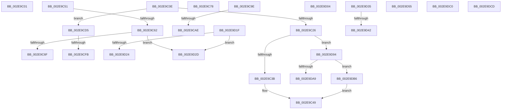

# sub_002E9C01

- RVA: `0x002E9C01`–`0x002E9DE5` (길이 `484` bytes)
- VA: `0x00000001402E9C01`
- 실행 섹션: `.text`
- PDB 이름 있음: `아니요`; PDB Function 태그: `아니요`
- unwind 정보 RVA: `0x00071530`
- 디코드: `117`개 명령, `484/484` bytes 표시
- 미해석 바이트: `0` (있으면 어셈블리에 `.byte`로 보존)

> 이 문서는 커널 이미지의 기계어와 PDB 기호를 분석해 생성했습니다. 4번과 5번은 함수 원형과 자료형을 바이너리 사용 방식에서 추정한 C 해석이며 원본 소스 복구 결과는 아닙니다.

## 1. Dependencies

- 직접 호출 지점: **8**; 고유 호출 대상: **8**
- 직접 호출자로 확인된 함수: **0**
- RIP 상대 이미지 참조: **0**

### Outgoing calls
- `0x002E9C18` → [RtlpHpLfhBucketCheckAndUpdate](../4F/RtlpHpLfhBucketCheckAndUpdate_function_004FC894.md) (function, `0x004FC894`)
- `0x002E9C44` → [RtlpHpVsContextAllocate](RtlpHpVsContextAllocate_function_002EA944.md) (function, `0x002EA944`)
- `0x002E9D12` → [RtlpHpLfhSlotAllocateSlow](RtlpHpLfhSlotAllocateSlow_function_002E8FBC.md) (function, `0x002E8FBC`)
- `0x002E9D48` → [RtlpHpLfhSubsegmentPrefetch](RtlpHpLfhSubsegmentPrefetch_function_002EBB18.md) (function, `0x002EBB18`)
- `0x002E9DA9` → [RtlpHpAllocateHeapBackend](../32/RtlpHpAllocateHeapBackend_function_00326580.md) (function, `0x00326580`)
- `0x002E9DB6` → [RtlpHpLargeAlloc](RtlpHpLargeAlloc_function_002EBD5C.md) (function, `0x002EBD5C`)
- `0x002E9DC3` → [RtlpHpLfhThreadDataInitializeSet](../4F/RtlpHpLfhThreadDataInitializeSet_function_004F6334.md) (function, `0x004F6334`)
- `0x002E9DDB` → [RtlpHpLfhBucketUpdateAffinityMapping](../4D/RtlpHpLfhBucketUpdateAffinityMapping_function_004D0008.md) (function, `0x004D0008`)

### Direct callers
- 이 함수 시작 RVA로 연결되는 직접 call은 확인되지 않았습니다. 간접 호출은 완전히 역산할 수 없습니다.

### Static image references
- 디코드된 RIP-relative 메모리 참조가 없습니다.

## 2. Other-region calls and transfers

- 다른 실행 섹션으로 향하는 call: **0**
- call이 아닌 외부 분기/꼬리 이동: **18**
  - `0x002E9C09` → [sub_002E98D9 + 0xF6](Unknown_function_002E98D9.md) (`tail-transfer`)
  - `0x002E9C4C` → [sub_002E98D9 + 0x2E7](Unknown_function_002E98D9.md) (`tail-transfer`)
  - `0x002E9C5C` → [sub_002E98D9 + 0x1D7](Unknown_function_002E98D9.md) (`tail-transfer`)
  - `0x002E9C73` → [sub_002E98D9 + 0x1C8](Unknown_function_002E98D9.md) (`tail-transfer`)
  - `0x002E9C99` → [sub_002E98D9 + 0x21C](Unknown_function_002E98D9.md) (`tail-transfer`)
  - `0x002E9CA8` → [sub_002E98D9 + 0x2C5](Unknown_function_002E98D9.md) (`tail-transfer`)
  - `0x002E9CD0` → [sub_006DE430 + 0x129](../6D/Unknown_function_006DE430.md) (`tail-transfer`)
  - `0x002E9CF5` → [sub_002E98D9 + 0xCE](Unknown_function_002E98D9.md) (`tail-transfer`)
  - `0x002E9CFF` → [sub_002E98D9 + 0xCE](Unknown_function_002E98D9.md) (`tail-transfer`)
  - `0x002E9D1A` → [sub_002E98D9 + 0x2DE](Unknown_function_002E98D9.md) (`tail-transfer`)
  - `0x002E9D28` → [sub_002E98D9 + 0x1C8](Unknown_function_002E98D9.md) (`tail-transfer`)
  - `0x002E9D30` → [sub_002E98D9 + 0x1C8](Unknown_function_002E98D9.md) (`tail-transfer`)
  - `0x002E9D3C` → [sub_002E98D9 + 0x298](Unknown_function_002E98D9.md) (`tail-transfer`)
  - `0x002E9D50` → [sub_002E98D9 + 0x298](Unknown_function_002E98D9.md) (`tail-transfer`)
  - `0x002E9D8F` → [sub_002E98D9 + 0x210](Unknown_function_002E98D9.md) (`tail-transfer`)
  - `0x002E9DB1` → [sub_002E98D9 + 0x2E7](Unknown_function_002E98D9.md) (`tail-transfer`)
  - `0x002E9DC8` → [sub_002E98D9 + 0xAB](Unknown_function_002E98D9.md) (`tail-transfer`)
  - `0x002E9DE0` → [sub_002E98D9 + 0x2DC](Unknown_function_002E98D9.md) (`tail-transfer`)

## 3. Assembly (complete function range)

```asm
002E9C01  44 89 54 24 38                  mov dword ptr [rsp + 0x38], r10d
002E9C06  48 8B D8                        mov rbx, rax
002E9C09  E9 C1 FD FF FF                  jmp 0x1402e99cf
002E9C0E  8B 94 24 B0 00 00 00            mov edx, dword ptr [rsp + 0xb0]
002E9C15  49 8B CD                        mov rcx, r13
002E9C18  E8 77 2C 21 00                  call 0x1404fc894
002E9C1D  48 85 C0                        test rax, rax
002E9C20  0F 85 AF 00 00 00               jne 0x1402e9cd5
002E9C26  8B DE                           mov ebx, esi
002E9C28  45 8B C7                        mov r8d, r15d
002E9C2B  44 8B CF                        mov r9d, edi
002E9C2E  49 81 FF 00 00 02 00            cmp r15, 0x20000
002E9C35  0F 87 59 01 00 00               ja 0x1402e9d94
002E9C3B  49 8D 8E C0 02 00 00            lea rcx, [r14 + 0x2c0]
002E9C42  8B D3                           mov edx, ebx
002E9C44  E8 FB 0C 00 00                  call 0x1402ea944
002E9C49  4C 8B E0                        mov r12, rax
002E9C4C  E9 6F FF FF FF                  jmp 0x1402e9bc0
002E9C51  4C 8B 4C 24 48                  mov r9, qword ptr [rsp + 0x48]
002E9C56  48 F7 D2                        not rdx
002E9C59  48 85 D2                        test rdx, rdx
002E9C5C  0F 85 4E FE FF FF               jne 0x1402e9ab0
002E9C62  49 8D 4B 40                     lea rcx, [r11 + 0x40]
002E9C66  4D 3B C1                        cmp r8, r9
002E9C69  0F 84 BE 00 00 00               je 0x1402e9d2d
002E9C6F  49 83 C0 08                     add r8, 8
002E9C73  E9 29 FE FF FF                  jmp 0x1402e9aa1
002E9C78  F3 48 0F B8 C2                  popcnt rax, rdx
002E9C7D  0F AF 44 24 20                  imul eax, dword ptr [rsp + 0x20]
002E9C82  B9 01 00 00 00                  mov ecx, 1
002E9C87  C1 E8 08                        shr eax, 8
002E9C8A  C4 E2 F9 F7 C1                  shlx rax, rcx, rax
002E9C8F  C4 62 FB F5 CA                  pdep r9, rax, rdx
002E9C94  F3 4D 0F BC D1                  tzcnt r10, r9
002E9C99  E9 57 FE FF FF                  jmp 0x1402e9af5
002E9C9E  8B 4C 24 24                     mov ecx, dword ptr [rsp + 0x24]
002E9CA2  49 8B C4                        mov rax, r12
002E9CA5  83 F9 FF                        cmp ecx, -1
002E9CA8  0F 84 F0 FE FF FF               je 0x1402e9b9e
002E9CAE  8B C1                           mov eax, ecx
002E9CB0  48 C7 C2 FE FF FF FF            mov rdx, 0xfffffffffffffffe
002E9CB7  C1 E8 06                        shr eax, 6
002E9CBA  83 E1 3F                        and ecx, 0x3f
002E9CBD  48 D3 C2                        rol rdx, cl
002E9CC0  F0 49 21 54 C3 40               lock and qword ptr [r11 + rax*8 + 0x40], rdx
002E9CC6  49 8B 43 10                     mov rax, qword ptr [r11 + 0x10]
002E9CCA  41 B8 02 00 00 00               mov r8d, 2
002E9CD0  E9 84 48 3F 00                  jmp 0x1406de559
002E9CD5  0F B6 8C 24 BC 00 00 00         movzx ecx, byte ptr [rsp + 0xbc]
002E9CDD  48 C1 E1 08                     shl rcx, 8
002E9CE1  48 81 C1 C0 05 00 00            add rcx, 0x5c0
002E9CE8  49 03 CD                        add rcx, r13
002E9CEB  0F B7 04 29                     movzx eax, word ptr [rcx + rbp]
002E9CEF  44 8B C0                        mov r8d, eax
002E9CF2  48 3B D9                        cmp rbx, rcx
002E9CF5  0F 84 AC FC FF FF               je 0x1402e99a7
002E9CFB  66 89 04 2B                     mov word ptr [rbx + rbp], ax
002E9CFF  E9 A3 FC FF FF                  jmp 0x1402e99a7
002E9D04  44 8B CF                        mov r9d, edi
002E9D07  44 8B C6                        mov r8d, esi
002E9D0A  48 8B D5                        mov rdx, rbp
002E9D0D  49 8B CD                        mov rcx, r13
002E9D10  8B DE                           mov ebx, esi
002E9D12  E8 A5 F2 FF FF                  call 0x1402e8fbc
002E9D17  4C 8B E0                        mov r12, rax
002E9D1A  E9 98 FE FF FF                  jmp 0x1402e9bb7
002E9D1F  4D 3B C1                        cmp r8, r9
002E9D22  74 09                           je 0x1402e9d2d
002E9D24  49 83 C0 08                     add r8, 8
002E9D28  E9 74 FD FF FF                  jmp 0x1402e9aa1
002E9D2D  4C 8B C1                        mov r8, rcx
002E9D30  E9 6C FD FF FF                  jmp 0x1402e9aa1
002E9D35  41 0F B7 43 30                  movzx eax, word ptr [r11 + 0x30]
002E9D3A  3B C8                           cmp ecx, eax
002E9D3C  0F 86 2F FE FF FF               jbe 0x1402e9b71
002E9D42  49 8B D3                        mov rdx, r11
002E9D45  49 8B CD                        mov rcx, r13
002E9D48  E8 CB 1D 00 00                  call 0x1402ebb18
002E9D4D  4C 8B DA                        mov r11, rdx
002E9D50  E9 1C FE FF FF                  jmp 0x1402e9b71
002E9D55  F3 48 0F BC CA                  tzcnt rcx, rdx
002E9D5A  48 0F BD C2                     bsr rax, rdx
002E9D5E  89 44 24 54                     mov dword ptr [rsp + 0x54], eax
002E9D62  2B C1                           sub eax, ecx
002E9D64  FF C0                           inc eax
002E9D66  44 3B C8                        cmp r9d, eax
002E9D69  41 0F 42 C1                     cmovb eax, r9d
002E9D6D  0F AF 44 24 20                  imul eax, dword ptr [rsp + 0x20]
002E9D72  44 8B C8                        mov r9d, eax
002E9D75  41 C1 E9 08                     shr r9d, 8
002E9D79  44 03 C9                        add r9d, ecx
002E9D7C  41 8B C9                        mov ecx, r9d
002E9D7F  44 89 4C 24 20                  mov dword ptr [rsp + 0x20], r9d
002E9D84  48 D3 CA                        ror rdx, cl
002E9D87  F3 4C 0F BC D2                  tzcnt r10, rdx
002E9D8C  45 03 D1                        add r10d, r9d
002E9D8F  E9 55 FD FF FF                  jmp 0x1402e9ae9
002E9D94  41 8B 86 10 02 00 00            mov eax, dword ptr [r14 + 0x210]
002E9D9B  4D 8B C7                        mov r8, r15
002E9D9E  48 8B D6                        mov rdx, rsi
002E9DA1  49 8B CE                        mov rcx, r14
002E9DA4  4C 3B F8                        cmp r15, rax
002E9DA7  77 0D                           ja 0x1402e9db6
002E9DA9  E8 D2 C7 03 00                  call 0x140326580
002E9DAE  4C 8B E0                        mov r12, rax
002E9DB1  E9 0A FE FF FF                  jmp 0x1402e9bc0
002E9DB6  E8 A1 1F 00 00                  call 0x1402ebd5c
002E9DBB  E9 89 FE FF FF                  jmp 0x1402e9c49
002E9DC0  49 8B CD                        mov rcx, r13
002E9DC3  E8 6C C5 20 00                  call 0x1404f6334
002E9DC8  E9 B7 FB FF FF                  jmp 0x1402e9984
002E9DCD  0F B7 55 02                     movzx edx, word ptr [rbp + 2]
002E9DD1  49 8B CD                        mov rcx, r13
002E9DD4  48 C1 E2 06                     shl rdx, 6
002E9DD8  49 03 D5                        add rdx, r13
002E9DDB  E8 28 62 1E 00                  call 0x1404d0008
002E9DE0  E9 D0 FD FF FF                  jmp 0x1402e9bb5
```

## 4. C-style interpretation (structured pseudocode)

```c
__int64 __fastcall sub_002E9C01(void)
{
    unsigned int v_stack_p20;
    unsigned int v_stack_p24;
    unsigned int v_stack_p38;
    unsigned __int64 v_stack_p48;
    unsigned int v_stack_p54;
    unsigned int v_stack_pB0;
    unsigned __int8 v_stack_pBC;

    v_stack_p38 = (unsigned int)(v_r10);
}
```

## 5. (Beta) C Style

```c
void sub_002E9C01(void)
{
    uint32_t v_stack_p20;
    uint32_t v_stack_p24;
    uint32_t v_stack_p38;
    uint64_t v_stack_p48;
    uint32_t v_stack_p54;
    uint32_t v_stack_pB0;
    uint8_t v_stack_pBC;

    v_stack_p38 = (uint32_t)(local_r10);
}
```

## 6. Execution-region graph

[열기: 2D/3D 그래프와 함수 탐색 컨트롤 패널](../../../control-panel.html?section=text&rva=0x002E9C01&view=graph)

- 2D 그래프는 위에서 아래로 흐르고, 3D 그래프는 빈 공간을 드래그해 회전합니다. Shift+드래그는 이동, 휠은 확대·축소, 함수 노드 선택은 대상 보고서 이동입니다.

### Static fallback


