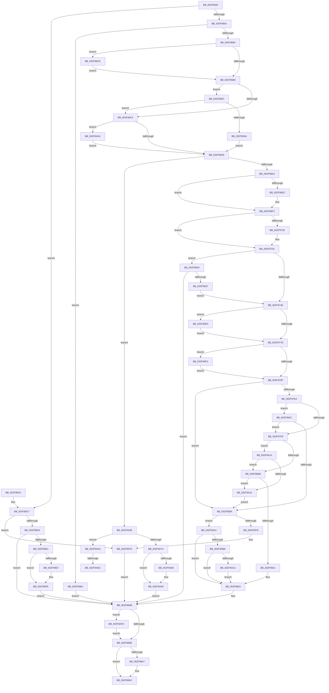

# AlpcpSignalAndWait

- RVA: `0x002F9620`–`0x002F9B01` (길이 `1,249` bytes)
- VA: `0x00000001402F9620`
- 실행 섹션: `.text`
- PDB 이름 있음: `예`; PDB Function 태그: `예`
- unwind 정보 RVA: `0x0007289C`
- 디코드: `289`개 명령, `1,249/1,249` bytes 표시
- 미해석 바이트: `0` (있으면 어셈블리에 `.byte`로 보존)

> 이 문서는 커널 이미지의 기계어와 PDB 기호를 분석해 생성했습니다. 4번과 5번은 함수 원형과 자료형을 바이너리 사용 방식에서 추정한 C 해석이며 원본 소스 복구 결과는 아닙니다.

## 1. Dependencies

- 직접 호출 지점: **27**; 고유 호출 대상: **23**
- 직접 호출자로 확인된 함수: **2**
- RIP 상대 이미지 참조: **5**

### Outgoing calls
- `0x002F9703` → [KeReleaseInStackQueuedSpinLock](../34/KeReleaseInStackQueuedSpinLock_function_00342CE0.md) (function, `0x00342CE0`)
- `0x002F971E` → [ExfReleasePushLockShared](../26/ExfReleasePushLockShared_function_00263440.md) (function, `0x00263440`)
- `0x002F972A` → [KeAbPostRelease](../2E/KeAbPostRelease_function_002E1600.md) (function, `0x002E1600`)
- `0x002F97D8` → [KiAcquireKobjectLockSafe](../25/KiAcquireKobjectLockSafe_function_00251C90.md) (function, `0x00251C90`)
- `0x002F9814` → [KiWakeQueueWaiter](../34/KiWakeQueueWaiter_function_00344C10.md) (function, `0x00344C10`)
- `0x002F9846` → [KiExitDispatcher](../25/KiExitDispatcher_function_00251CF0.md) (function, `0x00251CF0`)
- `0x002F9854` → [KeLeaveCriticalRegionThread](../25/KeLeaveCriticalRegionThread_function_0025EFF0.md) (function, `0x0025EFF0`)
- `0x002F9879` → [KeWaitForSingleObject](../20/KeWaitForSingleObject_function_0020E6B0.md) (function, `0x0020E6B0`)
- `0x002F98A7` → [ObfDereferenceObject](ObfDereferenceObject_function_002F9350.md) (function, `0x002F9350`)
- `0x002F98F0` → [KeSetEvent](../33/KeSetEvent_function_0033F310.md) (function, `0x0033F310`)
- `0x002F98F9` → [AlpcpReleaseDirectAttribute](../47/AlpcpReleaseDirectAttribute_function_00474804.md) (function, `0x00474804`)
- `0x002F990E` → [IopAllocateMiniCompletionPacket](../../page/9D/IopAllocateMiniCompletionPacket_function_009DA2E0.md) (function, `0x009DA2E0`)
- `0x002F9942` → [KiAcquireQueuedSpinLockInstrumented](../27/KiAcquireQueuedSpinLockInstrumented_function_00275850.md) (function, `0x00275850`)
- `0x002F99A8` → [KeReleaseSemaphoreEx](../34/KeReleaseSemaphoreEx_function_003468C0.md) (function, `0x003468C0`)
- `0x002F99C4` → [KeReleaseSemaphore](../39/KeReleaseSemaphore_function_00397080.md) (function, `0x00397080`)
- `0x002F99D4` → [KiRaiseIrqlProcessIrqlFlags](../4F/KiRaiseIrqlProcessIrqlFlags_function_004F56FC.md) (function, `0x004F56FC`)
- `0x002F99E9` → [KiRaiseIrqlProcessIrqlFlags](../4F/KiRaiseIrqlProcessIrqlFlags_function_004F56FC.md) (function, `0x004F56FC`)
- `0x002F99F6` → [KeIsThreadRunning](../39/KeIsThreadRunning_function_00396720.md) (function, `0x00396720`)
- `0x002F9A05` → [EtwTraceEnqueueWork](../39/EtwTraceEnqueueWork_function_0039674C.md) (function, `0x0039674C`)
- `0x002F9A2F` → [KxWaitForLockOwnerShip](../25/KxWaitForLockOwnerShip_function_00257EB0.md) (function, `0x00257EB0`)
- `0x002F9A3E` → [KeReleaseInStackQueuedSpinLock](../34/KeReleaseInStackQueuedSpinLock_function_00342CE0.md) (function, `0x00342CE0`)
- `0x002F9A6B` → [AlpcpQueueIoCompletion](../39/AlpcpQueueIoCompletion_function_00397480.md) (function, `0x00397480`)
- `0x002F9A8B` → [ExfReleasePushLockShared](../26/ExfReleasePushLockShared_function_00263440.md) (function, `0x00263440`)
- `0x002F9A97` → [KeAbPostRelease](../2E/KeAbPostRelease_function_002E1600.md) (function, `0x002E1600`)
- `0x002F9AC7` → [KiWakeOtherQueueWaiters](../39/KiWakeOtherQueueWaiters_function_003964D0.md) (function, `0x003964D0`)
- `0x002F9AD9` → [KeAcquireInStackQueuedSpinLock](../27/KeAcquireInStackQueuedSpinLock_function_002757A0.md) (function, `0x002757A0`)
- `0x002F9AF7` → [AlpcpLogUnwait](../../page/74/AlpcpLogUnwait_function_0074D228.md) (function, `0x0074D228`)

### Direct callers
- [AlpcpReceiveMessagePort](../../page/89/AlpcpReceiveMessagePort_function_00896B40.md) at `0x00897009`
- [AlpcpReceiveMessagePort](../../page/89/AlpcpReceiveMessagePort_function_00896B40.md) at `0x008971A0`
- [AlpcpReceiveSynchronousReply](../../page/92/AlpcpReceiveSynchronousReply_function_009224F0.md) at `0x00922543`

### Static image references
- `0x002F96A6` → RVA `0x00FC6D20` (`ALMOSTRO`; read)
- `0x002F96B3` → RVA `0x00FC6B06` (`ALMOSTRO`; read)
- `0x002F9786` → RVA `0x00FC6B04` (`ALMOSTRO`; read)
- `0x002F9891` → RVA `0x00E66D00` (`.data`; read)
- `0x002F992C` → RVA `0x00F0DE58` (`.data`; read)

## 2. Other-region calls and transfers

- 다른 실행 섹션으로 향하는 call: **2**
  - `0x002F990E` → [IopAllocateMiniCompletionPacket](../../page/9D/IopAllocateMiniCompletionPacket_function_009DA2E0.md) (`.text` → `PAGE`)
  - `0x002F9AF7` → [AlpcpLogUnwait](../../page/74/AlpcpLogUnwait_function_0074D228.md) (`.text` → `PAGE`)
- call이 아닌 외부 분기/꼬리 이동: **2**
  - `0x002F9AE6` → [sub_006DF3C2](../6D/Unknown_function_006DF3C2.md) (`tail-transfer`)
  - `0x002F9AF0` → [sub_006DF3C2 + 0x4](../6D/Unknown_function_006DF3C2.md) (`tail-transfer`)

## 3. Assembly (complete function range)

```asm
002F9620  48 89 5C 24 18                  mov qword ptr [rsp + 0x18], rbx
002F9625  48 89 54 24 10                  mov qword ptr [rsp + 0x10], rdx
002F962A  55                              push rbp
002F962B  56                              push rsi
002F962C  57                              push rdi
002F962D  41 54                           push r12
002F962F  41 55                           push r13
002F9631  41 56                           push r14
002F9633  41 57                           push r15
002F9635  48 83 EC 60                     sub rsp, 0x60
002F9639  8B 79 30                        mov edi, dword ptr [rcx + 0x30]
002F963C  45 0F B6 E1                     movzx r12d, r9b
002F9640  48 8B 69 20                     mov rbp, qword ptr [rcx + 0x20]
002F9644  45 8B E8                        mov r13d, r8d
002F9647  C1 EF 15                        shr edi, 0x15
002F964A  48 8B D9                        mov rbx, rcx
002F964D  40 80 E7 01                     and dil, 1
002F9651  48 85 ED                        test rbp, rbp
002F9654  0F 84 6D 02 00 00               je 0x1402f98c7
002F965A  80 79 3A 00                     cmp byte ptr [rcx + 0x3a], 0
002F965E  0F 84 4E 03 00 00               je 0x1402f99b2
002F9664  0F B6 41 3B                     movzx eax, byte ptr [rcx + 0x3b]
002F9668  0F 57 C0                        xorps xmm0, xmm0
002F966B  4C 8B 7D 30                     mov r15, qword ptr [rbp + 0x30]
002F966F  48 8B 75 20                     mov rsi, qword ptr [rbp + 0x20]
002F9673  0F 11 44 24 48                  movups xmmword ptr [rsp + 0x48], xmm0
002F9678  88 84 24 A0 00 00 00            mov byte ptr [rsp + 0xa0], al
002F967F  33 C0                           xor eax, eax
002F9681  45 33 F6                        xor r14d, r14d
002F9684  48 89 44 24 58                  mov qword ptr [rsp + 0x58], rax
002F9689  4C 89 74 24 48                  mov qword ptr [rsp + 0x48], r14
002F968E  4C 89 7C 24 50                  mov qword ptr [rsp + 0x50], r15
002F9693  90                              nop
002F9694  44 0F 20 C0                     mov rax, cr8
002F9698  48 89 44 24 38                  mov qword ptr [rsp + 0x38], rax
002F969D  B9 02 00 00 00                  mov ecx, 2
002F96A2  44 0F 22 C1                     mov cr8, rcx
002F96A6  44 39 35 73 D6 CC 00            cmp dword ptr [rip + 0xccd673], r14d
002F96AD  0F 85 1B 03 00 00               jne 0x1402f99ce
002F96B3  F6 05 4C D4 CC 00 21            test byte ptr [rip + 0xccd44c], 0x21
002F96BA  88 44 24 58                     mov byte ptr [rsp + 0x58], al
002F96BE  0F 85 68 02 00 00               jne 0x1402f992c
002F96C4  48 8D 54 24 48                  lea rdx, [rsp + 0x48]
002F96C9  49 87 17                        xchg qword ptr [r15], rdx
002F96CC  48 85 D2                        test rdx, rdx
002F96CF  0F 85 55 03 00 00               jne 0x1402f9a2a
002F96D5  41 8B 4F 0C                     mov ecx, dword ptr [r15 + 0xc]
002F96D9  41 3B 4F 08                     cmp ecx, dword ptr [r15 + 8]
002F96DD  0F 83 56 03 00 00               jae 0x1402f9a39
002F96E3  4D 8B 77 20                     mov r14, qword ptr [r15 + 0x20]
002F96E7  4D 85 F6                        test r14, r14
002F96EA  74 07                           je 0x1402f96f3
002F96EC  49 8B 06                        mov rax, qword ptr [r14]
002F96EF  49 89 47 20                     mov qword ptr [r15 + 0x20], rax
002F96F3  4D 8B 76 08                     mov r14, qword ptr [r14 + 8]
002F96F7  8D 41 01                        lea eax, [rcx + 1]
002F96FA  48 8D 4C 24 48                  lea rcx, [rsp + 0x48]
002F96FF  41 89 47 0C                     mov dword ptr [r15 + 0xc], eax
002F9703  E8 D8 95 04 00                  call 0x140342ce0
002F9708  48 8D 8D 60 01 00 00            lea rcx, [rbp + 0x160]
002F970F  B8 11 00 00 00                  mov eax, 0x11
002F9714  45 33 FF                        xor r15d, r15d
002F9717  F0 4C 0F B1 39                  lock cmpxchg qword ptr [rcx], r15
002F971C  74 0C                           je 0x1402f972a
002F971E  E8 1D 9D F6 FF                  call 0x140263440
002F9723  48 8D 8D 60 01 00 00            lea rcx, [rbp + 0x160]
002F972A  E8 D1 7E FE FF                  call 0x1402e1600
002F972F  F6 9C 24 A0 00 00 00            neg byte ptr [rsp + 0xa0]
002F9736  48 8B 6D 28                     mov rbp, qword ptr [rbp + 0x28]
002F973A  48 1B C0                        sbb rax, rax
002F973D  48 89 84 24 A0 00 00 00         mov qword ptr [rsp + 0xa0], rax
002F9745  4D 85 F6                        test r14, r14
002F9748  0F 84 BC 01 00 00               je 0x1402f990a
002F974E  49 89 6E 18                     mov qword ptr [r14 + 0x18], rbp
002F9752  49 89 46 20                     mov qword ptr [r14 + 0x20], rax
002F9756  45 89 7E 28                     mov dword ptr [r14 + 0x28], r15d
002F975A  4D 89 7E 30                     mov qword ptr [r14 + 0x30], r15
002F975E  44 0F 20 C0                     mov rax, cr8
002F9762  48 89 44 24 40                  mov qword ptr [rsp + 0x40], rax
002F9767  B9 02 00 00 00                  mov ecx, 2
002F976C  44 0F 22 C1                     mov cr8, rcx
002F9770  44 39 3D A9 D5 CC 00            cmp dword ptr [rip + 0xccd5a9], r15d
002F9777  0F 85 66 02 00 00               jne 0x1402f99e3
002F977D  65 48 8B 2C 25 20 00 00 00      mov rbp, qword ptr gs:[0x20]
002F9786  8B 05 78 D3 CC 00               mov eax, dword ptr [rip + 0xccd378]
002F978C  4C 8B 4D 08                     mov r9, qword ptr [rbp + 8]
002F9790  4C 89 4C 24 38                  mov qword ptr [rsp + 0x38], r9
002F9795  0F BA E0 18                     bt eax, 0x18
002F9799  0F 82 54 02 00 00               jb 0x1402f99f3
002F979F  0F B6 46 01                     movzx eax, byte ptr [rsi + 1]
002F97A3  48 8B CE                        mov rcx, rsi
002F97A6  F6 D0                           not al
002F97A8  D1 E8                           shr eax, 1
002F97AA  83 E0 01                        and eax, 1
002F97AD  89 44 24 30                     mov dword ptr [rsp + 0x30], eax
002F97B1  49 8B 81 50 06 00 00            mov rax, qword ptr [r9 + 0x650]
002F97B8  48 85 C0                        test rax, rax
002F97BB  49 0F 44 C1                     cmove rax, r9
002F97BF  48 8B 80 20 02 00 00            mov rax, qword ptr [rax + 0x220]
002F97C6  8B 80 88 00 00 00               mov eax, dword ptr [rax + 0x88]
002F97CC  C1 E8 0D                        shr eax, 0xd
002F97CF  24 01                           and al, 1
002F97D1  89 84 24 A0 00 00 00            mov dword ptr [rsp + 0xa0], eax
002F97D8  E8 B3 84 F5 FF                  call 0x140251c90
002F97DD  48 8D 4E 08                     lea rcx, [rsi + 8]
002F97E1  48 39 09                        cmp qword ptr [rcx], rcx
002F97E4  0F 84 70 01 00 00               je 0x1402f995a
002F97EA  8B 46 28                        mov eax, dword ptr [rsi + 0x28]
002F97ED  3B 46 2C                        cmp eax, dword ptr [rsi + 0x2c]
002F97F0  0F 83 56 01 00 00               jae 0x1402f994c
002F97F6  48 8B 4C 24 38                  mov rcx, qword ptr [rsp + 0x38]
002F97FB  48 8B 81 E8 00 00 00            mov rax, qword ptr [rcx + 0xe8]
002F9802  48 3B C6                        cmp rax, rsi
002F9805  0F 84 09 02 00 00               je 0x1402f9a14
002F980B  4D 8B C6                        mov r8, r14
002F980E  48 8B D6                        mov rdx, rsi
002F9811  48 8B CD                        mov rcx, rbp
002F9814  E8 F7 B3 04 00                  call 0x140344c10
002F9819  84 C0                           test al, al
002F981B  0F 84 00 02 00 00               je 0x1402f9a21
002F9821  4D 89 3E                        mov qword ptr [r14], r15
002F9824  B8 7F FF FF FF                  mov eax, 0xffffff7f
002F9829  F0 21 06                        lock and dword ptr [rsi], eax
002F982C  48 8B 44 24 40                  mov rax, qword ptr [rsp + 0x40]
002F9831  BA 03 00 00 00                  mov edx, 3
002F9836  44 8B 4C 24 30                  mov r9d, dword ptr [rsp + 0x30]
002F983B  48 8B CD                        mov rcx, rbp
002F983E  88 44 24 20                     mov byte ptr [rsp + 0x20], al
002F9842  44 8D 42 FE                     lea r8d, [rdx - 2]
002F9846  E8 A5 84 F5 FF                  call 0x140251cf0
002F984B  65 48 8B 0C 25 88 01 00 00      mov rcx, qword ptr gs:[0x188]
002F9854  E8 97 57 F6 FF                  call 0x14025eff0
002F9859  48 8B 84 24 C0 00 00 00         mov rax, qword ptr [rsp + 0xc0]
002F9861  44 0F B6 CF                     movzx r9d, dil
002F9865  48 8B 8C 24 A8 00 00 00         mov rcx, qword ptr [rsp + 0xa8]
002F986D  45 0F B6 C4                     movzx r8d, r12b
002F9871  41 8B D5                        mov edx, r13d
002F9874  48 89 44 24 20                  mov qword ptr [rsp + 0x20], rax
002F9879  E8 32 4E F1 FF                  call 0x14020e6b0
002F987E  65 48 8B 0C 25 88 01 00 00      mov rcx, qword ptr gs:[0x188]
002F9887  8B F8                           mov edi, eax
002F9889  66 FF 89 E4 01 00 00            dec word ptr [rcx + 0x1e4]
002F9890  90                              nop
002F9891  80 3D 68 D4 B6 00 00            cmp byte ptr [rip + 0xb6d468], 0
002F9898  0F 85 57 02 00 00               jne 0x1402f9af5
002F989E  48 8B 4B 20                     mov rcx, qword ptr [rbx + 0x20]
002F98A2  48 85 C9                        test rcx, rcx
002F98A5  74 05                           je 0x1402f98ac
002F98A7  E8 A4 FA FF FF                  call 0x1402f9350
002F98AC  48 8B 9C 24 B0 00 00 00         mov rbx, qword ptr [rsp + 0xb0]
002F98B4  8B C7                           mov eax, edi
002F98B6  48 83 C4 60                     add rsp, 0x60
002F98BA  41 5F                           pop r15
002F98BC  41 5E                           pop r14
002F98BE  41 5D                           pop r13
002F98C0  41 5C                           pop r12
002F98C2  5F                              pop rdi
002F98C3  5E                              pop rsi
002F98C4  5D                              pop rbp
002F98C5  C3                              ret
002F98C6  CC                              int3
002F98C7  48 8B 49 18                     mov rcx, qword ptr [rcx + 0x18]
002F98CB  48 85 C9                        test rcx, rcx
002F98CE  0F 85 A9 00 00 00               jne 0x1402f997d
002F98D4  48 8B 4B 28                     mov rcx, qword ptr [rbx + 0x28]
002F98D8  F6 C1 01                        test cl, 1
002F98DB  0F 84 6A FF FF FF               je 0x1402f984b
002F98E1  48 83 F9 04                     cmp rcx, 4
002F98E5  72 17                           jb 0x1402f98fe
002F98E7  48 83 E1 FC                     and rcx, 0xfffffffffffffffc
002F98EB  41 B0 01                        mov r8b, 1
002F98EE  33 D2                           xor edx, edx
002F98F0  E8 1B 5A 04 00                  call 0x14033f310
002F98F5  48 8B 4B 28                     mov rcx, qword ptr [rbx + 0x28]
002F98F9  E8 06 AF 17 00                  call 0x140474804
002F98FE  45 33 F6                        xor r14d, r14d
002F9901  4C 89 73 28                     mov qword ptr [rbx + 0x28], r14
002F9905  E9 41 FF FF FF                  jmp 0x1402f984b
002F990A  33 D2                           xor edx, edx
002F990C  B1 01                           mov cl, 1
002F990E  E8 CD 09 6E 00                  call 0x1409da2e0
002F9913  4C 8B F0                        mov r14, rax
002F9916  48 85 C0                        test rax, rax
002F9919  0F 84 2C FF FF FF               je 0x1402f984b
002F991F  48 8B 84 24 A0 00 00 00         mov rax, qword ptr [rsp + 0xa0]
002F9927  E9 22 FE FF FF                  jmp 0x1402f974e
002F992C  8B 05 26 45 C1 00               mov eax, dword ptr [rip + 0xc14526]
002F9932  85 C0                           test eax, eax
002F9934  0F 85 8A FD FF FF               jne 0x1402f96c4
002F993A  49 8B D7                        mov rdx, r15
002F993D  48 8D 4C 24 48                  lea rcx, [rsp + 0x48]
002F9942  E8 09 BF F7 FF                  call 0x140275850
002F9947  E9 89 FD FF FF                  jmp 0x1402f96d5
002F994C  44 38 BC 24 A0 00 00 00         cmp byte ptr [rsp + 0xa0], r15b
002F9954  0F 85 9C FE FF FF               jne 0x1402f97f6
002F995A  44 8B 46 04                     mov r8d, dword ptr [rsi + 4]
002F995E  41 8D 40 01                     lea eax, [r8 + 1]
002F9962  89 46 04                        mov dword ptr [rsi + 4], eax
002F9965  48 8D 46 18                     lea rax, [rsi + 0x18]
002F9969  48 8B 50 08                     mov rdx, qword ptr [rax + 8]
002F996D  48 39 02                        cmp qword ptr [rdx], rax
002F9970  0F 84 2B 01 00 00               je 0x1402f9aa1
002F9976  B9 03 00 00 00                  mov ecx, 3
002F997B  CD 29                           int 0x29
002F997D  80 BC 24 C8 00 00 00 00         cmp byte ptr [rsp + 0xc8], 0
002F9985  BA 01 00 00 00                  mov edx, 1
002F998A  B8 05 00 00 00                  mov eax, 5
002F998F  44 8B C2                        mov r8d, edx
002F9992  0F 45 C2                        cmovne eax, edx
002F9995  45 33 F6                        xor r14d, r14d
002F9998  4C 89 74 24 28                  mov qword ptr [rsp + 0x28], r14
002F999D  48 81 C1 18 05 00 00            add rcx, 0x518
002F99A4  89 44 24 20                     mov dword ptr [rsp + 0x20], eax
002F99A8  E8 13 CF 04 00                  call 0x1403468c0
002F99AD  E9 99 FE FF FF                  jmp 0x1402f984b
002F99B2  48 8B 8D F8 00 00 00            mov rcx, qword ptr [rbp + 0xf8]
002F99B9  BA 01 00 00 00                  mov edx, 1
002F99BE  44 8B C2                        mov r8d, edx
002F99C1  41 B1 01                        mov r9b, 1
002F99C4  E8 B7 D6 09 00                  call 0x140397080
002F99C9  E9 7D FE FF FF                  jmp 0x1402f984b
002F99CE  0F B6 D1                        movzx edx, cl
002F99D1  0F B6 C8                        movzx ecx, al
002F99D4  E8 23 BD 1F 00                  call 0x1404f56fc
002F99D9  48 8B 44 24 38                  mov rax, qword ptr [rsp + 0x38]
002F99DE  E9 D0 FC FF FF                  jmp 0x1402f96b3
002F99E3  0F B6 D1                        movzx edx, cl
002F99E6  0F B6 C8                        movzx ecx, al
002F99E9  E8 0E BD 1F 00                  call 0x1404f56fc
002F99EE  E9 8A FD FF FF                  jmp 0x1402f977d
002F99F3  49 8B C9                        mov rcx, r9
002F99F6  E8 25 CD 09 00                  call 0x140396720
002F99FB  44 0F B6 C0                     movzx r8d, al
002F99FF  49 8B C9                        mov rcx, r9
002F9A02  49 8B D6                        mov rdx, r14
002F9A05  E8 42 CD 09 00                  call 0x14039674c
002F9A0A  4C 8B 4C 24 38                  mov r9, qword ptr [rsp + 0x38]
002F9A0F  E9 8B FD FF FF                  jmp 0x1402f979f
002F9A14  80 B9 83 02 00 00 0F            cmp byte ptr [rcx + 0x283], 0xf
002F9A1B  0F 85 EA FD FF FF               jne 0x1402f980b
002F9A21  48 8D 4E 08                     lea rcx, [rsi + 8]
002F9A25  E9 30 FF FF FF                  jmp 0x1402f995a
002F9A2A  48 8D 4C 24 48                  lea rcx, [rsp + 0x48]
002F9A2F  E8 7C E4 F5 FF                  call 0x140257eb0
002F9A34  E9 9C FC FF FF                  jmp 0x1402f96d5
002F9A39  48 8D 4C 24 48                  lea rcx, [rsp + 0x48]
002F9A3E  E8 9D 92 04 00                  call 0x140342ce0
002F9A43  0F B6 84 24 A0 00 00 00         movzx eax, byte ptr [rsp + 0xa0]
002F9A4B  48 8B CE                        mov rcx, rsi
002F9A4E  48 8B 55 28                     mov rdx, qword ptr [rbp + 0x28]
002F9A52  F6 D8                           neg al
002F9A54  0F B6 84 24 C8 00 00 00         movzx eax, byte ptr [rsp + 0xc8]
002F9A5C  4D 1B C0                        sbb r8, r8
002F9A5F  89 44 24 28                     mov dword ptr [rsp + 0x28], eax
002F9A63  45 33 C9                        xor r9d, r9d
002F9A66  44 88 74 24 20                  mov byte ptr [rsp + 0x20], r14b
002F9A6B  E8 10 DA 09 00                  call 0x140397480
002F9A70  85 C0                           test eax, eax
002F9A72  74 5D                           je 0x1402f9ad1
002F9A74  B8 11 00 00 00                  mov eax, 0x11
002F9A79  F0 4C 0F B1 B5 60 01 00 00      lock cmpxchg qword ptr [rbp + 0x160], r14
002F9A82  74 0C                           je 0x1402f9a90
002F9A84  48 8D 8D 60 01 00 00            lea rcx, [rbp + 0x160]
002F9A8B  E8 B0 99 F6 FF                  call 0x140263440
002F9A90  48 8D 8D 60 01 00 00            lea rcx, [rbp + 0x160]
002F9A97  E8 64 7B FE FF                  call 0x1402e1600
002F9A9C  E9 AA FD FF FF                  jmp 0x1402f984b
002F9AA1  49 89 06                        mov qword ptr [r14], rax
002F9AA4  49 89 56 08                     mov qword ptr [r14 + 8], rdx
002F9AA8  4C 89 32                        mov qword ptr [rdx], r14
002F9AAB  4C 89 70 08                     mov qword ptr [rax + 8], r14
002F9AAF  45 85 C0                        test r8d, r8d
002F9AB2  0F 85 6C FD FF FF               jne 0x1402f9824
002F9AB8  48 39 09                        cmp qword ptr [rcx], rcx
002F9ABB  0F 84 63 FD FF FF               je 0x1402f9824
002F9AC1  48 8B D6                        mov rdx, rsi
002F9AC4  48 8B CD                        mov rcx, rbp
002F9AC7  E8 04 CA 09 00                  call 0x1403964d0
002F9ACC  E9 53 FD FF FF                  jmp 0x1402f9824
002F9AD1  48 8D 54 24 48                  lea rdx, [rsp + 0x48]
002F9AD6  49 8B CF                        mov rcx, r15
002F9AD9  E8 C2 BC F7 FF                  call 0x1402757a0
002F9ADE  44 38 B4 24 A0 00 00 00         cmp byte ptr [rsp + 0xa0], r14b
002F9AE6  0F 84 D6 58 3E 00               je 0x1406df3c2
002F9AEC  41 FF 47 14                     inc dword ptr [r15 + 0x14]
002F9AF0  E9 D1 58 3E 00                  jmp 0x1406df3c6
002F9AF5  8B CF                           mov ecx, edi
002F9AF7  E8 2C 37 45 00                  call 0x14074d228
002F9AFC  E9 9D FD FF FF                  jmp 0x1402f989e
```

## 4. C-style interpretation (structured pseudocode)

```c
__int64 __fastcall AlpcpSignalAndWait(__int64 a1, __int64 a2, int a3, unsigned __int8 a4, __int64 a5, unsigned __int8 a6)
{
    __int64 result;
    __int64 v_r14;
    __int64 v_r15;
    __int64 v_rdi;
    __int64 v_rsp;
    unsigned __int64 v_stack_m40;
    unsigned __int64 v_stack_m48;
    unsigned __int64 v_stack_m50;
    unsigned __int64 v_stack_m58;
    unsigned __int64 v_stack_m60;
    unsigned int v_stack_m68;
    unsigned __int8 v_stack_m78;
    unsigned __int64 v_stack_p10;
    unsigned __int64 v_stack_p18;
    unsigned int v_stack_p20;
    unsigned __int64 v_stack_p28;
    unsigned __int64 v_stack_p38;
    unsigned __int64 v_stack_p48;
    unsigned __int8 v_stack_p8;
    unsigned __int64 v_stack_pA0;

    v_stack_p18 = v_rbx;
    v_stack_p10 = a2;
    v_rsp = (v_rsp) - (96);
    v_rdi = (unsigned int)(((unsigned int)(*(unsigned int *)(a1 + 48))) >> (21));
    v_rdi = (unsigned __int8)((v_rdi) & (1));
    if (*(unsigned __int64 *)(a1 + 32) == 0) goto loc_002F98C7;
    if ((*(unsigned __int8 *)(a1 + 58)) == 0) goto loc_002F99B2;
    v_stack_m50 = v_xmm0;
    v_stack_p8 = (unsigned __int8)(*(unsigned __int8 *)(a1 + 59));
    result = 0;
    v_r14 = 0;
    v_stack_m40 = 0;
    v_stack_m50 = 0;
    v_stack_m48 = *(unsigned __int64 *)(*(unsigned __int64 *)(a1 + 32) + 48);
    v_stack_m60 = v_cr8;
    if ((*(unsigned int *)(v_rip + 13424243)) != 0) goto loc_002F99CE;
loc_002F96B3:
    v_stack_m40 = (unsigned __int8)(v_cr8);
    if (((*(unsigned __int8 *)(v_rip + 13423692)) & (33)) != 0) goto loc_002F992C;
loc_002F96C4:
    if (v_stack_m50 != 0) goto loc_002F9A2A;
loc_002F96D5:
    if (((unsigned int)((unsigned int)(*(unsigned int *)(*(unsigned __int64 *)(*(unsigned __int64 *)(a1 + 32) + 48) + 12)))) >= (*(unsigned int *)(*(unsigned __int64 *)(*(unsigned __int64 *)(a1 + 32) + 48) + 8))) goto loc_002F9A39;
    result = v_cr8;
    if (*(unsigned __int64 *)(*(unsigned __int64 *)(*(unsigned __int64 *)(a1 + 32) + 48) + 32) != 0) {
        result = *(unsigned __int64 *)(*(unsigned __int64 *)(*(unsigned __int64 *)(*(unsigned __int64 *)(a1 + 32) + 48) + 32));
        *(unsigned __int64 *)(*(unsigned __int64 *)(*(unsigned __int64 *)(a1 + 32) + 48) + 32) = result;
    }
    *(unsigned int *)(*(unsigned __int64 *)(*(unsigned __int64 *)(a1 + 32) + 48) + 12) = (unsigned int)((unsigned int)(*(unsigned int *)(*(unsigned __int64 *)(*(unsigned __int64 *)(a1 + 32) + 48) + 12)) + 1);
    result = KeReleaseInStackQueuedSpinLock(v_stack_m50, v_stack_m50, a3, a4);
    v_r15 = 0;
    result = 17;
    if (!(condition_is_equal)) {
        result = ExfReleasePushLockShared(*(unsigned __int64 *)(a1 + 32) + 352, v_stack_m50, a3, a4);
        a1 = *(unsigned __int64 *)(a1 + 32) + 352;
    }
    result = KeAbPostRelease(a1, v_stack_m50, a3, a4);
    v_stack_p8 = result;
    if (*(unsigned __int64 *)(*(unsigned __int64 *)(*(unsigned __int64 *)(*(unsigned __int64 *)(a1 + 32) + 48) + 32) + 8) == 0) goto loc_002F990A;
loc_002F974E:
    *(unsigned __int64 *)(*(unsigned __int64 *)(*(unsigned __int64 *)(*(unsigned __int64 *)(*(unsigned __int64 *)(a1 + 32) + 48) + 32) + 8) + 24) = *(unsigned __int64 *)(*(unsigned __int64 *)(a1 + 32) + 40);
    *(unsigned __int64 *)(*(unsigned __int64 *)(*(unsigned __int64 *)(*(unsigned __int64 *)(*(unsigned __int64 *)(a1 + 32) + 48) + 32) + 8) + 32) = result;
    *(unsigned int *)(*(unsigned __int64 *)(*(unsigned __int64 *)(*(unsigned __int64 *)(*(unsigned __int64 *)(a1 + 32) + 48) + 32) + 8) + 40) = 0;
    *(unsigned __int64 *)(*(unsigned __int64 *)(*(unsigned __int64 *)(*(unsigned __int64 *)(*(unsigned __int64 *)(a1 + 32) + 48) + 32) + 8) + 48) = 0;
    v_stack_m58 = 2;
    if ((*(unsigned int *)(v_rip + 13424041)) != 0) goto loc_002F99E3;
loc_002F977D:
    v_stack_m60 = *(unsigned __int64 *)(*(unsigned __int64 *)(gs_base + (0 + 32)) + 8);
    if ((*(unsigned int *)(v_rip + 13424041)) < 0) goto loc_002F99F3;
loc_002F979F:
    result = (unsigned __int8)(~(*(unsigned __int8 *)(*(unsigned __int64 *)(*(unsigned __int64 *)(a1 + 32) + 32) + 1)));
    result = (unsigned int)((result) >> (1));
    result = (unsigned int)((result) & (1));
    v_stack_m68 = (unsigned int)(result);
    result = *(unsigned __int64 *)(*(unsigned __int64 *)(*(unsigned __int64 *)(gs_base + (0 + 32)) + 8) + 1616);
    if (*(unsigned __int64 *)(*(unsigned __int64 *)(*(unsigned __int64 *)(gs_base + (0 + 32)) + 8) + 1616) == 0) { result = *(unsigned __int64 *)(*(unsigned __int64 *)(gs_base + (0 + 32)) + 8); }
    result = (unsigned int)(((unsigned int)(*(unsigned int *)(*(unsigned __int64 *)(result + 544) + 136))) >> (13));
    result = (unsigned __int8)((result) & (1));
    v_stack_p8 = (unsigned int)(result);
    result = KiAcquireKobjectLockSafe(*(unsigned __int64 *)(*(unsigned __int64 *)(a1 + 32) + 32), v_stack_m50, a3, *(unsigned __int64 *)(*(unsigned __int64 *)(gs_base + (0 + 32)) + 8));
    if ((*(unsigned __int64 *)(*(unsigned __int64 *)(*(unsigned __int64 *)(a1 + 32) + 32) + 8)) == (*(unsigned __int64 *)(*(unsigned __int64 *)(a1 + 32) + 32) + 8)) goto loc_002F995A;
    if (((unsigned int)((unsigned int)(*(unsigned int *)(*(unsigned __int64 *)(*(unsigned __int64 *)(a1 + 32) + 32) + 40)))) >= (*(unsigned int *)(*(unsigned __int64 *)(*(unsigned __int64 *)(a1 + 32) + 32) + 44))) goto loc_002F994C;
loc_002F97F6:
    if ((*(unsigned __int64 *)(v_stack_m60 + 232)) == (*(unsigned __int64 *)(*(unsigned __int64 *)(a1 + 32) + 32))) goto loc_002F9A14;
loc_002F980B:
    result = KiWakeQueueWaiter(*(unsigned __int64 *)(gs_base + (0 + 32)), *(unsigned __int64 *)(*(unsigned __int64 *)(a1 + 32) + 32), *(unsigned __int64 *)(*(unsigned __int64 *)(*(unsigned __int64 *)(*(unsigned __int64 *)(a1 + 32) + 48) + 32) + 8), *(unsigned __int64 *)(*(unsigned __int64 *)(gs_base + (0 + 32)) + 8));
    if ((unsigned __int8)(result) == 0) goto loc_002F9A21;
    *(unsigned __int64 *)(*(unsigned __int64 *)(*(unsigned __int64 *)(*(unsigned __int64 *)(*(unsigned __int64 *)(a1 + 32) + 48) + 32) + 8)) = 0;
loc_002F9824:
    v_stack_m78 = (unsigned __int8)(v_stack_m58);
    result = KiExitDispatcher(*(unsigned __int64 *)(gs_base + (0 + 32)), 3, 3 - 2, (unsigned int)(v_stack_m68));
loc_002F984B:
    result = KeLeaveCriticalRegionThread(*(unsigned __int64 *)(gs_base + (0 + 392)), 3, 3 - 2, (unsigned int)(v_stack_m68));
    v_stack_m78 = a5;
    result = KeWaitForSingleObject(v_stack_p10, (unsigned int)((unsigned int)((unsigned int)(a3))), a4, (unsigned __int8)(v_rdi));
    if ((*(unsigned __int8 *)(v_rip + 11981928)) != 0) goto loc_002F9AF5;
loc_002F989E:
    if (*(unsigned __int64 *)(a1 + 32) != 0) {
        result = ObfDereferenceObject(*(unsigned __int64 *)(a1 + 32), (unsigned int)((unsigned int)((unsigned int)(a3))), a4, (unsigned __int8)(v_rdi));
    }
    v_rsp = (v_rsp) + (96);
    return (unsigned int)((unsigned int)((unsigned int)((unsigned int)(result))));
loc_002F98C7:
    if (*(unsigned __int64 *)(*(unsigned __int64 *)(a1 + 32) + 24) != 0) goto loc_002F997D;
    if ((((unsigned __int8)(*(unsigned __int64 *)(v_stack_p18 + 40))) & (1)) == 0) goto loc_002F984B;
    result = (unsigned int)((unsigned int)((unsigned int)((unsigned int)(result))));
    if ((*(unsigned __int64 *)(v_stack_p18 + 40)) >= 4) {
        a1 = (*(unsigned __int64 *)(v_stack_p18 + 40)) & (-4);
        a3 = 1;
        a2 = 0;
        result = KeSetEvent(a1, a2, a3, (unsigned __int8)(v_rdi));
        a1 = *(unsigned __int64 *)(v_stack_p18 + 40);
        result = AlpcpReleaseDirectAttribute(a1, a2, a3, (unsigned __int8)(v_rdi));
    }
    v_r14 = 0;
    *(unsigned __int64 *)(v_stack_p18 + 40) = 0;
    goto loc_002F984B;
loc_002F990A:
    a2 = 0;
    result = IopAllocateMiniCompletionPacket(1, a2, a3, (unsigned __int8)(v_rdi));
    if (result == 0) goto loc_002F984B;
    goto loc_002F974E;
loc_002F992C:
    if ((unsigned int)((unsigned int)(*(unsigned int *)(v_rip + 12666150))) != 0) goto loc_002F96C4;
    result = KiAcquireQueuedSpinLockInstrumented(v_stack_p48, 0, a3, (unsigned __int8)(v_rdi));
    goto loc_002F96D5;
loc_002F994C:
    if (v_stack_pA0 != 0) goto loc_002F97F6;
loc_002F995A:
    *(unsigned int *)(*(unsigned __int64 *)(*(unsigned __int64 *)(a1 + 32) + 32) + 4) = (unsigned int)((unsigned int)(*(unsigned int *)(*(unsigned __int64 *)(*(unsigned __int64 *)(a1 + 32) + 32) + 4)) + 1);
    if ((*(unsigned __int64 *)(*(unsigned __int64 *)(*(unsigned __int64 *)(*(unsigned __int64 *)(a1 + 32) + 32) + 24 + 8))) == (*(unsigned __int64 *)(*(unsigned __int64 *)(a1 + 32) + 32) + 24)) goto loc_002F9AA1;
loc_002F997D:
    result = 5;
    if (a6 != 0) { result = 1; }
    v_r14 = 0;
    v_stack_p28 = 0;
    a1 = (3) + (0x518ULL);
    v_stack_p20 = (unsigned int)(result);
    result = KeReleaseSemaphoreEx(a1, 1, 1, (unsigned __int8)(v_rdi));
    goto loc_002F984B;
loc_002F99B2:
    result = KeReleaseSemaphore(*(unsigned __int64 *)(*(unsigned __int64 *)(gs_base + (0 + 32)) + 248), 1, 1, 1);
    goto loc_002F984B;
loc_002F99CE:
    result = KiRaiseIrqlProcessIrqlFlags((unsigned __int8)(result), (unsigned __int8)(*(unsigned __int64 *)(*(unsigned __int64 *)(gs_base + (0 + 32)) + 248)), 1, 1);
    goto loc_002F96B3;
loc_002F99E3:
    result = KiRaiseIrqlProcessIrqlFlags((unsigned __int8)(v_stack_p38), (unsigned __int8)((unsigned __int8)(result)), 1, 1);
    goto loc_002F977D;
loc_002F99F3:
    result = KeIsThreadRunning(1, (unsigned __int8)((unsigned __int8)(result)), 1, 1);
    result = EtwTraceEnqueueWork(1, 0, (unsigned __int8)(result), 1);
    goto loc_002F979F;
loc_002F9A14:
    if ((*(unsigned __int8 *)(1 + 643)) != 15) goto loc_002F980B;
loc_002F9A21:
    goto loc_002F995A;
loc_002F9A2A:
    result = KxWaitForLockOwnerShip(v_stack_p48, 0, (unsigned __int8)(result), v_stack_p38);
    goto loc_002F96D5;
loc_002F9A39:
    result = KeReleaseInStackQueuedSpinLock(v_stack_p48, 0, (unsigned __int8)(result), v_stack_p38);
    result = (unsigned __int8)(-(v_stack_pA0));
    v_stack_p28 = a6;
    a4 = 0;
    v_stack_p20 = 0;
    result = AlpcpQueueIoCompletion(*(unsigned __int64 *)(*(unsigned __int64 *)(a1 + 32) + 32), *(unsigned __int64 *)(*(unsigned __int64 *)(gs_base + (0 + 32)) + 40), (unsigned __int8)(result), a4);
    if ((unsigned int)(result) == 0) goto loc_002F9AD1;
    result = 17;
    if ((unsigned int)(result) != 0) {
        a1 = *(unsigned __int64 *)(gs_base + (0 + 32)) + 352;
        result = ExfReleasePushLockShared(a1, *(unsigned __int64 *)(*(unsigned __int64 *)(gs_base + (0 + 32)) + 40), (unsigned __int8)(result), a4);
    }
    result = KeAbPostRelease(*(unsigned __int64 *)(gs_base + (0 + 32)) + 352, *(unsigned __int64 *)(*(unsigned __int64 *)(gs_base + (0 + 32)) + 40), (unsigned __int8)(result), a4);
    goto loc_002F984B;
loc_002F9AA1:
    *(unsigned __int64 *)(v_r14) = result;
    *(unsigned __int64 *)(v_r14 + 8) = *(unsigned __int64 *)(*(unsigned __int64 *)(gs_base + (0 + 32)) + 40);
    *(unsigned __int64 *)(*(unsigned __int64 *)(*(unsigned __int64 *)(gs_base + (0 + 32)) + 40)) = 0;
    *(unsigned __int64 *)(result + 8) = 0;
    if ((unsigned int)((unsigned __int8)(result)) != 0) goto loc_002F9824;
    if ((*(unsigned __int64 *)(*(unsigned __int64 *)(gs_base + (0 + 32)) + 352)) == (*(unsigned __int64 *)(gs_base + (0 + 32)) + 352)) goto loc_002F9824;
    result = KiWakeOtherQueueWaiters(*(unsigned __int64 *)(gs_base + (0 + 32)), *(unsigned __int64 *)(*(unsigned __int64 *)(a1 + 32) + 32), (unsigned __int8)(result), a4);
    goto loc_002F9824;
loc_002F9AD1:
    result = KeAcquireInStackQueuedSpinLock(0, v_stack_p48, (unsigned __int8)(result), a4);
loc_002F9AF5:
    result = AlpcpLogUnwait((unsigned int)((unsigned int)((unsigned int)((unsigned int)(result)))), v_stack_p48, (unsigned __int8)(result), a4);
    goto loc_002F989E;
}
```

## 5. (Beta) C Style

```c
int64_t AlpcpSignalAndWait(void *Arg1, int64_t Arg2, int32_t Arg3, uint8_t Arg4, int64_t Arg5, uint8_t Arg6)
{
    uint8_t *arg1 = (uint8_t *)Arg1;

    int64_t result;
    int64_t local_r14;
    int64_t local_r15;
    int64_t local_rdi;
    int64_t local_rsp;
    uint64_t v_stack_m40;
    uint64_t v_stack_m48;
    uint64_t v_stack_m50;
    uint64_t v_stack_m58;
    uint64_t v_stack_m60;
    uint32_t v_stack_m68;
    uint8_t v_stack_m78;
    uint64_t v_stack_p10;
    uint64_t v_stack_p18;
    uint32_t v_stack_p20;
    uint64_t v_stack_p28;
    uint64_t v_stack_p38;
    uint64_t v_stack_p48;
    uint8_t v_stack_p8;
    uint64_t v_stack_pA0;

    v_stack_p18 = local_rbx;
    v_stack_p10 = Arg2;
    local_rsp = (local_rsp) - (96);
    local_rdi = (uint32_t)(((uint32_t)(*(uint32_t *)(arg1 + 0x30))) >> (21));
    local_rdi = (uint8_t)((local_rdi) & (1));
    if (*(uint64_t *)(arg1 + 0x20) == 0) goto loc_002F98C7;
    if ((*(uint8_t *)(arg1 + 0x3A)) == 0) goto loc_002F99B2;
    v_stack_m50 = v_xmm0;
    v_stack_p8 = (uint8_t)(*(uint8_t *)(arg1 + 0x3B));
    result = 0;
    local_r14 = 0;
    v_stack_m40 = 0;
    v_stack_m50 = 0;
    v_stack_m48 = *(uint64_t *)(*(uint64_t *)(arg1 + 0x20) + 0x30);
    v_stack_m60 = v_cr8;
    if ((*(uint32_t *)(v_rip + 0xCCD673)) != 0) goto loc_002F99CE;
loc_002F96B3:
    v_stack_m40 = (uint8_t)(v_cr8);
    if (((*(uint8_t *)(v_rip + 0xCCD44C)) & (33)) != 0) goto loc_002F992C;
loc_002F96C4:
    if (v_stack_m50 != 0) goto loc_002F9A2A;
loc_002F96D5:
    if (((uint32_t)((uint32_t)(*(uint32_t *)(*(uint64_t *)(*(uint64_t *)(arg1 + 0x20) + 0x30) + 0xC)))) >= (*(uint32_t *)(*(uint64_t *)(*(uint64_t *)(arg1 + 0x20) + 0x30) + 0x8))) goto loc_002F9A39;
    result = v_cr8;
    if (*(uint64_t *)(*(uint64_t *)(*(uint64_t *)(arg1 + 0x20) + 0x30) + 0x20) != 0) {
        result = *(uint64_t *)(*(uint64_t *)(*(uint64_t *)(*(uint64_t *)(arg1 + 0x20) + 0x30) + 0x20));
        *(uint64_t *)(*(uint64_t *)(*(uint64_t *)(arg1 + 0x20) + 0x30) + 0x20) = result;
    }
    *(uint32_t *)(*(uint64_t *)(*(uint64_t *)(arg1 + 0x20) + 0x30) + 0xC) = (uint32_t)((uint32_t)(*(uint32_t *)(*(uint64_t *)(*(uint64_t *)(arg1 + 0x20) + 0x30) + 0xC)) + 1);
    result = KeReleaseInStackQueuedSpinLock(v_stack_m50, v_stack_m50, Arg3, Arg4);
    local_r15 = 0;
    result = 17;
    if (!(condition_is_equal)) {
        result = ExfReleasePushLockShared(*(uint64_t *)(arg1 + 0x20) + 352, v_stack_m50, Arg3, Arg4);
        Arg1 = *(uint64_t *)(arg1 + 0x20) + 352;
    }
    result = KeAbPostRelease(Arg1, v_stack_m50, Arg3, Arg4);
    v_stack_p8 = result;
    if (*(uint64_t *)(*(uint64_t *)(*(uint64_t *)(*(uint64_t *)(arg1 + 0x20) + 0x30) + 0x20) + 0x8) == 0) goto loc_002F990A;
loc_002F974E:
    *(uint64_t *)(*(uint64_t *)(*(uint64_t *)(*(uint64_t *)(*(uint64_t *)(arg1 + 0x20) + 0x30) + 0x20) + 0x8) + 0x18) = *(uint64_t *)(*(uint64_t *)(arg1 + 0x20) + 0x28);
    *(uint64_t *)(*(uint64_t *)(*(uint64_t *)(*(uint64_t *)(*(uint64_t *)(arg1 + 0x20) + 0x30) + 0x20) + 0x8) + 0x20) = result;
    *(uint32_t *)(*(uint64_t *)(*(uint64_t *)(*(uint64_t *)(*(uint64_t *)(arg1 + 0x20) + 0x30) + 0x20) + 0x8) + 0x28) = 0;
    *(uint64_t *)(*(uint64_t *)(*(uint64_t *)(*(uint64_t *)(*(uint64_t *)(arg1 + 0x20) + 0x30) + 0x20) + 0x8) + 0x30) = 0;
    v_stack_m58 = 2;
    if ((*(uint32_t *)(v_rip + 0xCCD5A9)) != 0) goto loc_002F99E3;
loc_002F977D:
    v_stack_m60 = *(uint64_t *)(*(uint64_t *)(gs_base + (0 + 0x20)) + 0x8);
    if ((*(uint32_t *)(v_rip + 0xCCD5A9)) < 0) goto loc_002F99F3;
loc_002F979F:
    result = (uint8_t)(~(*(uint8_t *)(*(uint64_t *)(*(uint64_t *)(arg1 + 0x20) + 0x20) + 0x1)));
    result = (uint32_t)((result) >> (1));
    result = (uint32_t)((result) & (1));
    v_stack_m68 = (uint32_t)(result);
    result = *(uint64_t *)(*(uint64_t *)(*(uint64_t *)(gs_base + (0 + 0x20)) + 0x8) + 0x650);
    if (*(uint64_t *)(*(uint64_t *)(*(uint64_t *)(gs_base + (0 + 0x20)) + 0x8) + 0x650) == 0) { result = *(uint64_t *)(*(uint64_t *)(gs_base + (0 + 0x20)) + 0x8); }
    result = (uint32_t)(((uint32_t)(*(uint32_t *)(*(uint64_t *)(result + 0x220) + 0x88))) >> (13));
    result = (uint8_t)((result) & (1));
    v_stack_p8 = (uint32_t)(result);
    result = KiAcquireKobjectLockSafe(*(uint64_t *)(*(uint64_t *)(arg1 + 0x20) + 0x20), v_stack_m50, Arg3, *(uint64_t *)(*(uint64_t *)(gs_base + (0 + 0x20)) + 0x8));
    if ((*(uint64_t *)(*(uint64_t *)(*(uint64_t *)(arg1 + 0x20) + 0x20) + 0x8)) == (*(uint64_t *)(*(uint64_t *)(arg1 + 0x20) + 0x20) + 8)) goto loc_002F995A;
    if (((uint32_t)((uint32_t)(*(uint32_t *)(*(uint64_t *)(*(uint64_t *)(arg1 + 0x20) + 0x20) + 0x28)))) >= (*(uint32_t *)(*(uint64_t *)(*(uint64_t *)(arg1 + 0x20) + 0x20) + 0x2C))) goto loc_002F994C;
loc_002F97F6:
    if ((*(uint64_t *)(v_stack_m60 + 0xE8)) == (*(uint64_t *)(*(uint64_t *)(arg1 + 0x20) + 0x20))) goto loc_002F9A14;
loc_002F980B:
    result = KiWakeQueueWaiter(*(uint64_t *)(gs_base + (0 + 0x20)), *(uint64_t *)(*(uint64_t *)(arg1 + 0x20) + 0x20), *(uint64_t *)(*(uint64_t *)(*(uint64_t *)(*(uint64_t *)(arg1 + 0x20) + 0x30) + 0x20) + 0x8), *(uint64_t *)(*(uint64_t *)(gs_base + (0 + 0x20)) + 0x8));
    if ((uint8_t)(result) == 0) goto loc_002F9A21;
    *(uint64_t *)(*(uint64_t *)(*(uint64_t *)(*(uint64_t *)(*(uint64_t *)(arg1 + 0x20) + 0x30) + 0x20) + 0x8)) = 0;
loc_002F9824:
    v_stack_m78 = (uint8_t)(v_stack_m58);
    result = KiExitDispatcher(*(uint64_t *)(gs_base + (0 + 0x20)), 3, 3 - 2, (uint32_t)(v_stack_m68));
loc_002F984B:
    result = KeLeaveCriticalRegionThread(*(uint64_t *)(gs_base + (0 + 0x188)), 3, 3 - 2, (uint32_t)(v_stack_m68));
    v_stack_m78 = Arg5;
    result = KeWaitForSingleObject(v_stack_p10, (uint32_t)((uint32_t)((uint32_t)(Arg3))), Arg4, (uint8_t)(local_rdi));
    if ((*(uint8_t *)(v_rip + 0xB6D468)) != 0) goto loc_002F9AF5;
loc_002F989E:
    if (*(uint64_t *)(arg1 + 0x20) != 0) {
        result = ObfDereferenceObject(*(uint64_t *)(arg1 + 0x20), (uint32_t)((uint32_t)((uint32_t)(Arg3))), Arg4, (uint8_t)(local_rdi));
    }
    local_rsp = (local_rsp) + (96);
    return (uint32_t)((uint32_t)((uint32_t)((uint32_t)(result))));
loc_002F98C7:
    if (*(uint64_t *)(*(uint64_t *)(arg1 + 0x20) + 0x18) != 0) goto loc_002F997D;
    if ((((uint8_t)(*(uint64_t *)(v_stack_p18 + 0x28))) & (1)) == 0) goto loc_002F984B;
    result = (uint32_t)((uint32_t)((uint32_t)((uint32_t)(result))));
    if ((*(uint64_t *)(v_stack_p18 + 0x28)) >= 4) {
        Arg1 = (*(uint64_t *)(v_stack_p18 + 0x28)) & (-4);
        Arg3 = 1;
        Arg2 = 0;
        result = KeSetEvent(Arg1, Arg2, Arg3, (uint8_t)(local_rdi));
        Arg1 = *(uint64_t *)(v_stack_p18 + 0x28);
        result = AlpcpReleaseDirectAttribute(Arg1, Arg2, Arg3, (uint8_t)(local_rdi));
    }
    local_r14 = 0;
    *(uint64_t *)(v_stack_p18 + 0x28) = 0;
    goto loc_002F984B;
loc_002F990A:
    Arg2 = 0;
    result = IopAllocateMiniCompletionPacket(1, Arg2, Arg3, (uint8_t)(local_rdi));
    if (result == 0) goto loc_002F984B;
    goto loc_002F974E;
loc_002F992C:
    if ((uint32_t)((uint32_t)(*(uint32_t *)(v_rip + 0xC14526))) != 0) goto loc_002F96C4;
    result = KiAcquireQueuedSpinLockInstrumented(v_stack_p48, 0, Arg3, (uint8_t)(local_rdi));
    goto loc_002F96D5;
loc_002F994C:
    if (v_stack_pA0 != 0) goto loc_002F97F6;
loc_002F995A:
    *(uint32_t *)(*(uint64_t *)(*(uint64_t *)(arg1 + 0x20) + 0x20) + 0x4) = (uint32_t)((uint32_t)(*(uint32_t *)(*(uint64_t *)(*(uint64_t *)(arg1 + 0x20) + 0x20) + 0x4)) + 1);
    if ((*(uint64_t *)(*(uint64_t *)(*(uint64_t *)(*(uint64_t *)(arg1 + 0x20) + 0x20) + 0x18 + 0x8))) == (*(uint64_t *)(*(uint64_t *)(arg1 + 0x20) + 0x20) + 24)) goto loc_002F9AA1;
loc_002F997D:
    result = 5;
    if (Arg6 != 0) { result = 1; }
    local_r14 = 0;
    v_stack_p28 = 0;
    Arg1 = (3) + (0x518ULL);
    v_stack_p20 = (uint32_t)(result);
    result = KeReleaseSemaphoreEx(Arg1, 1, 1, (uint8_t)(local_rdi));
    goto loc_002F984B;
loc_002F99B2:
    result = KeReleaseSemaphore(*(uint64_t *)(*(uint64_t *)(gs_base + (0 + 0x20)) + 0xF8), 1, 1, 1);
    goto loc_002F984B;
loc_002F99CE:
    result = KiRaiseIrqlProcessIrqlFlags((uint8_t)(result), (uint8_t)(*(uint64_t *)(*(uint64_t *)(gs_base + (0 + 0x20)) + 0xF8)), 1, 1);
    goto loc_002F96B3;
loc_002F99E3:
    result = KiRaiseIrqlProcessIrqlFlags((uint8_t)(v_stack_p38), (uint8_t)((uint8_t)(result)), 1, 1);
    goto loc_002F977D;
loc_002F99F3:
    result = KeIsThreadRunning(1, (uint8_t)((uint8_t)(result)), 1, 1);
    result = EtwTraceEnqueueWork(1, 0, (uint8_t)(result), 1);
    goto loc_002F979F;
loc_002F9A14:
    if ((*(uint8_t *)(1 + 0x283)) != 15) goto loc_002F980B;
loc_002F9A21:
    goto loc_002F995A;
loc_002F9A2A:
    result = KxWaitForLockOwnerShip(v_stack_p48, 0, (uint8_t)(result), v_stack_p38);
    goto loc_002F96D5;
loc_002F9A39:
    result = KeReleaseInStackQueuedSpinLock(v_stack_p48, 0, (uint8_t)(result), v_stack_p38);
    result = (uint8_t)(-(v_stack_pA0));
    v_stack_p28 = Arg6;
    Arg4 = 0;
    v_stack_p20 = 0;
    result = AlpcpQueueIoCompletion(*(uint64_t *)(*(uint64_t *)(arg1 + 0x20) + 0x20), *(uint64_t *)(*(uint64_t *)(gs_base + (0 + 0x20)) + 0x28), (uint8_t)(result), Arg4);
    if ((uint32_t)(result) == 0) goto loc_002F9AD1;
    result = 17;
    if ((uint32_t)(result) != 0) {
        Arg1 = *(uint64_t *)(gs_base + (0 + 0x20)) + 352;
        result = ExfReleasePushLockShared(Arg1, *(uint64_t *)(*(uint64_t *)(gs_base + (0 + 0x20)) + 0x28), (uint8_t)(result), Arg4);
    }
    result = KeAbPostRelease(*(uint64_t *)(gs_base + (0 + 0x20)) + 352, *(uint64_t *)(*(uint64_t *)(gs_base + (0 + 0x20)) + 0x28), (uint8_t)(result), Arg4);
    goto loc_002F984B;
loc_002F9AA1:
    *(uint64_t *)(local_r14) = result;
    *(uint64_t *)(local_r14 + 0x8) = *(uint64_t *)(*(uint64_t *)(gs_base + (0 + 0x20)) + 0x28);
    *(uint64_t *)(*(uint64_t *)(*(uint64_t *)(gs_base + (0 + 0x20)) + 0x28)) = 0;
    *(uint64_t *)(result + 0x8) = 0;
    if ((uint32_t)((uint8_t)(result)) != 0) goto loc_002F9824;
    if ((*(uint64_t *)(*(uint64_t *)(gs_base + (0 + 0x20)) + 0x160)) == (*(uint64_t *)(gs_base + (0 + 0x20)) + 352)) goto loc_002F9824;
    result = KiWakeOtherQueueWaiters(*(uint64_t *)(gs_base + (0 + 0x20)), *(uint64_t *)(*(uint64_t *)(arg1 + 0x20) + 0x20), (uint8_t)(result), Arg4);
    goto loc_002F9824;
loc_002F9AD1:
    result = KeAcquireInStackQueuedSpinLock(0, v_stack_p48, (uint8_t)(result), Arg4);
loc_002F9AF5:
    result = AlpcpLogUnwait((uint32_t)((uint32_t)((uint32_t)((uint32_t)(result)))), v_stack_p48, (uint8_t)(result), Arg4);
    goto loc_002F989E;
}
```

### 관측된 메모리 오프셋

구조체 형식이 확인되지 않은 접근은 인자 기준의 오프셋으로만 기록했습니다.

| 기준 인자 | 오프셋 표현 | 폭 (bit) | 접근 |
|---|---:|---:|---|
| `Arg1` | `+ 0x18` | `64` | `R` |
| `Arg1` | `+ 0x20` | `64` | `R` |
| `Arg1` | `+ 0x28` | `64` | `R` |
| `Arg1` | `+ 0x28` | `64` | `W` |
| `Arg1` | `+ 0x30` | `32` | `R` |
| `Arg1` | `+ 0x3A` | `8` | `R` |
| `Arg1` | `+ 0x3B` | `8` | `R` |

## 6. Execution-region graph

[열기: 2D/3D 그래프와 함수 탐색 컨트롤 패널](../../../control-panel.html?section=text&rva=0x002F9620&view=graph)

- 2D 그래프는 위에서 아래로 흐르고, 3D 그래프는 빈 공간을 드래그해 회전합니다. Shift+드래그는 이동, 휠은 확대·축소, 함수 노드 선택은 대상 보고서 이동입니다.

### Static fallback


