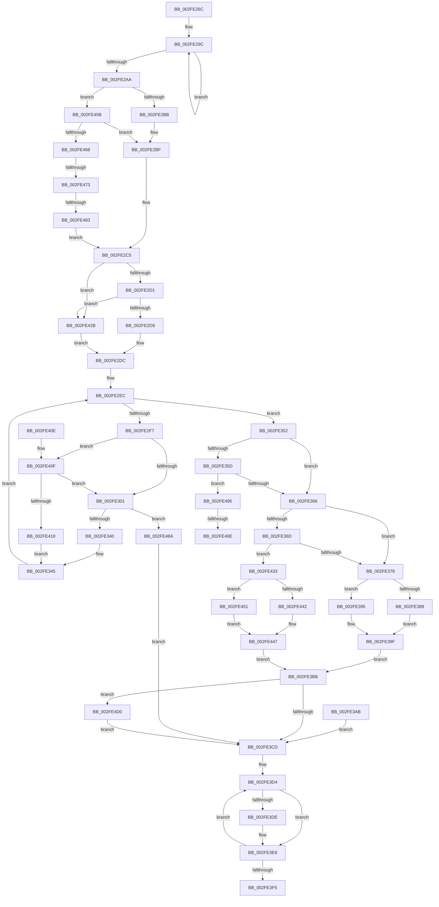

# AuthzBasepCompareUnicodeStringOperands

- RVA: `0x002FE26C`–`0x002FE4DF` (길이 `627` bytes)
- VA: `0x00000001402FE26C`
- 실행 섹션: `.text`
- PDB 이름 있음: `예`; PDB Function 태그: `예`
- unwind 정보 RVA: `0x00072D7C`
- 디코드: `164`개 명령, `627/627` bytes 표시
- 미해석 바이트: `0` (있으면 어셈블리에 `.byte`로 보존)

> 이 문서는 커널 이미지의 기계어와 PDB 기호를 분석해 생성했습니다. 4번과 5번은 함수 원형과 자료형을 바이너리 사용 방식에서 추정한 C 해석이며 원본 소스 복구 결과는 아닙니다.

## 1. Dependencies

- 직접 호출 지점: **5**; 고유 호출 대상: **5**
- 직접 호출자로 확인된 함수: **2**
- RIP 상대 이미지 참조: **0**

### Outgoing calls
- `0x002FE32C` → [AuthzBasepUnicodeStringFromOperandValue](AuthzBasepUnicodeStringFromOperandValue_function_002FE4E8.md) (function, `0x002FE4E8`)
- `0x002FE39F` → [RtlIsNameInExpression](RtlIsNameInExpression_function_002FDA70.md) (function, `0x002FDA70`)
- `0x002FE3E3` → [ExFreePoolWithTag](../../poolcode/B8/ExFreePoolWithTag_function_00B82870.md) (function, `0x00B82870`)
- `0x002FE442` → [AuthzBasepEqualUnicodeStringCaseSensitive](../3A/AuthzBasepEqualUnicodeStringCaseSensitive_function_003A8A44.md) (function, `0x003A8A44`)
- `0x002FE454` → [RtlEqualUnicodeString](../../page/93/RtlEqualUnicodeString_function_00932A20.md) (function, `0x00932A20`)

### Direct callers
- [AuthzBasepValueInSet](AuthzBasepValueInSet_function_002FE9B0.md) at `0x002FEA80`
- [AuthzBasepEvaluateExpression](../30/AuthzBasepEvaluateExpression_function_00300578.md) at `0x003006CD`

### Static image references
- 디코드된 RIP-relative 메모리 참조가 없습니다.

## 2. Other-region calls and transfers

- 다른 실행 섹션으로 향하는 call: **2**
  - `0x002FE3E3` → [ExFreePoolWithTag](../../poolcode/B8/ExFreePoolWithTag_function_00B82870.md) (`.text` → `POOLCODE`)
  - `0x002FE454` → [RtlEqualUnicodeString](../../page/93/RtlEqualUnicodeString_function_00932A20.md) (`.text` → `PAGE`)
- call이 아닌 외부 분기/꼬리 이동: **4**
  - `0x002FE46D` → [sub_006DFDF8](../6D/Unknown_function_006DFDF8.md) (`tail-transfer`)
  - `0x002FE47D` → [sub_006DFDF8](../6D/Unknown_function_006DFDF8.md) (`tail-transfer`)
  - `0x002FE498` → [sub_006DFDF8 + 0x2D](../6D/Unknown_function_006DFDF8.md) (`tail-transfer`)
  - `0x002FE4CB` → [sub_006DFDF8 + 0x7](../6D/Unknown_function_006DFDF8.md) (`tail-transfer`)

## 3. Assembly (complete function range)

```asm
002FE26C  48 8B C4                        mov rax, rsp
002FE26F  48 89 70 08                     mov qword ptr [rax + 8], rsi
002FE273  4C 89 40 18                     mov qword ptr [rax + 0x18], r8
002FE277  57                              push rdi
002FE278  41 54                           push r12
002FE27A  41 55                           push r13
002FE27C  41 56                           push r14
002FE27E  41 57                           push r15
002FE280  48 83 EC 50                     sub rsp, 0x50
002FE284  49 8B F8                        mov rdi, r8
002FE287  4C 8B F2                        mov r14, rdx
002FE28A  44 0F B6 E1                     movzx r12d, cl
002FE28E  66 83 60 10 00                  and word ptr [rax + 0x10], 0
002FE293  48 8D 40 B8                     lea rax, [rax - 0x48]
002FE297  B9 02 00 00 00                  mov ecx, 2
002FE29C  48 83 20 00                     and qword ptr [rax], 0
002FE2A0  48 8D 40 10                     lea rax, [rax + 0x10]
002FE2A4  48 83 E9 01                     sub rcx, 1
002FE2A8  75 F2                           jne 0x1402fe29c
002FE2AA  41 21 08                        and dword ptr [r8], ecx
002FE2AD  48 8D 72 10                     lea rsi, [rdx + 0x10]
002FE2B1  83 7A 0C 01                     cmp dword ptr [rdx + 0xc], 1
002FE2B5  0F 85 A0 01 00 00               jne 0x1402fe45b
002FE2BB  48 8B 42 38                     mov rax, qword ptr [rdx + 0x38]
002FE2BF  8A 48 24                        mov cl, byte ptr [rax + 0x24]
002FE2C2  80 E1 02                        and cl, 2
002FE2C5  44 0F 20 C0                     mov rax, cr8
002FE2C9  84 C9                           test cl, cl
002FE2CB  0F 85 5A 01 00 00               jne 0x1402fe42b
002FE2D1  3C 02                           cmp al, 2
002FE2D3  0F 83 52 01 00 00               jae 0x1402fe42b
002FE2D9  45 32 FF                        xor r15b, r15b
002FE2DC  45 33 ED                        xor r13d, r13d
002FE2DF  44 89 AC 24 98 00 00 00         mov dword ptr [rsp + 0x98], r13d
002FE2E7  48 8D 54 24 28                  lea rdx, [rsp + 0x28]
002FE2EC  48 89 54 24 20                  mov qword ptr [rsp + 0x20], rdx
002FE2F1  41 83 FD 02                     cmp r13d, 2
002FE2F5  7D 5B                           jge 0x1402fe352
002FE2F7  83 7E FC 01                     cmp dword ptr [rsi - 4], 1
002FE2FB  0F 85 0E 01 00 00               jne 0x1402fe40f
002FE301  49 63 CD                        movsxd rcx, r13d
002FE304  4C 8D 8C 24 88 00 00 00         lea r9, [rsp + 0x88]
002FE30C  4C 03 C9                        add r9, rcx
002FE30F  48 8B C1                        mov rax, rcx
002FE312  48 C1 E0 04                     shl rax, 4
002FE316  4C 8D 44 24 28                  lea r8, [rsp + 0x28]
002FE31B  4C 03 C0                        add r8, rax
002FE31E  41 8A D7                        mov dl, r15b
002FE321  80 F2 01                        xor dl, 1
002FE324  48 8D 04 89                     lea rax, [rcx + rcx*4]
002FE328  49 8D 0C C6                     lea rcx, [r14 + rax*8]
002FE32C  E8 B7 01 00 00                  call 0x1402fe4e8
002FE331  89 84 24 98 00 00 00            mov dword ptr [rsp + 0x98], eax
002FE338  85 C0                           test eax, eax
002FE33A  0F 88 4A 01 00 00               js 0x1402fe48a
002FE340  48 8B 54 24 20                  mov rdx, qword ptr [rsp + 0x20]
002FE345  41 FF C5                        inc r13d
002FE348  48 83 C6 28                     add rsi, 0x28
002FE34C  48 83 C2 10                     add rdx, 0x10
002FE350  EB 9A                           jmp 0x1402fe2ec
002FE352  41 8B CC                        mov ecx, r12d
002FE355  81 E9 80 00 00 00               sub ecx, 0x80
002FE35B  74 09                           je 0x1402fe366
002FE35D  83 F9 01                        cmp ecx, 1
002FE360  0F 85 2F 01 00 00               jne 0x1402fe495
002FE366  41 83 7E 0C 02                  cmp dword ptr [r14 + 0xc], 2
002FE36B  74 0B                           je 0x1402fe378
002FE36D  41 83 7E 34 02                  cmp dword ptr [r14 + 0x34], 2
002FE372  0F 85 BB 00 00 00               jne 0x1402fe433
002FE378  41 80 F7 01                     xor r15b, 1
002FE37C  45 33 C9                        xor r9d, r9d
002FE37F  45 8A C7                        mov r8b, r15b
002FE382  41 83 7E 34 01                  cmp dword ptr [r14 + 0x34], 1
002FE387  74 0C                           je 0x1402fe395
002FE389  48 8D 54 24 38                  lea rdx, [rsp + 0x38]
002FE38E  48 8D 4C 24 28                  lea rcx, [rsp + 0x28]
002FE393  EB 0A                           jmp 0x1402fe39f
002FE395  48 8D 54 24 28                  lea rdx, [rsp + 0x28]
002FE39A  48 8D 4C 24 38                  lea rcx, [rsp + 0x38]
002FE39F  E8 CC F6 FF FF                  call 0x1402fda70
002FE3A4  0F B6 C8                        movzx ecx, al
002FE3A7  89 0F                           mov dword ptr [rdi], ecx
002FE3A9  EB 10                           jmp 0x1402fe3bb
002FE3AB  44 8B E8                        mov r13d, eax
002FE3AE  48 8B 84 24 90 00 00 00         mov rax, qword ptr [rsp + 0x90]
002FE3B6  83 08 FF                        or dword ptr [rax], 0xffffffff
002FE3B9  EB 12                           jmp 0x1402fe3cd
002FE3BB  44 8B AC 24 98 00 00 00         mov r13d, dword ptr [rsp + 0x98]
002FE3C3  41 80 FC 81                     cmp r12b, 0x81
002FE3C7  0F 84 03 01 00 00               je 0x1402fe4d0
002FE3CD  33 FF                           xor edi, edi
002FE3CF  48 8D 74 24 30                  lea rsi, [rsp + 0x30]
002FE3D4  80 BC 3C 88 00 00 00 00         cmp byte ptr [rsp + rdi + 0x88], 0
002FE3DC  74 0A                           je 0x1402fe3e8
002FE3DE  33 D2                           xor edx, edx
002FE3E0  48 8B 0E                        mov rcx, qword ptr [rsi]
002FE3E3  E8 88 44 88 00                  call 0x140b82870
002FE3E8  48 FF C7                        inc rdi
002FE3EB  48 83 C6 10                     add rsi, 0x10
002FE3EF  48 83 FF 02                     cmp rdi, 2
002FE3F3  7C DF                           jl 0x1402fe3d4
002FE3F5  41 8B C5                        mov eax, r13d
002FE3F8  48 8B B4 24 80 00 00 00         mov rsi, qword ptr [rsp + 0x80]
002FE400  48 83 C4 50                     add rsp, 0x50
002FE404  41 5F                           pop r15
002FE406  41 5E                           pop r14
002FE408  41 5D                           pop r13
002FE40A  41 5C                           pop r12
002FE40C  5F                              pop rdi
002FE40D  C3                              ret
002FE40E  CC                              int3
002FE40F  45 84 FF                        test r15b, r15b
002FE412  0F 84 E9 FE FF FF               je 0x1402fe301
002FE418  48 8B 06                        mov rax, qword ptr [rsi]
002FE41B  48 8B 48 30                     mov rcx, qword ptr [rax + 0x30]
002FE41F  0F 10 01                        movups xmm0, xmmword ptr [rcx]
002FE422  F3 0F 7F 02                     movdqu xmmword ptr [rdx], xmm0
002FE426  E9 1A FF FF FF                  jmp 0x1402fe345
002FE42B  41 B7 01                        mov r15b, 1
002FE42E  E9 A9 FE FF FF                  jmp 0x1402fe2dc
002FE433  48 8D 54 24 38                  lea rdx, [rsp + 0x38]
002FE438  48 8D 4C 24 28                  lea rcx, [rsp + 0x28]
002FE43D  45 84 FF                        test r15b, r15b
002FE440  74 0F                           je 0x1402fe451
002FE442  E8 FD A5 0A 00                  call 0x1403a8a44
002FE447  0F B6 C8                        movzx ecx, al
002FE44A  89 0F                           mov dword ptr [rdi], ecx
002FE44C  E9 6A FF FF FF                  jmp 0x1402fe3bb
002FE451  41 B0 01                        mov r8b, 1
002FE454  E8 C7 45 63 00                  call 0x140932a20
002FE459  EB EC                           jmp 0x1402fe447
002FE45B  48 8B 06                        mov rax, qword ptr [rsi]
002FE45E  83 7A 34 01                     cmp dword ptr [rdx + 0x34], 1
002FE462  0F 84 57 FE FF FF               je 0x1402fe2bf
002FE468  8B 40 24                        mov eax, dword ptr [rax + 0x24]
002FE46B  A8 02                           test al, 2
002FE46D  0F 85 85 19 3E 00               jne 0x1406dfdf8
002FE473  48 8B 42 38                     mov rax, qword ptr [rdx + 0x38]
002FE477  8B 48 24                        mov ecx, dword ptr [rax + 0x24]
002FE47A  F6 C1 02                        test cl, 2
002FE47D  0F 85 75 19 3E 00               jne 0x1406dfdf8
002FE483  32 C9                           xor cl, cl
002FE485  E9 3B FE FF FF                  jmp 0x1402fe2c5
002FE48A  83 0F FF                        or dword ptr [rdi], 0xffffffff
002FE48D  44 8B E8                        mov r13d, eax
002FE490  E9 38 FF FF FF                  jmp 0x1402fe3cd
002FE495  45 84 FF                        test r15b, r15b
002FE498  0F 84 87 19 3E 00               je 0x1406dfe25
002FE49E  48 8B 4C 24 30                  mov rcx, qword ptr [rsp + 0x30]
002FE4A3  44 0F B7 4C 24 28               movzx r9d, word ptr [rsp + 0x28]
002FE4A9  44 0F B7 54 24 38               movzx r10d, word ptr [rsp + 0x38]
002FE4AF  41 0F B7 C1                     movzx eax, r9w
002FE4B3  66 45 3B CA                     cmp r9w, r10w
002FE4B7  66 41 0F 43 C2                  cmovae ax, r10w
002FE4BC  44 0F B7 C0                     movzx r8d, ax
002FE4C0  4C 03 C1                        add r8, rcx
002FE4C3  4C 8B 5C 24 40                  mov r11, qword ptr [rsp + 0x40]
002FE4C8  4C 2B D9                        sub r11, rcx
002FE4CB  E9 2F 19 3E 00                  jmp 0x1406dfdff
002FE4D0  33 C0                           xor eax, eax
002FE4D2  83 F9 01                        cmp ecx, 1
002FE4D5  0F 95 C0                        setne al
002FE4D8  89 07                           mov dword ptr [rdi], eax
002FE4DA  E9 EE FE FF FF                  jmp 0x1402fe3cd
```

## 4. C-style interpretation (structured pseudocode)

```c
__int64 __fastcall AuthzBasepCompareUnicodeStringOperands(unsigned __int8 a1, __int64 a2, __int64 a3)
{
    __int64 result;
    __int64 v_r11;
    __int64 v_r13;
    __int64 v_r15;
    __int64 v_rdi;
    __int64 v_rsi;
    __int64 v_rsp;
    unsigned __int64 v_stack_m40;
    unsigned __int64 v_stack_m48;
    unsigned __int64 v_stack_m50;
    unsigned __int64 v_stack_m58;
    unsigned __int64 v_stack_p10;
    unsigned __int64 v_stack_p18;
    unsigned int v_stack_p20;
    unsigned __int64 v_stack_p28;
    unsigned __int64 v_stack_p30;
    unsigned __int64 v_stack_p38;
    unsigned __int64 v_stack_p40;
    unsigned __int64 v_stack_p8;

    *(unsigned __int64 *)(v_rsp + 8) = v_rsi;
    *(unsigned __int64 *)(v_rsp + 24) = a3;
    v_rsp = (v_rsp) - (80);
loc_002FE29C:
    a1 = (2) - (1);
    if (condition_is_not_equal) goto loc_002FE29C;
    if ((*(unsigned int *)(a2 + 12)) != 1) goto loc_002FE45B;
loc_002FE2BF:
    a1 = (unsigned __int8)((*(unsigned __int8 *)(*(unsigned __int64 *)(a2 + 56) + 36)) & (2));
loc_002FE2C5:
    if (a1 != 0) goto loc_002FE42B;
    if (((unsigned __int8)(v_cr8)) >= 2) goto loc_002FE42B;
    v_r15 = 0;
loc_002FE2DC:
    v_r13 = 0;
    v_stack_p20 = 0;
loc_002FE2EC:
    v_stack_m58 = v_stack_m50;
    if (0 >= 2) goto loc_002FE352;
    if ((*(unsigned int *)(a2 + 16 - 4)) != 1) goto loc_002FE40F;
loc_002FE301:
    a4 = (v_stack_p10) + ((int)(0));
    result = ((int)(0)) << (4);
    a3 = (v_stack_m50) + (result);
    a2 = (unsigned __int8)((0) ^ (1));
    result = AuthzBasepUnicodeStringFromOperandValue(a2 + (int)(0) + (int)(0) * 4 * 8, a2, a3, a4);
    v_stack_p20 = (unsigned int)(result);
    if (sign_flag) goto loc_002FE48A;
loc_002FE345:
    v_r13 = (unsigned int)((v_r13) + 1);
    v_rsi = (a2 + 16) + (40);
    a2 = (v_stack_m58) + (16);
    goto loc_002FE2EC;
loc_002FE352:
    a1 = (unsigned int)(((unsigned int)(a1)) - (128));
    if (condition_is_equal) goto loc_002FE366;
    if (a1 != 1) goto loc_002FE495;
loc_002FE366:
    if ((*(unsigned int *)(a2 + 12)) == 2) goto loc_002FE378;
    if ((*(unsigned int *)(a2 + 52)) != 2) goto loc_002FE433;
loc_002FE378:
    v_r15 = (unsigned __int8)((v_r15) ^ (1));
    a4 = 0;
    if ((*(unsigned int *)(a2 + 52)) == 1) goto loc_002FE395;
    goto loc_002FE39F;
loc_002FE395:
loc_002FE39F:
    result = RtlIsNameInExpression(v_stack_m40, v_stack_m50, (unsigned __int8)(v_r15), a4);
    *(unsigned int *)(a3) = (unsigned int)((unsigned __int8)(result));
    goto loc_002FE3BB;
loc_002FE3BB:
    if (a1 == 129) goto loc_002FE4D0;
loc_002FE3CD:
    v_rdi = 0;
loc_002FE3D4:
    if ((*(unsigned __int8 *)(v_rsp + v_rdi * 1 + 136)) != 0) {
        a2 = 0;
        a1 = *(unsigned __int64 *)(v_stack_m48);
        result = ExFreePoolWithTag(a1, a2, (unsigned __int8)(v_r15), a4);
    }
    v_rdi = (v_rdi) + 1;
    v_rsi = (v_stack_m48) + (16);
    if (v_rdi < 2) goto loc_002FE3D4;
    v_rsp = (v_rsp) + (80);
    return (unsigned int)((unsigned int)((unsigned int)(v_stack_p20)));
loc_002FE40F:
    if ((unsigned __int8)(v_r15) == 0) goto loc_002FE301;
    *(unsigned __int64 *)(a2) = v_xmm0;
    goto loc_002FE345;
loc_002FE42B:
    goto loc_002FE2DC;
loc_002FE433:
    if (1 == 0) goto loc_002FE451;
    result = AuthzBasepEqualUnicodeStringCaseSensitive(v_stack_p28, v_stack_p38, (unsigned __int8)(v_r15), a4);
loc_002FE447:
    *(unsigned int *)(v_rdi) = (unsigned int)((unsigned __int8)(result));
    goto loc_002FE3BB;
loc_002FE451:
    result = RtlEqualUnicodeString((unsigned __int8)(result), v_stack_p38, 1, a4);
    goto loc_002FE447;
loc_002FE45B:
    if ((*(unsigned int *)(v_stack_p38 + 52)) == 1) goto loc_002FE2BF;
    a1 = 0;
    goto loc_002FE2C5;
loc_002FE48A:
    goto loc_002FE3CD;
loc_002FE495:
    result = (unsigned __int16)(v_stack_p28);
    if (((unsigned __int16)(v_stack_p28)) >= ((unsigned __int16)(v_stack_p38))) { result = (unsigned __int16)(v_stack_p38); }
    a3 = ((unsigned __int16)(result)) + (v_stack_p30);
    v_r11 = (v_stack_p40) - (v_stack_p30);
loc_002FE4D0:
    result = 0;
    result = (((unsigned int)(v_stack_p30)) != 1) ? 1 : 0;
    *(unsigned int *)(v_rdi) = (unsigned int)(result);
    goto loc_002FE3CD;
}
```

## 5. (Beta) C Style

```c
int64_t AuthzBasepCompareUnicodeStringOperands(uint8_t Arg1, void *Arg2, void *Arg3)
{
    uint8_t *arg2 = (uint8_t *)Arg2;
    uint8_t *arg3 = (uint8_t *)Arg3;

    int64_t result;
    int64_t local_r11;
    int64_t local_r13;
    int64_t local_r15;
    int64_t local_rdi;
    int64_t local_rsi;
    int64_t local_rsp;
    uint64_t v_stack_m40;
    uint64_t v_stack_m48;
    uint64_t v_stack_m50;
    uint64_t v_stack_m58;
    uint64_t v_stack_p10;
    uint64_t v_stack_p18;
    uint32_t v_stack_p20;
    uint64_t v_stack_p28;
    uint64_t v_stack_p30;
    uint64_t v_stack_p38;
    uint64_t v_stack_p40;
    uint64_t v_stack_p8;

    *(uint64_t *)(local_rsp + 0x8) = local_rsi;
    *(void **)(local_rsp + 0x18) = Arg3;
    local_rsp = (local_rsp) - (80);
loc_002FE29C:
    Arg1 = (2) - (1);
    if (condition_is_not_equal) goto loc_002FE29C;
    if ((*(uint32_t *)(arg2 + 0xC)) != 1) goto loc_002FE45B;
loc_002FE2BF:
    Arg1 = (uint8_t)((*(uint8_t *)(*(uint64_t *)(arg2 + 0x38) + 0x24)) & (2));
loc_002FE2C5:
    if (Arg1 != 0) goto loc_002FE42B;
    if (((uint8_t)(v_cr8)) >= 2) goto loc_002FE42B;
    local_r15 = 0;
loc_002FE2DC:
    local_r13 = 0;
    v_stack_p20 = 0;
loc_002FE2EC:
    v_stack_m58 = v_stack_m50;
    if (0 >= 2) goto loc_002FE352;
    if ((*(uint32_t *)(arg2 + 0x10 - 0x4)) != 1) goto loc_002FE40F;
loc_002FE301:
    a4 = (v_stack_p10) + ((int32_t)(0));
    result = ((int32_t)(0)) << (4);
    Arg3 = (v_stack_m50) + (result);
    Arg2 = (uint8_t)((0) ^ (1));
    result = AuthzBasepUnicodeStringFromOperandValue(Arg2 + (int32_t)(0) + (int32_t)(0) * 4 * 8, Arg2, Arg3, a4);
    v_stack_p20 = (uint32_t)(result);
    if (sign_flag) goto loc_002FE48A;
loc_002FE345:
    local_r13 = (uint32_t)((local_r13) + 1);
    local_rsi = (Arg2 + 16) + (40);
    Arg2 = (v_stack_m58) + (16);
    goto loc_002FE2EC;
loc_002FE352:
    Arg1 = (uint32_t)(((uint32_t)(Arg1)) - (128));
    if (condition_is_equal) goto loc_002FE366;
    if (Arg1 != 1) goto loc_002FE495;
loc_002FE366:
    if ((*(uint32_t *)(arg2 + 0xC)) == 2) goto loc_002FE378;
    if ((*(uint32_t *)(arg2 + 0x34)) != 2) goto loc_002FE433;
loc_002FE378:
    local_r15 = (uint8_t)((local_r15) ^ (1));
    a4 = 0;
    if ((*(uint32_t *)(arg2 + 0x34)) == 1) goto loc_002FE395;
    goto loc_002FE39F;
loc_002FE395:
loc_002FE39F:
    result = RtlIsNameInExpression(v_stack_m40, v_stack_m50, (uint8_t)(local_r15), a4);
    *(uint32_t *)(arg3) = (uint32_t)((uint8_t)(result));
    goto loc_002FE3BB;
loc_002FE3BB:
    if (Arg1 == 129) goto loc_002FE4D0;
loc_002FE3CD:
    local_rdi = 0;
loc_002FE3D4:
    if ((*(uint8_t *)(local_rsp + local_rdi * 1 + 0x88)) != 0) {
        Arg2 = 0;
        Arg1 = *(uint64_t *)(v_stack_m48);
        result = ExFreePoolWithTag(Arg1, Arg2, (uint8_t)(local_r15), a4);
    }
    local_rdi = (local_rdi) + 1;
    local_rsi = (v_stack_m48) + (16);
    if (local_rdi < 2) goto loc_002FE3D4;
    local_rsp = (local_rsp) + (80);
    return (uint32_t)((uint32_t)((uint32_t)(v_stack_p20)));
loc_002FE40F:
    if ((uint8_t)(local_r15) == 0) goto loc_002FE301;
    *(uint64_t *)(arg2) = v_xmm0;
    goto loc_002FE345;
loc_002FE42B:
    goto loc_002FE2DC;
loc_002FE433:
    if (1 == 0) goto loc_002FE451;
    result = AuthzBasepEqualUnicodeStringCaseSensitive(v_stack_p28, v_stack_p38, (uint8_t)(local_r15), a4);
loc_002FE447:
    *(uint32_t *)(local_rdi) = (uint32_t)((uint8_t)(result));
    goto loc_002FE3BB;
loc_002FE451:
    result = RtlEqualUnicodeString((uint8_t)(result), v_stack_p38, 1, a4);
    goto loc_002FE447;
loc_002FE45B:
    if ((*(uint32_t *)(v_stack_p38 + 0x34)) == 1) goto loc_002FE2BF;
    Arg1 = 0;
    goto loc_002FE2C5;
loc_002FE48A:
    goto loc_002FE3CD;
loc_002FE495:
    result = (uint16_t)(v_stack_p28);
    if (((uint16_t)(v_stack_p28)) >= ((uint16_t)(v_stack_p38))) { result = (uint16_t)(v_stack_p38); }
    Arg3 = ((uint16_t)(result)) + (v_stack_p30);
    local_r11 = (v_stack_p40) - (v_stack_p30);
loc_002FE4D0:
    result = 0;
    result = (((uint32_t)(v_stack_p30)) != 1) ? 1 : 0;
    *(uint32_t *)(local_rdi) = (uint32_t)(result);
    goto loc_002FE3CD;
}
```

### 관측된 메모리 오프셋

구조체 형식이 확인되지 않은 접근은 인자 기준의 오프셋으로만 기록했습니다.

| 기준 인자 | 오프셋 표현 | 폭 (bit) | 접근 |
|---|---:|---:|---|
| `Arg2` | `- 0x4` | `32` | `R` |
| `Arg2` | `+ 0x0` | `64` | `R` |
| `Arg2` | `+ 0x0 + rax*8` | `64` | `R` |
| `Arg2` | `+ 0xC` | `32` | `R` |
| `Arg2` | `+ 0x10` | `64` | `R` |
| `Arg2` | `+ 0x34` | `32` | `R` |
| `Arg2` | `+ 0x38` | `64` | `R` |
| `Arg3` | `+ 0x0` | `32` | `R/W` |
| `Arg3` | `+ 0x0` | `32` | `W` |

## 6. Execution-region graph

[열기: 2D/3D 그래프와 함수 탐색 컨트롤 패널](../../../control-panel.html?section=text&rva=0x002FE26C&view=graph)

- 2D 그래프는 위에서 아래로 흐르고, 3D 그래프는 빈 공간을 드래그해 회전합니다. Shift+드래그는 이동, 휠은 확대·축소, 함수 노드 선택은 대상 보고서 이동입니다.

### Static fallback


