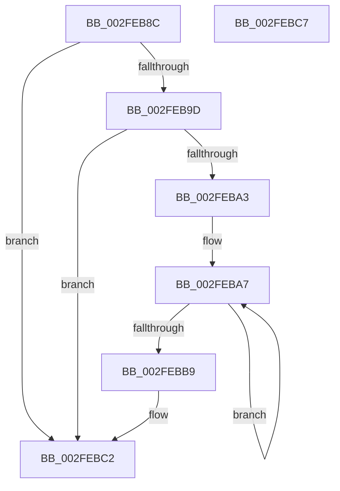

# AuthzBasepRestartOperandValueEnumeration

- RVA: `0x002FEB8C`–`0x002FEBC8` (길이 `60` bytes)
- VA: `0x00000001402FEB8C`
- 실행 섹션: `.text`
- PDB 이름 있음: `예`; PDB Function 태그: `아니요`
- unwind 정보 RVA: `0x0005C788`
- 디코드: `18`개 명령, `60/60` bytes 표시
- 미해석 바이트: `0` (있으면 어셈블리에 `.byte`로 보존)

> 이 문서는 커널 이미지의 기계어와 PDB 기호를 분석해 생성했습니다. 4번과 5번은 함수 원형과 자료형을 바이너리 사용 방식에서 추정한 C 해석이며 원본 소스 복구 결과는 아닙니다.

## 1. Dependencies

- 직접 호출 지점: **1**; 고유 호출 대상: **1**
- 직접 호출자로 확인된 함수: **2**
- RIP 상대 이미지 참조: **0**

### Outgoing calls
- `0x002FEBBD` → [AuthzBasepQuerySecurityAttributeAndValues](../30/AuthzBasepQuerySecurityAttributeAndValues_function_00300090.md) (function, `0x00300090`)

### Direct callers
- [AuthzBasepValueInSet](AuthzBasepValueInSet_function_002FE9B0.md) at `0x002FEA91`
- [sub_006DFF8E](../6D/Unknown_function_006DFF8E.md) at `0x006E00D8`

### Static image references
- 디코드된 RIP-relative 메모리 참조가 없습니다.

## 2. Other-region calls and transfers

- 다른 실행 섹션으로 향하는 call: **0**
- 별도 외부 분기/꼬리 이동을 확인하지 못했습니다.

## 3. Assembly (complete function range)

```asm
002FEB8C  48 83 EC 28                     sub rsp, 0x28
002FEB90  45 33 C0                        xor r8d, r8d
002FEB93  83 79 0C 01                     cmp dword ptr [rcx + 0xc], 1
002FEB97  44 89 41 08                     mov dword ptr [rcx + 8], r8d
002FEB9B  74 25                           je 0x1402febc2
002FEB9D  4C 39 41 10                     cmp qword ptr [rcx + 0x10], r8
002FEBA1  74 1F                           je 0x1402febc2
002FEBA3  41 8D 50 38                     lea edx, [r8 + 0x38]
002FEBA7  48 8B 41 10                     mov rax, qword ptr [rcx + 0x10]
002FEBAB  4C 89 04 02                     mov qword ptr [rdx + rax], r8
002FEBAF  48 83 C2 08                     add rdx, 8
002FEBB3  48 83 FA 48                     cmp rdx, 0x48
002FEBB7  7C EE                           jl 0x1402feba7
002FEBB9  48 8B 49 10                     mov rcx, qword ptr [rcx + 0x10]
002FEBBD  E8 CE 14 00 00                  call 0x140300090
002FEBC2  48 83 C4 28                     add rsp, 0x28
002FEBC6  C3                              ret
002FEBC7  CC                              int3
```

## 4. C-style interpretation (structured pseudocode)

```c
__int64 __fastcall AuthzBasepRestartOperandValueEnumeration(__int64 a1, __int64 a2, int a3)
{
    __int64 result;
    __int64 v_rsp;

    v_rsp = (v_rsp) - (40);
    a3 = 0;
    *(unsigned int *)(a1 + 8) = 0;
    if ((*(unsigned int *)(a1 + 12)) == 1) goto loc_002FEBC2;
    if ((*(unsigned __int64 *)(a1 + 16)) == 0) goto loc_002FEBC2;
loc_002FEBA7:
    *(unsigned __int64 *)(a3 + 56 + *(unsigned __int64 *)(a1 + 16) * 1) = 0;
    a2 = (a3 + 56) + (8);
    if (a2 < 72) goto loc_002FEBA7;
    result = AuthzBasepQuerySecurityAttributeAndValues(*(unsigned __int64 *)(a1 + 16), a2, a3, a4);
loc_002FEBC2:
    v_rsp = (v_rsp) + (40);
    return result;
}
```

## 5. (Beta) C Style

```c
int64_t AuthzBasepRestartOperandValueEnumeration(void *Arg1, int64_t Arg2, int32_t Arg3)
{
    uint8_t *arg1 = (uint8_t *)Arg1;

    int64_t result;
    int64_t local_rsp;

    local_rsp = (local_rsp) - (40);
    Arg3 = 0;
    *(uint32_t *)(arg1 + 0x8) = 0;
    if ((*(uint32_t *)(arg1 + 0xC)) == 1) goto loc_002FEBC2;
    if ((*(uint64_t *)(arg1 + 0x10)) == 0) goto loc_002FEBC2;
loc_002FEBA7:
    *(uint64_t *)(Arg3 + 0x38 + *(uint64_t *)(arg1 + 0x10) * 1) = 0;
    Arg2 = (Arg3 + 56) + (8);
    if (Arg2 < 72) goto loc_002FEBA7;
    result = AuthzBasepQuerySecurityAttributeAndValues(*(uint64_t *)(arg1 + 0x10), Arg2, Arg3, a4);
loc_002FEBC2:
    local_rsp = (local_rsp) + (40);
    return result;
}
```

### 관측된 메모리 오프셋

구조체 형식이 확인되지 않은 접근은 인자 기준의 오프셋으로만 기록했습니다.

| 기준 인자 | 오프셋 표현 | 폭 (bit) | 접근 |
|---|---:|---:|---|
| `Arg1` | `+ 0x8` | `32` | `W` |
| `Arg1` | `+ 0xC` | `32` | `R` |
| `Arg1` | `+ 0x10` | `64` | `R` |

## 6. Execution-region graph

[열기: 2D/3D 그래프와 함수 탐색 컨트롤 패널](../../../control-panel.html?section=text&rva=0x002FEB8C&view=graph)

- 2D 그래프는 위에서 아래로 흐르고, 3D 그래프는 빈 공간을 드래그해 회전합니다. Shift+드래그는 이동, 휠은 확대·축소, 함수 노드 선택은 대상 보고서 이동입니다.

### Static fallback


