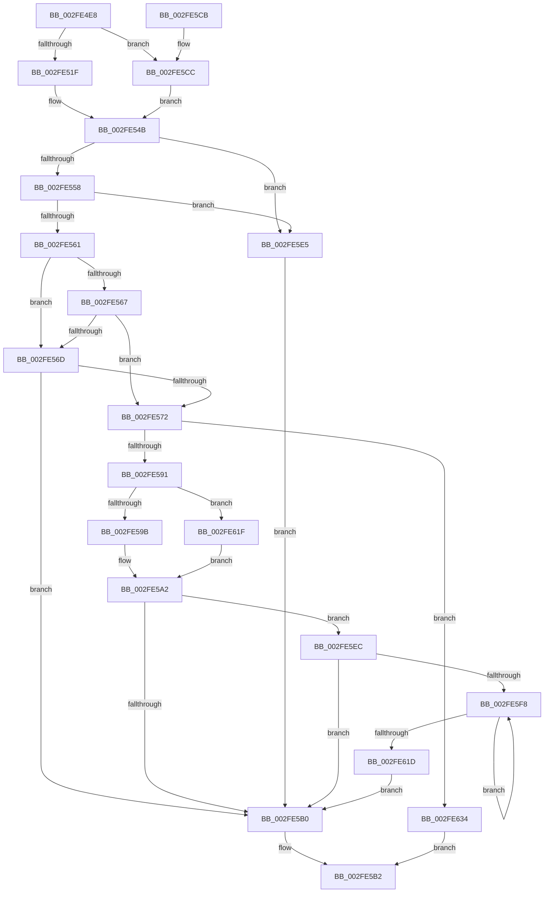

# AuthzBasepUnicodeStringFromOperandValue

- RVA: `0x002FE4E8`–`0x002FE63E` (길이 `342` bytes)
- VA: `0x00000001402FE4E8`
- 실행 섹션: `.text`
- PDB 이름 있음: `예`; PDB Function 태그: `아니요`
- unwind 정보 RVA: `0x00072DBC`
- 디코드: `95`개 명령, `342/342` bytes 표시
- 미해석 바이트: `0` (있으면 어셈블리에 `.byte`로 보존)

> 이 문서는 커널 이미지의 기계어와 PDB 기호를 분석해 생성했습니다. 4번과 5번은 함수 원형과 자료형을 바이너리 사용 방식에서 추정한 C 해석이며 원본 소스 복구 결과는 아닙니다.

## 1. Dependencies

- 직접 호출 지점: **3**; 고유 호출 대상: **3**
- 직접 호출자로 확인된 함수: **2**
- RIP 상대 이미지 참조: **0**

### Outgoing calls
- `0x002FE57C` → [AuthzBasepMemAlloc](AuthzBasepMemAlloc_function_002FFD90.md) (function, `0x002FFD90`)
- `0x002FE5A2` → [memcpy](../6C/memcpy_function_006C6840.md) (function, `0x006C6840`)
- `0x002FE602` → [RtlUpcaseUnicodeChar](../../page/85/RtlUpcaseUnicodeChar_function_0085F0F0.md) (function, `0x0085F0F0`)

### Direct callers
- [AuthzBasepCompareUnicodeStringOperands](AuthzBasepCompareUnicodeStringOperands_function_002FE26C.md) at `0x002FE32C`
- [AuthzBasepCompareFQBNOperands](../30/AuthzBasepCompareFQBNOperands_function_00301444.md) at `0x00301554`

### Static image references
- 디코드된 RIP-relative 메모리 참조가 없습니다.

## 2. Other-region calls and transfers

- 다른 실행 섹션으로 향하는 call: **1**
  - `0x002FE602` → [RtlUpcaseUnicodeChar](../../page/85/RtlUpcaseUnicodeChar_function_0085F0F0.md) (`.text` → `PAGE`)
- 별도 외부 분기/꼬리 이동을 확인하지 못했습니다.

## 3. Assembly (complete function range)

```asm
002FE4E8  48 89 5C 24 08                  mov qword ptr [rsp + 8], rbx
002FE4ED  48 89 6C 24 10                  mov qword ptr [rsp + 0x10], rbp
002FE4F2  48 89 74 24 18                  mov qword ptr [rsp + 0x18], rsi
002FE4F7  57                              push rdi
002FE4F8  41 56                           push r14
002FE4FA  41 57                           push r15
002FE4FC  48 83 EC 20                     sub rsp, 0x20
002FE500  33 FF                           xor edi, edi
002FE502  4C 8D 71 20                     lea r14, [rcx + 0x20]
002FE506  41 88 39                        mov byte ptr [r9], dil
002FE509  4D 8B F9                        mov r15, r9
002FE50C  83 79 0C 01                     cmp dword ptr [rcx + 0xc], 1
002FE510  49 8B F0                        mov rsi, r8
002FE513  40 8A EA                        mov bpl, dl
002FE516  48 8B D9                        mov rbx, rcx
002FE519  0F 84 AD 00 00 00               je 0x1402fe5cc
002FE51F  48 8B 41 10                     mov rax, qword ptr [rcx + 0x10]
002FE523  48 8B 48 30                     mov rcx, qword ptr [rax + 0x30]
002FE527  44 0F B7 41 02                  movzx r8d, word ptr [rcx + 2]
002FE52C  66 44 89 46 02                  mov word ptr [rsi + 2], r8w
002FE531  48 8B 43 10                     mov rax, qword ptr [rbx + 0x10]
002FE535  48 8B 48 30                     mov rcx, qword ptr [rax + 0x30]
002FE539  0F B7 11                        movzx edx, word ptr [rcx]
002FE53C  66 89 16                        mov word ptr [rsi], dx
002FE53F  48 8B 43 10                     mov rax, qword ptr [rbx + 0x10]
002FE543  48 8B 48 30                     mov rcx, qword ptr [rax + 0x30]
002FE547  48 8B 41 08                     mov rax, qword ptr [rcx + 8]
002FE54B  48 89 46 08                     mov qword ptr [rsi + 8], rax
002FE54F  66 85 D2                        test dx, dx
002FE552  0F 84 8D 00 00 00               je 0x1402fe5e5
002FE558  48 85 C0                        test rax, rax
002FE55B  0F 84 84 00 00 00               je 0x1402fe5e5
002FE561  83 7B 0C 01                     cmp dword ptr [rbx + 0xc], 1
002FE565  75 06                           jne 0x1402fe56d
002FE567  41 F6 06 01                     test byte ptr [r14], 1
002FE56B  75 05                           jne 0x1402fe572
002FE56D  40 84 ED                        test bpl, bpl
002FE570  74 3E                           je 0x1402fe5b0
002FE572  41 0F B7 C8                     movzx ecx, r8w
002FE576  41 B8 53 65 47 61               mov r8d, 0x61476553
002FE57C  E8 0F 18 00 00                  call 0x1402ffd90
002FE581  48 89 46 08                     mov qword ptr [rsi + 8], rax
002FE585  48 8B C8                        mov rcx, rax
002FE588  48 85 C0                        test rax, rax
002FE58B  0F 84 A3 00 00 00               je 0x1402fe634
002FE591  83 7B 0C 01                     cmp dword ptr [rbx + 0xc], 1
002FE595  0F 85 84 00 00 00               jne 0x1402fe61f
002FE59B  44 8B 43 18                     mov r8d, dword ptr [rbx + 0x18]
002FE59F  49 8B 16                        mov rdx, qword ptr [r14]
002FE5A2  E8 99 82 3C 00                  call 0x1406c6840
002FE5A7  41 C6 07 01                     mov byte ptr [r15], 1
002FE5AB  40 84 ED                        test bpl, bpl
002FE5AE  75 3C                           jne 0x1402fe5ec
002FE5B0  8B C7                           mov eax, edi
002FE5B2  48 8B 5C 24 40                  mov rbx, qword ptr [rsp + 0x40]
002FE5B7  48 8B 6C 24 48                  mov rbp, qword ptr [rsp + 0x48]
002FE5BC  48 8B 74 24 50                  mov rsi, qword ptr [rsp + 0x50]
002FE5C1  48 83 C4 20                     add rsp, 0x20
002FE5C5  41 5F                           pop r15
002FE5C7  41 5E                           pop r14
002FE5C9  5F                              pop rdi
002FE5CA  C3                              ret
002FE5CB  CC                              int3
002FE5CC  44 0F B7 41 18                  movzx r8d, word ptr [rcx + 0x18]
002FE5D1  66 44 89 46 02                  mov word ptr [rsi + 2], r8w
002FE5D6  0F B7 51 18                     movzx edx, word ptr [rcx + 0x18]
002FE5DA  66 89 16                        mov word ptr [rsi], dx
002FE5DD  49 8B 06                        mov rax, qword ptr [r14]
002FE5E0  E9 66 FF FF FF                  jmp 0x1402fe54b
002FE5E5  BF A2 01 00 C0                  mov edi, 0xc00001a2
002FE5EA  EB C4                           jmp 0x1402fe5b0
002FE5EC  0F B7 06                        movzx eax, word ptr [rsi]
002FE5EF  8B EF                           mov ebp, edi
002FE5F1  A9 FE FF FF FF                  test eax, 0xfffffffe
002FE5F6  76 B8                           jbe 0x1402fe5b0
002FE5F8  48 8B 4E 08                     mov rcx, qword ptr [rsi + 8]
002FE5FC  8B DD                           mov ebx, ebp
002FE5FE  0F B7 0C 59                     movzx ecx, word ptr [rcx + rbx*2]
002FE602  E8 E9 0A 56 00                  call 0x14085f0f0
002FE607  0F B7 C8                        movzx ecx, ax
002FE60A  FF C5                           inc ebp
002FE60C  48 8B 46 08                     mov rax, qword ptr [rsi + 8]
002FE610  66 89 0C 58                     mov word ptr [rax + rbx*2], cx
002FE614  0F B7 06                        movzx eax, word ptr [rsi]
002FE617  D1 E8                           shr eax, 1
002FE619  3B E8                           cmp ebp, eax
002FE61B  72 DB                           jb 0x1402fe5f8
002FE61D  EB 91                           jmp 0x1402fe5b0
002FE61F  48 8B 43 10                     mov rax, qword ptr [rbx + 0x10]
002FE623  48 8B 50 30                     mov rdx, qword ptr [rax + 0x30]
002FE627  44 0F B7 02                     movzx r8d, word ptr [rdx]
002FE62B  48 8B 52 08                     mov rdx, qword ptr [rdx + 8]
002FE62F  E9 6E FF FF FF                  jmp 0x1402fe5a2
002FE634  B8 17 00 00 C0                  mov eax, 0xc0000017
002FE639  E9 74 FF FF FF                  jmp 0x1402fe5b2
```

## 4. C-style interpretation (structured pseudocode)

```c
__int64 __fastcall AuthzBasepUnicodeStringFromOperandValue(__int64 a1, unsigned __int8 a2, __int64 a3, __int64 a4)
{
    __int64 result;
    __int64 v_rbp;
    __int64 v_rdi;
    __int64 v_rsp;
    unsigned __int64 v_stack_p10;
    unsigned __int64 v_stack_p18;
    unsigned __int64 v_stack_p8;

    v_stack_p8 = v_rbx;
    v_stack_p10 = v_rbp;
    v_stack_p18 = v_rsi;
    v_rsp = (v_rsp) - (32);
    v_rdi = 0;
    *(unsigned __int8 *)(a4) = 0;
    if ((*(unsigned int *)(a1 + 12)) == 1) goto loc_002FE5CC;
    *(unsigned __int16 *)(a3 + 2) = (unsigned __int16)(*(unsigned __int16 *)(*(unsigned __int64 *)(*(unsigned __int64 *)(a1 + 16) + 48) + 2));
    *(unsigned __int16 *)(a3) = (unsigned __int16)(*(unsigned __int16 *)(*(unsigned __int64 *)(*(unsigned __int64 *)(a1 + 16) + 48)));
loc_002FE54B:
    *(unsigned __int64 *)(a3 + 8) = *(unsigned __int64 *)(*(unsigned __int64 *)(*(unsigned __int64 *)(a1 + 16) + 48) + 8);
    if ((unsigned __int16)(*(unsigned __int16 *)(*(unsigned __int64 *)(*(unsigned __int64 *)(a1 + 16) + 48))) == 0) goto loc_002FE5E5;
    if (*(unsigned __int64 *)(*(unsigned __int64 *)(*(unsigned __int64 *)(a1 + 16) + 48) + 8) == 0) goto loc_002FE5E5;
    if ((*(unsigned int *)(a1 + 12)) != 1) goto loc_002FE56D;
    if (((*(unsigned __int8 *)(a1 + 32)) & (1)) != 0) goto loc_002FE572;
loc_002FE56D:
    if (a2 == 0) goto loc_002FE5B0;
loc_002FE572:
    result = AuthzBasepMemAlloc((unsigned __int16)(*(unsigned __int16 *)(*(unsigned __int64 *)(*(unsigned __int64 *)(a1 + 16) + 48) + 2)), *(unsigned __int16 *)(*(unsigned __int64 *)(*(unsigned __int64 *)(a1 + 16) + 48)), (unsigned int)(0x61476553ULL), a4);
    *(unsigned __int64 *)(a3 + 8) = result;
    if (result == 0) goto loc_002FE634;
    if ((*(unsigned int *)(a1 + 12)) != 1) goto loc_002FE61F;
loc_002FE5A2:
    result = memcpy(result, *(unsigned __int64 *)(a1 + 32), (unsigned int)(*(unsigned int *)(a1 + 24)), a4);
    *(unsigned __int8 *)(a4) = 1;
    if (a2 != 0) goto loc_002FE5EC;
loc_002FE5B0:
loc_002FE5B2:
    v_rsp = (v_rsp) + (32);
    return 0;
loc_002FE5CC:
    *(unsigned __int16 *)(v_stack_p18 + 2) = (unsigned __int16)(*(unsigned __int16 *)(result + 24));
    *(unsigned __int16 *)(v_stack_p18) = (unsigned __int16)(*(unsigned __int16 *)(result + 24));
    goto loc_002FE54B;
loc_002FE5E5:
    goto loc_002FE5B0;
loc_002FE5EC:
    if (condition_is_below_or_equal) goto loc_002FE5B0;
loc_002FE5F8:
    result = RtlUpcaseUnicodeChar(*(unsigned __int16 *)(*(unsigned __int64 *)(v_stack_p18 + 8) + (unsigned int)((unsigned int)((unsigned int)((unsigned int)((unsigned int)(0xC00001A2ULL))))) * 2), *(unsigned __int16 *)(result + 24), *(unsigned __int16 *)(result + 24), a4);
    v_rbp = (unsigned int)(((unsigned int)((unsigned int)((unsigned int)(0xC00001A2ULL)))) + 1);
    *(unsigned __int16 *)(*(unsigned __int64 *)(v_stack_p18 + 8) + (unsigned int)((unsigned int)((unsigned int)((unsigned int)((unsigned int)(0xC00001A2ULL))))) * 2) = (unsigned __int16)((unsigned __int16)(result));
    result = (unsigned int)((*(unsigned __int16 *)(v_stack_p18)) >> (1));
    if (((unsigned int)(v_rbp)) < ((unsigned int)(result))) goto loc_002FE5F8;
    goto loc_002FE5B0;
loc_002FE61F:
    goto loc_002FE5A2;
loc_002FE634:
    goto loc_002FE5B2;
}
```

## 5. (Beta) C Style

```c
int64_t AuthzBasepUnicodeStringFromOperandValue(void *Arg1, uint8_t Arg2, void *Arg3, void *Arg4)
{
    uint8_t *arg1 = (uint8_t *)Arg1;
    uint8_t *arg3 = (uint8_t *)Arg3;
    uint8_t *arg4 = (uint8_t *)Arg4;

    int64_t result;
    int64_t local_rbp;
    int64_t local_rdi;
    int64_t local_rsp;
    uint64_t v_stack_p10;
    uint64_t v_stack_p18;
    uint64_t v_stack_p8;

    v_stack_p8 = local_rbx;
    v_stack_p10 = local_rbp;
    v_stack_p18 = local_rsi;
    local_rsp = (local_rsp) - (32);
    local_rdi = 0;
    *(uint8_t *)(arg4) = 0;
    if ((*(uint32_t *)(arg1 + 0xC)) == 1) goto loc_002FE5CC;
    *(uint16_t *)(arg3 + 0x2) = (uint16_t)(*(uint16_t *)(*(uint64_t *)(*(uint64_t *)(arg1 + 0x10) + 0x30) + 0x2));
    *(uint16_t *)(arg3) = (uint16_t)(*(uint16_t *)(*(uint64_t *)(*(uint64_t *)(arg1 + 0x10) + 0x30)));
loc_002FE54B:
    *(uint64_t *)(arg3 + 0x8) = *(uint64_t *)(*(uint64_t *)(*(uint64_t *)(arg1 + 0x10) + 0x30) + 0x8);
    if ((uint16_t)(*(uint16_t *)(*(uint64_t *)(*(uint64_t *)(arg1 + 0x10) + 0x30))) == 0) goto loc_002FE5E5;
    if (*(uint64_t *)(*(uint64_t *)(*(uint64_t *)(arg1 + 0x10) + 0x30) + 0x8) == 0) goto loc_002FE5E5;
    if ((*(uint32_t *)(arg1 + 0xC)) != 1) goto loc_002FE56D;
    if (((*(uint8_t *)(arg1 + 0x20)) & (1)) != 0) goto loc_002FE572;
loc_002FE56D:
    if (Arg2 == 0) goto loc_002FE5B0;
loc_002FE572:
    result = AuthzBasepMemAlloc((uint16_t)(*(uint16_t *)(*(uint64_t *)(*(uint64_t *)(arg1 + 0x10) + 0x30) + 0x2)), *(uint16_t *)(*(uint64_t *)(*(uint64_t *)(arg1 + 0x10) + 0x30)), (uint32_t)(0x61476553ULL), Arg4);
    *(uint64_t *)(arg3 + 0x8) = result;
    if (result == 0) goto loc_002FE634;
    if ((*(uint32_t *)(arg1 + 0xC)) != 1) goto loc_002FE61F;
loc_002FE5A2:
    result = memcpy(result, *(uint64_t *)(arg1 + 0x20), (uint32_t)(*(uint32_t *)(arg1 + 0x18)), Arg4);
    *(uint8_t *)(arg4) = 1;
    if (Arg2 != 0) goto loc_002FE5EC;
loc_002FE5B0:
loc_002FE5B2:
    local_rsp = (local_rsp) + (32);
    return 0;
loc_002FE5CC:
    *(uint16_t *)(v_stack_p18 + 0x2) = (uint16_t)(*(uint16_t *)(result + 0x18));
    *(uint16_t *)(v_stack_p18) = (uint16_t)(*(uint16_t *)(result + 0x18));
    goto loc_002FE54B;
loc_002FE5E5:
    goto loc_002FE5B0;
loc_002FE5EC:
    if (condition_is_below_or_equal) goto loc_002FE5B0;
loc_002FE5F8:
    result = RtlUpcaseUnicodeChar(*(uint16_t *)(*(uint64_t *)(v_stack_p18 + 0x8) + (uint32_t)((uint32_t)((uint32_t)((uint32_t)((uint32_t)(0xC00001A2ULL))))) * 2), *(uint16_t *)(result + 0x18), *(uint16_t *)(result + 0x18), Arg4);
    local_rbp = (uint32_t)(((uint32_t)((uint32_t)((uint32_t)(0xC00001A2ULL)))) + 1);
    *(uint16_t *)(*(uint64_t *)(v_stack_p18 + 0x8) + (uint32_t)((uint32_t)((uint32_t)((uint32_t)((uint32_t)(0xC00001A2ULL))))) * 2) = (uint16_t)((uint16_t)(result));
    result = (uint32_t)((*(uint16_t *)(v_stack_p18)) >> (1));
    if (((uint32_t)(local_rbp)) < ((uint32_t)(result))) goto loc_002FE5F8;
    goto loc_002FE5B0;
loc_002FE61F:
    goto loc_002FE5A2;
loc_002FE634:
    goto loc_002FE5B2;
}
```

### 관측된 메모리 오프셋

구조체 형식이 확인되지 않은 접근은 인자 기준의 오프셋으로만 기록했습니다.

| 기준 인자 | 오프셋 표현 | 폭 (bit) | 접근 |
|---|---:|---:|---|
| `Arg1` | `+ 0x0` | `8` | `R` |
| `Arg1` | `+ 0x0` | `64` | `R` |
| `Arg1` | `+ 0xC` | `32` | `R` |
| `Arg1` | `+ 0x10` | `64` | `R` |
| `Arg1` | `+ 0x18` | `16` | `R` |
| `Arg1` | `+ 0x18` | `32` | `R` |
| `Arg1` | `+ 0x20` | `64` | `R` |
| `Arg3` | `+ 0x0` | `16` | `R` |
| `Arg3` | `+ 0x0` | `16` | `W` |
| `Arg3` | `+ 0x2` | `16` | `W` |
| `Arg3` | `+ 0x8` | `64` | `R` |
| `Arg3` | `+ 0x8` | `64` | `W` |
| `Arg4` | `+ 0x0` | `8` | `W` |

## 6. Execution-region graph

[열기: 2D/3D 그래프와 함수 탐색 컨트롤 패널](../../../control-panel.html?section=text&rva=0x002FE4E8&view=graph)

- 2D 그래프는 위에서 아래로 흐르고, 3D 그래프는 빈 공간을 드래그해 회전합니다. Shift+드래그는 이동, 휠은 확대·축소, 함수 노드 선택은 대상 보고서 이동입니다.

### Static fallback


