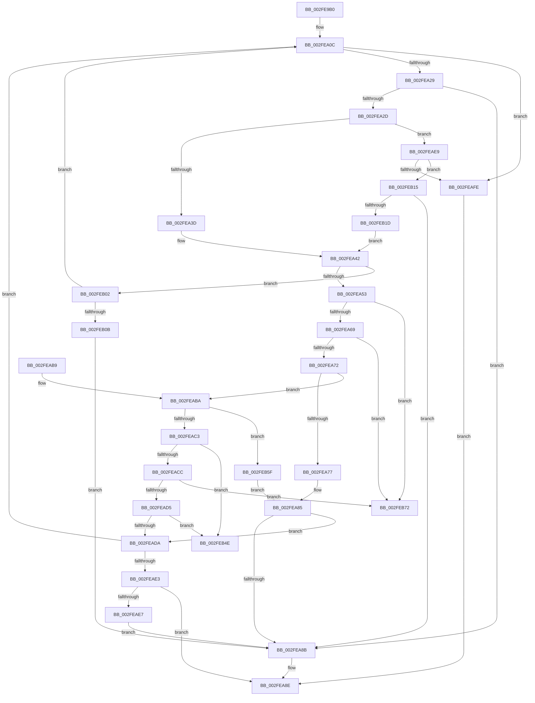

# AuthzBasepValueInSet

- RVA: `0x002FE9B0`–`0x002FEB83` (길이 `467` bytes)
- VA: `0x00000001402FE9B0`
- 실행 섹션: `.text`
- PDB 이름 있음: `예`; PDB Function 태그: `예`
- unwind 정보 RVA: `0x00072E34`
- 디코드: `131`개 명령, `467/467` bytes 표시
- 미해석 바이트: `0` (있으면 어셈블리에 `.byte`로 보존)

> 이 문서는 커널 이미지의 기계어와 PDB 기호를 분석해 생성했습니다. 4번과 5번은 함수 원형과 자료형을 바이너리 사용 방식에서 추정한 C 해석이며 원본 소스 복구 결과는 아닙니다.

## 1. Dependencies

- 직접 호출 지점: **8**; 고유 호출 대상: **7**
- 직접 호출자로 확인된 함수: **2**
- RIP 상대 이미지 참조: **0**

### Outgoing calls
- `0x002FEA17` → [AuthzBasepGetNextValue](../30/AuthzBasepGetNextValue_function_003007E0.md) (function, `0x003007E0`)
- `0x002FEA46` → [AuthzBasepOperandValueTypesCompatible](../30/AuthzBasepOperandValueTypesCompatible_function_00300708.md) (function, `0x00300708`)
- `0x002FEA80` → [AuthzBasepCompareUnicodeStringOperands](AuthzBasepCompareUnicodeStringOperands_function_002FE26C.md) (function, `0x002FE26C`)
- `0x002FEA91` → [AuthzBasepRestartOperandValueEnumeration](AuthzBasepRestartOperandValueEnumeration_function_002FEB8C.md) (function, `0x002FEB8C`)
- `0x002FEAF0` → [AuthzBasepGetNextValue](../30/AuthzBasepGetNextValue_function_003007E0.md) (function, `0x003007E0`)
- `0x002FEB54` → [AuthzBasepCompareOctetStringOperands](../4B/AuthzBasepCompareOctetStringOperands_function_004BD4A8.md) (function, `0x004BD4A8`)
- `0x002FEB68` → [AuthzBasepCompareFQBNOperands](../30/AuthzBasepCompareFQBNOperands_function_00301444.md) (function, `0x00301444`)
- `0x002FEB78` → [AuthzBasepCompareIntegerOperands](../69/AuthzBasepCompareIntegerOperands_function_0069D718.md) (function, `0x0069D718`)

### Direct callers
- [AuthzBasepEvaluateSetRelationship](../30/AuthzBasepEvaluateSetRelationship_function_003008F4.md) at `0x00300998`
- [sub_006DFF8E](../6D/Unknown_function_006DFF8E.md) at `0x006DFFEB`
- [sub_006DFF8E](../6D/Unknown_function_006DFF8E.md) at `0x006E0081`
- [sub_006DFF8E](../6D/Unknown_function_006DFF8E.md) at `0x006E0158`

### Static image references
- 디코드된 RIP-relative 메모리 참조가 없습니다.

## 2. Other-region calls and transfers

- 다른 실행 섹션으로 향하는 call: **0**
- call이 아닌 외부 분기/꼬리 이동: **2**
  - `0x002FEB5A` → [sub_006DFF40](../6D/Unknown_function_006DFF40.md) (`tail-transfer`)
  - `0x002FEB7E` → [sub_006DFF40](../6D/Unknown_function_006DFF40.md) (`tail-transfer`)

## 3. Assembly (complete function range)

```asm
002FE9B0  48 8B C4                        mov rax, rsp
002FE9B3  48 89 58 10                     mov qword ptr [rax + 0x10], rbx
002FE9B7  48 89 70 18                     mov qword ptr [rax + 0x18], rsi
002FE9BB  48 89 78 20                     mov qword ptr [rax + 0x20], rdi
002FE9BF  55                              push rbp
002FE9C0  41 54                           push r12
002FE9C2  41 55                           push r13
002FE9C4  41 56                           push r14
002FE9C6  41 57                           push r15
002FE9C8  48 8D 68 A1                     lea rbp, [rax - 0x5f]
002FE9CC  48 81 EC A0 00 00 00            sub rsp, 0xa0
002FE9D3  0F 10 49 10                     movups xmm1, xmmword ptr [rcx + 0x10]
002FE9D7  33 C0                           xor eax, eax
002FE9D9  45 8A E9                        mov r13b, r9b
002FE9DC  41 21 00                        and dword ptr [r8], eax
002FE9DF  0F 57 C0                        xorps xmm0, xmm0
002FE9E2  0F 11 45 B7                     movups xmmword ptr [rbp - 0x49], xmm0
002FE9E6  49 8B F0                        mov rsi, r8
002FE9E9  48 8B FA                        mov rdi, rdx
002FE9EC  0F 11 45 C7                     movups xmmword ptr [rbp - 0x39], xmm0
002FE9F0  89 45 D7                        mov dword ptr [rbp - 0x29], eax
002FE9F3  0F 10 01                        movups xmm0, xmmword ptr [rcx]
002FE9F6  66 89 45 DB                     mov word ptr [rbp - 0x25], ax
002FE9FA  0F 29 4D F7                     movaps xmmword ptr [rbp - 9], xmm1
002FE9FE  0F 29 45 E7                     movaps xmmword ptr [rbp - 0x19], xmm0
002FEA02  F2 0F 10 41 20                  movsd xmm0, qword ptr [rcx + 0x20]
002FEA07  F2 0F 11 45 07                  movsd qword ptr [rbp + 7], xmm0
002FEA0C  44 8B 67 08                     mov r12d, dword ptr [rdi + 8]
002FEA10  48 8D 55 0F                     lea rdx, [rbp + 0xf]
002FEA14  48 8B CF                        mov rcx, rdi
002FEA17  E8 C4 1D 00 00                  call 0x1403007e0
002FEA1C  8B D8                           mov ebx, eax
002FEA1E  3D 1A 00 00 80                  cmp eax, 0x8000001a
002FEA23  0F 84 D5 00 00 00               je 0x1402feafe
002FEA29  85 C0                           test eax, eax
002FEA2B  78 5E                           js 0x1402fea8b
002FEA2D  44 0F B7 75 E7                  movzx r14d, word ptr [rbp - 0x19]
002FEA32  66 41 83 FE 04                  cmp r14w, 4
002FEA37  0F 84 AC 00 00 00               je 0x1402feae9
002FEA3D  44 0F B7 7D 0F                  movzx r15d, word ptr [rbp + 0xf]
002FEA42  48 8D 4D E7                     lea rcx, [rbp - 0x19]
002FEA46  E8 BD 1C 00 00                  call 0x140300708
002FEA4B  84 C0                           test al, al
002FEA4D  0F 84 AF 00 00 00               je 0x1402feb02
002FEA53  83 7D F3 01                     cmp dword ptr [rbp - 0xd], 1
002FEA57  66 45 0F 44 F7                  cmove r14w, r15w
002FEA5C  41 0F B7 CE                     movzx ecx, r14w
002FEA60  83 E9 01                        sub ecx, 1
002FEA63  0F 84 09 01 00 00               je 0x1402feb72
002FEA69  83 E9 01                        sub ecx, 1
002FEA6C  0F 84 00 01 00 00               je 0x1402feb72
002FEA72  83 E9 01                        sub ecx, 1
002FEA75  75 43                           jne 0x1402feaba
002FEA77  4C 8B C6                        mov r8, rsi
002FEA7A  48 8D 55 E7                     lea rdx, [rbp - 0x19]
002FEA7E  B1 80                           mov cl, 0x80
002FEA80  E8 E7 F7 FF FF                  call 0x1402fe26c
002FEA85  8B D8                           mov ebx, eax
002FEA87  85 C0                           test eax, eax
002FEA89  79 4F                           jns 0x1402feada
002FEA8B  83 0E FF                        or dword ptr [rsi], 0xffffffff
002FEA8E  48 8B CF                        mov rcx, rdi
002FEA91  E8 F6 00 00 00                  call 0x1402feb8c
002FEA96  4C 8D 9C 24 A0 00 00 00         lea r11, [rsp + 0xa0]
002FEA9E  8B C3                           mov eax, ebx
002FEAA0  49 8B 5B 38                     mov rbx, qword ptr [r11 + 0x38]
002FEAA4  49 8B 73 40                     mov rsi, qword ptr [r11 + 0x40]
002FEAA8  49 8B 7B 48                     mov rdi, qword ptr [r11 + 0x48]
002FEAAC  49 8B E3                        mov rsp, r11
002FEAAF  41 5F                           pop r15
002FEAB1  41 5E                           pop r14
002FEAB3  41 5D                           pop r13
002FEAB5  41 5C                           pop r12
002FEAB7  5D                              pop rbp
002FEAB8  C3                              ret
002FEAB9  CC                              int3
002FEABA  83 E9 01                        sub ecx, 1
002FEABD  0F 84 9C 00 00 00               je 0x1402feb5f
002FEAC3  83 E9 01                        sub ecx, 1
002FEAC6  0F 84 82 00 00 00               je 0x1402feb4e
002FEACC  83 E9 01                        sub ecx, 1
002FEACF  0F 84 9D 00 00 00               je 0x1402feb72
002FEAD5  83 F9 0A                        cmp ecx, 0xa
002FEAD8  74 74                           je 0x1402feb4e
002FEADA  83 3E 01                        cmp dword ptr [rsi], 1
002FEADD  0F 85 29 FF FF FF               jne 0x1402fea0c
002FEAE3  85 DB                           test ebx, ebx
002FEAE5  79 A7                           jns 0x1402fea8e
002FEAE7  EB A2                           jmp 0x1402fea8b
002FEAE9  48 8D 55 B7                     lea rdx, [rbp - 0x49]
002FEAED  48 8B CF                        mov rcx, rdi
002FEAF0  E8 EB 1C 00 00                  call 0x1403007e0
002FEAF5  8B D8                           mov ebx, eax
002FEAF7  3D 1A 00 00 80                  cmp eax, 0x8000001a
002FEAFC  75 17                           jne 0x1402feb15
002FEAFE  33 DB                           xor ebx, ebx
002FEB00  EB 8C                           jmp 0x1402fea8e
002FEB02  45 84 ED                        test r13b, r13b
002FEB05  0F 85 01 FF FF FF               jne 0x1402fea0c
002FEB0B  BB A2 01 00 C0                  mov ebx, 0xc00001a2
002FEB10  E9 76 FF FF FF                  jmp 0x1402fea8b
002FEB15  85 C0                           test eax, eax
002FEB17  0F 88 6E FF FF FF               js 0x1402fea8b
002FEB1D  8A 47 04                        mov al, byte ptr [rdi + 4]
002FEB20  83 65 17 00                     and dword ptr [rbp + 0x17], 0
002FEB24  44 0F B7 3F                     movzx r15d, word ptr [rdi]
002FEB28  88 45 13                        mov byte ptr [rbp + 0x13], al
002FEB2B  48 8B 47 10                     mov rax, qword ptr [rdi + 0x10]
002FEB2F  48 89 45 1F                     mov qword ptr [rbp + 0x1f], rax
002FEB33  8B 47 08                        mov eax, dword ptr [rdi + 8]
002FEB36  89 45 27                        mov dword ptr [rbp + 0x27], eax
002FEB39  49 8B C4                        mov rax, r12
002FEB3C  48 03 47 20                     add rax, qword ptr [rdi + 0x20]
002FEB40  48 89 45 2F                     mov qword ptr [rbp + 0x2f], rax
002FEB44  66 44 89 7D 0F                  mov word ptr [rbp + 0xf], r15w
002FEB49  E9 F4 FE FF FF                  jmp 0x1402fea42
002FEB4E  48 8D 55 E7                     lea rdx, [rbp - 0x19]
002FEB52  B1 80                           mov cl, 0x80
002FEB54  E8 4F E9 1B 00                  call 0x1404bd4a8
002FEB59  90                              nop
002FEB5A  E9 E1 13 3E 00                  jmp 0x1406dff40
002FEB5F  4C 8B C6                        mov r8, rsi
002FEB62  48 8D 55 E7                     lea rdx, [rbp - 0x19]
002FEB66  B1 80                           mov cl, 0x80
002FEB68  E8 D7 28 00 00                  call 0x140301444
002FEB6D  E9 13 FF FF FF                  jmp 0x1402fea85
002FEB72  48 8D 55 E7                     lea rdx, [rbp - 0x19]
002FEB76  B1 80                           mov cl, 0x80
002FEB78  E8 9B EB 39 00                  call 0x14069d718
002FEB7D  90                              nop
002FEB7E  E9 BD 13 3E 00                  jmp 0x1406dff40
```

## 4. C-style interpretation (structured pseudocode)

```c
__int64 __fastcall AuthzBasepValueInSet(__int64 a1, __int64 a2, __int64 a3, unsigned __int8 a4)
{
    __int64 result;
    __int64 v_r14;
    __int64 v_rbx;
    __int64 v_rsp;
    unsigned __int64 v_stack_m28;

    *(unsigned __int64 *)(v_rsp + 16) = v_rbx;
    *(unsigned __int64 *)(v_rsp + 24) = v_rsi;
    *(unsigned __int64 *)(v_rsp + 32) = v_rdi;
    v_rsp = (v_rsp) - (160);
    result = 0;
    *(unsigned __int64 *)(v_rsp - 95 - 73) = v_xmm0;
    *(unsigned __int64 *)(v_rsp - 95 - 57) = v_xmm0;
    *(unsigned int *)(v_rsp - 95 - 41) = 0;
    *(unsigned __int16 *)(v_rsp - 95 - 37) = 0;
    *(unsigned __int64 *)(v_rsp - 95 - 9) = v_xmm1;
    *(unsigned __int64 *)(v_rsp - 95 - 25) = v_xmm0;
    *(unsigned __int64 *)(v_rsp - 95 + 7) = v_xmm0;
loc_002FEA0C:
    result = AuthzBasepGetNextValue(a2, v_rsp - 95 + 15, a3, a4);
    if (((unsigned int)(result)) == 0x8000001AULL) goto loc_002FEAFE;
    if (sign_flag) goto loc_002FEA8B;
    if (((unsigned __int16)(*(unsigned __int16 *)(v_rsp - 95 - 25))) == 4) goto loc_002FEAE9;
loc_002FEA42:
    result = AuthzBasepOperandValueTypesCompatible(v_rsp - 95 - 25, v_rsp - 95 + 15, a3, a4);
    if ((unsigned __int8)(result) == 0) goto loc_002FEB02;
    v_r14 = *(unsigned __int16 *)(v_rsp - 95 - 25);
    if ((*(unsigned int *)(v_rsp - 95 - 13)) == 1) { v_r14 = (unsigned __int16)(*(unsigned __int16 *)(v_rsp - 95 + 15)); }
    a1 = (unsigned int)(((unsigned __int16)(v_r14)) - (1));
    if (condition_is_equal) goto loc_002FEB72;
    a1 = (unsigned int)((a1) - (1));
    if (condition_is_equal) goto loc_002FEB72;
    a1 = (unsigned int)((a1) - (1));
    if (condition_is_not_equal) goto loc_002FEABA;
    result = AuthzBasepCompareUnicodeStringOperands(128, v_rsp - 95 - 25, a3, a4);
loc_002FEA85:
    if (!sign_flag) goto loc_002FEADA;
loc_002FEA8B:
loc_002FEA8E:
    result = AuthzBasepRestartOperandValueEnumeration(a2, v_rsp - 95 - 25, a3, a4);
    return (unsigned int)((unsigned int)((unsigned int)((unsigned int)(result))));
loc_002FEABA:
    a1 = (unsigned int)((a2) - (1));
    if (condition_is_equal) goto loc_002FEB5F;
    a1 = (unsigned int)((a1) - (1));
    if (condition_is_equal) goto loc_002FEB4E;
    a1 = (unsigned int)((a1) - (1));
    if (condition_is_equal) goto loc_002FEB72;
    if (((unsigned int)(a1)) == 10) goto loc_002FEB4E;
loc_002FEADA:
    if ((*(unsigned int *)(*(unsigned __int64 *)(v_stack_m28 + 64))) != 1) goto loc_002FEA0C;
    if (!sign_flag) goto loc_002FEA8E;
    goto loc_002FEA8B;
loc_002FEAE9:
    result = AuthzBasepGetNextValue(*(unsigned __int64 *)(v_stack_m28 + 72), v_rsp - 95 - 73, a3, a4);
    if (((unsigned int)(result)) != 0x8000001AULL) goto loc_002FEB15;
loc_002FEAFE:
    v_rbx = 0;
    goto loc_002FEA8E;
loc_002FEB02:
    if (a4 != 0) goto loc_002FEA0C;
    goto loc_002FEA8B;
loc_002FEB15:
    if (sign_flag) goto loc_002FEA8B;
    *(unsigned __int8 *)(v_rsp - 95 + 19) = (unsigned __int8)(*(unsigned __int8 *)(*(unsigned __int64 *)(v_stack_m28 + 72) + 4));
    *(unsigned __int64 *)(v_rsp - 95 + 31) = *(unsigned __int64 *)(*(unsigned __int64 *)(v_stack_m28 + 72) + 16);
    *(unsigned int *)(v_rsp - 95 + 39) = (unsigned int)((unsigned int)(*(unsigned int *)(*(unsigned __int64 *)(v_stack_m28 + 72) + 8)));
    result = ((unsigned int)(*(unsigned int *)(a2 + 8))) + (*(unsigned __int64 *)(*(unsigned __int64 *)(v_stack_m28 + 72) + 32));
    *(unsigned __int64 *)(v_rsp - 95 + 47) = result;
    *(unsigned __int16 *)(v_rsp - 95 + 15) = (unsigned __int16)(*(unsigned __int16 *)(*(unsigned __int64 *)(v_stack_m28 + 72)));
    goto loc_002FEA42;
loc_002FEB4E:
    result = AuthzBasepCompareOctetStringOperands(128, v_rsp - 95 - 25, a3, a4);
loc_002FEB5F:
    result = AuthzBasepCompareFQBNOperands(128, v_rsp - 95 - 25, *(unsigned __int64 *)(v_stack_m28 + 64), a4);
    goto loc_002FEA85;
loc_002FEB72:
    result = AuthzBasepCompareIntegerOperands(128, v_rsp - 95 - 25, *(unsigned __int64 *)(v_stack_m28 + 64), a4);
}
```

## 5. (Beta) C Style

```c
int64_t AuthzBasepValueInSet(void *Arg1, void *Arg2, void *Arg3, uint8_t Arg4)
{
    uint8_t *arg1 = (uint8_t *)Arg1;
    uint8_t *arg2 = (uint8_t *)Arg2;
    uint8_t *arg3 = (uint8_t *)Arg3;

    int64_t result;
    int64_t local_r14;
    int64_t local_rbx;
    int64_t local_rsp;
    uint64_t v_stack_m28;

    *(uint64_t *)(local_rsp + 0x10) = local_rbx;
    *(uint64_t *)(local_rsp + 0x18) = local_rsi;
    *(uint64_t *)(local_rsp + 0x20) = local_rdi;
    local_rsp = (local_rsp) - (160);
    result = 0;
    *(uint64_t *)(local_rsp - 0x5F - 0x49) = v_xmm0;
    *(uint64_t *)(local_rsp - 0x5F - 0x39) = v_xmm0;
    *(uint32_t *)(local_rsp - 0x5F - 0x29) = 0;
    *(uint16_t *)(local_rsp - 0x5F - 0x25) = 0;
    *(uint64_t *)(local_rsp - 0x5F - 0x9) = v_xmm1;
    *(uint64_t *)(local_rsp - 0x5F - 0x19) = v_xmm0;
    *(uint64_t *)(local_rsp - 0x5F + 0x7) = v_xmm0;
loc_002FEA0C:
    result = AuthzBasepGetNextValue(Arg2, local_rsp - 95 + 15, Arg3, Arg4);
    if (((uint32_t)(result)) == 0x8000001AULL) goto loc_002FEAFE;
    if (sign_flag) goto loc_002FEA8B;
    if (((uint16_t)(*(uint16_t *)(local_rsp - 0x5F - 0x19))) == 4) goto loc_002FEAE9;
loc_002FEA42:
    result = AuthzBasepOperandValueTypesCompatible(local_rsp - 95 - 25, local_rsp - 95 + 15, Arg3, Arg4);
    if ((uint8_t)(result) == 0) goto loc_002FEB02;
    local_r14 = *(uint16_t *)(local_rsp - 0x5F - 0x19);
    if ((*(uint32_t *)(local_rsp - 0x5F - 0xD)) == 1) { local_r14 = (uint16_t)(*(uint16_t *)(local_rsp - 0x5F + 0xF)); }
    Arg1 = (uint32_t)(((uint16_t)(local_r14)) - (1));
    if (condition_is_equal) goto loc_002FEB72;
    Arg1 = (uint32_t)((Arg1) - (1));
    if (condition_is_equal) goto loc_002FEB72;
    Arg1 = (uint32_t)((Arg1) - (1));
    if (condition_is_not_equal) goto loc_002FEABA;
    result = AuthzBasepCompareUnicodeStringOperands(128, local_rsp - 95 - 25, Arg3, Arg4);
loc_002FEA85:
    if (!sign_flag) goto loc_002FEADA;
loc_002FEA8B:
loc_002FEA8E:
    result = AuthzBasepRestartOperandValueEnumeration(Arg2, local_rsp - 95 - 25, Arg3, Arg4);
    return (uint32_t)((uint32_t)((uint32_t)((uint32_t)(result))));
loc_002FEABA:
    Arg1 = (uint32_t)((Arg2) - (1));
    if (condition_is_equal) goto loc_002FEB5F;
    Arg1 = (uint32_t)((Arg1) - (1));
    if (condition_is_equal) goto loc_002FEB4E;
    Arg1 = (uint32_t)((Arg1) - (1));
    if (condition_is_equal) goto loc_002FEB72;
    if (((uint32_t)(Arg1)) == 10) goto loc_002FEB4E;
loc_002FEADA:
    if ((*(uint32_t *)(*(uint64_t *)(v_stack_m28 + 0x40))) != 1) goto loc_002FEA0C;
    if (!sign_flag) goto loc_002FEA8E;
    goto loc_002FEA8B;
loc_002FEAE9:
    result = AuthzBasepGetNextValue(*(uint64_t *)(v_stack_m28 + 0x48), local_rsp - 95 - 73, Arg3, Arg4);
    if (((uint32_t)(result)) != 0x8000001AULL) goto loc_002FEB15;
loc_002FEAFE:
    local_rbx = 0;
    goto loc_002FEA8E;
loc_002FEB02:
    if (Arg4 != 0) goto loc_002FEA0C;
    goto loc_002FEA8B;
loc_002FEB15:
    if (sign_flag) goto loc_002FEA8B;
    *(uint8_t *)(local_rsp - 0x5F + 0x13) = (uint8_t)(*(uint8_t *)(*(uint64_t *)(v_stack_m28 + 0x48) + 0x4));
    *(uint64_t *)(local_rsp - 0x5F + 0x1F) = *(uint64_t *)(*(uint64_t *)(v_stack_m28 + 0x48) + 0x10);
    *(uint32_t *)(local_rsp - 0x5F + 0x27) = (uint32_t)((uint32_t)(*(uint32_t *)(*(uint64_t *)(v_stack_m28 + 0x48) + 0x8)));
    result = ((uint32_t)(*(uint32_t *)(arg2 + 0x8))) + (*(uint64_t *)(*(uint64_t *)(v_stack_m28 + 0x48) + 0x20));
    *(uint64_t *)(local_rsp - 0x5F + 0x2F) = result;
    *(uint16_t *)(local_rsp - 0x5F + 0xF) = (uint16_t)(*(uint16_t *)(*(uint64_t *)(v_stack_m28 + 0x48)));
    goto loc_002FEA42;
loc_002FEB4E:
    result = AuthzBasepCompareOctetStringOperands(128, local_rsp - 95 - 25, Arg3, Arg4);
loc_002FEB5F:
    result = AuthzBasepCompareFQBNOperands(128, local_rsp - 95 - 25, *(uint64_t *)(v_stack_m28 + 0x40), Arg4);
    goto loc_002FEA85;
loc_002FEB72:
    result = AuthzBasepCompareIntegerOperands(128, local_rsp - 95 - 25, *(uint64_t *)(v_stack_m28 + 0x40), Arg4);
}
```

### 관측된 메모리 오프셋

구조체 형식이 확인되지 않은 접근은 인자 기준의 오프셋으로만 기록했습니다.

| 기준 인자 | 오프셋 표현 | 폭 (bit) | 접근 |
|---|---:|---:|---|
| `Arg1` | `+ 0x0` | `128` | `R` |
| `Arg1` | `+ 0x10` | `128` | `R` |
| `Arg1` | `+ 0x20` | `64` | `R` |
| `Arg2` | `+ 0x0` | `16` | `R` |
| `Arg2` | `+ 0x4` | `8` | `R` |
| `Arg2` | `+ 0x8` | `32` | `R` |
| `Arg2` | `+ 0x10` | `64` | `R` |
| `Arg2` | `+ 0x20` | `64` | `R` |
| `Arg3` | `+ 0x0` | `32` | `R` |
| `Arg3` | `+ 0x0` | `32` | `R/W` |

## 6. Execution-region graph

[열기: 2D/3D 그래프와 함수 탐색 컨트롤 패널](../../../control-panel.html?section=text&rva=0x002FE9B0&view=graph)

- 2D 그래프는 위에서 아래로 흐르고, 3D 그래프는 빈 공간을 드래그해 회전합니다. Shift+드래그는 이동, 휠은 확대·축소, 함수 노드 선택은 대상 보고서 이동입니다.

### Static fallback


