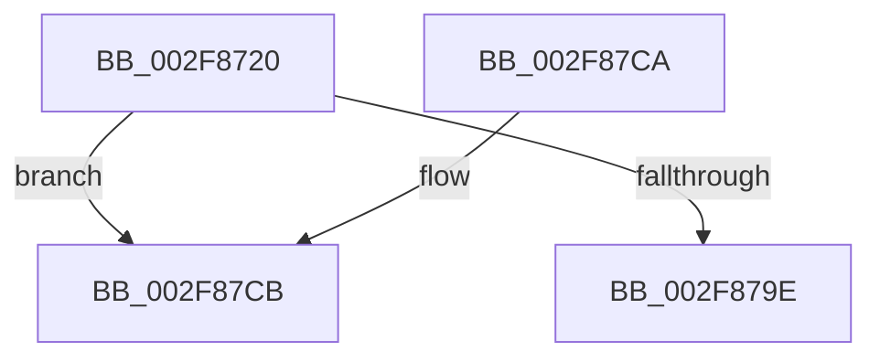

# CcFetchDataForRead

- RVA: `0x002F8720`–`0x002F87D4` (길이 `180` bytes)
- VA: `0x00000001402F8720`
- 실행 섹션: `.text`
- PDB 이름 있음: `예`; PDB Function 태그: `아니요`
- unwind 정보 RVA: `0x00072688`
- 디코드: `51`개 명령, `180/180` bytes 표시
- 미해석 바이트: `0` (있으면 어셈블리에 `.byte`로 보존)

> 이 문서는 커널 이미지의 기계어와 PDB 기호를 분석해 생성했습니다. 4번과 5번은 함수 원형과 자료형을 바이너리 사용 방식에서 추정한 C 해석이며 원본 소스 복구 결과는 아닙니다.

## 1. Dependencies

- 직접 호출 지점: **2**; 고유 호출 대상: **2**
- 직접 호출자로 확인된 함수: **2**
- RIP 상대 이미지 참조: **0**

### Outgoing calls
- `0x002F8795` → [MmHardFaultBytesRequired](../../page/9A/MmHardFaultBytesRequired_function_009A70F0.md) (function, `0x009A70F0`)
- `0x002F87AA` → [MmCheckCachedPageStates](MmCheckCachedPageStates_function_002F6C60.md) (function, `0x002F6C60`)

### Direct callers
- [CcMapAndCopyFromCache](../../page/A4/CcMapAndCopyFromCache_function_00A47060.md) at `0x00A47191`
- [CcMdlRead](../../page/AB/CcMdlRead_function_00ABA520.md) at `0x00ABA63F`

### Static image references
- 디코드된 RIP-relative 메모리 참조가 없습니다.

## 2. Other-region calls and transfers

- 다른 실행 섹션으로 향하는 call: **1**
  - `0x002F8795` → [MmHardFaultBytesRequired](../../page/9A/MmHardFaultBytesRequired_function_009A70F0.md) (`.text` → `PAGE`)
- call이 아닌 외부 분기/꼬리 이동: **1**
  - `0x002F87CE` → [sub_002F880D + 0x5B](Unknown_function_002F880D.md) (`tail-transfer`)

## 3. Assembly (complete function range)

```asm
002F8720  48 89 5C 24 10                  mov qword ptr [rsp + 0x10], rbx
002F8725  48 89 6C 24 18                  mov qword ptr [rsp + 0x18], rbp
002F872A  48 89 74 24 20                  mov qword ptr [rsp + 0x20], rsi
002F872F  57                              push rdi
002F8730  41 56                           push r14
002F8732  41 57                           push r15
002F8734  48 83 EC 40                     sub rsp, 0x40
002F8738  4C 8B 12                        mov r10, qword ptr [rdx]
002F873B  4C 8B F9                        mov r15, rcx
002F873E  4C 8B B4 24 88 00 00 00         mov r14, qword ptr [rsp + 0x88]
002F8746  49 8B FA                        mov rdi, r10
002F8749  48 81 E7 00 F0 FF FF            and rdi, 0xfffffffffffff000
002F8750  41 8B C0                        mov eax, r8d
002F8753  48 8B F7                        mov rsi, rdi
002F8756  B9 00 00 04 00                  mov ecx, 0x40000
002F875B  81 E6 FF FF 03 00               and esi, 0x3ffff
002F8761  49 8D 9A FF 0F 00 00            lea rbx, [r10 + 0xfff]
002F8768  49 03 36                        add rsi, qword ptr [r14]
002F876B  48 03 D8                        add rbx, rax
002F876E  8B C6                           mov eax, esi
002F8770  48 81 E3 00 F0 FF FF            and rbx, 0xfffffffffffff000
002F8777  25 FF FF 03 00                  and eax, 0x3ffff
002F877C  48 2B DF                        sub rbx, rdi
002F877F  2B C8                           sub ecx, eax
002F8781  48 8B D7                        mov rdx, rdi
002F8784  3B CB                           cmp ecx, ebx
002F8786  45 0F B6 D9                     movzx r11d, r9b
002F878A  0F 43 CB                        cmovae ecx, ebx
002F878D  8B E9                           mov ebp, ecx
002F878F  44 8B C1                        mov r8d, ecx
002F8792  48 8B CE                        mov rcx, rsi
002F8795  E8 56 E9 6A 00                  call 0x1409a70f0
002F879A  85 C0                           test eax, eax
002F879C  75 2D                           jne 0x1402f87cb
002F879E  45 33 C9                        xor r9d, r9d
002F87A1  45 33 C0                        xor r8d, r8d
002F87A4  48 8B D5                        mov rdx, rbp
002F87A7  48 8B CE                        mov rcx, rsi
002F87AA  E8 B1 E4 FF FF                  call 0x1402f6c60
002F87AF  B0 01                           mov al, 1
002F87B1  48 8B 5C 24 68                  mov rbx, qword ptr [rsp + 0x68]
002F87B6  48 8B 6C 24 70                  mov rbp, qword ptr [rsp + 0x70]
002F87BB  48 8B 74 24 78                  mov rsi, qword ptr [rsp + 0x78]
002F87C0  48 83 C4 40                     add rsp, 0x40
002F87C4  41 5F                           pop r15
002F87C6  41 5E                           pop r14
002F87C8  5F                              pop rdi
002F87C9  C3                              ret
002F87CA  CC                              int3
002F87CB  45 84 DB                        test r11b, r11b
002F87CE  0F 84 94 00 00 00               je 0x1402f8868
```

## 4. C-style interpretation (structured pseudocode)

```c
__int64 __fastcall CcFetchDataForRead(__int64 a1, __int64 a2, int a3, int a4, __int64 a5, __int64 a6)
{
    __int64 result;
    __int64 v_rbx;
    __int64 v_rdi;
    __int64 v_rsi;
    __int64 v_rsp;
    unsigned __int64 v_stack_p10;
    unsigned __int64 v_stack_p18;
    unsigned __int64 v_stack_p20;

    v_stack_p10 = v_rbx;
    v_stack_p18 = v_rbp;
    v_stack_p20 = v_rsi;
    v_rsp = (v_rsp) - (64);
    v_rdi = (*(unsigned __int64 *)(a2)) & (0xFFFFFFFFFFFFF000ULL);
    v_rsi = (unsigned int)((v_rdi) & (0x3FFFFULL));
    v_rsi = (v_rsi) + (*(unsigned __int64 *)(a6));
    v_rbx = (*(unsigned __int64 *)(a2) + 4095) + ((unsigned int)(a3));
    v_rbx = (v_rbx) & (0xFFFFFFFFFFFFF000ULL);
    result = (unsigned int)(((unsigned int)((unsigned int)(v_rsi))) & (0x3FFFFULL));
    v_rbx = (v_rbx) - (v_rdi);
    a1 = (unsigned int)(((unsigned int)(0x40000ULL)) - ((unsigned int)(result)));
    if (((unsigned int)(a1)) >= ((unsigned int)(v_rbx))) { a1 = (unsigned int)(v_rbx); }
    result = MmHardFaultBytesRequired(v_rsi, v_rdi, (unsigned int)((unsigned int)(a1)), a4);
    if ((unsigned int)(result) != 0) goto loc_002F87CB;
    a4 = 0;
    a3 = 0;
    result = MmCheckCachedPageStates(v_rsi, (unsigned int)((unsigned int)(a1)), a3, a4);
    v_rsp = (v_rsp) + (64);
    return 1;
loc_002F87CB:
}
```

## 5. (Beta) C Style

```c
int64_t CcFetchDataForRead(int64_t Arg1, void *Arg2, int32_t Arg3, int32_t Arg4, uint64_t Arg5, void *Arg6)
{
    uint8_t *arg2 = (uint8_t *)Arg2;
    uint8_t *arg6 = (uint8_t *)Arg6;

    int64_t result;
    int64_t local_rbx;
    int64_t local_rdi;
    int64_t local_rsi;
    int64_t local_rsp;
    uint64_t v_stack_p10;
    uint64_t v_stack_p18;
    uint64_t v_stack_p20;

    v_stack_p10 = local_rbx;
    v_stack_p18 = local_rbp;
    v_stack_p20 = local_rsi;
    local_rsp = (local_rsp) - (64);
    local_rdi = (*(uint64_t *)(arg2)) & (0xFFFFFFFFFFFFF000ULL);
    local_rsi = (uint32_t)((local_rdi) & (0x3FFFFULL));
    local_rsi = (local_rsi) + (*(uint64_t *)(arg6));
    local_rbx = (*(uint64_t *)(arg2) + 4095) + ((uint32_t)(Arg3));
    local_rbx = (local_rbx) & (0xFFFFFFFFFFFFF000ULL);
    result = (uint32_t)(((uint32_t)((uint32_t)(local_rsi))) & (0x3FFFFULL));
    local_rbx = (local_rbx) - (local_rdi);
    Arg1 = (uint32_t)(((uint32_t)(0x40000ULL)) - ((uint32_t)(result)));
    if (((uint32_t)(Arg1)) >= ((uint32_t)(local_rbx))) { Arg1 = (uint32_t)(local_rbx); }
    result = MmHardFaultBytesRequired(local_rsi, local_rdi, (uint32_t)((uint32_t)(Arg1)), Arg4);
    if ((uint32_t)(result) != 0) goto loc_002F87CB;
    Arg4 = 0;
    Arg3 = 0;
    result = MmCheckCachedPageStates(local_rsi, (uint32_t)((uint32_t)(Arg1)), Arg3, Arg4);
    local_rsp = (local_rsp) + (64);
    return 1;
loc_002F87CB:
}
```

### 관측된 메모리 오프셋

구조체 형식이 확인되지 않은 접근은 인자 기준의 오프셋으로만 기록했습니다.

| 기준 인자 | 오프셋 표현 | 폭 (bit) | 접근 |
|---|---:|---:|---|
| `Arg2` | `+ 0x0` | `64` | `R` |
| `Arg6` | `+ 0x0` | `64` | `R` |

## 6. Execution-region graph

[열기: 2D/3D 그래프와 함수 탐색 컨트롤 패널](../../../control-panel.html?section=text&rva=0x002F8720&view=graph)

- 2D 그래프는 위에서 아래로 흐르고, 3D 그래프는 빈 공간을 드래그해 회전합니다. Shift+드래그는 이동, 휠은 확대·축소, 함수 노드 선택은 대상 보고서 이동입니다.

### Static fallback


