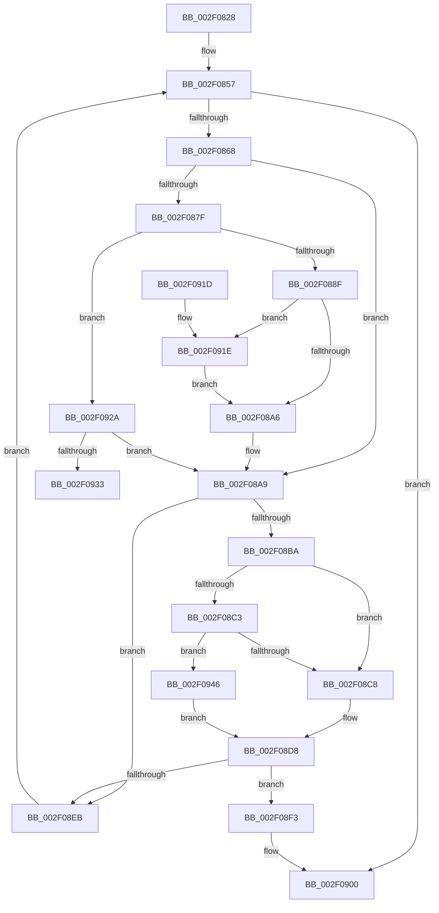

# CcForEachPartition

- RVA: `0x002F0828`–`0x002F0956` (길이 `302` bytes)
- VA: `0x00000001402F0828`
- 실행 섹션: `.text`
- PDB 이름 있음: `예`; PDB Function 태그: `예`
- unwind 정보 RVA: `0x00071CF0`
- 디코드: `83`개 명령, `302/302` bytes 표시
- 미해석 바이트: `0` (있으면 어셈블리에 `.byte`로 보존)

> 이 문서는 커널 이미지의 기계어와 PDB 기호를 분석해 생성했습니다. 4번과 5번은 함수 원형과 자료형을 바이너리 사용 방식에서 추정한 C 해석이며 원본 소스 복구 결과는 아닙니다.

## 1. Dependencies

- 직접 호출 지점: **7**; 고유 호출 대상: **7**
- 직접 호출자로 확인된 함수: **4**
- RIP 상대 이미지 참조: **2**

### Outgoing calls
- `0x002F0857` → [PsGetNextPartitionUnsafe](PsGetNextPartitionUnsafe_function_002F0E38.md) (function, `0x002F0E38`)
- `0x002F086F` → [KeAcquireSpinLockRaiseToDpc](../20/KeAcquireSpinLockRaiseToDpc_function_00208470.md) (function, `0x00208470`)
- `0x002F08B0` → [KeReleaseSpinLock](../39/KeReleaseSpinLock_function_00392BA0.md) (function, `0x00392BA0`)
- `0x002F08D3` → [guard_dispatch_icall](../6B/guard_dispatch_icall_function_006BAAD0.md) (function, `0x006BAAD0`)
- `0x002F08DE` → [CcDereferencePartition](../35/CcDereferencePartition_function_003572F0.md) (function, `0x003572F0`)
- `0x002F08FB` → [ObfDereferenceObjectWithTag](ObfDereferenceObjectWithTag_function_002F78E0.md) (function, `0x002F78E0`)
- `0x002F094F` → [CcForEachPrivateVolumeCacheMap](../38/CcForEachPrivateVolumeCacheMap_function_0038967C.md) (function, `0x0038967C`)

### Direct callers
- [MiFlushAllFilesystemPages](../4E/MiFlushAllFilesystemPages_function_004E141C.md) at `0x004E14D8`
- [CcNotifyWriteBehind](../57/CcNotifyWriteBehind_function_0057BA4C.md) at `0x0057BA61`
- [CcWaitForCurrentLazyWriterActivity](../57/CcWaitForCurrentLazyWriterActivity_function_0057C5C0.md) at `0x0057C5DB`
- [CcTelemetryPeriodicTimerCallback](../../page/A8/CcTelemetryPeriodicTimerCallback_function_00A88370.md) at `0x00A883DC`

### Static image references
- `0x002F0868` → RVA `0x00F8F510` (`.data`; read)
- `0x002F08BA` → RVA `0x00E65B88` (`.data`; read)

## 2. Other-region calls and transfers

- 다른 실행 섹션으로 향하는 call: **0**
- call이 아닌 외부 분기/꼬리 이동: **1**
  - `0x002F0941` → [sub_006DEE96](../6D/Unknown_function_006DEE96.md) (`tail-transfer`)

## 3. Assembly (complete function range)

```asm
002F0828  48 89 5C 24 08                  mov qword ptr [rsp + 8], rbx
002F082D  48 89 6C 24 10                  mov qword ptr [rsp + 0x10], rbp
002F0832  48 89 74 24 18                  mov qword ptr [rsp + 0x18], rsi
002F0837  57                              push rdi
002F0838  41 54                           push r12
002F083A  41 55                           push r13
002F083C  41 56                           push r14
002F083E  41 57                           push r15
002F0840  48 83 EC 20                     sub rsp, 0x20
002F0844  33 DB                           xor ebx, ebx
002F0846  40 32 FF                        xor dil, dil
002F0849  4C 8B F9                        mov r15, rcx
002F084C  45 8A E1                        mov r12b, r9b
002F084F  33 C9                           xor ecx, ecx
002F0851  45 8A E8                        mov r13b, r8b
002F0854  4C 8B F2                        mov r14, rdx
002F0857  E8 DC 05 00 00                  call 0x1402f0e38
002F085C  48 8B F0                        mov rsi, rax
002F085F  48 85 C0                        test rax, rax
002F0862  0F 84 98 00 00 00               je 0x1402f0900
002F0868  48 8D 0D A1 EC C9 00            lea rcx, [rip + 0xc9eca1]
002F086F  E8 FC 7B F1 FF                  call 0x140208470
002F0874  48 8B 4E 08                     mov rcx, qword ptr [rsi + 8]
002F0878  8A D0                           mov dl, al
002F087A  48 85 C9                        test rcx, rcx
002F087D  74 2A                           je 0x1402f08a9
002F087F  80 B9 0E 05 00 00 02            cmp byte ptr [rcx + 0x50e], 2
002F0886  48 8B D9                        mov rbx, rcx
002F0889  0F 83 9B 00 00 00               jae 0x1402f092a
002F088F  B9 01 00 00 00                  mov ecx, 1
002F0894  F0 48 0F C1 8B 10 05 00 00      lock xadd qword ptr [rbx + 0x510], rcx
002F089D  48 FF C1                        inc rcx
002F08A0  48 83 F9 01                     cmp rcx, 1
002F08A4  7E 78                           jle 0x1402f091e
002F08A6  40 B7 01                        mov dil, 1
002F08A9  48 8D 0D 60 EC C9 00            lea rcx, [rip + 0xc9ec60]
002F08B0  E8 EB 22 0A 00                  call 0x140392ba0
002F08B5  40 84 FF                        test dil, dil
002F08B8  74 31                           je 0x1402f08eb
002F08BA  80 3D C7 52 B7 00 00            cmp byte ptr [rip + 0xb752c7], 0
002F08C1  74 05                           je 0x1402f08c8
002F08C3  45 84 E4                        test r12b, r12b
002F08C6  74 7E                           je 0x1402f0946
002F08C8  4D 8B C6                        mov r8, r14
002F08CB  33 D2                           xor edx, edx
002F08CD  48 8B CB                        mov rcx, rbx
002F08D0  49 8B C7                        mov rax, r15
002F08D3  E8 F8 A1 3C 00                  call 0x1406baad0
002F08D8  48 8B CB                        mov rcx, rbx
002F08DB  40 8A E8                        mov bpl, al
002F08DE  E8 0D 6A 06 00                  call 0x1403572f0
002F08E3  40 32 FF                        xor dil, dil
002F08E6  40 84 ED                        test bpl, bpl
002F08E9  74 08                           je 0x1402f08f3
002F08EB  48 8B CE                        mov rcx, rsi
002F08EE  E9 64 FF FF FF                  jmp 0x1402f0857
002F08F3  BA 50 73 45 6E                  mov edx, 0x6e457350
002F08F8  48 8B CE                        mov rcx, rsi
002F08FB  E8 E0 6F 00 00                  call 0x1402f78e0
002F0900  48 8B 5C 24 50                  mov rbx, qword ptr [rsp + 0x50]
002F0905  48 8B 6C 24 58                  mov rbp, qword ptr [rsp + 0x58]
002F090A  48 8B 74 24 60                  mov rsi, qword ptr [rsp + 0x60]
002F090F  48 83 C4 20                     add rsp, 0x20
002F0913  41 5F                           pop r15
002F0915  41 5E                           pop r14
002F0917  41 5D                           pop r13
002F0919  41 5C                           pop r12
002F091B  5F                              pop rdi
002F091C  C3                              ret
002F091D  CC                              int3
002F091E  B9 0E 00 00 00                  mov ecx, 0xe
002F0923  CD 29                           int 0x29
002F0925  E9 7C FF FF FF                  jmp 0x1402f08a6
002F092A  45 84 ED                        test r13b, r13b
002F092D  0F 84 76 FF FF FF               je 0x1402f08a9
002F0933  0F 0D 89 10 05 00 00            prefetchw byte ptr [rcx + 0x510]
002F093A  48 8B 81 10 05 00 00            mov rax, qword ptr [rcx + 0x510]
002F0941  E9 50 E5 3E 00                  jmp 0x1406dee96
002F0946  4D 8B C6                        mov r8, r14
002F0949  49 8B D7                        mov rdx, r15
002F094C  48 8B CB                        mov rcx, rbx
002F094F  E8 28 8D 09 00                  call 0x14038967c
002F0954  EB 82                           jmp 0x1402f08d8
```

## 4. C-style interpretation (structured pseudocode)

```c
__int64 __fastcall CcForEachPartition(__int64 a1, __int64 a2, unsigned __int8 a3, unsigned __int8 a4)
{
    __int64 result;
    __int64 v_rbx;
    __int64 v_rdi;
    __int64 v_rsp;
    unsigned __int64 v_stack_p10;
    unsigned __int64 v_stack_p18;
    unsigned __int64 v_stack_p8;

    v_stack_p8 = v_rbx;
    v_stack_p10 = v_rbp;
    v_stack_p18 = v_rsi;
    v_rsp = (v_rsp) - (32);
    v_rbx = 0;
    v_rdi = 0;
    a1 = 0;
loc_002F0857:
    result = PsGetNextPartitionUnsafe(a1, a2, a3, a4);
    if (result == 0) goto loc_002F0900;
    result = KeAcquireSpinLockRaiseToDpc(v_rip + 13233313, a2, a3, a4);
    if (*(unsigned __int64 *)(result + 8) == 0) goto loc_002F08A9;
    if ((*(unsigned __int8 *)(*(unsigned __int64 *)(result + 8) + 1294)) >= 2) goto loc_002F092A;
    a1 = (1) + 1;
    if (a1 <= 1) goto loc_002F091E;
loc_002F08A6:
loc_002F08A9:
    result = KeReleaseSpinLock(v_rip + 13233248, (unsigned __int8)(result), a3, a4);
    if (1 == 0) goto loc_002F08EB;
    if ((*(unsigned __int8 *)(v_rip + 12014279)) == 0) goto loc_002F08C8;
    if (a4 == 0) goto loc_002F0946;
loc_002F08C8:
    a2 = 0;
    result = guard_dispatch_icall(*(unsigned __int64 *)(result + 8), a2, a2, a4);
loc_002F08D8:
    result = CcDereferencePartition(*(unsigned __int64 *)(result + 8), a2, a2, a4);
    v_rdi = 0;
    if ((unsigned __int8)((unsigned __int8)(result)) == 0) goto loc_002F08F3;
loc_002F08EB:
    goto loc_002F0857;
loc_002F08F3:
    result = ObfDereferenceObjectWithTag(result, (unsigned int)(0x6E457350ULL), a2, a4);
loc_002F0900:
    v_rsp = (v_rsp) + (32);
    return result;
loc_002F091E:
    goto loc_002F08A6;
loc_002F092A:
    if (a3 == 0) goto loc_002F08A9;
loc_002F0946:
    result = CcForEachPrivateVolumeCacheMap(v_stack_p8, a1, 0, a4);
    goto loc_002F08D8;
}
```

## 5. (Beta) C Style

```c
int64_t CcForEachPartition(int64_t Arg1, int64_t Arg2, uint8_t Arg3, uint8_t Arg4)
{
    int64_t result;
    int64_t local_rbx;
    int64_t local_rdi;
    int64_t local_rsp;
    uint64_t v_stack_p10;
    uint64_t v_stack_p18;
    uint64_t v_stack_p8;

    v_stack_p8 = local_rbx;
    v_stack_p10 = local_rbp;
    v_stack_p18 = local_rsi;
    local_rsp = (local_rsp) - (32);
    local_rbx = 0;
    local_rdi = 0;
    Arg1 = 0;
loc_002F0857:
    result = PsGetNextPartitionUnsafe(Arg1, Arg2, Arg3, Arg4);
    if (result == 0) goto loc_002F0900;
    result = KeAcquireSpinLockRaiseToDpc(v_rip + 13233313, Arg2, Arg3, Arg4);
    if (*(uint64_t *)(result + 0x8) == 0) goto loc_002F08A9;
    if ((*(uint8_t *)(*(uint64_t *)(result + 0x8) + 0x50E)) >= 2) goto loc_002F092A;
    Arg1 = (1) + 1;
    if (Arg1 <= 1) goto loc_002F091E;
loc_002F08A6:
loc_002F08A9:
    result = KeReleaseSpinLock(v_rip + 13233248, (uint8_t)(result), Arg3, Arg4);
    if (1 == 0) goto loc_002F08EB;
    if ((*(uint8_t *)(v_rip + 0xB752C7)) == 0) goto loc_002F08C8;
    if (Arg4 == 0) goto loc_002F0946;
loc_002F08C8:
    Arg2 = 0;
    result = guard_dispatch_icall(*(uint64_t *)(result + 0x8), Arg2, Arg2, Arg4);
loc_002F08D8:
    result = CcDereferencePartition(*(uint64_t *)(result + 0x8), Arg2, Arg2, Arg4);
    local_rdi = 0;
    if ((uint8_t)((uint8_t)(result)) == 0) goto loc_002F08F3;
loc_002F08EB:
    goto loc_002F0857;
loc_002F08F3:
    result = ObfDereferenceObjectWithTag(result, (uint32_t)(0x6E457350ULL), Arg2, Arg4);
loc_002F0900:
    local_rsp = (local_rsp) + (32);
    return result;
loc_002F091E:
    goto loc_002F08A6;
loc_002F092A:
    if (Arg3 == 0) goto loc_002F08A9;
loc_002F0946:
    result = CcForEachPrivateVolumeCacheMap(v_stack_p8, Arg1, 0, Arg4);
    goto loc_002F08D8;
}
```

## 6. Execution-region graph

[열기: 2D/3D 그래프와 함수 탐색 컨트롤 패널](../../../control-panel.html?section=text&rva=0x002F0828&view=graph)

- 2D 그래프는 위에서 아래로 흐르고, 3D 그래프는 빈 공간을 드래그해 회전합니다. Shift+드래그는 이동, 휠은 확대·축소, 함수 노드 선택은 대상 보고서 이동입니다.

### Static fallback


