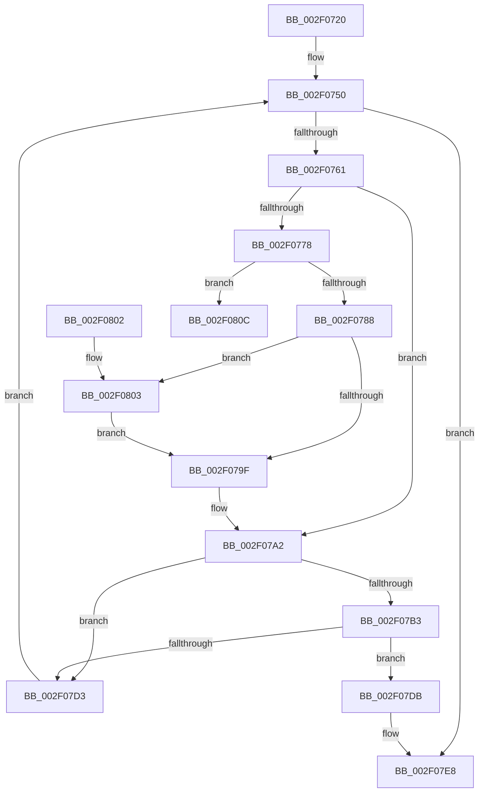

# CcGetDirtyPages

- RVA: `0x002F0720`–`0x002F081F` (길이 `255` bytes)
- VA: `0x00000001402F0720`
- 실행 섹션: `.text`
- PDB 이름 있음: `예`; PDB Function 태그: `예`
- unwind 정보 RVA: `0x00071CC8`
- 디코드: `66`개 명령, `255/255` bytes 표시
- 미해석 바이트: `0` (있으면 어셈블리에 `.byte`로 보존)

> 이 문서는 커널 이미지의 기계어와 PDB 기호를 분석해 생성했습니다. 4번과 5번은 함수 원형과 자료형을 바이너리 사용 방식에서 추정한 C 해석이며 원본 소스 복구 결과는 아닙니다.

## 1. Dependencies

- 직접 호출 지점: **6**; 고유 호출 대상: **6**
- 직접 호출자로 확인된 함수: **0**
- RIP 상대 이미지 참조: **1**

### Outgoing calls
- `0x002F0750` → [PsGetNextPartitionUnsafe](PsGetNextPartitionUnsafe_function_002F0E38.md) (function, `0x002F0E38`)
- `0x002F0768` → [KeAcquireSpinLockRaiseToDpc](../20/KeAcquireSpinLockRaiseToDpc_function_00208470.md) (function, `0x00208470`)
- `0x002F07A9` → [KeReleaseSpinLock](../39/KeReleaseSpinLock_function_00392BA0.md) (function, `0x00392BA0`)
- `0x002F07BD` → [CcGetDirtyPagesHelper](../35/CcGetDirtyPagesHelper_function_00358D40.md) (function, `0x00358D40`)
- `0x002F07C7` → [CcDereferencePartition](../35/CcDereferencePartition_function_003572F0.md) (function, `0x003572F0`)
- `0x002F07E3` → [ObfDereferenceObjectWithTag](ObfDereferenceObjectWithTag_function_002F78E0.md) (function, `0x002F78E0`)

### Direct callers
- 이 함수 시작 RVA로 연결되는 직접 call은 확인되지 않았습니다. 간접 호출은 완전히 역산할 수 없습니다.

### Static image references
- `0x002F0761` → RVA `0x00F8F510` (`.data`; read)

## 2. Other-region calls and transfers

- 다른 실행 섹션으로 향하는 call: **0**
- call이 아닌 외부 분기/꼬리 이동: **1**
  - `0x002F081A` → [sub_006DEE6A](../6D/Unknown_function_006DEE6A.md) (`tail-transfer`)

## 3. Assembly (complete function range)

```asm
002F0720  48 8B C4                        mov rax, rsp
002F0723  48 89 58 08                     mov qword ptr [rax + 8], rbx
002F0727  48 89 68 10                     mov qword ptr [rax + 0x10], rbp
002F072B  48 89 70 18                     mov qword ptr [rax + 0x18], rsi
002F072F  57                              push rdi
002F0730  48 83 EC 50                     sub rsp, 0x50
002F0734  48 83 60 E8 00                  and qword ptr [rax - 0x18], 0
002F0739  33 FF                           xor edi, edi
002F073B  40 32 F6                        xor sil, sil
002F073E  48 89 48 C8                     mov qword ptr [rax - 0x38], rcx
002F0742  33 C9                           xor ecx, ecx
002F0744  4C 89 40 D8                     mov qword ptr [rax - 0x28], r8
002F0748  4C 89 48 E0                     mov qword ptr [rax - 0x20], r9
002F074C  48 89 50 D0                     mov qword ptr [rax - 0x30], rdx
002F0750  E8 E3 06 00 00                  call 0x1402f0e38
002F0755  48 8B E8                        mov rbp, rax
002F0758  48 85 C0                        test rax, rax
002F075B  0F 84 87 00 00 00               je 0x1402f07e8
002F0761  48 8D 0D A8 ED C9 00            lea rcx, [rip + 0xc9eda8]
002F0768  E8 03 7D F1 FF                  call 0x140208470
002F076D  48 8B 4D 08                     mov rcx, qword ptr [rbp + 8]
002F0771  8A D0                           mov dl, al
002F0773  48 85 C9                        test rcx, rcx
002F0776  74 2A                           je 0x1402f07a2
002F0778  80 B9 0E 05 00 00 02            cmp byte ptr [rcx + 0x50e], 2
002F077F  48 8B F9                        mov rdi, rcx
002F0782  0F 83 84 00 00 00               jae 0x1402f080c
002F0788  B9 01 00 00 00                  mov ecx, 1
002F078D  F0 48 0F C1 8F 10 05 00 00      lock xadd qword ptr [rdi + 0x510], rcx
002F0796  48 FF C1                        inc rcx
002F0799  48 83 F9 01                     cmp rcx, 1
002F079D  7E 64                           jle 0x1402f0803
002F079F  40 B6 01                        mov sil, 1
002F07A2  48 8D 0D 67 ED C9 00            lea rcx, [rip + 0xc9ed67]
002F07A9  E8 F2 23 0A 00                  call 0x140392ba0
002F07AE  40 84 F6                        test sil, sil
002F07B1  74 20                           je 0x1402f07d3
002F07B3  4C 8D 44 24 20                  lea r8, [rsp + 0x20]
002F07B8  33 D2                           xor edx, edx
002F07BA  48 8B CF                        mov rcx, rdi
002F07BD  E8 7E 85 06 00                  call 0x140358d40
002F07C2  48 8B CF                        mov rcx, rdi
002F07C5  8A D8                           mov bl, al
002F07C7  E8 24 6B 06 00                  call 0x1403572f0
002F07CC  40 32 F6                        xor sil, sil
002F07CF  84 DB                           test bl, bl
002F07D1  74 08                           je 0x1402f07db
002F07D3  48 8B CD                        mov rcx, rbp
002F07D6  E9 75 FF FF FF                  jmp 0x1402f0750
002F07DB  BA 50 73 45 6E                  mov edx, 0x6e457350
002F07E0  48 8B CD                        mov rcx, rbp
002F07E3  E8 F8 70 00 00                  call 0x1402f78e0
002F07E8  48 8B 44 24 40                  mov rax, qword ptr [rsp + 0x40]
002F07ED  48 8B 5C 24 60                  mov rbx, qword ptr [rsp + 0x60]
002F07F2  48 8B 6C 24 68                  mov rbp, qword ptr [rsp + 0x68]
002F07F7  48 8B 74 24 70                  mov rsi, qword ptr [rsp + 0x70]
002F07FC  48 83 C4 50                     add rsp, 0x50
002F0800  5F                              pop rdi
002F0801  C3                              ret
002F0802  CC                              int3
002F0803  B9 0E 00 00 00                  mov ecx, 0xe
002F0808  CD 29                           int 0x29
002F080A  EB 93                           jmp 0x1402f079f
002F080C  0F 0D 89 10 05 00 00            prefetchw byte ptr [rcx + 0x510]
002F0813  48 8B 81 10 05 00 00            mov rax, qword ptr [rcx + 0x510]
002F081A  E9 4B E6 3E 00                  jmp 0x1406dee6a
```

## 4. C-style interpretation (structured pseudocode)

```c
__int64 __fastcall CcGetDirtyPages(__int64 a1, __int64 a2, __int64 a3, __int64 a4)
{
    __int64 result;
    __int64 v_rdi;
    __int64 v_rsi;
    __int64 v_rsp;
    unsigned __int64 v_stack_m18;
    unsigned __int64 v_stack_m38;
    unsigned __int64 v_stack_p10;
    unsigned __int64 v_stack_p18;
    unsigned __int64 v_stack_p8;

    *(unsigned __int64 *)(v_rsp + 8) = v_rbx;
    *(unsigned __int64 *)(v_rsp + 16) = v_rbp;
    *(unsigned __int64 *)(v_rsp + 24) = v_rsi;
    v_rsp = (v_rsp) - (80);
    v_rdi = 0;
    v_rsi = 0;
    *(unsigned __int64 *)(v_rsp - 56) = a1;
    a1 = 0;
    *(unsigned __int64 *)(v_rsp - 40) = a3;
    *(unsigned __int64 *)(v_rsp - 32) = a4;
    *(unsigned __int64 *)(v_rsp - 48) = a2;
loc_002F0750:
    result = PsGetNextPartitionUnsafe(a1, a2, a3, a4);
    if (result == 0) goto loc_002F07E8;
    result = KeAcquireSpinLockRaiseToDpc(v_rip + 13233576, a2, a3, a4);
    if (*(unsigned __int64 *)(result + 8) == 0) goto loc_002F07A2;
    if ((*(unsigned __int8 *)(*(unsigned __int64 *)(result + 8) + 1294)) >= 2) goto loc_002F080C;
    a1 = (1) + 1;
    if (a1 <= 1) goto loc_002F0803;
loc_002F079F:
loc_002F07A2:
    result = KeReleaseSpinLock(v_rip + 13233511, (unsigned __int8)(result), a3, a4);
    if (1 == 0) goto loc_002F07D3;
    a2 = 0;
    result = CcGetDirtyPagesHelper(*(unsigned __int64 *)(result + 8), a2, v_stack_m38, a4);
    result = CcDereferencePartition(*(unsigned __int64 *)(result + 8), a2, v_stack_m38, a4);
    v_rsi = 0;
    if ((unsigned __int8)((unsigned __int8)(result)) == 0) goto loc_002F07DB;
loc_002F07D3:
    goto loc_002F0750;
loc_002F07DB:
    result = ObfDereferenceObjectWithTag(result, (unsigned int)(0x6E457350ULL), v_stack_m38, a4);
loc_002F07E8:
    v_rsp = (v_rsp) + (80);
    return v_stack_m18;
loc_002F0803:
    goto loc_002F079F;
loc_002F080C:
}
```

## 5. (Beta) C Style

```c
int64_t CcGetDirtyPages(int64_t Arg1, int64_t Arg2, int64_t Arg3, int64_t Arg4)
{
    int64_t result;
    int64_t local_rdi;
    int64_t local_rsi;
    int64_t local_rsp;
    uint64_t v_stack_m18;
    uint64_t v_stack_m38;
    uint64_t v_stack_p10;
    uint64_t v_stack_p18;
    uint64_t v_stack_p8;

    *(uint64_t *)(local_rsp + 0x8) = local_rbx;
    *(uint64_t *)(local_rsp + 0x10) = local_rbp;
    *(uint64_t *)(local_rsp + 0x18) = local_rsi;
    local_rsp = (local_rsp) - (80);
    local_rdi = 0;
    local_rsi = 0;
    *(uint64_t *)(local_rsp - 0x38) = Arg1;
    Arg1 = 0;
    *(uint64_t *)(local_rsp - 0x28) = Arg3;
    *(uint64_t *)(local_rsp - 0x20) = Arg4;
    *(uint64_t *)(local_rsp - 0x30) = Arg2;
loc_002F0750:
    result = PsGetNextPartitionUnsafe(Arg1, Arg2, Arg3, Arg4);
    if (result == 0) goto loc_002F07E8;
    result = KeAcquireSpinLockRaiseToDpc(v_rip + 13233576, Arg2, Arg3, Arg4);
    if (*(uint64_t *)(result + 0x8) == 0) goto loc_002F07A2;
    if ((*(uint8_t *)(*(uint64_t *)(result + 0x8) + 0x50E)) >= 2) goto loc_002F080C;
    Arg1 = (1) + 1;
    if (Arg1 <= 1) goto loc_002F0803;
loc_002F079F:
loc_002F07A2:
    result = KeReleaseSpinLock(v_rip + 13233511, (uint8_t)(result), Arg3, Arg4);
    if (1 == 0) goto loc_002F07D3;
    Arg2 = 0;
    result = CcGetDirtyPagesHelper(*(uint64_t *)(result + 0x8), Arg2, v_stack_m38, Arg4);
    result = CcDereferencePartition(*(uint64_t *)(result + 0x8), Arg2, v_stack_m38, Arg4);
    local_rsi = 0;
    if ((uint8_t)((uint8_t)(result)) == 0) goto loc_002F07DB;
loc_002F07D3:
    goto loc_002F0750;
loc_002F07DB:
    result = ObfDereferenceObjectWithTag(result, (uint32_t)(0x6E457350ULL), v_stack_m38, Arg4);
loc_002F07E8:
    local_rsp = (local_rsp) + (80);
    return v_stack_m18;
loc_002F0803:
    goto loc_002F079F;
loc_002F080C:
}
```

## 6. Execution-region graph

[열기: 2D/3D 그래프와 함수 탐색 컨트롤 패널](../../../control-panel.html?section=text&rva=0x002F0720&view=graph)

- 2D 그래프는 위에서 아래로 흐르고, 3D 그래프는 빈 공간을 드래그해 회전합니다. Shift+드래그는 이동, 휠은 확대·축소, 함수 노드 선택은 대상 보고서 이동입니다.

### Static fallback


