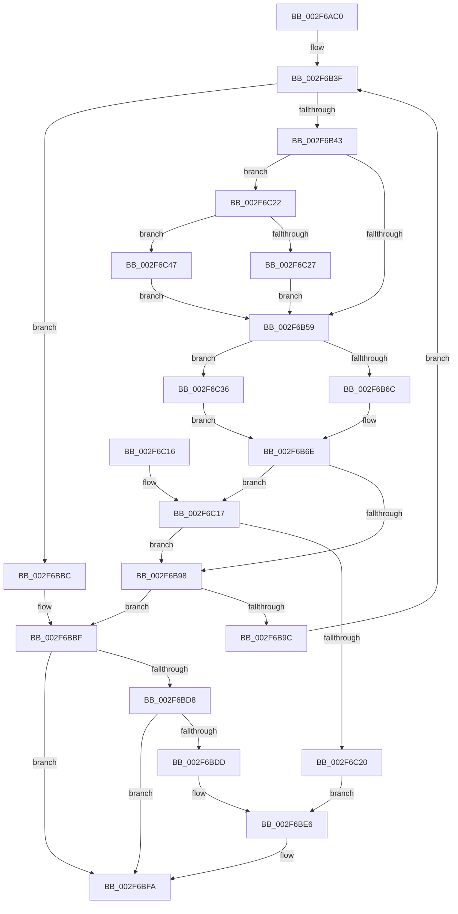

# CcMapAndRead

- RVA: `0x002F6AC0`–`0x002F6C52` (길이 `402` bytes)
- VA: `0x00000001402F6AC0`
- 실행 섹션: `.text`
- PDB 이름 있음: `예`; PDB Function 태그: `아니요`
- unwind 정보 RVA: `0x000722BC`
- 디코드: `110`개 명령, `402/402` bytes 표시
- 미해석 바이트: `0` (있으면 어셈블리에 `.byte`로 보존)

> 이 문서는 커널 이미지의 기계어와 PDB 기호를 분석해 생성했습니다. 4번과 5번은 함수 원형과 자료형을 바이너리 사용 방식에서 추정한 C 해석이며 원본 소스 복구 결과는 아닙니다.

## 1. Dependencies

- 직접 호출 지점: **2**; 고유 호출 대상: **2**
- 직접 호출자로 확인된 함수: **3**
- RIP 상대 이미지 참조: **0**

### Outgoing calls
- `0x002F6B83` → [MmCheckCachedPageStates](MmCheckCachedPageStates_function_002F6C60.md) (function, `0x002F6C60`)
- `0x002F6BE0` → [RtlRaiseStatus](RtlRaiseStatus_function_002F6A50.md) (function, `0x002F6A50`)

### Direct callers
- [CcPinFileData](../33/CcPinFileData_function_0033FB40.md) at `0x00340373`
- [CcPinFileData](../33/CcPinFileData_function_0033FB40.md) at `0x00340763`
- [CcPrepareMdlWrite](../49/CcPrepareMdlWrite_function_004996D0.md) at `0x0049983D`
- [CcMapData](../../page/96/CcMapData_function_0096C430.md) at `0x0096C4FC`

### Static image references
- 디코드된 RIP-relative 메모리 참조가 없습니다.

## 2. Other-region calls and transfers

- 다른 실행 섹션으로 향하는 call: **0**
- 별도 외부 분기/꼬리 이동을 확인하지 못했습니다.

## 3. Assembly (complete function range)

```asm
002F6AC0  44 88 44 24 18                  mov byte ptr [rsp + 0x18], r8b
002F6AC5  53                              push rbx
002F6AC6  56                              push rsi
002F6AC7  57                              push rdi
002F6AC8  41 54                           push r12
002F6ACA  41 55                           push r13
002F6ACC  41 56                           push r14
002F6ACE  48 83 EC 28                     sub rsp, 0x28
002F6AD2  65 48 8B 34 25 88 01 00 00      mov rsi, qword ptr gs:[0x188]
002F6ADB  4D 8B F1                        mov r14, r9
002F6ADE  45 33 C9                        xor r9d, r9d
002F6AE1  8B D9                           mov ebx, ecx
002F6AE3  49 8B CE                        mov rcx, r14
002F6AE6  48 89 6C 24 68                  mov qword ptr [rsp + 0x68], rbp
002F6AEB  45 32 E4                        xor r12b, r12b
002F6AEE  4C 89 7C 24 20                  mov qword ptr [rsp + 0x20], r15
002F6AF3  45 84 C0                        test r8b, r8b
002F6AF6  44 8B EA                        mov r13d, edx
002F6AF9  BA 02 00 00 00                  mov edx, 2
002F6AFE  41 BB 01 00 00 00               mov r11d, 1
002F6B04  41 0F 45 D1                     cmovne edx, r9d
002F6B08  44 88 5C 24 60                  mov byte ptr [rsp + 0x60], r11b
002F6B0D  0F B6 86 AC 05 00 00            movzx eax, byte ptr [rsi + 0x5ac]
002F6B14  81 E1 FF 0F 00 00               and ecx, 0xfff
002F6B1A  48 81 C3 FF 0F 00 00            add rbx, 0xfff
002F6B21  89 54 24 78                     mov dword ptr [rsp + 0x78], edx
002F6B25  48 03 D9                        add rbx, rcx
002F6B28  45 8B D1                        mov r10d, r9d
002F6B2B  8B 8E 98 05 00 00               mov ecx, dword ptr [rsi + 0x598]
002F6B31  48 C1 EB 0C                     shr rbx, 0xc
002F6B35  49 81 E6 00 F0 FF FF            and r14, 0xfffffffffffff000
002F6B3C  8D 3C 48                        lea edi, [rax + rcx*2]
002F6B3F  85 DB                           test ebx, ebx
002F6B41  74 79                           je 0x1402f6bbc
002F6B43  8D 43 FF                        lea eax, [rbx - 1]
002F6B46  C6 86 AC 05 00 00 01            mov byte ptr [rsi + 0x5ac], 1
002F6B4D  3B 86 98 05 00 00               cmp eax, dword ptr [rsi + 0x598]
002F6B53  0F 87 C9 00 00 00               ja 0x1402f6c22
002F6B59  45 85 DD                        test r13d, r11d
002F6B5C  45 8B C1                        mov r8d, r9d
002F6B5F  41 0F 95 C0                     setne r8b
002F6B63  45 85 ED                        test r13d, r13d
002F6B66  0F 85 CA 00 00 00               jne 0x1402f6c36
002F6B6C  8B EB                           mov ebp, ebx
002F6B6E  8B C5                           mov eax, ebp
002F6B70  4C 8D 4C 24 60                  lea r9, [rsp + 0x60]
002F6B75  C1 E0 0C                        shl eax, 0xc
002F6B78  44 0B C2                        or r8d, edx
002F6B7B  8B D0                           mov edx, eax
002F6B7D  49 8B CE                        mov rcx, r14
002F6B80  44 8B F8                        mov r15d, eax
002F6B83  E8 D8 00 00 00                  call 0x1402f6c60
002F6B88  44 8B D0                        mov r10d, eax
002F6B8B  44 0F B6 44 24 70               movzx r8d, byte ptr [rsp + 0x70]
002F6B91  44 38 64 24 60                  cmp byte ptr [rsp + 0x60], r12b
002F6B96  74 7F                           je 0x1402f6c17
002F6B98  85 C0                           test eax, eax
002F6B9A  78 23                           js 0x1402f6bbf
002F6B9C  8B 54 24 78                     mov edx, dword ptr [rsp + 0x78]
002F6BA0  4D 03 F7                        add r14, r15
002F6BA3  2B DD                           sub ebx, ebp
002F6BA5  41 BB 04 00 00 00               mov r11d, 4
002F6BAB  83 FB 01                        cmp ebx, 1
002F6BAE  B8 02 00 00 00                  mov eax, 2
002F6BB3  44 0F 45 D8                     cmovne r11d, eax
002F6BB7  45 33 C9                        xor r9d, r9d
002F6BBA  EB 83                           jmp 0x1402f6b3f
002F6BBC  41 B4 01                        mov r12b, 1
002F6BBF  40 0F B6 C7                     movzx eax, dil
002F6BC3  D1 EF                           shr edi, 1
002F6BC5  24 01                           and al, 1
002F6BC7  89 BE 98 05 00 00               mov dword ptr [rsi + 0x598], edi
002F6BCD  88 86 AC 05 00 00               mov byte ptr [rsi + 0x5ac], al
002F6BD3  45 84 C0                        test r8b, r8b
002F6BD6  74 22                           je 0x1402f6bfa
002F6BD8  45 85 D2                        test r10d, r10d
002F6BDB  79 1D                           jns 0x1402f6bfa
002F6BDD  41 8B CA                        mov ecx, r10d
002F6BE0  E8 6B FE FF FF                  call 0x1402f6a50
002F6BE5  CC                              int3
002F6BE6  40 0F B6 C7                     movzx eax, dil
002F6BEA  24 01                           and al, 1
002F6BEC  D1 EF                           shr edi, 1
002F6BEE  89 BE 98 05 00 00               mov dword ptr [rsi + 0x598], edi
002F6BF4  88 86 AC 05 00 00               mov byte ptr [rsi + 0x5ac], al
002F6BFA  4C 8B 7C 24 20                  mov r15, qword ptr [rsp + 0x20]
002F6BFF  41 0F B6 C4                     movzx eax, r12b
002F6C03  48 8B 6C 24 68                  mov rbp, qword ptr [rsp + 0x68]
002F6C08  48 83 C4 28                     add rsp, 0x28
002F6C0C  41 5E                           pop r14
002F6C0E  41 5D                           pop r13
002F6C10  41 5C                           pop r12
002F6C12  5F                              pop rdi
002F6C13  5E                              pop rsi
002F6C14  5B                              pop rbx
002F6C15  C3                              ret
002F6C16  CC                              int3
002F6C17  45 84 C0                        test r8b, r8b
002F6C1A  0F 85 78 FF FF FF               jne 0x1402f6b98
002F6C20  EB C4                           jmp 0x1402f6be6
002F6C22  83 F8 0F                        cmp eax, 0xf
002F6C25  76 20                           jbe 0x1402f6c47
002F6C27  C7 86 98 05 00 00 0F 00 00 00   mov dword ptr [rsi + 0x598], 0xf
002F6C31  E9 23 FF FF FF                  jmp 0x1402f6b59
002F6C36  41 83 FB 02                     cmp r11d, 2
002F6C3A  BD 01 00 00 00                  mov ebp, 1
002F6C3F  0F 44 E8                        cmove ebp, eax
002F6C42  E9 27 FF FF FF                  jmp 0x1402f6b6e
002F6C47  89 86 98 05 00 00               mov dword ptr [rsi + 0x598], eax
002F6C4D  E9 07 FF FF FF                  jmp 0x1402f6b59
```

## 4. C-style interpretation (structured pseudocode)

```c
__int64 __fastcall CcMapAndRead(int a1, int a2, unsigned __int8 a3, __int64 a4)
{
    __int64 result;
    __int64 v_r11;
    __int64 v_r12;
    __int64 v_r14;
    __int64 v_rbp;
    __int64 v_rbx;
    __int64 v_rdi;
    __int64 v_rsp;
    unsigned __int64 v_stack_m38;
    unsigned __int64 v_stack_p10;
    unsigned __int8 v_stack_p18;
    unsigned int v_stack_p20;
    unsigned __int8 v_stack_p8;

    v_stack_p18 = a3;
    v_rsp = (v_rsp) - (40);
    a4 = 0;
    v_stack_p10 = v_rbp;
    v_r12 = 0;
    v_stack_m38 = v_r15;
    a2 = 2;
    if (a3 != 0) { a2 = 0; }
    v_stack_p8 = 1;
    a1 = (unsigned int)((0) & (0xFFFULL));
    v_rbx = ((unsigned int)(a1)) + (0xFFFULL);
    v_stack_p20 = a2;
    v_rbx = (v_rbx) + (a1);
    v_rbx = (v_rbx) >> (12);
    v_r14 = (a4) & (0xFFFFFFFFFFFFF000ULL);
loc_002F6B3F:
    if ((unsigned int)(v_rbx) == 0) goto loc_002F6BBC;
    *(unsigned __int8 *)(*(unsigned __int64 *)(gs_base + (0 + 392)) + 1452) = 1;
    if (((unsigned int)(v_rbx - 1)) > (*(unsigned int *)(*(unsigned __int64 *)(gs_base + (0 + 392)) + 1432))) goto loc_002F6C22;
loc_002F6B59:
    a3 = ((((unsigned int)((unsigned int)(a2))) & (1)) != 0) ? 1 : 0;
    if ((unsigned int)((unsigned int)(a2)) != 0) goto loc_002F6C36;
loc_002F6B6E:
    result = (unsigned int)(((unsigned int)((unsigned int)((unsigned int)((unsigned int)(v_rbx))))) << (12));
    a3 = (unsigned int)((a3) | (a2));
    result = MmCheckCachedPageStates(v_r14, (unsigned int)((unsigned int)(result)), a3, v_stack_p8);
    if (v_stack_p8 == 0) goto loc_002F6C17;
loc_002F6B98:
    if (sign_flag) goto loc_002F6BBF;
    v_r14 = (v_r14) + ((unsigned int)((unsigned int)(result)));
    v_rbx = (unsigned int)((v_rbx) - ((unsigned int)((unsigned int)((unsigned int)(v_rbx)))));
    v_r11 = 4;
    if (((unsigned int)(v_rbx)) != 1) { v_r11 = 2; }
    a4 = 0;
    goto loc_002F6B3F;
loc_002F6BBC:
loc_002F6BBF:
    v_rdi = (unsigned int)((*(unsigned __int8 *)(*(unsigned __int64 *)(gs_base + (0 + 392)) + 1452) + (unsigned int)(*(unsigned int *)(*(unsigned __int64 *)(gs_base + (0 + 392)) + 1432)) * 2) >> (1));
    result = (unsigned __int8)(((unsigned __int8)(*(unsigned __int8 *)(*(unsigned __int64 *)(gs_base + (0 + 392)) + 1452) + (unsigned int)(*(unsigned int *)(*(unsigned __int64 *)(gs_base + (0 + 392)) + 1432)) * 2)) & (1));
    *(unsigned int *)(*(unsigned __int64 *)(gs_base + (0 + 392)) + 1432) = (unsigned int)(v_rdi);
    *(unsigned __int8 *)(*(unsigned __int64 *)(gs_base + (0 + 392)) + 1452) = (unsigned __int8)(result);
    if ((unsigned __int8)(v_stack_p18) == 0) goto loc_002F6BFA;
    if (!sign_flag) goto loc_002F6BFA;
    result = RtlRaiseStatus((unsigned int)((unsigned int)((unsigned int)((unsigned int)(result)))), (unsigned int)(v_stack_p20), v_stack_p18, a4);
loc_002F6BE6:
    result = (unsigned __int8)(((unsigned __int8)(v_rdi)) & (1));
    v_rdi = (unsigned int)((v_rdi) >> (1));
    *(unsigned int *)(*(unsigned __int64 *)(gs_base + (0 + 392)) + 1432) = (unsigned int)(v_rdi);
    *(unsigned __int8 *)(*(unsigned __int64 *)(gs_base + (0 + 392)) + 1452) = (unsigned __int8)(result);
loc_002F6BFA:
    v_rsp = (v_rsp) + (40);
    return 1;
loc_002F6C17:
    if ((unsigned __int8)(v_stack_p18) != 0) goto loc_002F6B98;
    goto loc_002F6BE6;
loc_002F6C22:
    if (1 <= 15) goto loc_002F6C47;
    *(unsigned int *)(*(unsigned __int64 *)(gs_base + (0 + 392)) + 1432) = 15;
    goto loc_002F6B59;
loc_002F6C36:
    v_rbp = 1;
    if (((unsigned int)(v_r11)) == 2) { v_rbp = 1; }
    goto loc_002F6B6E;
loc_002F6C47:
    *(unsigned int *)(*(unsigned __int64 *)(gs_base + (0 + 392)) + 1432) = 1;
    goto loc_002F6B59;
}
```

## 5. (Beta) C Style

```c
int64_t CcMapAndRead(int32_t Arg1, int32_t Arg2, uint8_t Arg3, int64_t Arg4)
{
    int64_t result;
    int64_t local_r11;
    int64_t local_r12;
    int64_t local_r14;
    int64_t local_rbp;
    int64_t local_rbx;
    int64_t local_rdi;
    int64_t local_rsp;
    uint64_t v_stack_m38;
    uint64_t v_stack_p10;
    uint8_t v_stack_p18;
    uint32_t v_stack_p20;
    uint8_t v_stack_p8;

    v_stack_p18 = Arg3;
    local_rsp = (local_rsp) - (40);
    Arg4 = 0;
    v_stack_p10 = local_rbp;
    local_r12 = 0;
    v_stack_m38 = local_r15;
    Arg2 = 2;
    if (Arg3 != 0) { Arg2 = 0; }
    v_stack_p8 = 1;
    Arg1 = (uint32_t)((0) & (0xFFFULL));
    local_rbx = ((uint32_t)(Arg1)) + (0xFFFULL);
    v_stack_p20 = Arg2;
    local_rbx = (local_rbx) + (Arg1);
    local_rbx = (local_rbx) >> (12);
    local_r14 = (Arg4) & (0xFFFFFFFFFFFFF000ULL);
loc_002F6B3F:
    if ((uint32_t)(local_rbx) == 0) goto loc_002F6BBC;
    *(uint8_t *)(*(uint64_t *)(gs_base + (0 + 0x188)) + 0x5AC) = 1;
    if (((uint32_t)(local_rbx - 1)) > (*(uint32_t *)(*(uint64_t *)(gs_base + (0 + 0x188)) + 0x598))) goto loc_002F6C22;
loc_002F6B59:
    Arg3 = ((((uint32_t)((uint32_t)(Arg2))) & (1)) != 0) ? 1 : 0;
    if ((uint32_t)((uint32_t)(Arg2)) != 0) goto loc_002F6C36;
loc_002F6B6E:
    result = (uint32_t)(((uint32_t)((uint32_t)((uint32_t)((uint32_t)(local_rbx))))) << (12));
    Arg3 = (uint32_t)((Arg3) | (Arg2));
    result = MmCheckCachedPageStates(local_r14, (uint32_t)((uint32_t)(result)), Arg3, v_stack_p8);
    if (v_stack_p8 == 0) goto loc_002F6C17;
loc_002F6B98:
    if (sign_flag) goto loc_002F6BBF;
    local_r14 = (local_r14) + ((uint32_t)((uint32_t)(result)));
    local_rbx = (uint32_t)((local_rbx) - ((uint32_t)((uint32_t)((uint32_t)(local_rbx)))));
    local_r11 = 4;
    if (((uint32_t)(local_rbx)) != 1) { local_r11 = 2; }
    Arg4 = 0;
    goto loc_002F6B3F;
loc_002F6BBC:
loc_002F6BBF:
    local_rdi = (uint32_t)((*(uint8_t *)(*(uint64_t *)(gs_base + (0 + 0x188)) + 0x5AC) + (uint32_t)(*(uint32_t *)(*(uint64_t *)(gs_base + (0 + 0x188)) + 0x598)) * 2) >> (1));
    result = (uint8_t)(((uint8_t)(*(uint8_t *)(*(uint64_t *)(gs_base + (0 + 0x188)) + 0x5AC) + (uint32_t)(*(uint32_t *)(*(uint64_t *)(gs_base + (0 + 0x188)) + 0x598)) * 2)) & (1));
    *(uint32_t *)(*(uint64_t *)(gs_base + (0 + 0x188)) + 0x598) = (uint32_t)(local_rdi);
    *(uint8_t *)(*(uint64_t *)(gs_base + (0 + 0x188)) + 0x5AC) = (uint8_t)(result);
    if ((uint8_t)(v_stack_p18) == 0) goto loc_002F6BFA;
    if (!sign_flag) goto loc_002F6BFA;
    result = RtlRaiseStatus((uint32_t)((uint32_t)((uint32_t)((uint32_t)(result)))), (uint32_t)(v_stack_p20), v_stack_p18, Arg4);
loc_002F6BE6:
    result = (uint8_t)(((uint8_t)(local_rdi)) & (1));
    local_rdi = (uint32_t)((local_rdi) >> (1));
    *(uint32_t *)(*(uint64_t *)(gs_base + (0 + 0x188)) + 0x598) = (uint32_t)(local_rdi);
    *(uint8_t *)(*(uint64_t *)(gs_base + (0 + 0x188)) + 0x5AC) = (uint8_t)(result);
loc_002F6BFA:
    local_rsp = (local_rsp) + (40);
    return 1;
loc_002F6C17:
    if ((uint8_t)(v_stack_p18) != 0) goto loc_002F6B98;
    goto loc_002F6BE6;
loc_002F6C22:
    if (1 <= 15) goto loc_002F6C47;
    *(uint32_t *)(*(uint64_t *)(gs_base + (0 + 0x188)) + 0x598) = 15;
    goto loc_002F6B59;
loc_002F6C36:
    local_rbp = 1;
    if (((uint32_t)(local_r11)) == 2) { local_rbp = 1; }
    goto loc_002F6B6E;
loc_002F6C47:
    *(uint32_t *)(*(uint64_t *)(gs_base + (0 + 0x188)) + 0x598) = 1;
    goto loc_002F6B59;
}
```

## 6. Execution-region graph

[열기: 2D/3D 그래프와 함수 탐색 컨트롤 패널](../../../control-panel.html?section=text&rva=0x002F6AC0&view=graph)

- 2D 그래프는 위에서 아래로 흐르고, 3D 그래프는 빈 공간을 드래그해 회전합니다. Shift+드래그는 이동, 휠은 확대·축소, 함수 노드 선택은 대상 보고서 이동입니다.

### Static fallback


