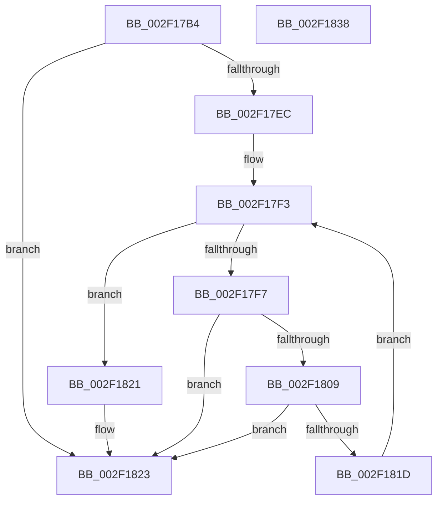

# CompareEventEntry

- RVA: `0x002F17B4`–`0x002F1839` (길이 `133` bytes)
- VA: `0x00000001402F17B4`
- 실행 섹션: `.text`
- PDB 이름 있음: `예`; PDB Function 태그: `예`
- unwind 정보 RVA: `0x0005C954`
- 디코드: `41`개 명령, `133/133` bytes 표시
- 미해석 바이트: `0` (있으면 어셈블리에 `.byte`로 보존)

> 이 문서는 커널 이미지의 기계어와 PDB 기호를 분석해 생성했습니다. 4번과 5번은 함수 원형과 자료형을 바이너리 사용 방식에서 추정한 C 해석이며 원본 소스 복구 결과는 아닙니다.

## 1. Dependencies

- 직접 호출 지점: **2**; 고유 호출 대상: **1**
- 직접 호출자로 확인된 함수: **1**
- RIP 상대 이미지 참조: **0**

### Outgoing calls
- `0x002F17E3` → [memcmp](../6C/memcmp_function_006C6B10.md) (function, `0x006C6B10`)
- `0x002F1814` → [memcmp](../6C/memcmp_function_006C6B10.md) (function, `0x006C6B10`)

### Direct callers
- [InsertEventEntryInLookUpTable](InsertEventEntryInLookUpTable_function_002F1424.md) at `0x002F14D7`

### Static image references
- 디코드된 RIP-relative 메모리 참조가 없습니다.

## 2. Other-region calls and transfers

- 다른 실행 섹션으로 향하는 call: **0**
- 별도 외부 분기/꼬리 이동을 확인하지 못했습니다.

## 3. Assembly (complete function range)

```asm
002F17B4  48 89 5C 24 08                  mov qword ptr [rsp + 8], rbx
002F17B9  48 89 6C 24 10                  mov qword ptr [rsp + 0x10], rbp
002F17BE  48 89 74 24 18                  mov qword ptr [rsp + 0x18], rsi
002F17C3  57                              push rdi
002F17C4  48 83 EC 20                     sub rsp, 0x20
002F17C8  49 8B 68 10                     mov rbp, qword ptr [r8 + 0x10]
002F17CC  48 8B F2                        mov rsi, rdx
002F17CF  49 8B D8                        mov rbx, r8
002F17D2  0F B6 F9                        movzx edi, cl
002F17D5  41 B8 08 00 00 00               mov r8d, 8
002F17DB  48 8D 55 10                     lea rdx, [rbp + 0x10]
002F17DF  48 8D 4E 10                     lea rcx, [rsi + 0x10]
002F17E3  E8 28 53 3D 00                  call 0x1406c6b10
002F17E8  85 C0                           test eax, eax
002F17EA  75 37                           jne 0x1402f1823
002F17EC  0F B6 5B 2D                     movzx ebx, byte ptr [rbx + 0x2d]
002F17F0  83 C3 02                        add ebx, 2
002F17F3  3B DF                           cmp ebx, edi
002F17F5  73 2A                           jae 0x1402f1821
002F17F7  8B CB                           mov ecx, ebx
002F17F9  48 C1 E1 04                     shl rcx, 4
002F17FD  8B 54 31 08                     mov edx, dword ptr [rcx + rsi + 8]
002F1801  8B C2                           mov eax, edx
002F1803  2B 44 29 08                     sub eax, dword ptr [rcx + rbp + 8]
002F1807  75 1A                           jne 0x1402f1823
002F1809  44 8B C2                        mov r8d, edx
002F180C  48 8B 14 29                     mov rdx, qword ptr [rcx + rbp]
002F1810  48 8B 0C 31                     mov rcx, qword ptr [rcx + rsi]
002F1814  E8 F7 52 3D 00                  call 0x1406c6b10
002F1819  85 C0                           test eax, eax
002F181B  75 06                           jne 0x1402f1823
002F181D  FF C3                           inc ebx
002F181F  EB D2                           jmp 0x1402f17f3
002F1821  33 C0                           xor eax, eax
002F1823  48 8B 5C 24 30                  mov rbx, qword ptr [rsp + 0x30]
002F1828  48 8B 6C 24 38                  mov rbp, qword ptr [rsp + 0x38]
002F182D  48 8B 74 24 40                  mov rsi, qword ptr [rsp + 0x40]
002F1832  48 83 C4 20                     add rsp, 0x20
002F1836  5F                              pop rdi
002F1837  C3                              ret
002F1838  CC                              int3
```

## 4. C-style interpretation (structured pseudocode)

```c
__int64 __fastcall CompareEventEntry(unsigned __int8 a1, __int64 a2, __int64 a3)
{
    __int64 result;
    __int64 v_rbx;
    __int64 v_rsp;
    unsigned __int64 v_stack_p10;
    unsigned __int64 v_stack_p18;
    unsigned __int64 v_stack_p8;

    v_stack_p8 = v_rbx;
    v_stack_p10 = v_rbp;
    v_stack_p18 = v_rsi;
    v_rsp = (v_rsp) - (32);
    result = memcmp(a2 + 16, *(unsigned __int64 *)(a3 + 16) + 16, 8, a4);
    if ((unsigned int)(result) != 0) goto loc_002F1823;
    v_rbx = (unsigned int)((*(unsigned __int8 *)(a3 + 45)) + (2));
loc_002F17F3:
    if (((unsigned int)(v_rbx)) >= a1) goto loc_002F1821;
    a1 = ((unsigned int)((unsigned int)(v_rbx))) << (4);
    result = (unsigned int)(((unsigned int)((unsigned int)((unsigned int)(*(unsigned int *)(a1 + a2 * 1 + 8))))) - (*(unsigned int *)(a1 + *(unsigned __int64 *)(a3 + 16) * 1 + 8)));
    if (condition_is_not_equal) goto loc_002F1823;
    result = memcmp(*(unsigned __int64 *)(a1 + a2 * 1), *(unsigned __int64 *)(a1 + *(unsigned __int64 *)(a3 + 16) * 1), (unsigned int)((unsigned int)((unsigned int)(*(unsigned int *)(a1 + a2 * 1 + 8)))), a4);
    if ((unsigned int)(result) != 0) goto loc_002F1823;
    v_rbx = (unsigned int)((v_rbx) + 1);
    goto loc_002F17F3;
loc_002F1821:
    result = 0;
loc_002F1823:
    v_rsp = (v_rsp) + (32);
    return result;
}
```

## 5. (Beta) C Style

```c
int64_t CompareEventEntry(uint8_t Arg1, void *Arg2, void *Arg3)
{
    uint8_t *arg2 = (uint8_t *)Arg2;
    uint8_t *arg3 = (uint8_t *)Arg3;

    int64_t result;
    int64_t local_rbx;
    int64_t local_rsp;
    uint64_t v_stack_p10;
    uint64_t v_stack_p18;
    uint64_t v_stack_p8;

    v_stack_p8 = local_rbx;
    v_stack_p10 = local_rbp;
    v_stack_p18 = local_rsi;
    local_rsp = (local_rsp) - (32);
    result = memcmp(Arg2 + 16, *(uint64_t *)(arg3 + 0x10) + 16, 8, a4);
    if ((uint32_t)(result) != 0) goto loc_002F1823;
    local_rbx = (uint32_t)((*(uint8_t *)(arg3 + 0x2D)) + (2));
loc_002F17F3:
    if (((uint32_t)(local_rbx)) >= Arg1) goto loc_002F1821;
    Arg1 = ((uint32_t)((uint32_t)(local_rbx))) << (4);
    result = (uint32_t)(((uint32_t)((uint32_t)((uint32_t)(*(uint32_t *)(Arg1 + arg2 * 1 + 0x8))))) - (*(uint32_t *)(Arg1 + *(uint64_t *)(arg3 + 0x10) * 1 + 0x8)));
    if (condition_is_not_equal) goto loc_002F1823;
    result = memcmp(*(uint64_t *)(Arg1 + arg2 * 1), *(uint64_t *)(Arg1 + *(uint64_t *)(arg3 + 0x10) * 1), (uint32_t)((uint32_t)((uint32_t)(*(uint32_t *)(Arg1 + arg2 * 1 + 0x8)))), a4);
    if ((uint32_t)(result) != 0) goto loc_002F1823;
    local_rbx = (uint32_t)((local_rbx) + 1);
    goto loc_002F17F3;
loc_002F1821:
    result = 0;
loc_002F1823:
    local_rsp = (local_rsp) + (32);
    return result;
}
```

### 관측된 메모리 오프셋

구조체 형식이 확인되지 않은 접근은 인자 기준의 오프셋으로만 기록했습니다.

| 기준 인자 | 오프셋 표현 | 폭 (bit) | 접근 |
|---|---:|---:|---|
| `Arg2` | `+ 0x10` | `64` | `R` |
| `Arg3` | `+ 0x10` | `64` | `R` |
| `Arg3` | `+ 0x2D` | `8` | `R` |

## 6. Execution-region graph

[열기: 2D/3D 그래프와 함수 탐색 컨트롤 패널](../../../control-panel.html?section=text&rva=0x002F17B4&view=graph)

- 2D 그래프는 위에서 아래로 흐르고, 3D 그래프는 빈 공간을 드래그해 회전합니다. Shift+드래그는 이동, 휠은 확대·축소, 함수 노드 선택은 대상 보고서 이동입니다.

### Static fallback


