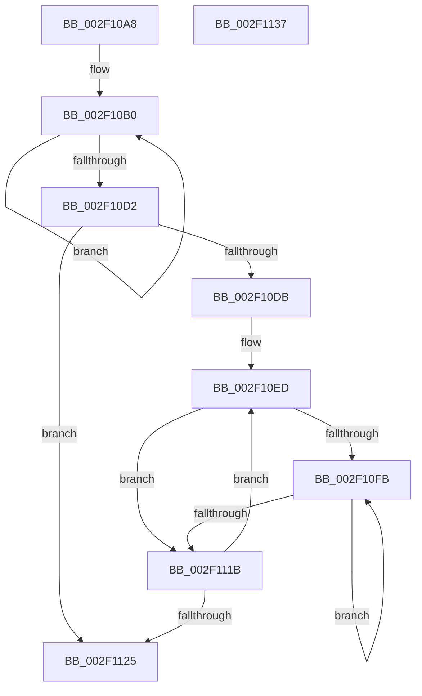

# ComputeEventEntryHash

- RVA: `0x002F10A8`–`0x002F1138` (길이 `144` bytes)
- VA: `0x00000001402F10A8`
- 실행 섹션: `.text`
- PDB 이름 있음: `예`; PDB Function 태그: `예`
- unwind 정보 RVA: `0x000DB714`
- 디코드: `44`개 명령, `144/144` bytes 표시
- 미해석 바이트: `0` (있으면 어셈블리에 `.byte`로 보존)

> 이 문서는 커널 이미지의 기계어와 PDB 기호를 분석해 생성했습니다. 4번과 5번은 함수 원형과 자료형을 바이너리 사용 방식에서 추정한 C 해석이며 원본 소스 복구 결과는 아닙니다.

## 1. Dependencies

- 직접 호출 지점: **0**; 고유 호출 대상: **0**
- 직접 호출자로 확인된 함수: **1**
- RIP 상대 이미지 참조: **0**

### Outgoing calls
- 직접 디코드된 call 명령이 없습니다.

### Direct callers
- [InsertEventEntryInLookUpTable](InsertEventEntryInLookUpTable_function_002F1424.md) at `0x002F1469`

### Static image references
- 디코드된 RIP-relative 메모리 참조가 없습니다.

## 2. Other-region calls and transfers

- 다른 실행 섹션으로 향하는 call: **0**
- 별도 외부 분기/꼬리 이동을 확인하지 못했습니다.

## 3. Assembly (complete function range)

```asm
002F10A8  45 33 C9                        xor r9d, r9d
002F10AB  44 8A D1                        mov r10b, cl
002F10AE  33 C9                           xor ecx, ecx
002F10B0  41 0F B6 44 08 10               movzx eax, byte ptr [r8 + rcx + 0x10]
002F10B6  48 FF C1                        inc rcx
002F10B9  41 03 C1                        add eax, r9d
002F10BC  44 69 C8 01 04 00 00            imul r9d, eax, 0x401
002F10C3  41 8B C1                        mov eax, r9d
002F10C6  C1 E8 06                        shr eax, 6
002F10C9  44 33 C8                        xor r9d, eax
002F10CC  48 83 F9 08                     cmp rcx, 8
002F10D0  72 DE                           jb 0x1402f10b0
002F10D2  41 80 C2 02                     add r10b, 2
002F10D6  44 3A D2                        cmp r10b, dl
002F10D9  73 4A                           jae 0x1402f1125
002F10DB  41 0F B6 CA                     movzx ecx, r10b
002F10DF  48 C1 E1 04                     shl rcx, 4
002F10E3  49 03 C8                        add rcx, r8
002F10E6  41 2A D2                        sub dl, r10b
002F10E9  44 0F B6 C2                     movzx r8d, dl
002F10ED  44 8B 51 08                     mov r10d, dword ptr [rcx + 8]
002F10F1  33 D2                           xor edx, edx
002F10F3  4C 8B 19                        mov r11, qword ptr [rcx]
002F10F6  4D 85 D2                        test r10, r10
002F10F9  74 20                           je 0x1402f111b
002F10FB  42 0F B6 04 1A                  movzx eax, byte ptr [rdx + r11]
002F1100  48 FF C2                        inc rdx
002F1103  41 03 C1                        add eax, r9d
002F1106  44 69 C8 01 04 00 00            imul r9d, eax, 0x401
002F110D  41 8B C1                        mov eax, r9d
002F1110  C1 E8 06                        shr eax, 6
002F1113  44 33 C8                        xor r9d, eax
002F1116  49 3B D2                        cmp rdx, r10
002F1119  72 E0                           jb 0x1402f10fb
002F111B  48 83 C1 10                     add rcx, 0x10
002F111F  49 83 E8 01                     sub r8, 1
002F1123  75 C8                           jne 0x1402f10ed
002F1125  43 8D 04 C9                     lea eax, [r9 + r9*8]
002F1129  8B C8                           mov ecx, eax
002F112B  C1 E9 0B                        shr ecx, 0xb
002F112E  33 C8                           xor ecx, eax
002F1130  69 C1 01 80 00 00               imul eax, ecx, 0x8001
002F1136  C3                              ret
002F1137  CC                              int3
```

## 4. C-style interpretation (structured pseudocode)

```c
__int64 __fastcall ComputeEventEntryHash(int a1, unsigned __int8 a2, __int64 a3, int a4)
{
    __int64 result;
    __int64 v_r10;

    a4 = 0;
    a1 = 0;
loc_002F10B0:
    a1 = (a1) + 1;
    result = (unsigned int)((*(unsigned __int8 *)(a3 + a1 * 1 + 16)) + (0));
    a4 = (unsigned int)((a4) * ((unsigned int)(result)));
    result = (unsigned int)(((unsigned int)(a4)) >> (6));
    a4 = (unsigned int)((a4) ^ ((unsigned int)(result)));
    if (a1 < 8) goto loc_002F10B0;
    v_r10 = (unsigned __int8)(((unsigned __int8)(a1)) + (2));
    if (((unsigned __int8)(v_r10)) >= a2) goto loc_002F1125;
    a1 = ((unsigned __int8)(v_r10)) << (4);
    a1 = (a1) + (a3);
    a2 = (unsigned __int8)((a2) - ((unsigned __int8)(v_r10)));
loc_002F10ED:
    a2 = 0;
    if ((unsigned int)(*(unsigned int *)(a1 + 8)) == 0) goto loc_002F111B;
loc_002F10FB:
    a2 = (a2) + 1;
    result = (unsigned int)((*(unsigned __int8 *)(a2 + *(unsigned __int64 *)(a1) * 1)) + (a4));
    a4 = (unsigned int)((a4) * ((unsigned int)(result)));
    result = (unsigned int)(((unsigned int)(a4)) >> (6));
    a4 = (unsigned int)((a4) ^ ((unsigned int)(result)));
    if (a2 < ((unsigned int)(*(unsigned int *)(a1 + 8)))) goto loc_002F10FB;
loc_002F111B:
    a1 = (a1) + (16);
    a3 = (a2) - (1);
    if (condition_is_not_equal) goto loc_002F10ED;
loc_002F1125:
    a1 = (unsigned int)(((unsigned int)((unsigned int)(a4 + a4 * 8))) >> (11));
    a1 = (unsigned int)((a1) ^ ((unsigned int)(a4 + a4 * 8)));
    result = (unsigned int)((a4 + a4 * 8) * (a1));
    return result;
}
```

## 5. (Beta) C Style

```c
int64_t ComputeEventEntryHash(int32_t Arg1, uint8_t Arg2, void *Arg3, int32_t Arg4)
{
    uint8_t *arg3 = (uint8_t *)Arg3;

    int64_t result;
    int64_t local_r10;

    Arg4 = 0;
    Arg1 = 0;
loc_002F10B0:
    Arg1 = (Arg1) + 1;
    result = (uint32_t)((*(uint8_t *)(arg3 + Arg1 * 1 + 0x10)) + (0));
    Arg4 = (uint32_t)((Arg4) * ((uint32_t)(result)));
    result = (uint32_t)(((uint32_t)(Arg4)) >> (6));
    Arg4 = (uint32_t)((Arg4) ^ ((uint32_t)(result)));
    if (Arg1 < 8) goto loc_002F10B0;
    local_r10 = (uint8_t)(((uint8_t)(Arg1)) + (2));
    if (((uint8_t)(local_r10)) >= Arg2) goto loc_002F1125;
    Arg1 = ((uint8_t)(local_r10)) << (4);
    Arg1 = (Arg1) + (Arg3);
    Arg2 = (uint8_t)((Arg2) - ((uint8_t)(local_r10)));
loc_002F10ED:
    Arg2 = 0;
    if ((uint32_t)(*(uint32_t *)(Arg1 + 0x8)) == 0) goto loc_002F111B;
loc_002F10FB:
    Arg2 = (Arg2) + 1;
    result = (uint32_t)((*(uint8_t *)(Arg2 + *(uint64_t *)(Arg1) * 1)) + (Arg4));
    Arg4 = (uint32_t)((Arg4) * ((uint32_t)(result)));
    result = (uint32_t)(((uint32_t)(Arg4)) >> (6));
    Arg4 = (uint32_t)((Arg4) ^ ((uint32_t)(result)));
    if (Arg2 < ((uint32_t)(*(uint32_t *)(Arg1 + 0x8)))) goto loc_002F10FB;
loc_002F111B:
    Arg1 = (Arg1) + (16);
    Arg3 = (Arg2) - (1);
    if (condition_is_not_equal) goto loc_002F10ED;
loc_002F1125:
    Arg1 = (uint32_t)(((uint32_t)((uint32_t)(Arg4 + Arg4 * 8))) >> (11));
    Arg1 = (uint32_t)((Arg1) ^ ((uint32_t)(Arg4 + Arg4 * 8)));
    result = (uint32_t)((Arg4 + Arg4 * 8) * (Arg1));
    return result;
}
```

### 관측된 메모리 오프셋

구조체 형식이 확인되지 않은 접근은 인자 기준의 오프셋으로만 기록했습니다.

| 기준 인자 | 오프셋 표현 | 폭 (bit) | 접근 |
|---|---:|---:|---|
| `Arg3` | `+ 0x10 + rcx*1` | `8` | `R` |

## 6. Execution-region graph

[열기: 2D/3D 그래프와 함수 탐색 컨트롤 패널](../../../control-panel.html?section=text&rva=0x002F10A8&view=graph)

- 2D 그래프는 위에서 아래로 흐르고, 3D 그래프는 빈 공간을 드래그해 회전합니다. Shift+드래그는 이동, 휠은 확대·축소, 함수 노드 선택은 대상 보고서 이동입니다.

### Static fallback


