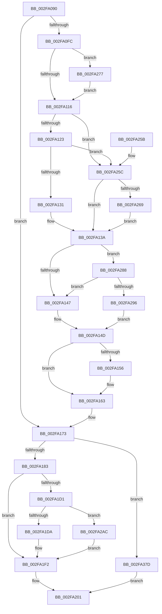

# EtwpApcPoolThunk

- RVA: `0x002FA090`–`0x002FA39B` (길이 `779` bytes)
- VA: `0x00000001402FA090`
- 실행 섹션: `.text`
- PDB 이름 있음: `예`; PDB Function 태그: `아니요`
- unwind 정보 RVA: `0x00072918`
- 디코드: `163`개 명령, `779/779` bytes 표시
- 미해석 바이트: `0` (있으면 어셈블리에 `.byte`로 보존)

> 이 문서는 커널 이미지의 기계어와 PDB 기호를 분석해 생성했습니다. 4번과 5번은 함수 원형과 자료형을 바이너리 사용 방식에서 추정한 C 해석이며 원본 소스 복구 결과는 아닙니다.

## 1. Dependencies

- 직접 호출 지점: **14**; 고유 호출 대상: **14**
- 직접 호출자로 확인된 함수: **1**
- RIP 상대 이미지 참조: **8**

### Outgoing calls
- `0x002FA135` → [KiAcquireSpinLockInstrumented](../20/KiAcquireSpinLockInstrumented_function_002084F0.md) (function, `0x002084F0`)
- `0x002FA15E` → [KiLowerIrqlProcessIrqlFlags](../4F/KiLowerIrqlProcessIrqlFlags_function_004F5698.md) (function, `0x004F5698`)
- `0x002FA193` → [memset](../6C/memset_function_006C6C40.md) (function, `0x006C6C40`)
- `0x002FA1C8` → [PsIsThreadTerminating](PsIsThreadTerminating_function_002FA3D0.md) (function, `0x002FA3D0`)
- `0x002FA1ED` → [EtwpTraceStackWalk](EtwpTraceStackWalk_function_002F8D60.md) (function, `0x002F8D60`)
- `0x002FA1FC` → [EtwpFinalizePendingStackwalkApc](EtwpFinalizePendingStackwalkApc_function_002FA3A4.md) (function, `0x002FA3A4`)
- `0x002FA210` → [ExpInterlockedPushEntrySList](../6B/ExpInterlockedPushEntrySList_function_006BA5B0.md) (function, `0x006BA5B0`)
- `0x002FA232` → [ExReleaseRundownProtectionCacheAwareEx](../25/ExReleaseRundownProtectionCacheAwareEx_function_0025F050.md) (function, `0x0025F050`)
- `0x002FA242` → [_security_check_cookie](../6A/_security_check_cookie_function_006AC640.md) (function, `0x006AC640`)
- `0x002FA26D` → [KxWaitForSpinLockAndAcquire](../20/KxWaitForSpinLockAndAcquire_function_002085C0.md) (function, `0x002085C0`)
- `0x002FA27E` → [KiRaiseIrqlProcessIrqlFlags](../4F/KiRaiseIrqlProcessIrqlFlags_function_004F56FC.md) (function, `0x004F56FC`)
- `0x002FA2A2` → [KiReleaseSpinLockInstrumented](../39/KiReleaseSpinLockInstrumented_function_00392EF0.md) (function, `0x00392EF0`)
- `0x002FA373` → [EtwpEventWriteFull](../22/EtwpEventWriteFull_function_00225C10.md) (function, `0x00225C10`)
- `0x002FA391` → [guard_dispatch_icall](../6B/guard_dispatch_icall_function_006BAAD0.md) (function, `0x006BAAD0`)

### Direct callers
- [sub_00250F85](../25/Unknown_function_00250F85.md) at `0x002510F0`

### Static image references
- `0x002FA0A4` → RVA `0x00E0A740` (`.data`; read)
- `0x002FA109` → RVA `0x00FC6D20` (`ALMOSTRO`; read)
- `0x002FA116` → RVA `0x00FC6B06` (`ALMOSTRO`; read)
- `0x002FA123` → RVA `0x00F0DE58` (`.data`; read)
- `0x002FA173` → RVA `0x00227870` (`EtwpStackWalkApc`; read)
- `0x002FA2AC` → RVA `0x00013050` (`.rdata`; read)
- `0x002FA2E2` → RVA `0x00010980` (`.rdata`; read)
- `0x002FA340` → RVA `0x00010FF8` (`.rdata`; read)

## 2. Other-region calls and transfers

- 다른 실행 섹션으로 향하는 call: **0**
- 별도 외부 분기/꼬리 이동을 확인하지 못했습니다.

## 3. Assembly (complete function range)

```asm
002FA090  40 53                           push rbx
002FA092  55                              push rbp
002FA093  56                              push rsi
002FA094  57                              push rdi
002FA095  41 54                           push r12
002FA097  41 55                           push r13
002FA099  41 56                           push r14
002FA09B  41 57                           push r15
002FA09D  48 81 EC 68 03 00 00            sub rsp, 0x368
002FA0A4  48 8B 05 95 06 B1 00            mov rax, qword ptr [rip + 0xb10695]
002FA0AB  48 33 C4                        xor rax, rsp
002FA0AE  48 89 84 24 50 03 00 00         mov qword ptr [rsp + 0x350], rax
002FA0B6  65 4C 8B 3C 25 88 01 00 00      mov r15, qword ptr gs:[0x188]
002FA0BF  4C 8B F1                        mov r14, rcx
002FA0C2  48 8B 8C 24 D0 03 00 00         mov rcx, qword ptr [rsp + 0x3d0]
002FA0CA  33 C0                           xor eax, eax
002FA0CC  4D 8B E9                        mov r13, r9
002FA0CF  48 89 8C 24 98 00 00 00         mov qword ptr [rsp + 0x98], rcx
002FA0D7  4D 8B E0                        mov r12, r8
002FA0DA  49 8B 9E 80 00 00 00            mov rbx, qword ptr [r14 + 0x80]
002FA0E1  49 8B AE 88 00 00 00            mov rbp, qword ptr [r14 + 0x88]
002FA0E8  48 89 02                        mov qword ptr [rdx], rax
002FA0EB  F0 09 04 24                     lock or dword ptr [rsp], eax
002FA0EF  48 8B 03                        mov rax, qword ptr [rbx]
002FA0F2  8B 80 40 01 00 00               mov eax, dword ptr [rax + 0x140]
002FA0F8  85 C0                           test eax, eax
002FA0FA  75 77                           jne 0x1402fa173
002FA0FC  44 0F 20 C6                     mov rsi, cr8
002FA100  B8 02 00 00 00                  mov eax, 2
002FA105  44 0F 22 C0                     mov cr8, rax
002FA109  83 3D 10 CC CC 00 00            cmp dword ptr [rip + 0xcccc10], 0
002FA110  0F 85 61 01 00 00               jne 0x1402fa277
002FA116  F6 05 E9 C9 CC 00 21            test byte ptr [rip + 0xccc9e9], 0x21
002FA11D  0F 84 39 01 00 00               je 0x1402fa25c
002FA123  8B 05 2F 3D C1 00               mov eax, dword ptr [rip + 0xc13d2f]
002FA129  85 C0                           test eax, eax
002FA12B  0F 85 2B 01 00 00               jne 0x1402fa25c
002FA131  48 8D 4B 08                     lea rcx, [rbx + 8]
002FA135  E8 B6 E3 F0 FF                  call 0x1402084f0
002FA13A  F6 05 C5 C9 CC 00 01            test byte ptr [rip + 0xccc9c5], 1
002FA141  0F 85 41 01 00 00               jne 0x1402fa288
002FA147  F0 48 83 63 08 00               lock and qword ptr [rbx + 8], 0
002FA14D  83 3D CC CB CC 00 00            cmp dword ptr [rip + 0xcccbcc], 0
002FA154  74 0D                           je 0x1402fa163
002FA156  44 0F 20 C1                     mov rcx, cr8
002FA15A  40 0F B6 D6                     movzx edx, sil
002FA15E  E8 35 B5 1F 00                  call 0x1404f5698
002FA163  40 0F B6 C6                     movzx eax, sil
002FA167  44 0F 22 C0                     mov cr8, rax
002FA16B  48 8B 8C 24 98 00 00 00         mov rcx, qword ptr [rsp + 0x98]
002FA173  48 8D 05 F6 D6 F2 FF            lea rax, [rip - 0xd290a]
002FA17A  48 3B E8                        cmp rbp, rax
002FA17D  0F 85 FA 01 00 00               jne 0x1402fa37d
002FA183  33 D2                           xor edx, edx
002FA185  48 8D 8C 24 A0 00 00 00         lea rcx, [rsp + 0xa0]
002FA18D  41 B8 A8 02 00 00               mov r8d, 0x2a8
002FA193  E8 A8 CA 3C 00                  call 0x1406c6c40
002FA198  65 48 8B 2C 25 88 01 00 00      mov rbp, qword ptr gs:[0x188]
002FA1A1  41 8B 45 00                     mov eax, dword ptr [r13]
002FA1A5  48 8B CD                        mov rcx, rbp
002FA1A8  48 8B 33                        mov rsi, qword ptr [rbx]
002FA1AB  41 0F B6 3C 24                  movzx edi, byte ptr [r12]
002FA1B0  89 84 24 94 00 00 00            mov dword ptr [rsp + 0x94], eax
002FA1B7  48 8B 84 24 98 00 00 00         mov rax, qword ptr [rsp + 0x98]
002FA1BF  8B 00                           mov eax, dword ptr [rax]
002FA1C1  89 84 24 90 00 00 00            mov dword ptr [rsp + 0x90], eax
002FA1C8  E8 03 02 00 00                  call 0x1402fa3d0
002FA1CD  84 C0                           test al, al
002FA1CF  75 21                           jne 0x1402fa1f2
002FA1D1  40 84 FF                        test dil, dil
002FA1D4  0F 85 D2 00 00 00               jne 0x1402fa2ac
002FA1DA  4C 8D 8C 24 90 00 00 00         lea r9, [rsp + 0x90]
002FA1E2  4C 8B C5                        mov r8, rbp
002FA1E5  BA 00 10 00 00                  mov edx, 0x1000
002FA1EA  48 8B CE                        mov rcx, rsi
002FA1ED  E8 6E EB FF FF                  call 0x1402f8d60
002FA1F2  44 0F B6 C7                     movzx r8d, dil
002FA1F6  49 8B D7                        mov rdx, r15
002FA1F9  48 8B CE                        mov rcx, rsi
002FA1FC  E8 A3 01 00 00                  call 0x1402fa3a4
002FA201  F0 FF 8B B0 00 00 00            lock dec dword ptr [rbx + 0xb0]
002FA208  49 8D 56 70                     lea rdx, [r14 + 0x70]
002FA20C  48 8D 4B 20                     lea rcx, [rbx + 0x20]
002FA210  E8 9B 03 3C 00                  call 0x1406ba5b0
002FA215  48 8B 03                        mov rax, qword ptr [rbx]
002FA218  BA 01 00 00 00                  mov edx, 1
002FA21D  4C 8B 80 50 05 00 00            mov r8, qword ptr [rax + 0x550]
002FA224  44 8B 08                        mov r9d, dword ptr [rax]
002FA227  49 8B 88 C0 02 00 00            mov rcx, qword ptr [r8 + 0x2c0]
002FA22E  4A 8B 0C C9                     mov rcx, qword ptr [rcx + r9*8]
002FA232  E8 19 4E F6 FF                  call 0x14025f050
002FA237  48 8B 8C 24 50 03 00 00         mov rcx, qword ptr [rsp + 0x350]
002FA23F  48 33 CC                        xor rcx, rsp
002FA242  E8 F9 23 3B 00                  call 0x1406ac640
002FA247  48 81 C4 68 03 00 00            add rsp, 0x368
002FA24E  41 5F                           pop r15
002FA250  41 5E                           pop r14
002FA252  41 5D                           pop r13
002FA254  41 5C                           pop r12
002FA256  5F                              pop rdi
002FA257  5E                              pop rsi
002FA258  5D                              pop rbp
002FA259  5B                              pop rbx
002FA25A  C3                              ret
002FA25B  CC                              int3
002FA25C  F0 48 0F BA 6B 08 00            lock bts qword ptr [rbx + 8], 0
002FA263  0F 83 D1 FE FF FF               jae 0x1402fa13a
002FA269  48 8D 4B 08                     lea rcx, [rbx + 8]
002FA26D  E8 4E E3 F0 FF                  call 0x1402085c0
002FA272  E9 C3 FE FF FF                  jmp 0x1402fa13a
002FA277  0F B6 D0                        movzx edx, al
002FA27A  40 0F B6 CE                     movzx ecx, sil
002FA27E  E8 79 B4 1F 00                  call 0x1404f56fc
002FA283  E9 8E FE FF FF                  jmp 0x1402fa116
002FA288  8B 05 CA 3B C1 00               mov eax, dword ptr [rip + 0xc13bca]
002FA28E  85 C0                           test eax, eax
002FA290  0F 85 B1 FE FF FF               jne 0x1402fa147
002FA296  48 8B 94 24 A8 03 00 00         mov rdx, qword ptr [rsp + 0x3a8]
002FA29E  48 8D 4B 08                     lea rcx, [rbx + 8]
002FA2A2  E8 49 8C 09 00                  call 0x140392ef0
002FA2A7  E9 A1 FE FF FF                  jmp 0x1402fa14d
002FA2AC  0F 10 05 9D 8D D1 FF            movups xmm0, xmmword ptr [rip - 0x2e7263]
002FA2B3  48 8B 84 24 90 00 00 00         mov rax, qword ptr [rsp + 0x90]
002FA2BB  48 8D 8C 24 A0 00 00 00         lea rcx, [rsp + 0xa0]
002FA2C3  48 89 84 24 F0 00 00 00         mov qword ptr [rsp + 0xf0], rax
002FA2CB  BA 01 00 00 00                  mov edx, 1
002FA2D0  0F 11 84 24 C8 00 00 00         movups xmmword ptr [rsp + 0xc8], xmm0
002FA2D8  48 8B 86 50 05 00 00            mov rax, qword ptr [rsi + 0x550]
002FA2DF  45 33 C9                        xor r9d, r9d
002FA2E2  66 0F 6F 05 96 66 D1 FF         movdqa xmm0, xmmword ptr [rip - 0x2e996a]
002FA2EA  45 33 C0                        xor r8d, r8d
002FA2ED  48 89 84 24 28 03 00 00         mov qword ptr [rsp + 0x328], rax
002FA2F5  0F B7 06                        movzx eax, word ptr [rsi]
002FA2F8  66 89 84 24 26 01 00 00         mov word ptr [rsp + 0x126], ax
002FA300  33 C0                           xor eax, eax
002FA302  48 89 84 24 80 00 00 00         mov qword ptr [rsp + 0x80], rax
002FA30A  48 89 44 24 78                  mov qword ptr [rsp + 0x78], rax
002FA30F  66 89 44 24 70                  mov word ptr [rsp + 0x70], ax
002FA314  48 89 44 24 68                  mov qword ptr [rsp + 0x68], rax
002FA319  48 89 44 24 60                  mov qword ptr [rsp + 0x60], rax
002FA31E  48 89 44 24 58                  mov qword ptr [rsp + 0x58], rax
002FA323  48 89 44 24 50                  mov qword ptr [rsp + 0x50], rax
002FA328  89 44 24 48                     mov dword ptr [rsp + 0x48], eax
002FA32C  48 89 44 24 40                  mov qword ptr [rsp + 0x40], rax
002FA331  48 89 44 24 38                  mov qword ptr [rsp + 0x38], rax
002FA336  66 89 44 24 30                  mov word ptr [rsp + 0x30], ax
002FA33B  66 89 44 24 28                  mov word ptr [rsp + 0x28], ax
002FA340  48 8D 05 B1 6C D1 FF            lea rax, [rip - 0x2e934f]
002FA347  48 89 44 24 20                  mov qword ptr [rsp + 0x20], rax
002FA34C  C7 84 24 20 01 00 00 01 00 00 00  mov dword ptr [rsp + 0x120], 1
002FA357  C7 84 24 28 01 00 00 44 00 00 00  mov dword ptr [rsp + 0x128], 0x44
002FA362  C6 84 24 24 01 00 00 FF         mov byte ptr [rsp + 0x124], 0xff
002FA36A  66 0F 7F 84 24 30 01 00 00      movdqa xmmword ptr [rsp + 0x130], xmm0
002FA373  E8 98 B8 F2 FF                  call 0x140225c10
002FA378  E9 75 FE FF FF                  jmp 0x1402fa1f2
002FA37D  48 89 4C 24 20                  mov qword ptr [rsp + 0x20], rcx
002FA382  4D 8B CD                        mov r9, r13
002FA385  48 8B CB                        mov rcx, rbx
002FA388  4D 8B C4                        mov r8, r12
002FA38B  49 8B D7                        mov rdx, r15
002FA38E  48 8B C5                        mov rax, rbp
002FA391  E8 3A 07 3C 00                  call 0x1406baad0
002FA396  E9 66 FE FF FF                  jmp 0x1402fa201
```

## 4. C-style interpretation (structured pseudocode)

```c
__int64 __fastcall EtwpApcPoolThunk(__int64 a1, __int64 a2, __int64 a3, __int64 a4, __int64 a5)
{
    __int64 result;
    __int64 v_rsp;
    unsigned __int64 v_stack_m308;
    unsigned __int64 v_stack_m310;
    unsigned int v_stack_m314;
    unsigned int v_stack_m318;
    unsigned int v_stack_m3A8;
    unsigned __int64 v_stack_m58;
    unsigned int v_stack_p120;
    unsigned __int8 v_stack_p124;
    unsigned __int16 v_stack_p126;
    unsigned int v_stack_p128;
    unsigned __int64 v_stack_p130;
    unsigned __int64 v_stack_p20;
    unsigned __int16 v_stack_p28;
    unsigned __int16 v_stack_p30;
    unsigned __int64 v_stack_p328;
    unsigned __int64 v_stack_p38;
    unsigned __int64 v_stack_p3A8;
    unsigned __int64 v_stack_p40;
    unsigned int v_stack_p48;
    unsigned __int64 v_stack_p50;
    unsigned __int64 v_stack_p58;
    unsigned __int64 v_stack_p60;
    unsigned __int64 v_stack_p68;
    unsigned __int16 v_stack_p70;
    unsigned __int64 v_stack_p78;
    unsigned __int64 v_stack_p80;
    unsigned __int64 v_stack_p90;
    unsigned __int64 v_stack_pA0;
    unsigned __int64 v_stack_pC8;
    unsigned __int64 v_stack_pF0;

    v_rsp = (v_rsp) - (872);
    result = (*(unsigned __int64 *)(v_rip + 11601557)) ^ (v_rsp);
    v_stack_m58 = result;
    result = 0;
    v_stack_m310 = a5;
    *(unsigned __int64 *)(a2) = 0;
    if ((unsigned int)((unsigned int)(*(unsigned int *)(*(unsigned __int64 *)(*(unsigned __int64 *)(a1 + 128)) + 320))) != 0) goto loc_002FA173;
    if ((*(unsigned int *)(v_rip + 13421584)) != 0) goto loc_002FA277;
loc_002FA116:
    if (((*(unsigned __int8 *)(v_rip + 13421033)) & (33)) == 0) goto loc_002FA25C;
    if ((unsigned int)((unsigned int)(*(unsigned int *)(v_rip + 12664111))) != 0) goto loc_002FA25C;
    result = KiAcquireSpinLockInstrumented(*(unsigned __int64 *)(a1 + 128) + 8, a2, a3, a4);
loc_002FA13A:
    if (((*(unsigned __int8 *)(v_rip + 13420997)) & (1)) != 0) goto loc_002FA288;
loc_002FA147:
loc_002FA14D:
    if ((*(unsigned int *)(v_rip + 13421516)) != 0) {
        a1 = 2;
        a2 = (unsigned __int8)(v_cr8);
        result = KiLowerIrqlProcessIrqlFlags(a1, a2, a3, a4);
    }
loc_002FA173:
    if ((*(unsigned __int64 *)(a1 + 136)) != (v_rip - 862474)) goto loc_002FA37D;
    a2 = 0;
    result = memset(v_stack_m308, a2, 680, a4);
    v_stack_m314 = (unsigned int)((unsigned int)(*(unsigned int *)(a4)));
    v_stack_m318 = (unsigned int)((unsigned int)(*(unsigned int *)(v_stack_m310)));
    result = PsIsThreadTerminating(*(unsigned __int64 *)(gs_base + (0 + 392)), a2, 680, a4);
    if ((unsigned __int8)(result) != 0) goto loc_002FA1F2;
    if ((unsigned __int8)(*(unsigned __int8 *)(a3)) != 0) goto loc_002FA2AC;
    result = EtwpTraceStackWalk(*(unsigned __int64 *)(*(unsigned __int64 *)(a1 + 128)), (unsigned int)(0x1000ULL), *(unsigned __int64 *)(gs_base + (0 + 392)), v_stack_m318);
loc_002FA1F2:
    result = EtwpFinalizePendingStackwalkApc(*(unsigned __int64 *)(*(unsigned __int64 *)(a1 + 128)), *(unsigned __int64 *)(gs_base + (0 + 392)), (unsigned __int8)(*(unsigned __int8 *)(a3)), v_stack_m318);
loc_002FA201:
    result = ExpInterlockedPushEntrySList(*(unsigned __int64 *)(a1 + 128) + 32, a1 + 112, (unsigned __int8)(*(unsigned __int8 *)(a3)), v_stack_m318);
    result = ExReleaseRundownProtectionCacheAwareEx(*(unsigned __int64 *)(*(unsigned __int64 *)(*(unsigned __int64 *)(*(unsigned __int64 *)(*(unsigned __int64 *)(a1 + 128)) + 1360) + 704) + (unsigned int)(*(unsigned int *)(*(unsigned __int64 *)(*(unsigned __int64 *)(a1 + 128)))) * 8), 1, *(unsigned __int64 *)(*(unsigned __int64 *)(*(unsigned __int64 *)(a1 + 128)) + 1360), (unsigned int)(*(unsigned int *)(*(unsigned __int64 *)(*(unsigned __int64 *)(a1 + 128)))));
    a1 = (v_stack_m58) ^ (v_rsp);
    result = _security_check_cookie(a1, 1, *(unsigned __int64 *)(*(unsigned __int64 *)(*(unsigned __int64 *)(a1 + 128)) + 1360), (unsigned int)(*(unsigned int *)(*(unsigned __int64 *)(*(unsigned __int64 *)(a1 + 128)))));
    v_rsp = (v_rsp) + (872);
    return result;
loc_002FA25C:
    if (condition_is_above_or_equal) goto loc_002FA13A;
    result = KxWaitForSpinLockAndAcquire(*(unsigned __int64 *)(a1 + 128) + 8, 1, *(unsigned __int64 *)(*(unsigned __int64 *)(*(unsigned __int64 *)(a1 + 128)) + 1360), (unsigned int)(*(unsigned int *)(*(unsigned __int64 *)(*(unsigned __int64 *)(a1 + 128)))));
    goto loc_002FA13A;
loc_002FA277:
    result = KiRaiseIrqlProcessIrqlFlags((unsigned __int8)(*(unsigned __int64 *)(*(unsigned __int64 *)(a1 + 128))), (unsigned __int8)(result), *(unsigned __int64 *)(*(unsigned __int64 *)(*(unsigned __int64 *)(a1 + 128)) + 1360), (unsigned int)(*(unsigned int *)(*(unsigned __int64 *)(*(unsigned __int64 *)(a1 + 128)))));
    goto loc_002FA116;
loc_002FA288:
    if ((unsigned int)((unsigned int)(*(unsigned int *)(v_rip + 12663754))) != 0) goto loc_002FA147;
    result = KiReleaseSpinLockInstrumented(*(unsigned __int64 *)(a1 + 128) + 8, v_stack_p3A8, *(unsigned __int64 *)(*(unsigned __int64 *)(*(unsigned __int64 *)(a1 + 128)) + 1360), (unsigned int)(*(unsigned int *)(*(unsigned __int64 *)(*(unsigned __int64 *)(a1 + 128)))));
    goto loc_002FA14D;
loc_002FA2AC:
    v_stack_pF0 = v_stack_p90;
    v_stack_pC8 = v_xmm0;
    a4 = 0;
    a3 = 0;
    v_stack_p328 = *(unsigned __int64 *)(*(unsigned __int64 *)(*(unsigned __int64 *)(a1 + 128)) + 1360);
    v_stack_p126 = (unsigned __int16)(*(unsigned __int16 *)(*(unsigned __int64 *)(*(unsigned __int64 *)(a1 + 128))));
    result = 0;
    v_stack_p80 = 0;
    v_stack_p78 = 0;
    v_stack_p70 = 0;
    v_stack_p68 = 0;
    v_stack_p60 = 0;
    v_stack_p58 = 0;
    v_stack_p50 = 0;
    v_stack_p48 = 0;
    v_stack_p40 = 0;
    v_stack_p38 = 0;
    v_stack_p30 = 0;
    v_stack_p28 = 0;
    v_stack_p20 = v_rip - 3052367;
    v_stack_p120 = 1;
    v_stack_p128 = 68;
    v_stack_p124 = 255;
    v_stack_p130 = v_xmm0;
    result = EtwpEventWriteFull(v_stack_pA0, 1, a3, a4);
    goto loc_002FA1F2;
loc_002FA37D:
    v_stack_p20 = v_stack_pA0;
    result = guard_dispatch_icall(*(unsigned __int64 *)(a1 + 128), *(unsigned __int64 *)(gs_base + (0 + 392)), 0, 0);
    goto loc_002FA201;
}
```

## 5. (Beta) C Style

```c
int64_t EtwpApcPoolThunk(void *Arg1, void *Arg2, void *Arg3, void *Arg4, int64_t Arg5)
{
    uint8_t *arg1 = (uint8_t *)Arg1;
    uint8_t *arg2 = (uint8_t *)Arg2;
    uint8_t *arg3 = (uint8_t *)Arg3;
    uint8_t *arg4 = (uint8_t *)Arg4;

    int64_t result;
    int64_t local_rsp;
    uint64_t v_stack_m308;
    uint64_t v_stack_m310;
    uint32_t v_stack_m314;
    uint32_t v_stack_m318;
    uint32_t v_stack_m3A8;
    uint64_t v_stack_m58;
    uint32_t v_stack_p120;
    uint8_t v_stack_p124;
    uint16_t v_stack_p126;
    uint32_t v_stack_p128;
    uint64_t v_stack_p130;
    uint64_t v_stack_p20;
    uint16_t v_stack_p28;
    uint16_t v_stack_p30;
    uint64_t v_stack_p328;
    uint64_t v_stack_p38;
    uint64_t v_stack_p3A8;
    uint64_t v_stack_p40;
    uint32_t v_stack_p48;
    uint64_t v_stack_p50;
    uint64_t v_stack_p58;
    uint64_t v_stack_p60;
    uint64_t v_stack_p68;
    uint16_t v_stack_p70;
    uint64_t v_stack_p78;
    uint64_t v_stack_p80;
    uint64_t v_stack_p90;
    uint64_t v_stack_pA0;
    uint64_t v_stack_pC8;
    uint64_t v_stack_pF0;

    local_rsp = (local_rsp) - (872);
    result = (*(uint64_t *)(v_rip + 0xB10695)) ^ (local_rsp);
    v_stack_m58 = result;
    result = 0;
    v_stack_m310 = Arg5;
    *(uint64_t *)(arg2) = 0;
    if ((uint32_t)((uint32_t)(*(uint32_t *)(*(uint64_t *)(*(uint64_t *)(arg1 + 0x80)) + 0x140))) != 0) goto loc_002FA173;
    if ((*(uint32_t *)(v_rip + 0xCCCC10)) != 0) goto loc_002FA277;
loc_002FA116:
    if (((*(uint8_t *)(v_rip + 0xCCC9E9)) & (33)) == 0) goto loc_002FA25C;
    if ((uint32_t)((uint32_t)(*(uint32_t *)(v_rip + 0xC13D2F))) != 0) goto loc_002FA25C;
    result = KiAcquireSpinLockInstrumented(*(uint64_t *)(arg1 + 0x80) + 8, Arg2, Arg3, Arg4);
loc_002FA13A:
    if (((*(uint8_t *)(v_rip + 0xCCC9C5)) & (1)) != 0) goto loc_002FA288;
loc_002FA147:
loc_002FA14D:
    if ((*(uint32_t *)(v_rip + 0xCCCBCC)) != 0) {
        Arg1 = 2;
        Arg2 = (uint8_t)(v_cr8);
        result = KiLowerIrqlProcessIrqlFlags(Arg1, Arg2, Arg3, Arg4);
    }
loc_002FA173:
    if ((*(uint64_t *)(arg1 + 0x88)) != (v_rip - 862474)) goto loc_002FA37D;
    Arg2 = 0;
    result = memset(v_stack_m308, Arg2, 680, Arg4);
    v_stack_m314 = (uint32_t)((uint32_t)(*(uint32_t *)(arg4)));
    v_stack_m318 = (uint32_t)((uint32_t)(*(uint32_t *)(v_stack_m310)));
    result = PsIsThreadTerminating(*(uint64_t *)(gs_base + (0 + 0x188)), Arg2, 680, Arg4);
    if ((uint8_t)(result) != 0) goto loc_002FA1F2;
    if ((uint8_t)(*(uint8_t *)(arg3)) != 0) goto loc_002FA2AC;
    result = EtwpTraceStackWalk(*(uint64_t *)(*(uint64_t *)(arg1 + 0x80)), (uint32_t)(0x1000ULL), *(uint64_t *)(gs_base + (0 + 0x188)), v_stack_m318);
loc_002FA1F2:
    result = EtwpFinalizePendingStackwalkApc(*(uint64_t *)(*(uint64_t *)(arg1 + 0x80)), *(uint64_t *)(gs_base + (0 + 0x188)), (uint8_t)(*(uint8_t *)(arg3)), v_stack_m318);
loc_002FA201:
    result = ExpInterlockedPushEntrySList(*(uint64_t *)(arg1 + 0x80) + 32, Arg1 + 112, (uint8_t)(*(uint8_t *)(arg3)), v_stack_m318);
    result = ExReleaseRundownProtectionCacheAwareEx(*(uint64_t *)(*(uint64_t *)(*(uint64_t *)(*(uint64_t *)(*(uint64_t *)(arg1 + 0x80)) + 0x550) + 0x2C0) + (uint32_t)(*(uint32_t *)(*(uint64_t *)(*(uint64_t *)(arg1 + 0x80)))) * 8), 1, *(uint64_t *)(*(uint64_t *)(*(uint64_t *)(arg1 + 0x80)) + 0x550), (uint32_t)(*(uint32_t *)(*(uint64_t *)(*(uint64_t *)(arg1 + 0x80)))));
    Arg1 = (v_stack_m58) ^ (local_rsp);
    result = _security_check_cookie(Arg1, 1, *(uint64_t *)(*(uint64_t *)(*(uint64_t *)(arg1 + 0x80)) + 0x550), (uint32_t)(*(uint32_t *)(*(uint64_t *)(*(uint64_t *)(arg1 + 0x80)))));
    local_rsp = (local_rsp) + (872);
    return result;
loc_002FA25C:
    if (condition_is_above_or_equal) goto loc_002FA13A;
    result = KxWaitForSpinLockAndAcquire(*(uint64_t *)(arg1 + 0x80) + 8, 1, *(uint64_t *)(*(uint64_t *)(*(uint64_t *)(arg1 + 0x80)) + 0x550), (uint32_t)(*(uint32_t *)(*(uint64_t *)(*(uint64_t *)(arg1 + 0x80)))));
    goto loc_002FA13A;
loc_002FA277:
    result = KiRaiseIrqlProcessIrqlFlags((uint8_t)(*(uint64_t *)(*(uint64_t *)(arg1 + 0x80))), (uint8_t)(result), *(uint64_t *)(*(uint64_t *)(*(uint64_t *)(arg1 + 0x80)) + 0x550), (uint32_t)(*(uint32_t *)(*(uint64_t *)(*(uint64_t *)(arg1 + 0x80)))));
    goto loc_002FA116;
loc_002FA288:
    if ((uint32_t)((uint32_t)(*(uint32_t *)(v_rip + 0xC13BCA))) != 0) goto loc_002FA147;
    result = KiReleaseSpinLockInstrumented(*(uint64_t *)(arg1 + 0x80) + 8, v_stack_p3A8, *(uint64_t *)(*(uint64_t *)(*(uint64_t *)(arg1 + 0x80)) + 0x550), (uint32_t)(*(uint32_t *)(*(uint64_t *)(*(uint64_t *)(arg1 + 0x80)))));
    goto loc_002FA14D;
loc_002FA2AC:
    v_stack_pF0 = v_stack_p90;
    v_stack_pC8 = v_xmm0;
    Arg4 = 0;
    Arg3 = 0;
    v_stack_p328 = *(uint64_t *)(*(uint64_t *)(*(uint64_t *)(arg1 + 0x80)) + 0x550);
    v_stack_p126 = (uint16_t)(*(uint16_t *)(*(uint64_t *)(*(uint64_t *)(arg1 + 0x80))));
    result = 0;
    v_stack_p80 = 0;
    v_stack_p78 = 0;
    v_stack_p70 = 0;
    v_stack_p68 = 0;
    v_stack_p60 = 0;
    v_stack_p58 = 0;
    v_stack_p50 = 0;
    v_stack_p48 = 0;
    v_stack_p40 = 0;
    v_stack_p38 = 0;
    v_stack_p30 = 0;
    v_stack_p28 = 0;
    v_stack_p20 = v_rip - 3052367;
    v_stack_p120 = 1;
    v_stack_p128 = 68;
    v_stack_p124 = 255;
    v_stack_p130 = v_xmm0;
    result = EtwpEventWriteFull(v_stack_pA0, 1, Arg3, Arg4);
    goto loc_002FA1F2;
loc_002FA37D:
    v_stack_p20 = v_stack_pA0;
    result = guard_dispatch_icall(*(uint64_t *)(arg1 + 0x80), *(uint64_t *)(gs_base + (0 + 0x188)), 0, 0);
    goto loc_002FA201;
}
```

### 관측된 메모리 오프셋

구조체 형식이 확인되지 않은 접근은 인자 기준의 오프셋으로만 기록했습니다.

| 기준 인자 | 오프셋 표현 | 폭 (bit) | 접근 |
|---|---:|---:|---|
| `Arg1` | `+ 0x70` | `64` | `R` |
| `Arg1` | `+ 0x80` | `64` | `R` |
| `Arg1` | `+ 0x88` | `64` | `R` |
| `Arg2` | `+ 0x0` | `64` | `W` |
| `Arg3` | `+ 0x0` | `8` | `R` |
| `Arg4` | `+ 0x0` | `32` | `R` |

## 6. Execution-region graph

[열기: 2D/3D 그래프와 함수 탐색 컨트롤 패널](../../../control-panel.html?section=text&rva=0x002FA090&view=graph)

- 2D 그래프는 위에서 아래로 흐르고, 3D 그래프는 빈 공간을 드래그해 회전합니다. Shift+드래그는 이동, 휠은 확대·축소, 함수 노드 선택은 대상 보고서 이동입니다.

### Static fallback


