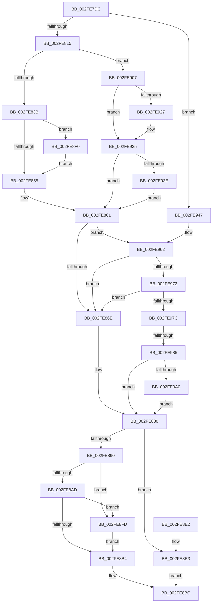

# EtwpEnqueueAvailableBuffer

- RVA: `0x002FE7DC`–`0x002FE9A9` (길이 `461` bytes)
- VA: `0x00000001402FE7DC`
- 실행 섹션: `.text`
- PDB 이름 있음: `예`; PDB Function 태그: `예`
- unwind 정보 RVA: `0x00072E04`
- 디코드: `116`개 명령, `461/461` bytes 표시
- 미해석 바이트: `0` (있으면 어셈블리에 `.byte`로 보존)

> 이 문서는 커널 이미지의 기계어와 PDB 기호를 분석해 생성했습니다. 4번과 5번은 함수 원형과 자료형을 바이너리 사용 방식에서 추정한 C 해석이며 원본 소스 복구 결과는 아닙니다.

## 1. Dependencies

- 직접 호출 지점: **8**; 고유 호출 대상: **8**
- 직접 호출자로 확인된 함수: **8**
- RIP 상대 이미지 참조: **1**

### Outgoing calls
- `0x002FE85C` → [KeAcquireSpinLockAtDpcLevel](../20/KeAcquireSpinLockAtDpcLevel_function_00208430.md) (function, `0x00208430`)
- `0x002FE8B7` → [KeAbPostRelease](../2E/KeAbPostRelease_function_002E1600.md) (function, `0x002E1600`)
- `0x002FE8E9` → [KeReleaseSpinLock](../39/KeReleaseSpinLock_function_00392BA0.md) (function, `0x00392BA0`)
- `0x002FE8F3` → [KiRaiseIrqlProcessIrqlFlags](../4F/KiRaiseIrqlProcessIrqlFlags_function_004F56FC.md) (function, `0x004F56FC`)
- `0x002FE900` → [ExfReleasePushLock](../26/ExfReleasePushLock_function_002638D0.md) (function, `0x002638D0`)
- `0x002FE916` → [KeAbPreAcquire](../21/KeAbPreAcquire_function_00210230.md) (function, `0x00210230`)
- `0x002FE930` → [ExfAcquirePushLockExclusiveEx](../20/ExfAcquirePushLockExclusiveEx_function_0020FC90.md) (function, `0x0020FC90`)
- `0x002FE95C` → [KeBugCheckEx](../4F/KeBugCheckEx_function_004FD660.md) (function, `0x004FD660`)

### Direct callers
- [EtwpReserveTraceBuffer](EtwpReserveTraceBuffer_function_002FC8C0.md) at `0x002FCAF1`
- [EtwpReserveTraceBuffer](EtwpReserveTraceBuffer_function_002FC8C0.md) at `0x002FCB95`
- [EtwpReserveTraceBuffer](EtwpReserveTraceBuffer_function_002FC8C0.md) at `0x002FCE15`
- [EtwpPrepareDirtyBuffer](EtwpPrepareDirtyBuffer_function_002FE750.md) at `0x002FE78E`
- [EtwpPrepareDirtyBuffer](EtwpPrepareDirtyBuffer_function_002FE750.md) at `0x002FE79B`
- [EtwpAllocateFreeBuffers](../3E/EtwpAllocateFreeBuffers_function_003EAEA4.md) at `0x003EAFC8`
- [EtwpRelinquishCompressionTarget](../65/EtwpRelinquishCompressionTarget_function_00653818.md) at `0x0065384B`
- [EtwpRotateCompressionTarget](../65/EtwpRotateCompressionTarget_function_00653868.md) at `0x006538A1`
- [EtwpFlushActiveBuffers](../../page/9B/EtwpFlushActiveBuffers_function_009BDEF4.md) at `0x009BE0AF`
- [EtwpCompleteBuffer](../../page/AB/EtwpCompleteBuffer_function_00AB0C78.md) at `0x00AB0C85`
- [sub_00B2E9B2](../../page/B2/Unknown_function_00B2E9B2.md) at `0x00B2E9DC`

### Static image references
- `0x002FE848` → RVA `0x00FC6D20` (`ALMOSTRO`; read)

## 2. Other-region calls and transfers

- 다른 실행 섹션으로 향하는 call: **0**
- call이 아닌 외부 분기/꼬리 이동: **1**
  - `0x002FE97F` → [sub_006DFED2](../6D/Unknown_function_006DFED2.md) (`tail-transfer`)

## 3. Assembly (complete function range)

```asm
002FE7DC  48 8B C4                        mov rax, rsp
002FE7DF  48 89 58 08                     mov qword ptr [rax + 8], rbx
002FE7E3  48 89 68 10                     mov qword ptr [rax + 0x10], rbp
002FE7E7  48 89 70 18                     mov qword ptr [rax + 0x18], rsi
002FE7EB  48 89 78 20                     mov qword ptr [rax + 0x20], rdi
002FE7EF  41 54                           push r12
002FE7F1  41 56                           push r14
002FE7F3  41 57                           push r15
002FE7F5  48 83 EC 30                     sub rsp, 0x30
002FE7F9  8B 02                           mov eax, dword ptr [rdx]
002FE7FB  45 33 E4                        xor r12d, r12d
002FE7FE  48 8B D9                        mov rbx, rcx
002FE801  45 8B F0                        mov r14d, r8d
002FE804  8B 49 04                        mov ecx, dword ptr [rcx + 4]
002FE807  48 8B F2                        mov rsi, rdx
002FE80A  45 8A FC                        mov r15b, r12b
002FE80D  3B C8                           cmp ecx, eax
002FE80F  0F 85 32 01 00 00               jne 0x1402fe947
002FE815  44 89 42 2C                     mov dword ptr [rdx + 0x2c], r8d
002FE819  41 8D 44 24 01                  lea eax, [r12 + 1]
002FE81E  F0 48 0F C1 83 28 03 00 00      lock xadd qword ptr [rbx + 0x328], rax
002FE827  48 FF C0                        inc rax
002FE82A  48 89 42 18                     mov qword ptr [rdx + 0x18], rax
002FE82E  83 BB 2C 01 00 00 01            cmp dword ptr [rbx + 0x12c], 1
002FE835  0F 84 CC 00 00 00               je 0x1402fe907
002FE83B  45 0F 20 C7                     mov r15, cr8
002FE83F  41 8D 54 24 0F                  lea edx, [r12 + 0xf]
002FE844  44 0F 22 C2                     mov cr8, rdx
002FE848  44 39 25 D1 84 CC 00            cmp dword ptr [rip + 0xcc84d1], r12d
002FE84F  0F 85 9B 00 00 00               jne 0x1402fe8f0
002FE855  48 8D 8B B8 02 00 00            lea rcx, [rbx + 0x2b8]
002FE85C  E8 CF 9B F0 FF                  call 0x140208430
002FE861  F7 43 0C 00 00 00 04            test dword ptr [rbx + 0xc], 0x4000000
002FE868  0F 85 F4 00 00 00               jne 0x1402fe962
002FE86E  48 8D 4E 20                     lea rcx, [rsi + 0x20]
002FE872  4C 89 21                        mov qword ptr [rcx], r12
002FE875  48 8B 43 30                     mov rax, qword ptr [rbx + 0x30]
002FE879  48 89 08                        mov qword ptr [rax], rcx
002FE87C  48 89 4B 30                     mov qword ptr [rbx + 0x30], rcx
002FE880  83 BB 2C 01 00 00 01            cmp dword ptr [rbx + 0x12c], 1
002FE887  48 8D BB B8 02 00 00            lea rdi, [rbx + 0x2b8]
002FE88E  75 53                           jne 0x1402fe8e3
002FE890  0F 0D 0F                        prefetchw byte ptr [rdi]
002FE893  48 8B 07                        mov rax, qword ptr [rdi]
002FE896  48 8B C8                        mov rcx, rax
002FE899  48 83 E1 F0                     and rcx, 0xfffffffffffffff0
002FE89D  48 83 F9 10                     cmp rcx, 0x10
002FE8A1  48 8D 50 F0                     lea rdx, [rax - 0x10]
002FE8A5  49 0F 46 D4                     cmovbe rdx, r12
002FE8A9  A8 02                           test al, 2
002FE8AB  75 50                           jne 0x1402fe8fd
002FE8AD  F0 48 0F B1 17                  lock cmpxchg qword ptr [rdi], rdx
002FE8B2  75 49                           jne 0x1402fe8fd
002FE8B4  48 8B CF                        mov rcx, rdi
002FE8B7  E8 44 2D FE FF                  call 0x1402e1600
002FE8BC  F0 FF 83 E4 00 00 00            lock inc dword ptr [rbx + 0xe4]
002FE8C3  48 8B 5C 24 50                  mov rbx, qword ptr [rsp + 0x50]
002FE8C8  48 8B 6C 24 58                  mov rbp, qword ptr [rsp + 0x58]
002FE8CD  48 8B 74 24 60                  mov rsi, qword ptr [rsp + 0x60]
002FE8D2  48 8B 7C 24 68                  mov rdi, qword ptr [rsp + 0x68]
002FE8D7  48 83 C4 30                     add rsp, 0x30
002FE8DB  41 5F                           pop r15
002FE8DD  41 5E                           pop r14
002FE8DF  41 5C                           pop r12
002FE8E1  C3                              ret
002FE8E2  CC                              int3
002FE8E3  41 8A D7                        mov dl, r15b
002FE8E6  48 8B CF                        mov rcx, rdi
002FE8E9  E8 B2 42 09 00                  call 0x140392ba0
002FE8EE  EB CC                           jmp 0x1402fe8bc
002FE8F0  41 8A CF                        mov cl, r15b
002FE8F3  E8 04 6E 1F 00                  call 0x1404f56fc
002FE8F8  E9 58 FF FF FF                  jmp 0x1402fe855
002FE8FD  48 8B CF                        mov rcx, rdi
002FE900  E8 CB 4F F6 FF                  call 0x1402638d0
002FE905  EB AD                           jmp 0x1402fe8b4
002FE907  48 8D AB B8 02 00 00            lea rbp, [rbx + 0x2b8]
002FE90E  45 33 C0                        xor r8d, r8d
002FE911  48 8B CD                        mov rcx, rbp
002FE914  33 D2                           xor edx, edx
002FE916  E8 15 19 F1 FF                  call 0x140210230
002FE91B  F0 48 0F BA 6D 00 00            lock bts qword ptr [rbp], 0
002FE922  48 8B F8                        mov rdi, rax
002FE925  73 0E                           jae 0x1402fe935
002FE927  4C 8B C5                        mov r8, rbp
002FE92A  48 8B D0                        mov rdx, rax
002FE92D  48 8B CD                        mov rcx, rbp
002FE930  E8 5B 13 F1 FF                  call 0x14020fc90
002FE935  48 85 FF                        test rdi, rdi
002FE938  0F 84 23 FF FF FF               je 0x1402fe861
002FE93E  C6 47 0A 01                     mov byte ptr [rdi + 0xa], 1
002FE942  E9 1A FF FF FF                  jmp 0x1402fe861
002FE947  4C 8B C9                        mov r9, rcx
002FE94A  48 89 44 24 20                  mov qword ptr [rsp + 0x20], rax
002FE94F  B9 1D 01 00 00                  mov ecx, 0x11d
002FE954  4C 8B C6                        mov r8, rsi
002FE957  BA 07 00 00 00                  mov edx, 7
002FE95C  E8 FF EC 1F 00                  call 0x1404fd660
002FE961  CC                              int3
002FE962  48 8D 7B 38                     lea rdi, [rbx + 0x38]
002FE966  48 8B 0F                        mov rcx, qword ptr [rdi]
002FE969  48 85 C9                        test rcx, rcx
002FE96C  0F 84 FC FE FF FF               je 0x1402fe86e
002FE972  41 83 FE 04                     cmp r14d, 4
002FE976  0F 84 F2 FE FF FF               je 0x1402fe86e
002FE97C  45 85 F6                        test r14d, r14d
002FE97F  0F 85 4D 15 3E 00               jne 0x1406dfed2
002FE985  48 83 C6 20                     add rsi, 0x20
002FE989  48 8D 4B 38                     lea rcx, [rbx + 0x38]
002FE98D  48 8B 01                        mov rax, qword ptr [rcx]
002FE990  48 89 06                        mov qword ptr [rsi], rax
002FE993  48 89 31                        mov qword ptr [rcx], rsi
002FE996  48 3B 4B 30                     cmp rcx, qword ptr [rbx + 0x30]
002FE99A  0F 85 E0 FE FF FF               jne 0x1402fe880
002FE9A0  48 89 73 30                     mov qword ptr [rbx + 0x30], rsi
002FE9A4  E9 D7 FE FF FF                  jmp 0x1402fe880
```

## 4. C-style interpretation (structured pseudocode)

```c
__int64 __fastcall EtwpEnqueueAvailableBuffer(__int64 a1, __int64 a2, int a3)
{
    __int64 result;
    __int64 v_r12;
    __int64 v_rsi;
    __int64 v_rsp;
    unsigned __int64 v_stack_p10;
    unsigned __int64 v_stack_p18;
    unsigned __int64 v_stack_p20;
    unsigned __int64 v_stack_p8;

    *(unsigned __int64 *)(v_rsp + 8) = v_rbx;
    *(unsigned __int64 *)(v_rsp + 16) = v_rbp;
    *(unsigned __int64 *)(v_rsp + 24) = v_rsi;
    *(unsigned __int64 *)(v_rsp + 32) = v_rdi;
    v_rsp = (v_rsp) - (48);
    v_r12 = 0;
    if (((unsigned int)((unsigned int)(*(unsigned int *)(a1 + 4)))) != ((unsigned int)((unsigned int)(*(unsigned int *)(a2))))) goto loc_002FE947;
    *(unsigned int *)(a2 + 44) = a3;
    result = (v_r12 + 1) + 1;
    *(unsigned __int64 *)(a2 + 24) = result;
    if ((*(unsigned int *)(a1 + 300)) == 1) goto loc_002FE907;
    if ((*(unsigned int *)(v_rip + 13403345)) != 0) goto loc_002FE8F0;
loc_002FE855:
    result = KeAcquireSpinLockAtDpcLevel(a1 + 696, v_r12 + 15, a3, a4);
loc_002FE861:
    if (((*(unsigned int *)(a1 + 12)) & (0x4000000ULL)) != 0) goto loc_002FE962;
loc_002FE86E:
    *(unsigned __int64 *)(a2 + 32) = 0;
    *(unsigned __int64 *)(*(unsigned __int64 *)(a1 + 48)) = a2 + 32;
    *(unsigned __int64 *)(a1 + 48) = a2 + 32;
loc_002FE880:
    if ((*(unsigned int *)(a1 + 300)) != 1) goto loc_002FE8E3;
    a1 = (*(unsigned __int64 *)(a1 + 696)) & (-16);
    a2 = *(unsigned __int64 *)(a1 + 696) - 16;
    if (a1 <= 16) { a2 = 0; }
    if ((((unsigned __int8)(*(unsigned __int64 *)(a1 + 696))) & (2)) != 0) goto loc_002FE8FD;
    if ((((unsigned __int8)(*(unsigned __int64 *)(a1 + 696))) & (2)) != 0) goto loc_002FE8FD;
loc_002FE8B4:
    result = KeAbPostRelease(a1 + 696, a2, a3, a4);
loc_002FE8BC:
    v_rsp = (v_rsp) + (48);
    return result;
loc_002FE8E3:
    result = KeReleaseSpinLock(v_stack_p20, (unsigned __int8)(v_cr8), a3, a4);
    goto loc_002FE8BC;
loc_002FE8F0:
    result = KiRaiseIrqlProcessIrqlFlags((unsigned __int8)(v_cr8), (unsigned __int8)(v_cr8), a3, a4);
    goto loc_002FE855;
loc_002FE8FD:
    result = ExfReleasePushLock(v_stack_p20, (unsigned __int8)(v_cr8), a3, a4);
    goto loc_002FE8B4;
loc_002FE907:
    a3 = 0;
    a2 = 0;
    result = KeAbPreAcquire(v_stack_p8 + 696, a2, a3, a4);
    if (!(condition_is_above_or_equal)) {
        a3 = v_stack_p8 + 696;
        a2 = result;
        a1 = v_stack_p8 + 696;
        result = ExfAcquirePushLockExclusiveEx(a1, a2, a3, a4);
    }
    if (result == 0) goto loc_002FE861;
    *(unsigned __int8 *)(result + 10) = 1;
    goto loc_002FE861;
loc_002FE947:
    v_stack_p20 = result;
    result = KeBugCheckEx(285, 7, v_stack_p18, a1);
loc_002FE962:
    if (*(unsigned __int64 *)(v_stack_p8 + 56) == 0) goto loc_002FE86E;
    if (((unsigned int)((unsigned int)(a3))) == 4) goto loc_002FE86E;
    v_rsi = (v_stack_p18) + (32);
    *(unsigned __int64 *)(v_rsi) = *(unsigned __int64 *)(v_stack_p8 + 56);
    *(unsigned __int64 *)(v_stack_p8 + 56) = v_rsi;
    if ((v_stack_p8 + 56) != (*(unsigned __int64 *)(v_stack_p8 + 48))) goto loc_002FE880;
    *(unsigned __int64 *)(v_stack_p8 + 48) = v_rsi;
    goto loc_002FE880;
}
```

## 5. (Beta) C Style

```c
int64_t EtwpEnqueueAvailableBuffer(void *Arg1, void *Arg2, int32_t Arg3)
{
    uint8_t *arg1 = (uint8_t *)Arg1;
    uint8_t *arg2 = (uint8_t *)Arg2;

    int64_t result;
    int64_t local_r12;
    int64_t local_rsi;
    int64_t local_rsp;
    uint64_t v_stack_p10;
    uint64_t v_stack_p18;
    uint64_t v_stack_p20;
    uint64_t v_stack_p8;

    *(uint64_t *)(local_rsp + 0x8) = local_rbx;
    *(uint64_t *)(local_rsp + 0x10) = local_rbp;
    *(uint64_t *)(local_rsp + 0x18) = local_rsi;
    *(uint64_t *)(local_rsp + 0x20) = local_rdi;
    local_rsp = (local_rsp) - (48);
    local_r12 = 0;
    if (((uint32_t)((uint32_t)(*(uint32_t *)(arg1 + 0x4)))) != ((uint32_t)((uint32_t)(*(uint32_t *)(arg2))))) goto loc_002FE947;
    *(uint32_t *)(arg2 + 0x2C) = Arg3;
    result = (local_r12 + 1) + 1;
    *(uint64_t *)(arg2 + 0x18) = result;
    if ((*(uint32_t *)(arg1 + 0x12C)) == 1) goto loc_002FE907;
    if ((*(uint32_t *)(v_rip + 0xCC84D1)) != 0) goto loc_002FE8F0;
loc_002FE855:
    result = KeAcquireSpinLockAtDpcLevel(Arg1 + 696, local_r12 + 15, Arg3, a4);
loc_002FE861:
    if (((*(uint32_t *)(arg1 + 0xC)) & (0x4000000ULL)) != 0) goto loc_002FE962;
loc_002FE86E:
    *(uint64_t *)(arg2 + 0x20) = 0;
    *(void **)(*(uint64_t *)(arg1 + 0x30)) = Arg2 + 32;
    *(void **)(arg1 + 0x30) = Arg2 + 32;
loc_002FE880:
    if ((*(uint32_t *)(arg1 + 0x12C)) != 1) goto loc_002FE8E3;
    Arg1 = (*(uint64_t *)(arg1 + 0x2B8)) & (-16);
    Arg2 = *(uint64_t *)(arg1 + 0x2B8) - 16;
    if (Arg1 <= 16) { Arg2 = 0; }
    if ((((uint8_t)(*(uint64_t *)(arg1 + 0x2B8))) & (2)) != 0) goto loc_002FE8FD;
    if ((((uint8_t)(*(uint64_t *)(arg1 + 0x2B8))) & (2)) != 0) goto loc_002FE8FD;
loc_002FE8B4:
    result = KeAbPostRelease(Arg1 + 696, Arg2, Arg3, a4);
loc_002FE8BC:
    local_rsp = (local_rsp) + (48);
    return result;
loc_002FE8E3:
    result = KeReleaseSpinLock(v_stack_p20, (uint8_t)(v_cr8), Arg3, a4);
    goto loc_002FE8BC;
loc_002FE8F0:
    result = KiRaiseIrqlProcessIrqlFlags((uint8_t)(v_cr8), (uint8_t)(v_cr8), Arg3, a4);
    goto loc_002FE855;
loc_002FE8FD:
    result = ExfReleasePushLock(v_stack_p20, (uint8_t)(v_cr8), Arg3, a4);
    goto loc_002FE8B4;
loc_002FE907:
    Arg3 = 0;
    Arg2 = 0;
    result = KeAbPreAcquire(v_stack_p8 + 696, Arg2, Arg3, a4);
    if (!(condition_is_above_or_equal)) {
        Arg3 = v_stack_p8 + 696;
        Arg2 = result;
        Arg1 = v_stack_p8 + 696;
        result = ExfAcquirePushLockExclusiveEx(Arg1, Arg2, Arg3, a4);
    }
    if (result == 0) goto loc_002FE861;
    *(uint8_t *)(result + 0xA) = 1;
    goto loc_002FE861;
loc_002FE947:
    v_stack_p20 = result;
    result = KeBugCheckEx(285, 7, v_stack_p18, Arg1);
loc_002FE962:
    if (*(uint64_t *)(v_stack_p8 + 0x38) == 0) goto loc_002FE86E;
    if (((uint32_t)((uint32_t)(Arg3))) == 4) goto loc_002FE86E;
    local_rsi = (v_stack_p18) + (32);
    *(uint64_t *)(local_rsi) = *(uint64_t *)(v_stack_p8 + 0x38);
    *(uint64_t *)(v_stack_p8 + 0x38) = local_rsi;
    if ((v_stack_p8 + 56) != (*(uint64_t *)(v_stack_p8 + 0x30))) goto loc_002FE880;
    *(uint64_t *)(v_stack_p8 + 0x30) = local_rsi;
    goto loc_002FE880;
}
```

### 관측된 메모리 오프셋

구조체 형식이 확인되지 않은 접근은 인자 기준의 오프셋으로만 기록했습니다.

| 기준 인자 | 오프셋 표현 | 폭 (bit) | 접근 |
|---|---:|---:|---|
| `Arg1` | `+ 0x0` | `8` | `R` |
| `Arg1` | `+ 0x0` | `64` | `R` |
| `Arg1` | `+ 0x0` | `64` | `R/W` |
| `Arg1` | `+ 0x0` | `64` | `W` |
| `Arg1` | `+ 0x4` | `32` | `R` |
| `Arg1` | `+ 0xC` | `32` | `R` |
| `Arg1` | `+ 0x30` | `64` | `R` |
| `Arg1` | `+ 0x30` | `64` | `W` |
| `Arg1` | `+ 0x38` | `64` | `R` |
| `Arg1` | `+ 0xE4` | `32` | `R/W` |
| `Arg1` | `+ 0x12C` | `32` | `R` |
| `Arg1` | `+ 0x2B8` | `64` | `R` |
| `Arg1` | `+ 0x328` | `64` | `R/W` |
| `Arg2` | `+ 0x0` | `32` | `R` |
| `Arg2` | `+ 0x0` | `64` | `W` |
| `Arg2` | `+ 0x18` | `64` | `W` |
| `Arg2` | `+ 0x20` | `64` | `R` |
| `Arg2` | `+ 0x2C` | `32` | `W` |

## 6. Execution-region graph

[열기: 2D/3D 그래프와 함수 탐색 컨트롤 패널](../../../control-panel.html?section=text&rva=0x002FE7DC&view=graph)

- 2D 그래프는 위에서 아래로 흐르고, 3D 그래프는 빈 공간을 드래그해 회전합니다. Shift+드래그는 이동, 휠은 확대·축소, 함수 노드 선택은 대상 보고서 이동입니다.

### Static fallback


