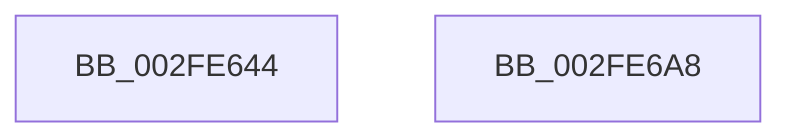

# EtwpEnqueueOverflowBuffer

- RVA: `0x002FE644`–`0x002FE6A9` (길이 `101` bytes)
- VA: `0x00000001402FE644`
- 실행 섹션: `.text`
- PDB 이름 있음: `예`; PDB Function 태그: `아니요`
- unwind 정보 RVA: `0x0005FD94`
- 디코드: `27`개 명령, `101/101` bytes 표시
- 미해석 바이트: `0` (있으면 어셈블리에 `.byte`로 보존)

> 이 문서는 커널 이미지의 기계어와 PDB 기호를 분석해 생성했습니다. 4번과 5번은 함수 원형과 자료형을 바이너리 사용 방식에서 추정한 C 해석이며 원본 소스 복구 결과는 아닙니다.

## 1. Dependencies

- 직접 호출 지점: **2**; 고유 호출 대상: **2**
- 직접 호출자로 확인된 함수: **2**
- RIP 상대 이미지 참조: **0**

### Outgoing calls
- `0x002FE66D` → [EtwpLockBufferList](../3E/EtwpLockBufferList_function_003EB49C.md) (function, `0x003EB49C`)
- `0x002FE68C` → [EtwpUnlockBufferList](../2D/EtwpUnlockBufferList_function_002DFC28.md) (function, `0x002DFC28`)

### Direct callers
- [EtwpReserveTraceBuffer](EtwpReserveTraceBuffer_function_002FC8C0.md) at `0x002FCB4A`
- [EtwpDequeueFreeBuffer](../3E/EtwpDequeueFreeBuffer_function_003EB1F0.md) at `0x003EB2F9`

### Static image references
- 디코드된 RIP-relative 메모리 참조가 없습니다.

## 2. Other-region calls and transfers

- 다른 실행 섹션으로 향하는 call: **0**
- 별도 외부 분기/꼬리 이동을 확인하지 못했습니다.

## 3. Assembly (complete function range)

```asm
002FE644  48 89 5C 24 10                  mov qword ptr [rsp + 0x10], rbx
002FE649  48 89 74 24 18                  mov qword ptr [rsp + 0x18], rsi
002FE64E  57                              push rdi
002FE64F  48 83 EC 20                     sub rsp, 0x20
002FE653  33 F6                           xor esi, esi
002FE655  48 8B DA                        mov rbx, rdx
002FE658  48 8B F9                        mov rdi, rcx
002FE65B  40 88 74 24 30                  mov byte ptr [rsp + 0x30], sil
002FE660  8D 46 01                        lea eax, [rsi + 1]
002FE663  F0 0F B1 72 2C                  lock cmpxchg dword ptr [rdx + 0x2c], esi
002FE668  48 8D 54 24 30                  lea rdx, [rsp + 0x30]
002FE66D  E8 2A CE 0E 00                  call 0x1403eb49c
002FE672  48 8D 53 20                     lea rdx, [rbx + 0x20]
002FE676  48 8B CF                        mov rcx, rdi
002FE679  48 89 32                        mov qword ptr [rdx], rsi
002FE67C  48 8B 47 40                     mov rax, qword ptr [rdi + 0x40]
002FE680  48 89 10                        mov qword ptr [rax], rdx
002FE683  48 89 57 40                     mov qword ptr [rdi + 0x40], rdx
002FE687  48 8D 54 24 30                  lea rdx, [rsp + 0x30]
002FE68C  E8 97 15 FE FF                  call 0x1402dfc28
002FE691  F0 FF 87 E4 00 00 00            lock inc dword ptr [rdi + 0xe4]
002FE698  48 8B 5C 24 38                  mov rbx, qword ptr [rsp + 0x38]
002FE69D  48 8B 74 24 40                  mov rsi, qword ptr [rsp + 0x40]
002FE6A2  48 83 C4 20                     add rsp, 0x20
002FE6A6  5F                              pop rdi
002FE6A7  C3                              ret
002FE6A8  CC                              int3
```

## 4. C-style interpretation (structured pseudocode)

```c
__int64 __fastcall EtwpEnqueueOverflowBuffer(__int64 a1, __int64 a2)
{
    __int64 result;
    __int64 v_rsi;
    __int64 v_rsp;
    unsigned __int64 v_stack_p10;
    unsigned __int64 v_stack_p18;
    unsigned __int8 v_stack_p8;

    v_stack_p10 = v_rbx;
    v_stack_p18 = v_rsi;
    v_rsp = (v_rsp) - (32);
    v_rsi = 0;
    v_stack_p8 = 0;
    result = EtwpLockBufferList(a1, v_stack_p8, a3, a4);
    *(unsigned __int64 *)(a2 + 32) = 0;
    *(unsigned __int64 *)(*(unsigned __int64 *)(a1 + 64)) = a2 + 32;
    *(unsigned __int64 *)(a1 + 64) = a2 + 32;
    result = EtwpUnlockBufferList(a1, v_stack_p8, a3, a4);
    v_rsp = (v_rsp) + (32);
    return result;
}
```

## 5. (Beta) C Style

```c
int64_t EtwpEnqueueOverflowBuffer(void *Arg1, void *Arg2)
{
    uint8_t *arg1 = (uint8_t *)Arg1;
    uint8_t *arg2 = (uint8_t *)Arg2;

    int64_t result;
    int64_t local_rsi;
    int64_t local_rsp;
    uint64_t v_stack_p10;
    uint64_t v_stack_p18;
    uint8_t v_stack_p8;

    v_stack_p10 = local_rbx;
    v_stack_p18 = local_rsi;
    local_rsp = (local_rsp) - (32);
    local_rsi = 0;
    v_stack_p8 = 0;
    result = EtwpLockBufferList(Arg1, v_stack_p8, a3, a4);
    *(uint64_t *)(arg2 + 0x20) = 0;
    *(void **)(*(uint64_t *)(arg1 + 0x40)) = Arg2 + 32;
    *(void **)(arg1 + 0x40) = Arg2 + 32;
    result = EtwpUnlockBufferList(Arg1, v_stack_p8, a3, a4);
    local_rsp = (local_rsp) + (32);
    return result;
}
```

### 관측된 메모리 오프셋

구조체 형식이 확인되지 않은 접근은 인자 기준의 오프셋으로만 기록했습니다.

| 기준 인자 | 오프셋 표현 | 폭 (bit) | 접근 |
|---|---:|---:|---|
| `Arg1` | `+ 0x40` | `64` | `R` |
| `Arg1` | `+ 0x40` | `64` | `W` |
| `Arg1` | `+ 0xE4` | `32` | `R/W` |
| `Arg2` | `+ 0x0` | `64` | `W` |
| `Arg2` | `+ 0x20` | `64` | `R` |
| `Arg2` | `+ 0x2C` | `32` | `R` |

## 6. Execution-region graph

[열기: 2D/3D 그래프와 함수 탐색 컨트롤 패널](../../../control-panel.html?section=text&rva=0x002FE644&view=graph)

- 2D 그래프는 위에서 아래로 흐르고, 3D 그래프는 빈 공간을 드래그해 회전합니다. Shift+드래그는 이동, 휠은 확대·축소, 함수 노드 선택은 대상 보고서 이동입니다.

### Static fallback


