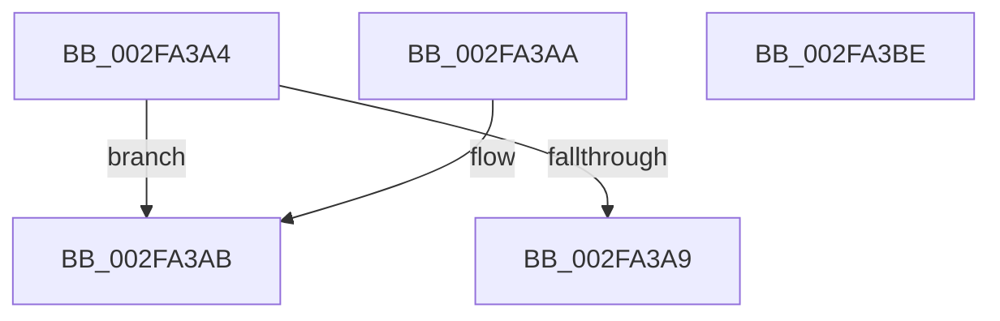

# EtwpFinalizePendingStackwalkApc

- RVA: `0x002FA3A4`–`0x002FA3BF` (길이 `27` bytes)
- VA: `0x00000001402FA3A4`
- 실행 섹션: `.text`
- PDB 이름 있음: `예`; PDB Function 태그: `아니요`
- unwind 정보 RVA: `0x000DB714`
- 디코드: `10`개 명령, `27/27` bytes 표시
- 미해석 바이트: `0` (있으면 어셈블리에 `.byte`로 보존)

> 이 문서는 커널 이미지의 기계어와 PDB 기호를 분석해 생성했습니다. 4번과 5번은 함수 원형과 자료형을 바이너리 사용 방식에서 추정한 C 해석이며 원본 소스 복구 결과는 아닙니다.

## 1. Dependencies

- 직접 호출 지점: **0**; 고유 호출 대상: **0**
- 직접 호출자로 확인된 함수: **2**
- RIP 상대 이미지 참조: **0**

### Outgoing calls
- 직접 디코드된 call 명령이 없습니다.

### Direct callers
- [EtwpApcPoolThunk](EtwpApcPoolThunk_function_002FA090.md) at `0x002FA1FC`
- [EtwpCancelStackWalkApc](../4B/EtwpCancelStackWalkApc_function_004B8470.md) at `0x004B847A`

### Static image references
- 디코드된 RIP-relative 메모리 참조가 없습니다.

## 2. Other-region calls and transfers

- 다른 실행 섹션으로 향하는 call: **0**
- 별도 외부 분기/꼬리 이동을 확인하지 못했습니다.

## 3. Assembly (complete function range)

```asm
002FA3A4  45 84 C0                        test r8b, r8b
002FA3A7  74 02                           je 0x1402fa3ab
002FA3A9  C3                              ret
002FA3AA  CC                              int3
002FA3AB  0F B7 81 32 03 00 00            movzx eax, word ptr [rcx + 0x332]
002FA3B2  83 E0 07                        and eax, 7
002FA3B5  83 C0 18                        add eax, 0x18
002FA3B8  F0 0F B3 42 78                  lock btr dword ptr [rdx + 0x78], eax
002FA3BD  C3                              ret
002FA3BE  CC                              int3
```

## 4. C-style interpretation (structured pseudocode)

```c
__int64 __fastcall EtwpFinalizePendingStackwalkApc(__int64 a1, __int64 a2, unsigned __int8 a3)
{
    __int64 result;

    if (a3 == 0) goto loc_002FA3AB;
    return result;
loc_002FA3AB:
    result = (unsigned int)((*(unsigned __int16 *)(a1 + 818)) & (7));
    result = (unsigned int)((result) + (24));
    return result;
}
```

## 5. (Beta) C Style

```c
int64_t EtwpFinalizePendingStackwalkApc(void *Arg1, void *Arg2, uint8_t Arg3)
{
    uint8_t *arg1 = (uint8_t *)Arg1;
    uint8_t *arg2 = (uint8_t *)Arg2;

    int64_t result;

    if (Arg3 == 0) goto loc_002FA3AB;
    return result;
loc_002FA3AB:
    result = (uint32_t)((*(uint16_t *)(arg1 + 0x332)) & (7));
    result = (uint32_t)((result) + (24));
    return result;
}
```

### 관측된 메모리 오프셋

구조체 형식이 확인되지 않은 접근은 인자 기준의 오프셋으로만 기록했습니다.

| 기준 인자 | 오프셋 표현 | 폭 (bit) | 접근 |
|---|---:|---:|---|
| `Arg1` | `+ 0x332` | `16` | `R` |
| `Arg2` | `+ 0x78` | `32` | `R/W` |

## 6. Execution-region graph

[열기: 2D/3D 그래프와 함수 탐색 컨트롤 패널](../../../control-panel.html?section=text&rva=0x002FA3A4&view=graph)

- 2D 그래프는 위에서 아래로 흐르고, 3D 그래프는 빈 공간을 드래그해 회전합니다. Shift+드래그는 이동, 휠은 확대·축소, 함수 노드 선택은 대상 보고서 이동입니다.

### Static fallback


