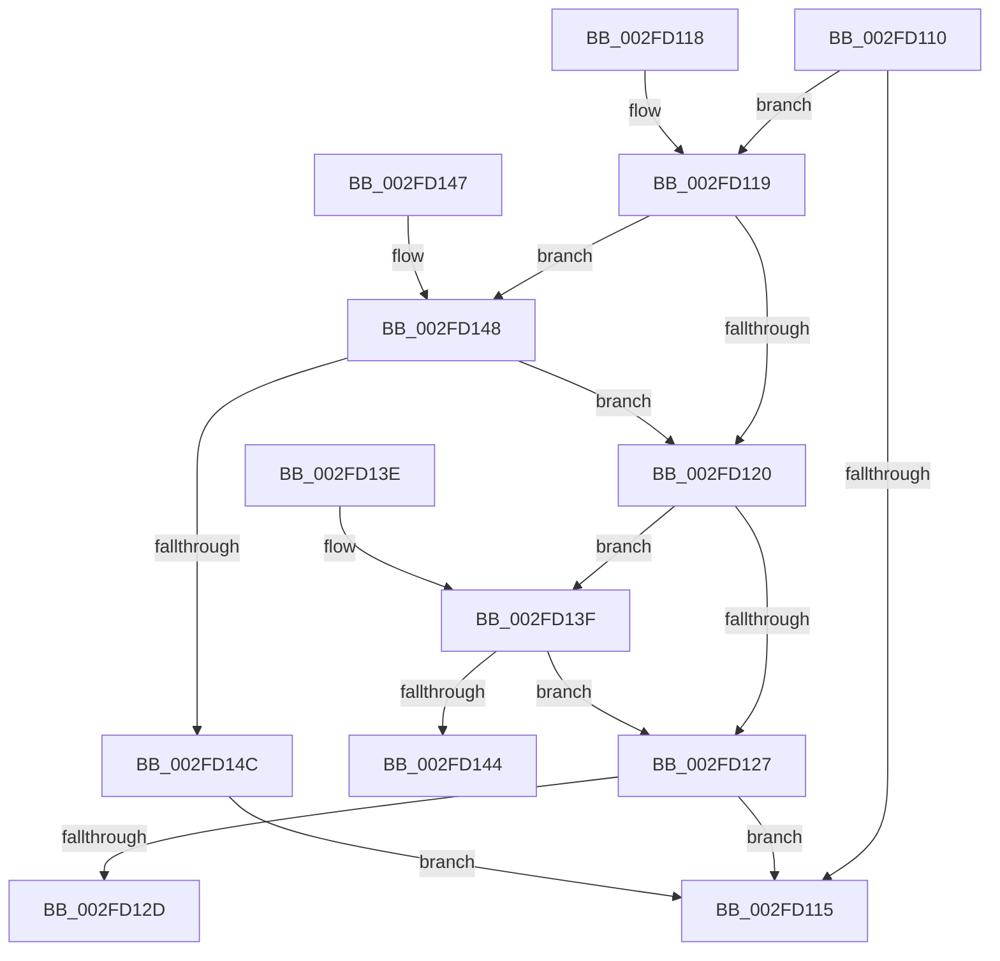

# EtwpLevelKeywordEnabled

- RVA: `0x002FD110`–`0x002FD14E` (길이 `62` bytes)
- VA: `0x00000001402FD110`
- 실행 섹션: `.text`
- PDB 이름 있음: `예`; PDB Function 태그: `아니요`
- unwind 정보 RVA: `0x000DB714`
- 디코드: `28`개 명령, `62/62` bytes 표시
- 미해석 바이트: `0` (있으면 어셈블리에 `.byte`로 보존)

> 이 문서는 커널 이미지의 기계어와 PDB 기호를 분석해 생성했습니다. 4번과 5번은 함수 원형과 자료형을 바이너리 사용 방식에서 추정한 C 해석이며 원본 소스 복구 결과는 아닙니다.

## 1. Dependencies

- 직접 호출 지점: **0**; 고유 호출 대상: **0**
- 직접 호출자로 확인된 함수: **27**
- RIP 상대 이미지 참조: **0**

### Outgoing calls
- 직접 디코드된 call 명령이 없습니다.

### Direct callers
- [EtwpDiskProvTraceDisk](../22/EtwpDiskProvTraceDisk_function_00225A1C.md) at `0x00225AC4`
- [EtwpEventWriteFull](../22/EtwpEventWriteFull_function_00225C10.md) at `0x00225FDB`
- [KiSetNextClockTickDueTime](../23/KiSetNextClockTickDueTime_function_002363F0.md) at `0x0023658C`
- [sub_0025F1D2](../25/Unknown_function_0025F1D2.md) at `0x0025F388`
- [sub_0025F1D2](../25/Unknown_function_0025F1D2.md) at `0x0025F430`
- [PopDiagTraceFxDefaultPepWorkerStart](../2B/PopDiagTraceFxDefaultPepWorkerStart_function_002BD168.md) at `0x002BD250`
- [sub_002BD6E6](../2B/Unknown_function_002BD6E6.md) at `0x002BD79F`
- [PopDiagTraceFxComponentIdleState](../2B/PopDiagTraceFxComponentIdleState_function_002BE0C4.md) at `0x002BE26D`
- [PopDiagTraceFxComponentLatency](../2B/PopDiagTraceFxComponentLatency_function_002BF5C4.md) at `0x002BF76D`
- [KiIntSteerEtwEventEnabled](../2D/KiIntSteerEtwEventEnabled_function_002D7128.md) at `0x002D719D`
- [PpmEventTraceProcessorLatencyLimitChange](../2D/PpmEventTraceProcessorLatencyLimitChange_function_002D974C.md) at `0x002D9852`
- [PpmEventTracePerfCheckStop](../2D/PpmEventTracePerfCheckStop_function_002DA34C.md) at `0x002DA413`
- [EtwpTraceMessageVa](EtwpTraceMessageVa_function_002FB2B0.md) at `0x002FBB9B`
- [EtwpLogSystemEventUnsafe](EtwpLogSystemEventUnsafe_function_002FBF10.md) at `0x002FC419`
- [PoTraceSystemTimerResolutionKernel](PoTraceSystemTimerResolutionKernel_function_002FD154.md) at `0x002FD1CD`
- [sub_0039CA0B](../39/Unknown_function_0039CA0B.md) at `0x0039CD65`
- [EtwProviderEnabled](../3B/EtwProviderEnabled_function_003BA250.md) at `0x003BA2B4`
- [PpmEventTracePerfCheckStart](../3B/PpmEventTracePerfCheckStart_function_003BEEE4.md) at `0x003BEFE1`
- [EtwpFailLogging](../3F/EtwpFailLogging_function_003F0A50.md) at `0x003F0BEE`
- [PpmEventTraceDeliveredPerfChange](../43/PpmEventTraceDeliveredPerfChange_function_0043B200.md) at `0x0043B381`
- [PopDiagTraceFxComponentLogicalCondition](../43/PopDiagTraceFxComponentLogicalCondition_function_0043D3A0.md) at `0x0043D4BD`
- [PopDiagTraceFxDefaultPepWorkerEnd](../44/PopDiagTraceFxDefaultPepWorkerEnd_function_004451E8.md) at `0x0044545C`
- [PopDiagTraceFxDefaultPepWorkerEnd](../44/PopDiagTraceFxDefaultPepWorkerEnd_function_004451E8.md) at `0x00445479`
- [PopDiagTraceFxDefaultPepWorkerEnd](../44/PopDiagTraceFxDefaultPepWorkerEnd_function_004451E8.md) at `0x00445496`
- [PpmEventComputeEnergy](../45/PpmEventComputeEnergy_function_00452EC0.md) at `0x00452FB2`
- [SshpTracingWriteBlockerStateChange](../45/SshpTracingWriteBlockerStateChange_function_00453B5C.md) at `0x00453C81`
- [PpmEventParkNodeRecordedStats](../45/PpmEventParkNodeRecordedStats_function_0045AD74.md) at `0x0045AEB4`
- [sub_006D6BDE](../6D/Unknown_function_006D6BDE.md) at `0x006D6BED`
- [sub_006D6BDE](../6D/Unknown_function_006D6BDE.md) at `0x006D6C98`
- [sub_006D6BDE](../6D/Unknown_function_006D6BDE.md) at `0x006D6D31`
- [sub_006FB552](../6F/Unknown_function_006FB552.md) at `0x006FB55A`
- [sub_006FB552](../6F/Unknown_function_006FB552.md) at `0x006FB5F0`
- [sub_006FB552](../6F/Unknown_function_006FB552.md) at `0x006FB6A0`
- [sub_006FB552](../6F/Unknown_function_006FB552.md) at `0x006FB744`
- [EtwpWriteUserEvent](../../page/AF/EtwpWriteUserEvent_function_00AF2FEC.md) at `0x00AF329E`

### Static image references
- 디코드된 RIP-relative 메모리 참조가 없습니다.

## 2. Other-region calls and transfers

- 다른 실행 섹션으로 향하는 call: **0**
- 별도 외부 분기/꼬리 이동을 확인하지 못했습니다.

## 3. Assembly (complete function range)

```asm
002FD110  83 39 00                        cmp dword ptr [rcx], 0
002FD113  75 04                           jne 0x1402fd119
002FD115  32 C0                           xor al, al
002FD117  C3                              ret
002FD118  CC                              int3
002FD119  8A 41 04                        mov al, byte ptr [rcx + 4]
002FD11C  3A D0                           cmp dl, al
002FD11E  77 28                           ja 0x1402fd148
002FD120  8B 41 08                        mov eax, dword ptr [rcx + 8]
002FD123  A8 40                           test al, 0x40
002FD125  75 18                           jne 0x1402fd13f
002FD127  4C 85 41 10                     test qword ptr [rcx + 0x10], r8
002FD12B  74 E8                           je 0x1402fd115
002FD12D  48 8B 49 18                     mov rcx, qword ptr [rcx + 0x18]
002FD131  48 8B C1                        mov rax, rcx
002FD134  49 23 C0                        and rax, r8
002FD137  48 3B C1                        cmp rax, rcx
002FD13A  0F 94 C0                        sete al
002FD13D  C3                              ret
002FD13E  CC                              int3
002FD13F  4D 85 C0                        test r8, r8
002FD142  75 E3                           jne 0x1402fd127
002FD144  B0 01                           mov al, 1
002FD146  C3                              ret
002FD147  CC                              int3
002FD148  84 C0                           test al, al
002FD14A  74 D4                           je 0x1402fd120
002FD14C  EB C7                           jmp 0x1402fd115
```

## 4. C-style interpretation (structured pseudocode)

```c
__int64 __fastcall EtwpLevelKeywordEnabled(__int64 a1, unsigned __int8 a2, __int64 a3)
{
    __int64 result;

    if ((*(unsigned int *)(a1)) != 0) goto loc_002FD119;
loc_002FD115:
    result = 0;
    return result;
loc_002FD119:
    if (a2 > ((unsigned __int8)(*(unsigned __int8 *)(a1 + 4)))) goto loc_002FD148;
loc_002FD120:
    if ((((unsigned __int8)((unsigned int)(*(unsigned int *)(a1 + 8)))) & (64)) != 0) goto loc_002FD13F;
loc_002FD127:
    if (((*(unsigned __int64 *)(a1 + 16)) & (a3)) == 0) goto loc_002FD115;
    result = (*(unsigned __int64 *)(a1 + 24)) & (a3);
    result = (result == (*(unsigned __int64 *)(a1 + 24))) ? 1 : 0;
    return result;
loc_002FD13F:
    if (a3 != 0) goto loc_002FD127;
    return 1;
loc_002FD148:
    if (1 == 0) goto loc_002FD120;
    goto loc_002FD115;
}
```

## 5. (Beta) C Style

```c
int64_t EtwpLevelKeywordEnabled(void *Arg1, uint8_t Arg2, int64_t Arg3)
{
    uint8_t *arg1 = (uint8_t *)Arg1;

    int64_t result;

    if ((*(uint32_t *)(arg1)) != 0) goto loc_002FD119;
loc_002FD115:
    result = 0;
    return result;
loc_002FD119:
    if (Arg2 > ((uint8_t)(*(uint8_t *)(arg1 + 0x4)))) goto loc_002FD148;
loc_002FD120:
    if ((((uint8_t)((uint32_t)(*(uint32_t *)(arg1 + 0x8)))) & (64)) != 0) goto loc_002FD13F;
loc_002FD127:
    if (((*(uint64_t *)(arg1 + 0x10)) & (Arg3)) == 0) goto loc_002FD115;
    result = (*(uint64_t *)(arg1 + 0x18)) & (Arg3);
    result = (result == (*(uint64_t *)(arg1 + 0x18))) ? 1 : 0;
    return result;
loc_002FD13F:
    if (Arg3 != 0) goto loc_002FD127;
    return 1;
loc_002FD148:
    if (1 == 0) goto loc_002FD120;
    goto loc_002FD115;
}
```

### 관측된 메모리 오프셋

구조체 형식이 확인되지 않은 접근은 인자 기준의 오프셋으로만 기록했습니다.

| 기준 인자 | 오프셋 표현 | 폭 (bit) | 접근 |
|---|---:|---:|---|
| `Arg1` | `+ 0x0` | `32` | `R` |
| `Arg1` | `+ 0x4` | `8` | `R` |
| `Arg1` | `+ 0x8` | `32` | `R` |
| `Arg1` | `+ 0x10` | `64` | `R` |
| `Arg1` | `+ 0x18` | `64` | `R` |

## 6. Execution-region graph

[열기: 2D/3D 그래프와 함수 탐색 컨트롤 패널](../../../control-panel.html?section=text&rva=0x002FD110&view=graph)

- 2D 그래프는 위에서 아래로 흐르고, 3D 그래프는 빈 공간을 드래그해 회전합니다. Shift+드래그는 이동, 휠은 확대·축소, 함수 노드 선택은 대상 보고서 이동입니다.

### Static fallback


