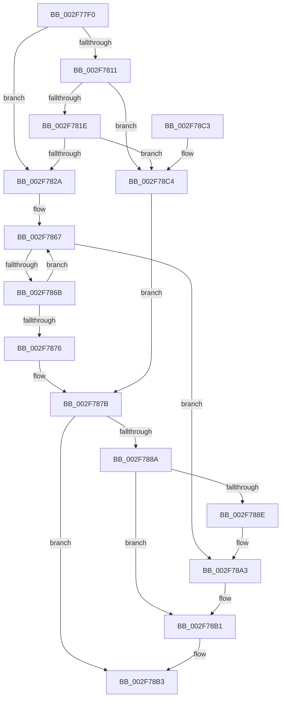

# EtwpOpenLogger

- RVA: `0x002F77F0`–`0x002F78CB` (길이 `219` bytes)
- VA: `0x00000001402F77F0`
- 실행 섹션: `.text`
- PDB 이름 있음: `예`; PDB Function 태그: `아니요`
- unwind 정보 RVA: `0x0006383C`
- 디코드: `59`개 명령, `219/219` bytes 표시
- 미해석 바이트: `0` (있으면 어셈블리에 `.byte`로 보존)

> 이 문서는 커널 이미지의 기계어와 PDB 기호를 분석해 생성했습니다. 4번과 5번은 함수 원형과 자료형을 바이너리 사용 방식에서 추정한 C 해석이며 원본 소스 복구 결과는 아닙니다.

## 1. Dependencies

- 직접 호출 지점: **3**; 고유 호출 대상: **3**
- 직접 호출자로 확인된 함수: **5**
- RIP 상대 이미지 참조: **0**

### Outgoing calls
- `0x002F7811` → [KeAreInterruptsEnabled](KeAreInterruptsEnabled_function_002F8060.md) (function, `0x002F8060`)
- `0x002F789E` → [ExReleaseRundownProtectionCacheAwareEx](../25/ExReleaseRundownProtectionCacheAwareEx_function_0025F050.md) (function, `0x0025F050`)
- `0x002F78AC` → [KeLeaveCriticalRegionThread](../25/KeLeaveCriticalRegionThread_function_0025EFF0.md) (function, `0x0025EFF0`)

### Direct callers
- [EtwpCCSwapFlush](../41/EtwpCCSwapFlush_function_00417F50.md) at `0x00417FB3`
- [EtwSendTraceBuffer](../65/EtwSendTraceBuffer_function_00651560.md) at `0x006515B9`
- [EtwTraceRaw](../65/EtwTraceRaw_function_006516CC.md) at `0x0065174F`
- [sub_006DF40E](../6D/Unknown_function_006DF40E.md) at `0x006DF43E`
- [EtwpKernelTraceRundown](../../page/9E/EtwpKernelTraceRundown_function_009E4080.md) at `0x009E40C9`

### Static image references
- 디코드된 RIP-relative 메모리 참조가 없습니다.

## 2. Other-region calls and transfers

- 다른 실행 섹션으로 향하는 call: **0**
- 별도 외부 분기/꼬리 이동을 확인하지 못했습니다.

## 3. Assembly (complete function range)

```asm
002F77F0  48 89 5C 24 08                  mov qword ptr [rsp + 8], rbx
002F77F5  48 89 74 24 10                  mov qword ptr [rsp + 0x10], rsi
002F77FA  57                              push rdi
002F77FB  48 83 EC 20                     sub rsp, 0x20
002F77FF  8B F1                           mov esi, ecx
002F7801  49 8B D9                        mov rbx, r9
002F7804  41 C6 01 00                     mov byte ptr [r9], 0
002F7808  48 8B FA                        mov rdi, rdx
002F780B  41 80 F8 01                     cmp r8b, 1
002F780F  74 19                           je 0x1402f782a
002F7811  E8 4A 08 00 00                  call 0x1402f8060
002F7816  84 C0                           test al, al
002F7818  0F 84 A6 00 00 00               je 0x1402f78c4
002F781E  44 0F 20 C0                     mov rax, cr8
002F7822  3C 02                           cmp al, 2
002F7824  0F 83 9A 00 00 00               jae 0x1402f78c4
002F782A  65 48 8B 04 25 88 01 00 00      mov rax, qword ptr gs:[0x188]
002F7833  33 D2                           xor edx, edx
002F7835  4C 8B CE                        mov r9, rsi
002F7838  66 FF 88 E4 01 00 00            dec word ptr [rax + 0x1e4]
002F783F  90                              nop
002F7840  48 8B 87 C0 02 00 00            mov rax, qword ptr [rdi + 0x2c0]
002F7847  48 8B 0C F0                     mov rcx, qword ptr [rax + rsi*8]
002F784B  65 8B 04 25 A4 01 00 00         mov eax, dword ptr gs:[0x1a4]
002F7853  F7 71 14                        div dword ptr [rcx + 0x14]
002F7856  0F AF 51 10                     imul edx, dword ptr [rcx + 0x10]
002F785A  44 8B C2                        mov r8d, edx
002F785D  4C 03 01                        add r8, qword ptr [rcx]
002F7860  41 0F 0D 08                     prefetchw byte ptr [r8]
002F7864  49 8B 00                        mov rax, qword ptr [r8]
002F7867  A8 01                           test al, 1
002F7869  75 38                           jne 0x1402f78a3
002F786B  48 8D 48 02                     lea rcx, [rax + 2]
002F786F  F0 49 0F B1 08                  lock cmpxchg qword ptr [r8], rcx
002F7874  75 F1                           jne 0x1402f7867
002F7876  C6 03 01                        mov byte ptr [rbx], 1
002F7879  B1 01                           mov cl, 1
002F787B  48 8B 87 C8 02 00 00            mov rax, qword ptr [rdi + 0x2c8]
002F7882  4A 8B 04 C8                     mov rax, qword ptr [rax + r9*8]
002F7886  A8 01                           test al, 1
002F7888  74 29                           je 0x1402f78b3
002F788A  84 C9                           test cl, cl
002F788C  74 23                           je 0x1402f78b1
002F788E  48 8B 8F C0 02 00 00            mov rcx, qword ptr [rdi + 0x2c0]
002F7895  BA 01 00 00 00                  mov edx, 1
002F789A  4A 8B 0C C9                     mov rcx, qword ptr [rcx + r9*8]
002F789E  E8 AD 77 F6 FF                  call 0x14025f050
002F78A3  65 48 8B 0C 25 88 01 00 00      mov rcx, qword ptr gs:[0x188]
002F78AC  E8 3F 77 F6 FF                  call 0x14025eff0
002F78B1  33 C0                           xor eax, eax
002F78B3  48 8B 5C 24 30                  mov rbx, qword ptr [rsp + 0x30]
002F78B8  48 8B 74 24 38                  mov rsi, qword ptr [rsp + 0x38]
002F78BD  48 83 C4 20                     add rsp, 0x20
002F78C1  5F                              pop rdi
002F78C2  C3                              ret
002F78C3  CC                              int3
002F78C4  4C 8B CE                        mov r9, rsi
002F78C7  32 C9                           xor cl, cl
002F78C9  EB B0                           jmp 0x1402f787b
```

## 4. C-style interpretation (structured pseudocode)

```c
__int64 __fastcall EtwpOpenLogger(int a1, __int64 a2, unsigned __int8 a3, __int64 a4)
{
    __int64 result;
    __int64 v_rsp;
    unsigned __int64 v_stack_p10;
    unsigned __int64 v_stack_p8;

    v_stack_p8 = v_rbx;
    v_stack_p10 = v_rsi;
    v_rsp = (v_rsp) - (32);
    *(unsigned __int8 *)(a4) = 0;
    if (a3 == 1) goto loc_002F782A;
    result = KeAreInterruptsEnabled(a1, a2, a3, a4);
    if ((unsigned __int8)(result) == 0) goto loc_002F78C4;
    if (((unsigned __int8)(v_cr8)) >= 2) goto loc_002F78C4;
loc_002F782A:
    a2 = 0;
    a2 = (unsigned int)((a2) * (*(unsigned int *)(*(unsigned __int64 *)(*(unsigned __int64 *)(a2 + 704) + (unsigned int)(a1) * 8) + 16)));
    a3 = ((unsigned int)((unsigned int)(a2))) + (*(unsigned __int64 *)(*(unsigned __int64 *)(*(unsigned __int64 *)(a2 + 704) + (unsigned int)(a1) * 8)));
loc_002F7867:
    if ((((unsigned __int8)(*(unsigned __int64 *)(a3))) & (1)) != 0) goto loc_002F78A3;
    if ((((unsigned __int8)(*(unsigned __int64 *)(a3))) & (1)) != 0) goto loc_002F7867;
    *(unsigned __int8 *)(a4) = 1;
loc_002F787B:
    if ((((unsigned __int8)(*(unsigned __int64 *)(*(unsigned __int64 *)(a2 + 712) + (unsigned int)(a1) * 8))) & (1)) == 0) goto loc_002F78B3;
    if (1 == 0) goto loc_002F78B1;
    result = ExReleaseRundownProtectionCacheAwareEx(*(unsigned __int64 *)(*(unsigned __int64 *)(a2 + 704) + (unsigned int)(a1) * 8), 1, a3, (unsigned int)(a1));
loc_002F78A3:
    result = KeLeaveCriticalRegionThread(*(unsigned __int64 *)(gs_base + (0 + 392)), 1, a3, (unsigned int)(a1));
loc_002F78B1:
    result = 0;
loc_002F78B3:
    v_rsp = (v_rsp) + (32);
    return result;
loc_002F78C4:
    a1 = 0;
    goto loc_002F787B;
}
```

## 5. (Beta) C Style

```c
int64_t EtwpOpenLogger(int32_t Arg1, void *Arg2, uint8_t Arg3, void *Arg4)
{
    uint8_t *arg2 = (uint8_t *)Arg2;
    uint8_t *arg4 = (uint8_t *)Arg4;

    int64_t result;
    int64_t local_rsp;
    uint64_t v_stack_p10;
    uint64_t v_stack_p8;

    v_stack_p8 = local_rbx;
    v_stack_p10 = local_rsi;
    local_rsp = (local_rsp) - (32);
    *(uint8_t *)(arg4) = 0;
    if (Arg3 == 1) goto loc_002F782A;
    result = KeAreInterruptsEnabled(Arg1, Arg2, Arg3, Arg4);
    if ((uint8_t)(result) == 0) goto loc_002F78C4;
    if (((uint8_t)(v_cr8)) >= 2) goto loc_002F78C4;
loc_002F782A:
    Arg2 = 0;
    Arg2 = (uint32_t)((Arg2) * (*(uint32_t *)(*(uint64_t *)(*(uint64_t *)(arg2 + 0x2C0) + (uint32_t)(Arg1) * 8) + 0x10)));
    Arg3 = ((uint32_t)((uint32_t)(Arg2))) + (*(uint64_t *)(*(uint64_t *)(*(uint64_t *)(arg2 + 0x2C0) + (uint32_t)(Arg1) * 8)));
loc_002F7867:
    if ((((uint8_t)(*(uint64_t *)(Arg3))) & (1)) != 0) goto loc_002F78A3;
    if ((((uint8_t)(*(uint64_t *)(Arg3))) & (1)) != 0) goto loc_002F7867;
    *(uint8_t *)(arg4) = 1;
loc_002F787B:
    if ((((uint8_t)(*(uint64_t *)(*(uint64_t *)(arg2 + 0x2C8) + (uint32_t)(Arg1) * 8))) & (1)) == 0) goto loc_002F78B3;
    if (1 == 0) goto loc_002F78B1;
    result = ExReleaseRundownProtectionCacheAwareEx(*(uint64_t *)(*(uint64_t *)(arg2 + 0x2C0) + (uint32_t)(Arg1) * 8), 1, Arg3, (uint32_t)(Arg1));
loc_002F78A3:
    result = KeLeaveCriticalRegionThread(*(uint64_t *)(gs_base + (0 + 0x188)), 1, Arg3, (uint32_t)(Arg1));
loc_002F78B1:
    result = 0;
loc_002F78B3:
    local_rsp = (local_rsp) + (32);
    return result;
loc_002F78C4:
    Arg1 = 0;
    goto loc_002F787B;
}
```

### 관측된 메모리 오프셋

구조체 형식이 확인되지 않은 접근은 인자 기준의 오프셋으로만 기록했습니다.

| 기준 인자 | 오프셋 표현 | 폭 (bit) | 접근 |
|---|---:|---:|---|
| `Arg2` | `+ 0x2C0` | `64` | `R` |
| `Arg2` | `+ 0x2C8` | `64` | `R` |
| `Arg4` | `+ 0x0` | `8` | `W` |

## 6. Execution-region graph

[열기: 2D/3D 그래프와 함수 탐색 컨트롤 패널](../../../control-panel.html?section=text&rva=0x002F77F0&view=graph)

- 2D 그래프는 위에서 아래로 흐르고, 3D 그래프는 빈 공간을 드래그해 회전합니다. Shift+드래그는 이동, 휠은 확대·축소, 함수 노드 선택은 대상 보고서 이동입니다.

### Static fallback


