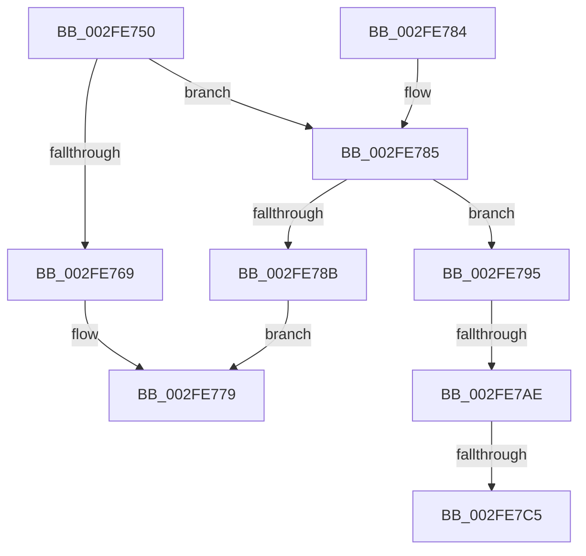

# EtwpPrepareDirtyBuffer

- RVA: `0x002FE750`–`0x002FE7D3` (길이 `131` bytes)
- VA: `0x00000001402FE750`
- 실행 섹션: `.text`
- PDB 이름 있음: `예`; PDB Function 태그: `예`
- unwind 정보 RVA: `0x00072DE4`
- 디코드: `34`개 명령, `131/131` bytes 표시
- 미해석 바이트: `0` (있으면 어셈블리에 `.byte`로 보존)

> 이 문서는 커널 이미지의 기계어와 PDB 기호를 분석해 생성했습니다. 4번과 5번은 함수 원형과 자료형을 바이너리 사용 방식에서 추정한 C 해석이며 원본 소스 복구 결과는 아닙니다.

## 1. Dependencies

- 직접 호출 지점: **4**; 고유 호출 대상: **3**
- 직접 호출자로 확인된 함수: **2**
- RIP 상대 이미지 참조: **0**

### Outgoing calls
- `0x002FE770` → [EtwpGetLoggerTimeStamp](../37/EtwpGetLoggerTimeStamp_function_0037E690.md) (function, `0x0037E690`)
- `0x002FE78E` → [EtwpEnqueueAvailableBuffer](EtwpEnqueueAvailableBuffer_function_002FE7DC.md) (function, `0x002FE7DC`)
- `0x002FE79B` → [EtwpEnqueueAvailableBuffer](EtwpEnqueueAvailableBuffer_function_002FE7DC.md) (function, `0x002FE7DC`)
- `0x002FE7C8` → [EtwpReenableCompression](../65/EtwpReenableCompression_function_00653768.md) (function, `0x00653768`)

### Direct callers
- [EtwpBufferingModeFlush](../../page/9B/EtwpBufferingModeFlush_function_009BD8F4.md) at `0x009BDA50`
- [EtwpFlushActiveBuffers](../../page/9B/EtwpFlushActiveBuffers_function_009BDEF4.md) at `0x009BE183`

### Static image references
- 디코드된 RIP-relative 메모리 참조가 없습니다.

## 2. Other-region calls and transfers

- 다른 실행 섹션으로 향하는 call: **0**
- call이 아닌 외부 분기/꼬리 이동: **3**
  - `0x002FE7A8` → [sub_006DFE7E](../6D/Unknown_function_006DFE7E.md) (`tail-transfer`)
  - `0x002FE7BF` → [sub_006DFE7E](../6D/Unknown_function_006DFE7E.md) (`tail-transfer`)
  - `0x002FE7CE` → [sub_006DFE7E](../6D/Unknown_function_006DFE7E.md) (`tail-transfer`)

## 3. Assembly (complete function range)

```asm
002FE750  48 89 5C 24 08                  mov qword ptr [rsp + 8], rbx
002FE755  57                              push rdi
002FE756  48 83 EC 20                     sub rsp, 0x20
002FE75A  8B 41 0C                        mov eax, dword ptr [rcx + 0xc]
002FE75D  48 8B FA                        mov rdi, rdx
002FE760  48 8B D9                        mov rbx, rcx
002FE763  0F BA E0 0A                     bt eax, 0xa
002FE767  72 1C                           jb 0x1402fe785
002FE769  C7 42 2C 03 00 00 00            mov dword ptr [rdx + 0x2c], 3
002FE770  E8 1B FF 07 00                  call 0x14037e690
002FE775  48 89 47 10                     mov qword ptr [rdi + 0x10], rax
002FE779  48 8B 5C 24 30                  mov rbx, qword ptr [rsp + 0x30]
002FE77E  48 83 C4 20                     add rsp, 0x20
002FE782  5F                              pop rdi
002FE783  C3                              ret
002FE784  CC                              int3
002FE785  0F BA E0 1A                     bt eax, 0x1a
002FE789  72 0A                           jb 0x1402fe795
002FE78B  45 33 C0                        xor r8d, r8d
002FE78E  E8 49 00 00 00                  call 0x1402fe7dc
002FE793  EB E4                           jmp 0x1402fe779
002FE795  41 B8 04 00 00 00               mov r8d, 4
002FE79B  E8 3C 00 00 00                  call 0x1402fe7dc
002FE7A0  8B 83 98 05 00 00               mov eax, dword ptr [rbx + 0x598]
002FE7A6  85 C0                           test eax, eax
002FE7A8  0F 85 D0 16 3E 00               jne 0x1406dfe7e
002FE7AE  48 8B 83 10 06 00 00            mov rax, qword ptr [rbx + 0x610]
002FE7B5  48 03 C0                        add rax, rax
002FE7B8  48 39 83 08 06 00 00            cmp qword ptr [rbx + 0x608], rax
002FE7BF  0F 8C B9 16 3E 00               jl 0x1406dfe7e
002FE7C5  48 8B CB                        mov rcx, rbx
002FE7C8  E8 9B 4F 35 00                  call 0x140653768
002FE7CD  90                              nop
002FE7CE  E9 AB 16 3E 00                  jmp 0x1406dfe7e
```

## 4. C-style interpretation (structured pseudocode)

```c
__int64 __fastcall EtwpPrepareDirtyBuffer(__int64 a1, __int64 a2, int a3)
{
    __int64 result;
    __int64 v_rsp;
    unsigned __int64 v_stack_p8;

    v_stack_p8 = v_rbx;
    v_rsp = (v_rsp) - (32);
    if (condition_is_below) goto loc_002FE785;
    *(unsigned int *)(a2 + 44) = 3;
    result = EtwpGetLoggerTimeStamp(a1, a2, a3, a4);
    *(unsigned __int64 *)(a2 + 16) = result;
loc_002FE779:
    v_rsp = (v_rsp) + (32);
    return result;
loc_002FE785:
    if (condition_is_below) goto loc_002FE795;
    a3 = 0;
    result = EtwpEnqueueAvailableBuffer(a1, a2, a3, a4);
    goto loc_002FE779;
loc_002FE795:
    result = EtwpEnqueueAvailableBuffer(a1, a2, 4, a4);
    result = (*(unsigned __int64 *)(v_stack_p8 + 1552)) + (*(unsigned __int64 *)(v_stack_p8 + 1552));
    result = EtwpReenableCompression(v_stack_p8, a2, 4, a4);
}
```

## 5. (Beta) C Style

```c
int64_t EtwpPrepareDirtyBuffer(void *Arg1, void *Arg2, int32_t Arg3)
{
    uint8_t *arg1 = (uint8_t *)Arg1;
    uint8_t *arg2 = (uint8_t *)Arg2;

    int64_t result;
    int64_t local_rsp;
    uint64_t v_stack_p8;

    v_stack_p8 = local_rbx;
    local_rsp = (local_rsp) - (32);
    if (condition_is_below) goto loc_002FE785;
    *(uint32_t *)(arg2 + 0x2C) = 3;
    result = EtwpGetLoggerTimeStamp(Arg1, Arg2, Arg3, a4);
    *(uint64_t *)(arg2 + 0x10) = result;
loc_002FE779:
    local_rsp = (local_rsp) + (32);
    return result;
loc_002FE785:
    if (condition_is_below) goto loc_002FE795;
    Arg3 = 0;
    result = EtwpEnqueueAvailableBuffer(Arg1, Arg2, Arg3, a4);
    goto loc_002FE779;
loc_002FE795:
    result = EtwpEnqueueAvailableBuffer(Arg1, Arg2, 4, a4);
    result = (*(uint64_t *)(v_stack_p8 + 0x610)) + (*(uint64_t *)(v_stack_p8 + 0x610));
    result = EtwpReenableCompression(v_stack_p8, Arg2, 4, a4);
}
```

### 관측된 메모리 오프셋

구조체 형식이 확인되지 않은 접근은 인자 기준의 오프셋으로만 기록했습니다.

| 기준 인자 | 오프셋 표현 | 폭 (bit) | 접근 |
|---|---:|---:|---|
| `Arg1` | `+ 0xC` | `32` | `R` |
| `Arg1` | `+ 0x598` | `32` | `R` |
| `Arg1` | `+ 0x608` | `64` | `R` |
| `Arg1` | `+ 0x610` | `64` | `R` |
| `Arg2` | `+ 0x10` | `64` | `W` |
| `Arg2` | `+ 0x2C` | `32` | `W` |

## 6. Execution-region graph

[열기: 2D/3D 그래프와 함수 탐색 컨트롤 패널](../../../control-panel.html?section=text&rva=0x002FE750&view=graph)

- 2D 그래프는 위에서 아래로 흐르고, 3D 그래프는 빈 공간을 드래그해 회전합니다. Shift+드래그는 이동, 휠은 확대·축소, 함수 노드 선택은 대상 보고서 이동입니다.

### Static fallback


