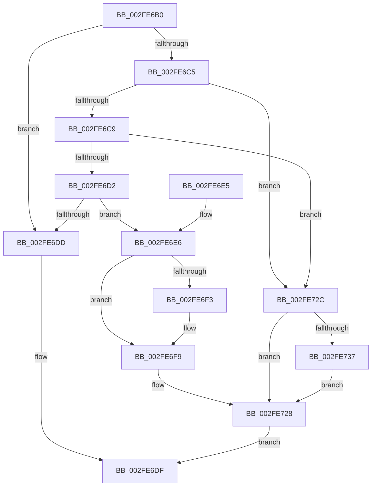

# EtwpRequestFlushTimer

- RVA: `0x002FE6B0`–`0x002FE74A` (길이 `154` bytes)
- VA: `0x00000001402FE6B0`
- 실행 섹션: `.text`
- PDB 이름 있음: `예`; PDB Function 태그: `아니요`
- unwind 정보 RVA: `0x00072DD8`
- 디코드: `42`개 명령, `154/154` bytes 표시
- 미해석 바이트: `0` (있으면 어셈블리에 `.byte`로 보존)

> 이 문서는 커널 이미지의 기계어와 PDB 기호를 분석해 생성했습니다. 4번과 5번은 함수 원형과 자료형을 바이너리 사용 방식에서 추정한 C 해석이며 원본 소스 복구 결과는 아닙니다.

## 1. Dependencies

- 직접 호출 지점: **3**; 고유 호출 대상: **3**
- 직접 호출자로 확인된 함수: **4**
- RIP 상대 이미지 참조: **1**

### Outgoing calls
- `0x002FE6C9` → [KeGetEffectiveIrql](KeGetEffectiveIrql_function_002F8030.md) (function, `0x002F8030`)
- `0x002FE723` → [KeSetCoalescableTimer](../22/KeSetCoalescableTimer_function_0022FFD0.md) (function, `0x0022FFD0`)
- `0x002FE743` → [KeInsertQueueDpc](../20/KeInsertQueueDpc_function_00207C50.md) (function, `0x00207C50`)

### Direct callers
- [EtwpReserveTraceBuffer](EtwpReserveTraceBuffer_function_002FC8C0.md) at `0x002FCB73`
- [EtwpLoggerDpc](../4A/EtwpLoggerDpc_function_004A5AF0.md) at `0x004A5B40`
- [EtwpFlushActiveBuffers](../../page/9B/EtwpFlushActiveBuffers_function_009BDEF4.md) at `0x009BE0F8`
- [EtwpFlushActiveBuffers](../../page/9B/EtwpFlushActiveBuffers_function_009BDEF4.md) at `0x009BE2A6`
- [EtwpLogger](../../page/9B/EtwpLogger_function_009BE310.md) at `0x009BE5EB`

### Static image references
- `0x002FE701` → RVA `0x00010FF0` (`.rdata`; read)

## 2. Other-region calls and transfers

- 다른 실행 섹션으로 향하는 call: **0**
- 별도 외부 분기/꼬리 이동을 확인하지 못했습니다.

## 3. Assembly (complete function range)

```asm
002FE6B0  40 53                           push rbx
002FE6B2  48 83 EC 30                     sub rsp, 0x30
002FE6B6  8B 81 38 03 00 00               mov eax, dword ptr [rcx + 0x338]
002FE6BC  48 8B D9                        mov rbx, rcx
002FE6BF  0F BA E0 0A                     bt eax, 0xa
002FE6C3  72 18                           jb 0x1402fe6dd
002FE6C5  84 D2                           test dl, dl
002FE6C7  75 63                           jne 0x1402fe72c
002FE6C9  E8 62 99 FF FF                  call 0x1402f8030
002FE6CE  3C 02                           cmp al, 2
002FE6D0  77 5A                           ja 0x1402fe72c
002FE6D2  F0 0F BA AB 38 03 00 00 0A      lock bts dword ptr [rbx + 0x338], 0xa
002FE6DB  73 09                           jae 0x1402fe6e6
002FE6DD  32 C0                           xor al, al
002FE6DF  48 83 C4 30                     add rsp, 0x30
002FE6E3  5B                              pop rbx
002FE6E4  C3                              ret
002FE6E5  CC                              int3
002FE6E6  8B 43 0C                        mov eax, dword ptr [rbx + 0xc]
002FE6E9  8B 8B D0 00 00 00               mov ecx, dword ptr [rbx + 0xd0]
002FE6EF  A8 10                           test al, 0x10
002FE6F1  75 06                           jne 0x1402fe6f9
002FE6F3  69 C9 E8 03 00 00               imul ecx, ecx, 0x3e8
002FE6F9  8B D1                           mov edx, ecx
002FE6FB  41 B9 F4 01 00 00               mov r9d, 0x1f4
002FE701  48 0F AF 15 E7 28 D1 FF         imul rdx, qword ptr [rip - 0x2ed719]
002FE709  C1 E9 02                        shr ecx, 2
002FE70C  41 3B C9                        cmp ecx, r9d
002FE70F  44 0F 42 C9                     cmovb r9d, ecx
002FE713  48 83 64 24 20 00               and qword ptr [rsp + 0x20], 0
002FE719  48 8D 8B F8 01 00 00            lea rcx, [rbx + 0x1f8]
002FE720  45 33 C0                        xor r8d, r8d
002FE723  E8 A8 18 F3 FF                  call 0x14022ffd0
002FE728  B0 01                           mov al, 1
002FE72A  EB B3                           jmp 0x1402fe6df
002FE72C  F0 0F BA AB 38 03 00 00 09      lock bts dword ptr [rbx + 0x338], 9
002FE735  72 F1                           jb 0x1402fe728
002FE737  48 8D 8B 38 02 00 00            lea rcx, [rbx + 0x238]
002FE73E  45 33 C0                        xor r8d, r8d
002FE741  33 D2                           xor edx, edx
002FE743  E8 08 95 F0 FF                  call 0x140207c50
002FE748  EB DE                           jmp 0x1402fe728
```

## 4. C-style interpretation (structured pseudocode)

```c
__int64 __fastcall EtwpRequestFlushTimer(__int64 a1, unsigned __int8 a2, int a3)
{
    __int64 result;
    __int64 v_rsp;
    unsigned __int64 v_stack_p20;

    v_rsp = (v_rsp) - (48);
    if (condition_is_below) goto loc_002FE6DD;
    if (a2 != 0) goto loc_002FE72C;
    result = KeGetEffectiveIrql(a1, a2, a3, a4);
    if (((unsigned __int8)(result)) > 2) goto loc_002FE72C;
    if (((unsigned __int8)(result)) >= 2) goto loc_002FE6E6;
loc_002FE6DD:
    result = 0;
loc_002FE6DF:
    v_rsp = (v_rsp) + (48);
    return result;
loc_002FE6E6:
    if ((((unsigned __int8)((unsigned int)(*(unsigned int *)(a1 + 12)))) & (16)) == 0) {
        a1 = (unsigned int)(((unsigned int)(*(unsigned int *)(a1 + 208))) * ((unsigned int)((unsigned int)(*(unsigned int *)(a1 + 208)))));
    }
    a2 = ((unsigned int)((unsigned int)(a1))) * (*(unsigned __int64 *)(v_rip - 3069721));
    a1 = (unsigned int)((a1) >> (2));
    a4 = 500;
    if (((unsigned int)(a1)) < 500) { a4 = (unsigned int)(a1); }
    a3 = 0;
    result = KeSetCoalescableTimer(a1 + 504, a2, a3, a4);
loc_002FE728:
    goto loc_002FE6DF;
loc_002FE72C:
    if (condition_is_below) goto loc_002FE728;
    a3 = 0;
    a2 = 0;
    result = KeInsertQueueDpc(a1 + 568, a2, a3, a4);
    goto loc_002FE728;
}
```

## 5. (Beta) C Style

```c
int64_t EtwpRequestFlushTimer(void *Arg1, uint8_t Arg2, int32_t Arg3)
{
    uint8_t *arg1 = (uint8_t *)Arg1;

    int64_t result;
    int64_t local_rsp;
    uint64_t v_stack_p20;

    local_rsp = (local_rsp) - (48);
    if (condition_is_below) goto loc_002FE6DD;
    if (Arg2 != 0) goto loc_002FE72C;
    result = KeGetEffectiveIrql(Arg1, Arg2, Arg3, a4);
    if (((uint8_t)(result)) > 2) goto loc_002FE72C;
    if (((uint8_t)(result)) >= 2) goto loc_002FE6E6;
loc_002FE6DD:
    result = 0;
loc_002FE6DF:
    local_rsp = (local_rsp) + (48);
    return result;
loc_002FE6E6:
    if ((((uint8_t)((uint32_t)(*(uint32_t *)(arg1 + 0xC)))) & (16)) == 0) {
        Arg1 = (uint32_t)(((uint32_t)(*(uint32_t *)(arg1 + 0xD0))) * ((uint32_t)((uint32_t)(*(uint32_t *)(arg1 + 0xD0)))));
    }
    Arg2 = ((uint32_t)((uint32_t)(Arg1))) * (*(uint64_t *)(v_rip - 0x2ED719));
    Arg1 = (uint32_t)((Arg1) >> (2));
    a4 = 500;
    if (((uint32_t)(Arg1)) < 500) { a4 = (uint32_t)(Arg1); }
    Arg3 = 0;
    result = KeSetCoalescableTimer(Arg1 + 504, Arg2, Arg3, a4);
loc_002FE728:
    goto loc_002FE6DF;
loc_002FE72C:
    if (condition_is_below) goto loc_002FE728;
    Arg3 = 0;
    Arg2 = 0;
    result = KeInsertQueueDpc(Arg1 + 568, Arg2, Arg3, a4);
    goto loc_002FE728;
}
```

### 관측된 메모리 오프셋

구조체 형식이 확인되지 않은 접근은 인자 기준의 오프셋으로만 기록했습니다.

| 기준 인자 | 오프셋 표현 | 폭 (bit) | 접근 |
|---|---:|---:|---|
| `Arg1` | `+ 0xC` | `32` | `R` |
| `Arg1` | `+ 0xD0` | `32` | `R` |
| `Arg1` | `+ 0x1F8` | `64` | `R` |
| `Arg1` | `+ 0x238` | `64` | `R` |
| `Arg1` | `+ 0x338` | `32` | `R` |
| `Arg1` | `+ 0x338` | `32` | `R/W` |

## 6. Execution-region graph

[열기: 2D/3D 그래프와 함수 탐색 컨트롤 패널](../../../control-panel.html?section=text&rva=0x002FE6B0&view=graph)

- 2D 그래프는 위에서 아래로 흐르고, 3D 그래프는 빈 공간을 드래그해 회전합니다. Shift+드래그는 이동, 휠은 확대·축소, 함수 노드 선택은 대상 보고서 이동입니다.

### Static fallback


