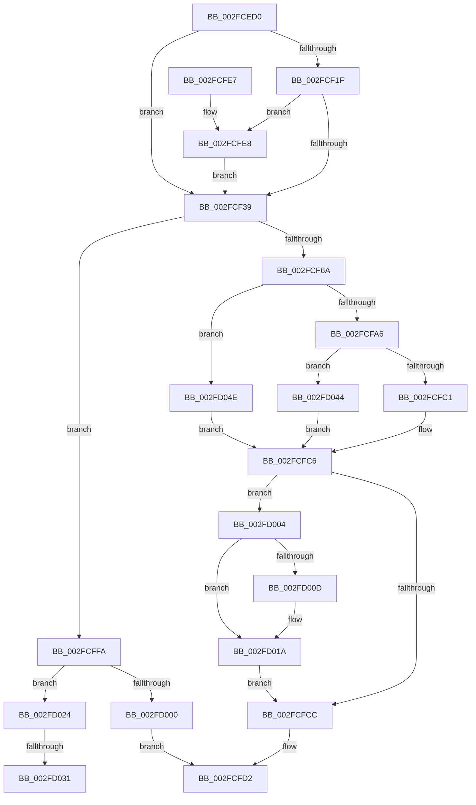

# EtwpReserveWithPmcCounters

- RVA: `0x002FCED0`–`0x002FD06B` (길이 `411` bytes)
- VA: `0x00000001402FCED0`
- 실행 섹션: `.text`
- PDB 이름 있음: `예`; PDB Function 태그: `예`
- unwind 정보 RVA: `0x00072B80`
- 디코드: `103`개 명령, `411/411` bytes 표시
- 미해석 바이트: `0` (있으면 어셈블리에 `.byte`로 보존)

> 이 문서는 커널 이미지의 기계어와 PDB 기호를 분석해 생성했습니다. 4번과 5번은 함수 원형과 자료형을 바이너리 사용 방식에서 추정한 C 해석이며 원본 소스 복구 결과는 아닙니다.

## 1. Dependencies

- 직접 호출 지점: **7**; 고유 호출 대상: **6**
- 직접 호출자로 확인된 함수: **2**
- RIP 상대 이미지 참조: **3**

### Outgoing calls
- `0x002FCF59` → [EtwpReserveTraceBuffer](EtwpReserveTraceBuffer_function_002FC8C0.md) (function, `0x002FC8C0`)
- `0x002FCFC1` → [HalpCollectPmcCounters](HalpCollectPmcCounters_function_002FD080.md) (function, `0x002FD080`)
- `0x002FCFE8` → [KiRaiseIrqlProcessIrqlFlags](../4F/KiRaiseIrqlProcessIrqlFlags_function_004F56FC.md) (function, `0x004F56FC`)
- `0x002FD015` → [KiLowerIrqlProcessIrqlFlags](../4F/KiLowerIrqlProcessIrqlFlags_function_004F5698.md) (function, `0x004F5698`)
- `0x002FD039` → [KiLowerIrqlProcessIrqlFlags](../4F/KiLowerIrqlProcessIrqlFlags_function_004F5698.md) (function, `0x004F5698`)
- `0x002FD044` → [guard_dispatch_icall](../6B/guard_dispatch_icall_function_006BAAD0.md) (function, `0x006BAAD0`)
- `0x002FD061` → [memset](../6C/memset_function_006C6C40.md) (function, `0x006C6C40`)

### Direct callers
- [EtwpLogKernelEvent](../25/EtwpLogKernelEvent_function_0025CC00.md) at `0x0025D612`
- [EtwpLogContextSwapEvent](../41/EtwpLogContextSwapEvent_function_004175F0.md) at `0x00417B19`

### Static image references
- `0x002FCF2C` → RVA `0x00FC6D20` (`ALMOSTRO`; read)
- `0x002FCFA6` → RVA `0x00E00A38` (`.data`; read)
- `0x002FCFAD` → RVA `0x002FD080` (`HalpCollectPmcCounters`; read)

## 2. Other-region calls and transfers

- 다른 실행 섹션으로 향하는 call: **0**
- call이 아닌 외부 분기/꼬리 이동: **2**
  - `0x002FD02B` → [sub_006DFC0A](../6D/Unknown_function_006DFC0A.md) (`tail-transfer`)
  - `0x002FD03F` → [sub_006DFC0A](../6D/Unknown_function_006DFC0A.md) (`tail-transfer`)

## 3. Assembly (complete function range)

```asm
002FCED0  48 89 5C 24 08                  mov qword ptr [rsp + 8], rbx
002FCED5  4C 89 4C 24 20                  mov qword ptr [rsp + 0x20], r9
002FCEDA  66 89 54 24 10                  mov word ptr [rsp + 0x10], dx
002FCEDF  55                              push rbp
002FCEE0  56                              push rsi
002FCEE1  57                              push rdi
002FCEE2  41 54                           push r12
002FCEE4  41 55                           push r13
002FCEE6  41 56                           push r14
002FCEE8  41 57                           push r15
002FCEEA  48 83 EC 30                     sub rsp, 0x30
002FCEEE  4C 8B B9 28 04 00 00            mov r15, qword ptr [rcx + 0x428]
002FCEF5  48 8B D9                        mov rbx, rcx
002FCEF8  49 8B C1                        mov rax, r9
002FCEFB  41 8B 4F 14                     mov ecx, dword ptr [r15 + 0x14]
002FCEFF  0F B6 F9                        movzx edi, cl
002FCF02  89 8C 24 80 00 00 00            mov dword ptr [rsp + 0x80], ecx
002FCF09  44 8D 34 FD 10 00 00 00         lea r14d, [rdi*8 + 0x10]
002FCF11  43 8D 34 06                     lea esi, [r14 + r8]
002FCF15  44 0F 20 C5                     mov rbp, cr8
002FCF19  40 80 FD 02                     cmp bpl, 2
002FCF1D  73 1A                           jae 0x1402fcf39
002FCF1F  44 0F 20 C1                     mov rcx, cr8
002FCF23  BA 02 00 00 00                  mov edx, 2
002FCF28  44 0F 22 C2                     mov cr8, rdx
002FCF2C  83 3D ED 9D CC 00 00            cmp dword ptr [rip + 0xcc9ded], 0
002FCF33  0F 85 AF 00 00 00               jne 0x1402fcfe8
002FCF39  4C 8B AC 24 90 00 00 00         mov r13, qword ptr [rsp + 0x90]
002FCF41  4C 8B C0                        mov r8, rax
002FCF44  44 8B A4 24 98 00 00 00         mov r12d, dword ptr [rsp + 0x98]
002FCF4C  4D 8B CD                        mov r9, r13
002FCF4F  8B D6                           mov edx, esi
002FCF51  44 89 64 24 20                  mov dword ptr [rsp + 0x20], r12d
002FCF56  48 8B CB                        mov rcx, rbx
002FCF59  E8 62 F9 FF FF                  call 0x1402fc8c0
002FCF5E  48 8B D8                        mov rbx, rax
002FCF61  48 85 C0                        test rax, rax
002FCF64  0F 84 90 00 00 00               je 0x1402fcffa
002FCF6A  49 8B 45 00                     mov rax, qword ptr [r13]
002FCF6E  48 89 43 08                     mov qword ptr [rbx + 8], rax
002FCF72  41 0F B6 C4                     movzx eax, r12b
002FCF76  C1 E7 08                        shl edi, 8
002FCF79  0B F8                           or edi, eax
002FCF7B  66 89 73 04                     mov word ptr [rbx + 4], si
002FCF7F  0F B7 44 24 78                  movzx eax, word ptr [rsp + 0x78]
002FCF84  81 CF 00 00 11 C0               or edi, 0xc0110000
002FCF8A  89 3B                           mov dword ptr [rbx], edi
002FCF8C  66 89 43 06                     mov word ptr [rbx + 6], ax
002FCF90  65 8B 04 25 A4 01 00 00         mov eax, dword ptr gs:[0x1a4]
002FCF98  49 8B 4C C7 18                  mov rcx, qword ptr [r15 + rax*8 + 0x18]
002FCF9D  48 85 C9                        test rcx, rcx
002FCFA0  0F 84 A8 00 00 00               je 0x1402fd04e
002FCFA6  48 8B 05 8B 3A B0 00            mov rax, qword ptr [rip + 0xb03a8b]
002FCFAD  48 8D 15 CC 00 00 00            lea rdx, [rip + 0xcc]
002FCFB4  48 3B C2                        cmp rax, rdx
002FCFB7  48 8D 53 10                     lea rdx, [rbx + 0x10]
002FCFBB  0F 85 83 00 00 00               jne 0x1402fd044
002FCFC1  E8 BA 00 00 00                  call 0x1402fd080
002FCFC6  40 80 FD 02                     cmp bpl, 2
002FCFCA  72 38                           jb 0x1402fd004
002FCFCC  41 8B C6                        mov eax, r14d
002FCFCF  48 03 C3                        add rax, rbx
002FCFD2  48 8B 5C 24 70                  mov rbx, qword ptr [rsp + 0x70]
002FCFD7  48 83 C4 30                     add rsp, 0x30
002FCFDB  41 5F                           pop r15
002FCFDD  41 5E                           pop r14
002FCFDF  41 5D                           pop r13
002FCFE1  41 5C                           pop r12
002FCFE3  5F                              pop rdi
002FCFE4  5E                              pop rsi
002FCFE5  5D                              pop rbp
002FCFE6  C3                              ret
002FCFE7  CC                              int3
002FCFE8  E8 0F 87 1F 00                  call 0x1404f56fc
002FCFED  48 8B 84 24 88 00 00 00         mov rax, qword ptr [rsp + 0x88]
002FCFF5  E9 3F FF FF FF                  jmp 0x1402fcf39
002FCFFA  40 80 FD 02                     cmp bpl, 2
002FCFFE  72 24                           jb 0x1402fd024
002FD000  33 C0                           xor eax, eax
002FD002  EB CE                           jmp 0x1402fcfd2
002FD004  83 3D 15 9D CC 00 00            cmp dword ptr [rip + 0xcc9d15], 0
002FD00B  74 0D                           je 0x1402fd01a
002FD00D  44 0F 20 C1                     mov rcx, cr8
002FD011  40 0F B6 D5                     movzx edx, bpl
002FD015  E8 7E 86 1F 00                  call 0x1404f5698
002FD01A  40 0F B6 C5                     movzx eax, bpl
002FD01E  44 0F 22 C0                     mov cr8, rax
002FD022  EB A8                           jmp 0x1402fcfcc
002FD024  83 3D F5 9C CC 00 00            cmp dword ptr [rip + 0xcc9cf5], 0
002FD02B  0F 84 D9 2B 3E 00               je 0x1406dfc0a
002FD031  44 0F 20 C1                     mov rcx, cr8
002FD035  40 0F B6 D5                     movzx edx, bpl
002FD039  E8 5A 86 1F 00                  call 0x1404f5698
002FD03E  90                              nop
002FD03F  E9 C6 2B 3E 00                  jmp 0x1406dfc0a
002FD044  E8 87 DA 3B 00                  call 0x1406baad0
002FD049  E9 78 FF FF FF                  jmp 0x1402fcfc6
002FD04E  44 0F B6 84 24 80 00 00 00      movzx r8d, byte ptr [rsp + 0x80]
002FD057  48 8D 4B 10                     lea rcx, [rbx + 0x10]
002FD05B  49 C1 E0 03                     shl r8, 3
002FD05F  33 D2                           xor edx, edx
002FD061  E8 DA 9B 3C 00                  call 0x1406c6c40
002FD066  E9 5B FF FF FF                  jmp 0x1402fcfc6
```

## 4. C-style interpretation (structured pseudocode)

```c
__int64 __fastcall EtwpReserveWithPmcCounters(__int64 a1, unsigned __int16 a2, __int64 a3, __int64 a4, __int64 a5, unsigned int a6)
{
    __int64 result;
    __int64 v_rdi;
    __int64 v_rsp;
    unsigned int v_stack_m48;
    unsigned __int16 v_stack_p10;
    unsigned int v_stack_p18;
    unsigned __int64 v_stack_p20;
    unsigned __int64 v_stack_p8;
    unsigned __int8 v_stack_p80;
    unsigned __int64 v_stack_p88;

    v_stack_p8 = v_rbx;
    v_stack_p20 = a4;
    v_stack_p10 = a2;
    v_rsp = (v_rsp) - (48);
    v_stack_p18 = (unsigned int)((unsigned int)(*(unsigned int *)(*(unsigned __int64 *)(a1 + 1064) + 20)));
    if (((unsigned __int8)(v_cr8)) >= 2) goto loc_002FCF39;
    if ((*(unsigned int *)(v_rip + 13409773)) != 0) goto loc_002FCFE8;
loc_002FCF39:
    v_stack_m48 = (unsigned int)((unsigned int)(a6));
    result = EtwpReserveTraceBuffer(a1, (unsigned int)((unsigned int)((unsigned __int8)((unsigned int)(*(unsigned int *)(*(unsigned __int64 *)(a1 + 1064) + 20))) * 8 + 16 + a3 * 1)), a4, a5);
    if (result == 0) goto loc_002FCFFA;
    *(unsigned __int64 *)(result + 8) = *(unsigned __int64 *)(a5);
    v_rdi = (unsigned int)(((unsigned __int8)((unsigned int)(*(unsigned int *)(*(unsigned __int64 *)(a1 + 1064) + 20)))) << (8));
    v_rdi = (unsigned int)((v_rdi) | ((unsigned int)((unsigned __int8)((unsigned int)(a6)))));
    *(unsigned __int16 *)(result + 4) = (unsigned __int16)((unsigned __int8)((unsigned int)(*(unsigned int *)(*(unsigned __int64 *)(a1 + 1064) + 20))) * 8 + 16 + a3 * 1);
    v_rdi = (unsigned int)((v_rdi) | (0xC0110000ULL));
    *(unsigned int *)(result) = (unsigned int)(v_rdi);
    *(unsigned __int16 *)(result + 6) = (unsigned __int16)(v_stack_p10);
    if (*(unsigned __int64 *)(*(unsigned __int64 *)(a1 + 1064) + (unsigned int)(*(unsigned int *)(gs_base + (0 + 420))) * 8 + 24) == 0) goto loc_002FD04E;
    if ((*(unsigned __int64 *)(v_rip + 11549323)) != (v_rip + 204)) goto loc_002FD044;
    result = HalpCollectPmcCounters(*(unsigned __int64 *)(*(unsigned __int64 *)(a1 + 1064) + (unsigned int)(*(unsigned int *)(gs_base + (0 + 420))) * 8 + 24), result + 16, a4, a5);
loc_002FCFC6:
    if (((unsigned __int8)(v_cr8)) < 2) goto loc_002FD004;
loc_002FCFCC:
    result = ((unsigned int)((unsigned int)((unsigned __int8)((unsigned int)(*(unsigned int *)(*(unsigned __int64 *)(a1 + 1064) + 20))) * 8 + 16))) + (result);
loc_002FCFD2:
    v_rsp = (v_rsp) + (48);
    return result;
loc_002FCFE8:
    result = KiRaiseIrqlProcessIrqlFlags(*(unsigned __int64 *)(*(unsigned __int64 *)(a1 + 1064) + (unsigned int)(*(unsigned int *)(gs_base + (0 + 420))) * 8 + 24), result + 16, a4, a5);
    goto loc_002FCF39;
loc_002FCFFA:
    if (((unsigned __int8)(v_cr8)) < 2) goto loc_002FD024;
    result = 0;
    goto loc_002FCFD2;
loc_002FD004:
    if ((*(unsigned int *)(v_rip + 13409557)) != 0) {
        a1 = 2;
        a2 = (unsigned __int8)(v_cr8);
        result = KiLowerIrqlProcessIrqlFlags(a1, a2, a4, a5);
    }
    goto loc_002FCFCC;
loc_002FD024:
    result = KiLowerIrqlProcessIrqlFlags((unsigned __int8)(v_cr8), (unsigned __int8)(v_cr8), a4, a5);
loc_002FD044:
    result = guard_dispatch_icall((unsigned __int8)(v_cr8), (unsigned __int8)(v_cr8), a4, a5);
    goto loc_002FCFC6;
loc_002FD04E:
    a3 = (v_stack_p80) << (3);
    a2 = 0;
    result = memset(v_stack_p8 + 16, a2, a3, a5);
    goto loc_002FCFC6;
}
```

## 5. (Beta) C Style

```c
int64_t EtwpReserveWithPmcCounters(void *Arg1, uint16_t Arg2, int64_t Arg3, int64_t Arg4, void *Arg5, uint32_t Arg6)
{
    uint8_t *arg1 = (uint8_t *)Arg1;
    uint8_t *arg5 = (uint8_t *)Arg5;

    int64_t result;
    int64_t local_rdi;
    int64_t local_rsp;
    uint32_t v_stack_m48;
    uint16_t v_stack_p10;
    uint32_t v_stack_p18;
    uint64_t v_stack_p20;
    uint64_t v_stack_p8;
    uint8_t v_stack_p80;
    uint64_t v_stack_p88;

    v_stack_p8 = local_rbx;
    v_stack_p20 = Arg4;
    v_stack_p10 = Arg2;
    local_rsp = (local_rsp) - (48);
    v_stack_p18 = (uint32_t)((uint32_t)(*(uint32_t *)(*(uint64_t *)(arg1 + 0x428) + 0x14)));
    if (((uint8_t)(v_cr8)) >= 2) goto loc_002FCF39;
    if ((*(uint32_t *)(v_rip + 0xCC9DED)) != 0) goto loc_002FCFE8;
loc_002FCF39:
    v_stack_m48 = (uint32_t)((uint32_t)(Arg6));
    result = EtwpReserveTraceBuffer(Arg1, (uint32_t)((uint32_t)((uint8_t)((uint32_t)(*(uint32_t *)(*(uint64_t *)(arg1 + 0x428) + 0x14))) * 8 + 16 + Arg3 * 1)), Arg4, Arg5);
    if (result == 0) goto loc_002FCFFA;
    *(uint64_t *)(result + 0x8) = *(uint64_t *)(arg5);
    local_rdi = (uint32_t)(((uint8_t)((uint32_t)(*(uint32_t *)(*(uint64_t *)(arg1 + 0x428) + 0x14)))) << (8));
    local_rdi = (uint32_t)((local_rdi) | ((uint32_t)((uint8_t)((uint32_t)(Arg6)))));
    *(uint16_t *)(result + 0x4) = (uint16_t)((uint8_t)((uint32_t)(*(uint32_t *)(*(uint64_t *)(arg1 + 0x428) + 0x14))) * 8 + 16 + Arg3 * 1);
    local_rdi = (uint32_t)((local_rdi) | (0xC0110000ULL));
    *(uint32_t *)(result) = (uint32_t)(local_rdi);
    *(uint16_t *)(result + 0x6) = (uint16_t)(v_stack_p10);
    if (*(uint64_t *)(*(uint64_t *)(arg1 + 0x428) + (uint32_t)(*(uint32_t *)(gs_base + (0 + 0x1A4))) * 8 + 0x18) == 0) goto loc_002FD04E;
    if ((*(uint64_t *)(v_rip + 0xB03A8B)) != (v_rip + 204)) goto loc_002FD044;
    result = HalpCollectPmcCounters(*(uint64_t *)(*(uint64_t *)(arg1 + 0x428) + (uint32_t)(*(uint32_t *)(gs_base + (0 + 0x1A4))) * 8 + 0x18), result + 16, Arg4, Arg5);
loc_002FCFC6:
    if (((uint8_t)(v_cr8)) < 2) goto loc_002FD004;
loc_002FCFCC:
    result = ((uint32_t)((uint32_t)((uint8_t)((uint32_t)(*(uint32_t *)(*(uint64_t *)(arg1 + 0x428) + 0x14))) * 8 + 16))) + (result);
loc_002FCFD2:
    local_rsp = (local_rsp) + (48);
    return result;
loc_002FCFE8:
    result = KiRaiseIrqlProcessIrqlFlags(*(uint64_t *)(*(uint64_t *)(arg1 + 0x428) + (uint32_t)(*(uint32_t *)(gs_base + (0 + 0x1A4))) * 8 + 0x18), result + 16, Arg4, Arg5);
    goto loc_002FCF39;
loc_002FCFFA:
    if (((uint8_t)(v_cr8)) < 2) goto loc_002FD024;
    result = 0;
    goto loc_002FCFD2;
loc_002FD004:
    if ((*(uint32_t *)(v_rip + 0xCC9D15)) != 0) {
        Arg1 = 2;
        Arg2 = (uint8_t)(v_cr8);
        result = KiLowerIrqlProcessIrqlFlags(Arg1, Arg2, Arg4, Arg5);
    }
    goto loc_002FCFCC;
loc_002FD024:
    result = KiLowerIrqlProcessIrqlFlags((uint8_t)(v_cr8), (uint8_t)(v_cr8), Arg4, Arg5);
loc_002FD044:
    result = guard_dispatch_icall((uint8_t)(v_cr8), (uint8_t)(v_cr8), Arg4, Arg5);
    goto loc_002FCFC6;
loc_002FD04E:
    Arg3 = (v_stack_p80) << (3);
    Arg2 = 0;
    result = memset(v_stack_p8 + 16, Arg2, Arg3, Arg5);
    goto loc_002FCFC6;
}
```

### 관측된 메모리 오프셋

구조체 형식이 확인되지 않은 접근은 인자 기준의 오프셋으로만 기록했습니다.

| 기준 인자 | 오프셋 표현 | 폭 (bit) | 접근 |
|---|---:|---:|---|
| `Arg1` | `+ 0x428` | `64` | `R` |
| `Arg5` | `+ 0x0` | `64` | `R` |

## 6. Execution-region graph

[열기: 2D/3D 그래프와 함수 탐색 컨트롤 패널](../../../control-panel.html?section=text&rva=0x002FCED0&view=graph)

- 2D 그래프는 위에서 아래로 흐르고, 3D 그래프는 빈 공간을 드래그해 회전합니다. Shift+드래그는 이동, 휠은 확대·축소, 함수 노드 선택은 대상 보고서 이동입니다.

### Static fallback


