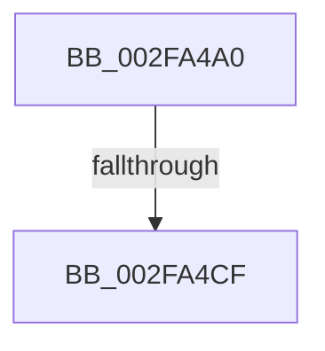

# EtwpStackTraceDispatcher

- RVA: `0x002FA4A0`–`0x002FA4E0` (길이 `64` bytes)
- VA: `0x00000001402FA4A0`
- 실행 섹션: `.text`
- PDB 이름 있음: `예`; PDB Function 태그: `아니요`
- unwind 정보 RVA: `0x00072954`
- 디코드: `18`개 명령, `64/64` bytes 표시
- 미해석 바이트: `0` (있으면 어셈블리에 `.byte`로 보존)

> 이 문서는 커널 이미지의 기계어와 PDB 기호를 분석해 생성했습니다. 4번과 5번은 함수 원형과 자료형을 바이너리 사용 방식에서 추정한 C 해석이며 원본 소스 복구 결과는 아닙니다.

## 1. Dependencies

- 직접 호출 지점: **0**; 고유 호출 대상: **0**
- 직접 호출자로 확인된 함수: **2**
- RIP 상대 이미지 참조: **0**

### Outgoing calls
- 직접 디코드된 call 명령이 없습니다.

### Direct callers
- [EtwpLogSystemEventUnsafe](EtwpLogSystemEventUnsafe_function_002FBF10.md) at `0x002FC590`
- [EtwpLogContextSwapEvent](../41/EtwpLogContextSwapEvent_function_004175F0.md) at `0x00417A18`

### Static image references
- 디코드된 RIP-relative 메모리 참조가 없습니다.

## 2. Other-region calls and transfers

- 다른 실행 섹션으로 향하는 call: **0**
- call이 아닌 외부 분기/꼬리 이동: **2**
  - `0x002FA4C9` → [sub_002FA56A](Unknown_function_002FA56A.md) (`tail-transfer`)
  - `0x002FA4DA` → [sub_002FA5CC](Unknown_function_002FA5CC.md) (`tail-transfer`)

## 3. Assembly (complete function range)

```asm
002FA4A0  40 53                           push rbx
002FA4A2  55                              push rbp
002FA4A3  56                              push rsi
002FA4A4  57                              push rdi
002FA4A5  41 55                           push r13
002FA4A7  48 83 EC 40                     sub rsp, 0x40
002FA4AB  49 8B F8                        mov rdi, r8
002FA4AE  41 8B D9                        mov ebx, r9d
002FA4B1  65 4C 8B 04 25 88 01 00 00      mov r8, qword ptr gs:[0x188]
002FA4BA  48 8B EA                        mov rbp, rdx
002FA4BD  48 8B F1                        mov rsi, rcx
002FA4C0  45 0F 20 C5                     mov r13, cr8
002FA4C4  41 0F BA E1 0E                  bt r9d, 0xe
002FA4C9  0F 82 9B 00 00 00               jb 0x1402fa56a
002FA4CF  48 85 FF                        test rdi, rdi
002FA4D2  49 0F 44 F8                     cmove rdi, r8
002FA4D6  0F BA E3 0C                     bt ebx, 0xc
002FA4DA  0F 83 EC 00 00 00               jae 0x1402fa5cc
```

## 4. C-style interpretation (structured pseudocode)

```c
void __fastcall EtwpStackTraceDispatcher(__int64 a1, __int64 a2, __int64 a3, int a4)
{
    __int64 v_rsp;

    v_rsp = (v_rsp) - (64);
    if (a3 == 0) { a3 = *(unsigned __int64 *)(gs_base + (0 + 392)); }
}
```

## 5. (Beta) C Style

```c
void EtwpStackTraceDispatcher(int64_t Arg1, int64_t Arg2, int64_t Arg3, int32_t Arg4)
{
    int64_t local_rsp;

    local_rsp = (local_rsp) - (64);
    if (Arg3 == 0) { Arg3 = *(uint64_t *)(gs_base + (0 + 0x188)); }
}
```

## 6. Execution-region graph

[열기: 2D/3D 그래프와 함수 탐색 컨트롤 패널](../../../control-panel.html?section=text&rva=0x002FA4A0&view=graph)

- 2D 그래프는 위에서 아래로 흐르고, 3D 그래프는 빈 공간을 드래그해 회전합니다. Shift+드래그는 이동, 휠은 확대·축소, 함수 노드 선택은 대상 보고서 이동입니다.

### Static fallback


