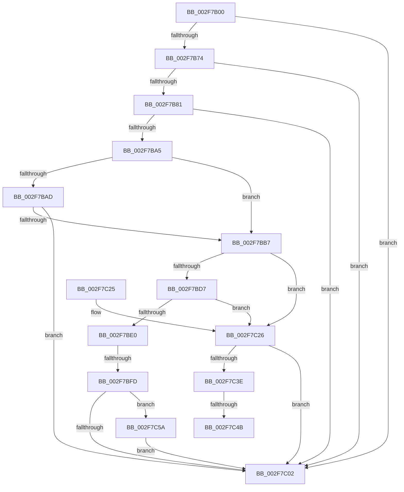

# EtwpTraceLastBranchRecord

- RVA: `0x002F7B00`–`0x002F7C6C` (길이 `364` bytes)
- VA: `0x00000001402F7B00`
- 실행 섹션: `.text`
- PDB 이름 있음: `예`; PDB Function 태그: `예`
- unwind 정보 RVA: `0x00072404`
- 디코드: `97`개 명령, `364/364` bytes 표시
- 미해석 바이트: `0` (있으면 어셈블리에 `.byte`로 보존)

> 이 문서는 커널 이미지의 기계어와 PDB 기호를 분석해 생성했습니다. 4번과 5번은 함수 원형과 자료형을 바이너리 사용 방식에서 추정한 C 해석이며 원본 소스 복구 결과는 아닙니다.

## 1. Dependencies

- 직접 호출 지점: **7**; 고유 호출 대상: **6**
- 직접 호출자로 확인된 함수: **1**
- RIP 상대 이미지 참조: **4**

### Outgoing calls
- `0x002F7B88` → [KeGetCurrentStackPointer](../6B/KeGetCurrentStackPointer_function_006B1070.md) (function, `0x006B1070`)
- `0x002F7B9C` → [KeQueryCurrentStackInformationEx](KeQueryCurrentStackInformationEx_function_002F7CD0.md) (function, `0x002F7CD0`)
- `0x002F7BCD` → [ExpInterlockedPopEntrySList](../6B/ExpInterlockedPopEntrySList_function_006BA570.md) (function, `0x006BA570`)
- `0x002F7BF0` → [guard_dispatch_icall](../6B/guard_dispatch_icall_function_006BAAD0.md) (function, `0x006BAAD0`)
- `0x002F7C09` → [_security_check_cookie](../6A/_security_check_cookie_function_006AC640.md) (function, `0x006AC640`)
- `0x002F7C29` → [KeGetCurrentStackPointer](../6B/KeGetCurrentStackPointer_function_006B1070.md) (function, `0x006B1070`)
- `0x002F7C65` → [ExpInterlockedPushEntrySList](../6B/ExpInterlockedPushEntrySList_function_006BA5B0.md) (function, `0x006BA5B0`)

### Direct callers
- [EtwpLogContextSwapEvent](../41/EtwpLogContextSwapEvent_function_004175F0.md) at `0x00417B30`

### Static image references
- `0x002F7B1F` → RVA `0x00E0A740` (`.data`; read)
- `0x002F7BB7` → RVA `0x00FC6DA0` (`ALMOSTRO`; read)
- `0x002F7BBD` → RVA `0x00E28FB0` (`.data`; read)
- `0x002F7BE0` → RVA `0x00E00BE8` (`.data`; read)

## 2. Other-region calls and transfers

- 다른 실행 섹션으로 향하는 call: **0**
- call이 아닌 외부 분기/꼬리 이동: **3**
  - `0x002F7BF7` → [sub_006DF314 + 0x19](../6D/Unknown_function_006DF314.md) (`tail-transfer`)
  - `0x002F7C45` → [sub_006DF314](../6D/Unknown_function_006DF314.md) (`tail-transfer`)
  - `0x002F7C55` → [sub_006DF314](../6D/Unknown_function_006DF314.md) (`tail-transfer`)

## 3. Assembly (complete function range)

```asm
002F7B00  40 55                           push rbp
002F7B02  56                              push rsi
002F7B03  57                              push rdi
002F7B04  41 54                           push r12
002F7B06  41 55                           push r13
002F7B08  41 56                           push r14
002F7B0A  41 57                           push r15
002F7B0C  48 81 EC A0 00 00 00            sub rsp, 0xa0
002F7B13  48 8D 6C 24 30                  lea rbp, [rsp + 0x30]
002F7B18  48 89 9D B8 00 00 00            mov qword ptr [rbp + 0xb8], rbx
002F7B1F  48 8B 05 1A 2C B1 00            mov rax, qword ptr [rip + 0xb12c1a]
002F7B26  48 33 C5                        xor rax, rbp
002F7B29  48 89 45 68                     mov qword ptr [rbp + 0x68], rax
002F7B2D  33 C0                           xor eax, eax
002F7B2F  0F 57 C0                        xorps xmm0, xmm0
002F7B32  89 45 00                        mov dword ptr [rbp], eax
002F7B35  4C 8B E1                        mov r12, rcx
002F7B38  0F 11 45 18                     movups xmmword ptr [rbp + 0x18], xmm0
002F7B3C  48 89 45 10                     mov qword ptr [rbp + 0x10], rax
002F7B40  41 8B F1                        mov esi, r9d
002F7B43  0F 11 45 28                     movups xmmword ptr [rbp + 0x28], xmm0
002F7B47  48 89 45 08                     mov qword ptr [rbp + 8], rax
002F7B4B  49 8B F8                        mov rdi, r8
002F7B4E  0F 11 45 38                     movups xmmword ptr [rbp + 0x38], xmm0
002F7B52  65 48 8B 0C 25 88 01 00 00      mov rcx, qword ptr gs:[0x188]
002F7B5B  4C 8B EA                        mov r13, rdx
002F7B5E  89 45 04                        mov dword ptr [rbp + 4], eax
002F7B61  65 48 8B 04 25 20 00 00 00      mov rax, qword ptr gs:[0x20]
002F7B6A  48 39 48 18                     cmp qword ptr [rax + 0x18], rcx
002F7B6E  0F 84 8E 00 00 00               je 0x1402f7c02
002F7B74  41 F7 C1 00 18 00 00            test r9d, 0x1800
002F7B7B  0F 84 81 00 00 00               je 0x1402f7c02
002F7B81  4D 85 C0                        test r8, r8
002F7B84  48 0F 44 F9                     cmove rdi, rcx
002F7B88  E8 E3 94 3B 00                  call 0x1406b1070
002F7B8D  48 8B C8                        mov rcx, rax
002F7B90  4C 8D 4D 10                     lea r9, [rbp + 0x10]
002F7B94  4C 8D 45 08                     lea r8, [rbp + 8]
002F7B98  48 8D 55 04                     lea rdx, [rbp + 4]
002F7B9C  E8 2F 01 00 00                  call 0x1402f7cd0
002F7BA1  84 C0                           test al, al
002F7BA3  74 5D                           je 0x1402f7c02
002F7BA5  8B 45 04                        mov eax, dword ptr [rbp + 4]
002F7BA8  83 F8 09                        cmp eax, 9
002F7BAB  77 0A                           ja 0x1402f7bb7
002F7BAD  B9 A1 03 00 00                  mov ecx, 0x3a1
002F7BB2  0F A3 C1                        bt ecx, eax
002F7BB5  72 4B                           jb 0x1402f7c02
002F7BB7  8B 05 E3 F1 CC 00               mov eax, dword ptr [rip + 0xccf1e3]
002F7BBD  48 8D 0D EC 13 B3 00            lea rcx, [rip + 0xb313ec]
002F7BC4  45 32 F6                        xor r14b, r14b
002F7BC7  8D 1C 40                        lea ebx, [rax + rax*2]
002F7BCA  C1 E3 03                        shl ebx, 3
002F7BCD  E8 9E 29 3C 00                  call 0x1406ba570
002F7BD2  48 85 C0                        test rax, rax
002F7BD5  74 4F                           je 0x1402f7c26
002F7BD7  4C 8D 78 10                     lea r15, [rax + 0x10]
002F7BDB  4D 85 FF                        test r15, r15
002F7BDE  74 46                           je 0x1402f7c26
002F7BE0  48 8B 05 01 90 B0 00            mov rax, qword ptr [rip + 0xb09001]
002F7BE7  4C 8D 45 00                     lea r8, [rbp]
002F7BEB  49 8B D7                        mov rdx, r15
002F7BEE  8B CB                           mov ecx, ebx
002F7BF0  E8 DB 2E 3C 00                  call 0x1406baad0
002F7BF5  85 C0                           test eax, eax
002F7BF7  0F 89 30 77 3E 00               jns 0x1406df32d
002F7BFD  45 84 F6                        test r14b, r14b
002F7C00  74 58                           je 0x1402f7c5a
002F7C02  48 8B 4D 68                     mov rcx, qword ptr [rbp + 0x68]
002F7C06  48 33 CD                        xor rcx, rbp
002F7C09  E8 32 4A 3B 00                  call 0x1406ac640
002F7C0E  48 8B 9D B8 00 00 00            mov rbx, qword ptr [rbp + 0xb8]
002F7C15  48 8D 65 70                     lea rsp, [rbp + 0x70]
002F7C19  41 5F                           pop r15
002F7C1B  41 5E                           pop r14
002F7C1D  41 5D                           pop r13
002F7C1F  41 5C                           pop r12
002F7C21  5F                              pop rdi
002F7C22  5E                              pop rsi
002F7C23  5D                              pop rbp
002F7C24  C3                              ret
002F7C25  CC                              int3
002F7C26  44 8B F3                        mov r14d, ebx
002F7C29  E8 42 94 3B 00                  call 0x1406b1070
002F7C2E  48 2B 45 08                     sub rax, qword ptr [rbp + 8]
002F7C32  48 8D 8B 30 0E 00 00            lea rcx, [rbx + 0xe30]
002F7C39  48 3B C1                        cmp rax, rcx
002F7C3C  76 C4                           jbe 0x1402f7c02
002F7C3E  48 8D 43 0F                     lea rax, [rbx + 0xf]
002F7C42  49 3B C6                        cmp rax, r14
002F7C45  0F 87 C9 76 3E 00               ja 0x1406df314
002F7C4B  48 B8 F0 FF FF FF FF FF FF 0F   movabs rax, 0xffffffffffffff0
002F7C55  E9 BA 76 3E 00                  jmp 0x1406df314
002F7C5A  49 8D 57 F0                     lea rdx, [r15 - 0x10]
002F7C5E  48 8D 0D 4B 13 B3 00            lea rcx, [rip + 0xb3134b]
002F7C65  E8 46 29 3C 00                  call 0x1406ba5b0
002F7C6A  EB 96                           jmp 0x1402f7c02
```

## 4. C-style interpretation (structured pseudocode)

```c
__int64 __fastcall EtwpTraceLastBranchRecord(__int64 a1, __int64 a2, __int64 a3, int a4)
{
    __int64 result;
    __int64 v_r14;
    __int64 v_rbx;
    __int64 v_rsp;
    unsigned __int64 v_stack_m38;
    unsigned __int64 v_stack_m40;
    unsigned __int64 v_stack_m70;
    unsigned __int64 v_stack_m80;
    unsigned __int64 v_stack_m90;
    unsigned __int64 v_stack_m98;
    unsigned __int64 v_stack_mA0;
    unsigned int v_stack_mA4;
    unsigned __int64 v_stack_mA8;
    unsigned __int64 v_stack_p10;

    v_rsp = (v_rsp) - (160);
    v_stack_p10 = v_rbx;
    result = (*(unsigned __int64 *)(v_rip + 11611162)) ^ (v_stack_mA8);
    v_stack_m40 = result;
    result = 0;
    v_stack_mA8 = 0;
    v_stack_m90 = v_xmm0;
    v_stack_m98 = 0;
    v_stack_m80 = v_xmm0;
    v_stack_mA0 = 0;
    v_stack_m70 = v_xmm0;
    v_stack_mA4 = 0;
    if ((*(unsigned __int64 *)(*(unsigned __int64 *)(gs_base + (0 + 32)) + 24)) == (*(unsigned __int64 *)(gs_base + (0 + 392)))) goto loc_002F7C02;
    if (((a4) & (0x1800ULL)) == 0) goto loc_002F7C02;
    if (a3 == 0) { a3 = *(unsigned __int64 *)(gs_base + (0 + 392)); }
    result = KeGetCurrentStackPointer(*(unsigned __int64 *)(gs_base + (0 + 392)), a2, a3, a4);
    result = KeQueryCurrentStackInformationEx(result, v_stack_mA4, v_stack_mA0, v_stack_m98);
    if ((unsigned __int8)(result) == 0) goto loc_002F7C02;
    if (((unsigned int)((unsigned int)(v_stack_mA4))) > 9) goto loc_002F7BB7;
    if (((unsigned int)((unsigned int)(v_stack_mA4))) < 9) goto loc_002F7C02;
loc_002F7BB7:
    v_r14 = 0;
    v_rbx = (unsigned int)(((unsigned int)(*(unsigned int *)(v_rip + 13431267)) + (unsigned int)(*(unsigned int *)(v_rip + 13431267)) * 2) << (3));
    result = ExpInterlockedPopEntrySList(v_rip + 11736044, v_stack_mA4, v_stack_mA0, v_stack_m98);
    if (result == 0) goto loc_002F7C26;
    if (result + 16 == 0) goto loc_002F7C26;
    result = guard_dispatch_icall((unsigned int)((unsigned int)(v_rbx)), result + 16, v_stack_mA8, v_stack_m98);
    if (0 == 0) goto loc_002F7C5A;
loc_002F7C02:
    a1 = (v_stack_m40) ^ (v_stack_mA8);
    result = _security_check_cookie(a1, result + 16, v_stack_mA8, v_stack_m98);
    return result;
loc_002F7C26:
    result = KeGetCurrentStackPointer(a1, result + 16, v_stack_mA8, v_stack_m98);
    result = (result) - (v_stack_mA0);
    if (result <= (v_stack_p10 + 3632)) goto loc_002F7C02;
loc_002F7C5A:
    result = ExpInterlockedPushEntrySList(v_rip + 11735883, result + 16 - 16, v_stack_mA8, v_stack_m98);
    goto loc_002F7C02;
}
```

## 5. (Beta) C Style

```c
int64_t EtwpTraceLastBranchRecord(int64_t Arg1, int64_t Arg2, int64_t Arg3, int32_t Arg4)
{
    int64_t result;
    int64_t local_r14;
    int64_t local_rbx;
    int64_t local_rsp;
    uint64_t v_stack_m38;
    uint64_t v_stack_m40;
    uint64_t v_stack_m70;
    uint64_t v_stack_m80;
    uint64_t v_stack_m90;
    uint64_t v_stack_m98;
    uint64_t v_stack_mA0;
    uint32_t v_stack_mA4;
    uint64_t v_stack_mA8;
    uint64_t v_stack_p10;

    local_rsp = (local_rsp) - (160);
    v_stack_p10 = local_rbx;
    result = (*(uint64_t *)(v_rip + 0xB12C1A)) ^ (v_stack_mA8);
    v_stack_m40 = result;
    result = 0;
    v_stack_mA8 = 0;
    v_stack_m90 = v_xmm0;
    v_stack_m98 = 0;
    v_stack_m80 = v_xmm0;
    v_stack_mA0 = 0;
    v_stack_m70 = v_xmm0;
    v_stack_mA4 = 0;
    if ((*(uint64_t *)(*(uint64_t *)(gs_base + (0 + 0x20)) + 0x18)) == (*(uint64_t *)(gs_base + (0 + 0x188)))) goto loc_002F7C02;
    if (((Arg4) & (0x1800ULL)) == 0) goto loc_002F7C02;
    if (Arg3 == 0) { Arg3 = *(uint64_t *)(gs_base + (0 + 0x188)); }
    result = KeGetCurrentStackPointer(*(uint64_t *)(gs_base + (0 + 0x188)), Arg2, Arg3, Arg4);
    result = KeQueryCurrentStackInformationEx(result, v_stack_mA4, v_stack_mA0, v_stack_m98);
    if ((uint8_t)(result) == 0) goto loc_002F7C02;
    if (((uint32_t)((uint32_t)(v_stack_mA4))) > 9) goto loc_002F7BB7;
    if (((uint32_t)((uint32_t)(v_stack_mA4))) < 9) goto loc_002F7C02;
loc_002F7BB7:
    local_r14 = 0;
    local_rbx = (uint32_t)(((uint32_t)(*(uint32_t *)(v_rip + 0xCCF1E3)) + (uint32_t)(*(uint32_t *)(v_rip + 0xCCF1E3)) * 2) << (3));
    result = ExpInterlockedPopEntrySList(v_rip + 11736044, v_stack_mA4, v_stack_mA0, v_stack_m98);
    if (result == 0) goto loc_002F7C26;
    if (result + 16 == 0) goto loc_002F7C26;
    result = guard_dispatch_icall((uint32_t)((uint32_t)(local_rbx)), result + 16, v_stack_mA8, v_stack_m98);
    if (0 == 0) goto loc_002F7C5A;
loc_002F7C02:
    Arg1 = (v_stack_m40) ^ (v_stack_mA8);
    result = _security_check_cookie(Arg1, result + 16, v_stack_mA8, v_stack_m98);
    return result;
loc_002F7C26:
    result = KeGetCurrentStackPointer(Arg1, result + 16, v_stack_mA8, v_stack_m98);
    result = (result) - (v_stack_mA0);
    if (result <= (v_stack_p10 + 3632)) goto loc_002F7C02;
loc_002F7C5A:
    result = ExpInterlockedPushEntrySList(v_rip + 11735883, result + 16 - 16, v_stack_mA8, v_stack_m98);
    goto loc_002F7C02;
}
```

## 6. Execution-region graph

[열기: 2D/3D 그래프와 함수 탐색 컨트롤 패널](../../../control-panel.html?section=text&rva=0x002F7B00&view=graph)

- 2D 그래프는 위에서 아래로 흐르고, 3D 그래프는 빈 공간을 드래그해 회전합니다. Shift+드래그는 이동, 휠은 확대·축소, 함수 노드 선택은 대상 보고서 이동입니다.

### Static fallback


