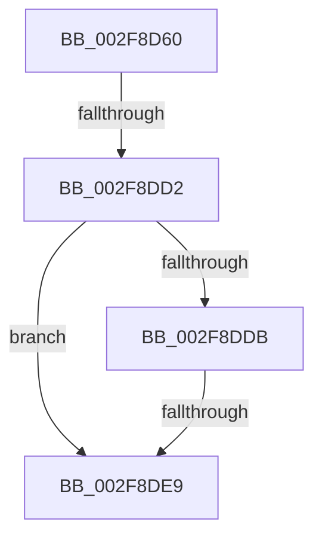

# EtwpTraceStackWalk

- RVA: `0x002F8D60`–`0x002F8DF2` (길이 `146` bytes)
- VA: `0x00000001402F8D60`
- 실행 섹션: `.text`
- PDB 이름 있음: `예`; PDB Function 태그: `아니요`
- unwind 정보 RVA: `0x00072720`
- 디코드: `36`개 명령, `146/146` bytes 표시
- 미해석 바이트: `0` (있으면 어셈블리에 `.byte`로 보존)

> 이 문서는 커널 이미지의 기계어와 PDB 기호를 분석해 생성했습니다. 4번과 5번은 함수 원형과 자료형을 바이너리 사용 방식에서 추정한 C 해석이며 원본 소스 복구 결과는 아닙니다.

## 1. Dependencies

- 직접 호출 지점: **2**; 고유 호출 대상: **2**
- 직접 호출자로 확인된 함수: **4**
- RIP 상대 이미지 참조: **1**

### Outgoing calls
- `0x002F8DAE` → [KeGetCurrentStackPointer](../6B/KeGetCurrentStackPointer_function_006B1070.md) (function, `0x006B1070`)
- `0x002F8DC5` → [KeQueryCurrentStackInformationEx](KeQueryCurrentStackInformationEx_function_002F7CD0.md) (function, `0x002F7CD0`)

### Direct callers
- [EtwpStackWalkApc](../22/EtwpStackWalkApc_function_00227870.md) at `0x002278E0`
- [EtwpLogKernelEvent](../25/EtwpLogKernelEvent_function_0025CC00.md) at `0x0025D350`
- [EtwpApcPoolThunk](EtwpApcPoolThunk_function_002FA090.md) at `0x002FA1ED`
- [sub_002FA5CC](Unknown_function_002FA5CC.md) at `0x002FA5DF`

### Static image references
- `0x002F8D73` → RVA `0x00E0A740` (`.data`; read)

## 2. Other-region calls and transfers

- 다른 실행 섹션으로 향하는 call: **0**
- call이 아닌 외부 분기/꼬리 이동: **2**
  - `0x002F8DCC` → [sub_002F9093](Unknown_function_002F9093.md) (`tail-transfer`)
  - `0x002F8DE3` → [sub_002F9093](Unknown_function_002F9093.md) (`tail-transfer`)

## 3. Assembly (complete function range)

```asm
002F8D60  40 55                           push rbp
002F8D62  53                              push rbx
002F8D63  41 56                           push r14
002F8D65  41 57                           push r15
002F8D67  48 8D 6C 24 D8                  lea rbp, [rsp - 0x28]
002F8D6C  48 81 EC 28 01 00 00            sub rsp, 0x128
002F8D73  48 8B 05 C6 19 B1 00            mov rax, qword ptr [rip + 0xb119c6]
002F8D7A  48 33 C4                        xor rax, rsp
002F8D7D  48 89 45 08                     mov qword ptr [rbp + 8], rax
002F8D81  33 DB                           xor ebx, ebx
002F8D83  4C 89 4C 24 70                  mov qword ptr [rsp + 0x70], r9
002F8D88  0F 57 C0                        xorps xmm0, xmm0
002F8D8B  89 5C 24 38                     mov dword ptr [rsp + 0x38], ebx
002F8D8F  33 C0                           xor eax, eax
002F8D91  48 89 5C 24 60                  mov qword ptr [rsp + 0x60], rbx
002F8D96  0F 11 45 80                     movups xmmword ptr [rbp - 0x80], xmm0
002F8D9A  48 89 45 90                     mov qword ptr [rbp - 0x70], rax
002F8D9E  44 8B F2                        mov r14d, edx
002F8DA1  48 89 5C 24 58                  mov qword ptr [rsp + 0x58], rbx
002F8DA6  4C 8B F9                        mov r15, rcx
002F8DA9  4C 89 44 24 68                  mov qword ptr [rsp + 0x68], r8
002F8DAE  E8 BD 82 3B 00                  call 0x1406b1070
002F8DB3  48 8B C8                        mov rcx, rax
002F8DB6  4C 8D 4C 24 58                  lea r9, [rsp + 0x58]
002F8DBB  4C 8D 44 24 60                  lea r8, [rsp + 0x60]
002F8DC0  48 8D 54 24 38                  lea rdx, [rsp + 0x38]
002F8DC5  E8 06 EF FF FF                  call 0x1402f7cd0
002F8DCA  84 C0                           test al, al
002F8DCC  0F 84 C1 02 00 00               je 0x1402f9093
002F8DD2  8B 44 24 38                     mov eax, dword ptr [rsp + 0x38]
002F8DD6  83 F8 09                        cmp eax, 9
002F8DD9  77 0E                           ja 0x1402f8de9
002F8DDB  B9 A1 03 00 00                  mov ecx, 0x3a1
002F8DE0  0F A3 C1                        bt ecx, eax
002F8DE3  0F 82 AA 02 00 00               jb 0x1402f9093
002F8DE9  65 48 8B 04 25 20 00 00 00      mov rax, qword ptr gs:[0x20]
```

## 4. C-style interpretation (structured pseudocode)

```c
__int64 __fastcall EtwpTraceStackWalk(__int64 a1, int a2, __int64 a3, __int64 a4)
{
    __int64 result;
    __int64 v_rbx;
    __int64 v_rsp;
    unsigned int v_stack_m110;
    unsigned __int64 v_stack_m40;
    unsigned __int64 v_stack_m48;
    unsigned __int64 v_stack_mB8;
    unsigned __int64 v_stack_mC8;
    unsigned __int64 v_stack_mD8;
    unsigned __int64 v_stack_mE0;
    unsigned __int64 v_stack_mE8;
    unsigned __int64 v_stack_mF0;

    v_rsp = (v_rsp) - (296);
    result = (*(unsigned __int64 *)(v_rip + 11606470)) ^ (v_rsp);
    v_stack_m40 = result;
    v_rbx = 0;
    v_stack_mD8 = a4;
    v_stack_m110 = 0;
    result = 0;
    v_stack_mE8 = 0;
    v_stack_mC8 = v_xmm0;
    v_stack_mB8 = 0;
    v_stack_mF0 = 0;
    v_stack_mE0 = a3;
    result = KeGetCurrentStackPointer(a1, a2, a3, a4);
    result = KeQueryCurrentStackInformationEx(result, v_stack_m110, v_stack_mE8, v_stack_mF0);
    if (((unsigned int)((unsigned int)(v_stack_m110))) > 9) goto loc_002F8DE9;
loc_002F8DE9:
    return *(unsigned __int64 *)(gs_base + (0 + 32));
}
```

## 5. (Beta) C Style

```c
int64_t EtwpTraceStackWalk(int64_t Arg1, int32_t Arg2, int64_t Arg3, int64_t Arg4)
{
    int64_t result;
    int64_t local_rbx;
    int64_t local_rsp;
    uint32_t v_stack_m110;
    uint64_t v_stack_m40;
    uint64_t v_stack_m48;
    uint64_t v_stack_mB8;
    uint64_t v_stack_mC8;
    uint64_t v_stack_mD8;
    uint64_t v_stack_mE0;
    uint64_t v_stack_mE8;
    uint64_t v_stack_mF0;

    local_rsp = (local_rsp) - (296);
    result = (*(uint64_t *)(v_rip + 0xB119C6)) ^ (local_rsp);
    v_stack_m40 = result;
    local_rbx = 0;
    v_stack_mD8 = Arg4;
    v_stack_m110 = 0;
    result = 0;
    v_stack_mE8 = 0;
    v_stack_mC8 = v_xmm0;
    v_stack_mB8 = 0;
    v_stack_mF0 = 0;
    v_stack_mE0 = Arg3;
    result = KeGetCurrentStackPointer(Arg1, Arg2, Arg3, Arg4);
    result = KeQueryCurrentStackInformationEx(result, v_stack_m110, v_stack_mE8, v_stack_mF0);
    if (((uint32_t)((uint32_t)(v_stack_m110))) > 9) goto loc_002F8DE9;
loc_002F8DE9:
    return *(uint64_t *)(gs_base + (0 + 0x20));
}
```

## 6. Execution-region graph

[열기: 2D/3D 그래프와 함수 탐색 컨트롤 패널](../../../control-panel.html?section=text&rva=0x002F8D60&view=graph)

- 2D 그래프는 위에서 아래로 흐르고, 3D 그래프는 빈 공간을 드래그해 회전합니다. Shift+드래그는 이동, 휠은 확대·축소, 함수 노드 선택은 대상 보고서 이동입니다.

### Static fallback


