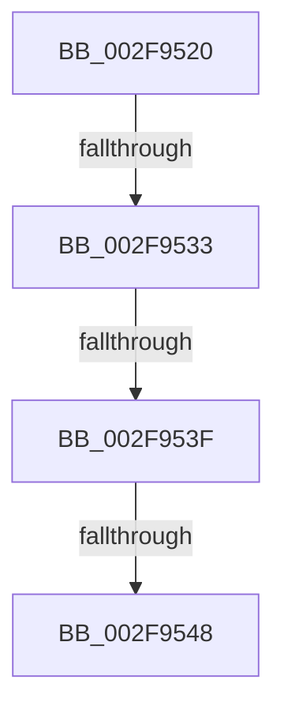

# ExQueueWorkItem

- RVA: `0x002F9520`–`0x002F955F` (길이 `63` bytes)
- VA: `0x00000001402F9520`
- 실행 섹션: `.text`
- PDB 이름 있음: `예`; PDB Function 태그: `아니요`
- unwind 정보 RVA: `0x00072848`
- 디코드: `14`개 명령, `63/63` bytes 표시
- 미해석 바이트: `0` (있으면 어셈블리에 `.byte`로 보존)

> 이 문서는 커널 이미지의 기계어와 PDB 기호를 분석해 생성했습니다. 4번과 5번은 함수 원형과 자료형을 바이너리 사용 방식에서 추정한 C 해석이며 원본 소스 복구 결과는 아닙니다.

## 1. Dependencies

- 직접 호출 지점: **0**; 고유 호출 대상: **0**
- 직접 호출자로 확인된 함수: **237**
- RIP 상대 이미지 참조: **0**

### Outgoing calls
- 직접 디코드된 call 명령이 없습니다.

### Direct callers
- [KiRcuFlushCompleted](../20/KiRcuFlushCompleted_function_0020AD38.md) at `0x0020AF07`
- [IoRaiseHardError](../22/IoRaiseHardError_function_002230D0.md) at `0x002231AB`
- [ExpCenturyDpcRoutine](../22/ExpCenturyDpcRoutine_function_00223520.md) at `0x00223604`
- [SepQueueWorkItem](../22/SepQueueWorkItem_function_00225844.md) at `0x002259A3`
- [IopReleaseFileObjectLock](../25/IopReleaseFileObjectLock_function_00250A90.md) at `0x00250EF9`
- [SMKM_STORE_MGR&lt;SM_TRAITS&gt;::SmFeEvictComplete](../26/SMKM_STORE_MGR_SM_TRAITS_SmFeEvictComplete_function_00266854.md) at `0x00266B30`
- [PopDequeueQuerySetIrp](../26/PopDequeueQuerySetIrp_function_0026EC34.md) at `0x0026ED86`
- [IopCompleteUnloadOrDelete](../27/IopCompleteUnloadOrDelete_function_00270BC8.md) at `0x00270E7E`
- [PopQueueQuerySetIrp](../2B/PopQueueQuerySetIrp_function_002BEF18.md) at `0x002BEFD8`
- [MiCheckLogPinDriverAddresses](../2D/MiCheckLogPinDriverAddresses_function_002DC318.md) at `0x002DC452`
- [ObfDereferenceObjectWithTag](ObfDereferenceObjectWithTag_function_002F78E0.md) at `0x002F7A4C`
- [ObfDereferenceObject](ObfDereferenceObject_function_002F9350.md) at `0x002F94E4`
- [NtTraceEvent](NtTraceEvent_function_002FA6C0.md) at `0x002FB1F5`
- [MmReportParkedProcessors](../30/MmReportParkedProcessors_function_00305600.md) at `0x003056D5`
- [PsDereferencePartition](../34/PsDereferencePartition_function_00342E70.md) at `0x00342EAE`
- [PfSnGetFileInformation](../34/PfSnGetFileInformation_function_00343210.md) at `0x00343743`
- [PfSnTraceGetLogEntry](../34/PfSnTraceGetLogEntry_function_003437A0.md) at `0x003438D8`
- [MiFreeCombineBlock](../37/MiFreeCombineBlock_function_00372000.md) at `0x00372169`
- [CmpWorkItemQueueWork](../37/CmpWorkItemQueueWork_function_00378D4C.md) at `0x00378D70`
- [IoWMIWriteEvent](../38/IoWMIWriteEvent_function_00386480.md) at `0x00386597`
- [WheapWorkQueueAddItem](../38/WheapWorkQueueAddItem_function_0038662C.md) at `0x00386671`
- [LZNT1DecompressChunkNewThread](../38/LZNT1DecompressChunkNewThread_function_0038F3F8.md) at `0x0038F4A5`
- [PspHardDereferenceSiloWorker](../38/PspHardDereferenceSiloWorker_function_0038F740.md) at `0x0038F79F`
- [PopDeepSleepSetDisengageReason](../38/PopDeepSleepSetDisengageReason_function_0038FEC4.md) at `0x0038FF78`
- [PopDeepSleepClearDisengageReason](../39/PopDeepSleepClearDisengageReason_function_0039010C.md) at `0x003901B5`
- [ObpDeferObjectDeletion](../3A/ObpDeferObjectDeletion_function_003A2394.md) at `0x003A23E4`
- [ExpHpGCTimerCallback](../3A/ExpHpGCTimerCallback_function_003A3040.md) at `0x003A308A`
- [EtwpTiAsyncVadQueryEventWrite](../3B/EtwpTiAsyncVadQueryEventWrite_function_003B9428.md) at `0x003B9566`
- [EtwpQueuePerfMemInfoWorkItem](../3B/EtwpQueuePerfMemInfoWorkItem_function_003B9C24.md) at `0x003B9C61`
- [PoLatencySensitivityHint](../3B/PoLatencySensitivityHint_function_003BE9B0.md) at `0x003BEAE3`
- [PpmCheckPeriodicStart](../3B/PpmCheckPeriodicStart_function_003BED70.md) at `0x003BEE07`
- [IoFreeAdapterChannelV3](../3D/IoFreeAdapterChannelV3_function_003DAA20.md) at `0x003DAA64`
- [IoIncrementKeepAliveCount](../42/IoIncrementKeepAliveCount_function_0042EAD0.md) at `0x0042EB92`
- [PopThermalCsEntry](../42/PopThermalCsEntry_function_0042FE14.md) at `0x0042FE65`
- [MiAgeAweRegions](../44/MiAgeAweRegions_function_004464A4.md) at `0x00446662`
- [SmKmStoreDeleteWhenEmpty](../45/SmKmStoreDeleteWhenEmpty_function_00450D50.md) at `0x00450E90`
- [EtwTelemetryCoverageReport](../46/EtwTelemetryCoverageReport_function_00460430.md) at `0x00460521`
- [CmpArmDelayedCloseTimer](../46/CmpArmDelayedCloseTimer_function_00462DD0.md) at `0x00462DEC`
- [MiIssueSegmentDereferenceWork](../46/MiIssueSegmentDereferenceWork_function_00464AB0.md) at `0x00464C4A`
- [IoReportTargetDeviceChangeAsynchronous](../47/IoReportTargetDeviceChangeAsynchronous_function_00475DA0.md) at `0x00475F46`
- [PopPowerRequestReferenceAcquire](../47/PopPowerRequestReferenceAcquire_function_004776C0.md) at `0x004777E4`
- [PopPowerRequestHandleRequestOverrideQueryResponse](../47/PopPowerRequestHandleRequestOverrideQueryResponse_function_004777FC.md) at `0x00477876`
- [PnpRequestDeviceAction](../47/PnpRequestDeviceAction_function_00477FF8.md) at `0x0047832B`
- [PoNotifyMediaBuffering](../48/PoNotifyMediaBuffering_function_00481FC0.md) at `0x00482028`
- [PopUserPresentSet](../48/PopUserPresentSet_function_00482B90.md) at `0x00482BEF`
- [PopCheckForWork](../48/PopCheckForWork_function_00482CAC.md) at `0x00482D07`
- [SshpWorkItemQueue](../48/SshpWorkItemQueue_function_00486B3C.md) at `0x00486B5C`
- [IoDecrementKeepAliveCount](../48/IoDecrementKeepAliveCount_function_004898E0.md) at `0x00489A3F`
- [PfSnTraceTimerRoutine](../48/PfSnTraceTimerRoutine_function_0048AEC0.md) at `0x0048AF7E`
- [PspRequestDeferredJobNotification](../49/PspRequestDeferredJobNotification_function_004938F8.md) at `0x00493958`
- [KiIdealProcessorRebalancerTimerCallback](../49/KiIdealProcessorRebalancerTimerCallback_function_004951C0.md) at `0x00495208`
- [IopQueueInvalidateBusRelationsRequest](../49/IopQueueInvalidateBusRelationsRequest_function_0049E28C.md) at `0x0049E3F6`
- [PopQueueWorkItem](../4A/PopQueueWorkItem_function_004A20F8.md) at `0x004A2110`
- [PnpUnlockDeviceActionQueue](../4A/PnpUnlockDeviceActionQueue_function_004A42F4.md) at `0x004A4342`
- [WheapWorkQueueDpcRoutine](../4A/WheapWorkQueueDpcRoutine_function_004A6BB0.md) at `0x004A6BBD`
- [HalpQueueMapBufferWorker](../4A/HalpQueueMapBufferWorker_function_004A7B38.md) at `0x004A7BD7`
- [PopBatteryQueueWork](../4A/PopBatteryQueueWork_function_004AE3DC.md) at `0x004AE409`
- [PopFxReinitializeAccountingInstance](../4B/PopFxReinitializeAccountingInstance_function_004B0960.md) at `0x004B09D8`
- [PopThermalIrpComplete](../4B/PopThermalIrpComplete_function_004B1E40.md) at `0x004B1E50`
- [PopBsdHandleRequest](../4B/PopBsdHandleRequest_function_004B27A0.md) at `0x004B27DD`
- [SmQueueExWorkItem](../4B/SmQueueExWorkItem_function_004B400C.md) at `0x004B4027`
- [PopIdleWakeNotifyModernStandbyExit](../4B/PopIdleWakeNotifyModernStandbyExit_function_004B4034.md) at `0x004B40B6`
- [IoWriteErrorLogEntry](../4B/IoWriteErrorLogEntry_function_004B5B30.md) at `0x004B5BEC`
- [ExpTimeRefreshDpcRoutine](../4B/ExpTimeRefreshDpcRoutine_function_004B8DC0.md) at `0x004B8ED1`
- [HalpGenericPolledDpcRoutine](../4B/HalpGenericPolledDpcRoutine_function_004BA330.md) at `0x004BA354`
- [WdipTimeoutTimerRoutine](../4B/WdipTimeoutTimerRoutine_function_004BA980.md) at `0x004BA990`
- [PopPowerRequestRevokeRequests](../4C/PopPowerRequestRevokeRequests_function_004C0158.md) at `0x004C0213`
- [PopEnsureCoalescingWorkerWillRun](../4C/PopEnsureCoalescingWorkerWillRun_function_004C266C.md) at `0x004C2694`
- [TlgAggregateInternalFlushTimerCallbackKernelMode](../4C/TlgAggregateInternalFlushTimerCallbackKernelMode_function_004C4240.md) at `0x004C425B`
- [HalpCmcDeferredRoutine](../4C/HalpCmcDeferredRoutine_function_004C6880.md) at `0x004C68A7`
- [PpmHeteroHgsUpdateDpcRoutine](../4C/PpmHeteroHgsUpdateDpcRoutine_function_004C6FD0.md) at `0x004C6FE0`
- [PopWakeInfoDereference](../4C/PopWakeInfoDereference_function_004C74AC.md) at `0x004C74E2`
- [PopSleepstudyScenarioStopTimerCallback](../4C/PopSleepstudyScenarioStopTimerCallback_function_004CD070.md) at `0x004CD080`
- [CcTelemetryPeriodicTimerDpc](../4C/CcTelemetryPeriodicTimerDpc_function_004CDEB0.md) at `0x004CDEDF`
- [PiDrvDbUnloadNodeDpcRoutine](../4C/PiDrvDbUnloadNodeDpcRoutine_function_004CFF40.md) at `0x004CFF84`
- [MiWakeFileOnlyReaper](../4D/MiWakeFileOnlyReaper_function_004D1D00.md) at `0x004D1D3A`
- [PopFanIrpComplete](../4D/PopFanIrpComplete_function_004D2330.md) at `0x004D2340`
- [IopCopyCompleteReadIrp](../4E/IopCopyCompleteReadIrp_function_004E83F0.md) at `0x004E86E5`
- [IopLoadDriverImage](../4F/IopLoadDriverImage_function_004FA0FC.md) at `0x004FA2C6`
- [KiAvailableCpusSubscriptionQueueWorkItem](../4F/KiAvailableCpusSubscriptionQueueWorkItem_function_004FCE5C.md) at `0x004FCE82`
- [CcBcbProfiler](../50/CcBcbProfiler_function_005099B0.md) at `0x005099E9`
- [HalpPmuArbiterPeriodicTimerCallback](../54/HalpPmuArbiterPeriodicTimerCallback_function_00547540.md) at `0x0054755C`
- [HalpBlkWdTimerRoutine](../56/HalpBlkWdTimerRoutine_function_0056E7D0.md) at `0x0056E7F5`
- [CcSetupWatchForRegistryChanges](../57/CcSetupWatchForRegistryChanges_function_0057CE10.md) at `0x0057CFB0`
- [CcQueueAsyncGetDeviceGuid](../57/CcQueueAsyncGetDeviceGuid_function_0057EE74.md) at `0x0057EED6`
- [EmpQueueRuleUpdateState](../58/EmpQueueRuleUpdateState_function_005809B0.md) at `0x00580A7D`
- [FsRtlpOplockAckTimeoutDpc](../58/FsRtlpOplockAckTimeoutDpc_function_00582920.md) at `0x00582930`
- [HvlpInitializeSvmIommuSupport](../58/HvlpInitializeSvmIommuSupport_function_0058C188.md) at `0x0058C247`
- [HvlpIommuPrqDpcRoutine](../58/HvlpIommuPrqDpcRoutine_function_0058C280.md) at `0x0058C294`
- [IopErrorLogDpc](../5A/IopErrorLogDpc_function_005A3AA0.md) at `0x005A3ADA`
- [IoRequestDeviceEjectEx](../5A/IoRequestDeviceEjectEx_function_005A59D0.md) at `0x005A5AE2`
- [IopDeviceEjectComplete](../5A/IopDeviceEjectComplete_function_005AA4E0.md) at `0x005AA512`
- [KeBalanceSetManager](../5C/KeBalanceSetManager_function_005C5B30.md) at `0x005C5C0D`
- [KeBalanceSetManager](../5C/KeBalanceSetManager_function_005C5B30.md) at `0x005C5D06`
- [KeBalanceSetManager](../5C/KeBalanceSetManager_function_005C5B30.md) at `0x005C5D60`
- [KiScheduleBugcheckRecoveryWorkItem](../5C/KiScheduleBugcheckRecoveryWorkItem_function_005C7BE0.md) at `0x005C7C37`
- [KiLogUserCetSetContextIpValidationFailure](../5C/KiLogUserCetSetContextIpValidationFailure_function_005C830C.md) at `0x005C83D0`
- [KiAltContextWorkQueueAddItem](../5C/KiAltContextWorkQueueAddItem_function_005CB028.md) at `0x005CB0EB`
- [KiAltReturnDpcRoutine](../5C/KiAltReturnDpcRoutine_function_005CB110.md) at `0x005CB11D`
- [ObpProcessRemoveObjectDpcWorker](../5C/ObpProcessRemoveObjectDpcWorker_function_005CD9C0.md) at `0x005CD9CD`
- [ObpDeferPushRefDerefInfo](../5C/ObpDeferPushRefDerefInfo_function_005CD9E0.md) at `0x005CDABF`
- [PfpPowerActionDpcRoutine](../5C/PfpPowerActionDpcRoutine_function_005CDAE0.md) at `0x005CDB4C`
- [PfSnPowerBoostDpc](../5C/PfSnPowerBoostDpc_function_005CE190.md) at `0x005CE19D`
- [PopPowerActionWatchdog](../5D/PopPowerActionWatchdog_function_005D51A0.md) at `0x005D51DA`
- [PopPowerAggregatorDozeTimerCallback](../5D/PopPowerAggregatorDozeTimerCallback_function_005D9170.md) at `0x005D918D`
- [PopPowerAggregatorSessionSwitchTimerCallback](../5D/PopPowerAggregatorSessionSwitchTimerCallback_function_005D92C0.md) at `0x005D92D0`
- [PopBatteryWakeDpc](../5D/PopBatteryWakeDpc_function_005D9550.md) at `0x005D95A0`
- [PpmWmiIdleAccountingProcedure](../5D/PpmWmiIdleAccountingProcedure_function_005D97B0.md) at `0x005D97E7`
- [PopIdleAoAcDozeS4TimerCallback](../5D/PopIdleAoAcDozeS4TimerCallback_function_005D9840.md) at `0x005D9899`
- [PopWatchdogDpc](../5D/PopWatchdogDpc_function_005DA160.md) at `0x005DA1CD`
- [SshpAlpcOpenGracePeriodTimerCallback](../5E/SshpAlpcOpenGracePeriodTimerCallback_function_005E20D0.md) at `0x005E20EE`
- [TtmpScheduledEvaluationDpc](../5E/TtmpScheduledEvaluationDpc_function_005E2100.md) at `0x005E2120`
- [TtmpTerminalInactivityTimerDpcRoutine](../5E/TtmpTerminalInactivityTimerDpcRoutine_function_005E2140.md) at `0x005E2160`
- [PspEnqueueProcessQosChangeNotification](../5E/PspEnqueueProcessQosChangeNotification_function_005E2ED0.md) at `0x005E2F8B`
- [SepAuditFailedRaisedIrql](../60/SepAuditFailedRaisedIrql_function_0060B894.md) at `0x0060B8DC`
- [SMKM_STORE_MGR&lt;SM_TRAITS&gt;::SmStoreTerminate](../61/SMKM_STORE_MGR_SM_TRAITS_SmStoreTerminate_function_00610BD4.md) at `0x00610C8C`
- [CarWriteLivedump](../61/CarWriteLivedump_function_0061BD24.md) at `0x0061BDD5`
- [EtwpContainerStateWnfCallback](../64/EtwpContainerStateWnfCallback_function_0064E790.md) at `0x0064E7EB`
- [EtwpCoverageFlushTimerCallback](../65/EtwpCoverageFlushTimerCallback_function_00651AD0.md) at `0x00651AEE`
- [EtwpCoverageResetTimerCallback](../65/EtwpCoverageResetTimerCallback_function_00651D60.md) at `0x00651D7E`
- [EtwpCompressionDpc](../65/EtwpCompressionDpc_function_00653290.md) at `0x006532E2`
- [ExpNextYearDpcRoutine](../65/ExpNextYearDpcRoutine_function_006555A0.md) at `0x006555E7`
- [ExpTimeZoneDpcRoutine](../65/ExpTimeZoneDpcRoutine_function_00655710.md) at `0x0065581E`
- [ExpTrackRaiseLimitNotification](../65/ExpTrackRaiseLimitNotification_function_00657264.md) at `0x006572BC`
- [ExpDebuggerDpcRoutine](../65/ExpDebuggerDpcRoutine_function_0065A390.md) at `0x0065A3A0`
- [ExpNodeHotAddProcessor](../65/ExpNodeHotAddProcessor_function_0065A664.md) at `0x0065A699`
- [ExpSvmDpcRoutine](../65/ExpSvmDpcRoutine_function_0065BD70.md) at `0x0065BD86`
- [WheapDeferredRecoveryServiceDpcRoutine](../66/WheapDeferredRecoveryServiceDpcRoutine_function_006601C0.md) at `0x00660276`
- [WheaFlushETWEventsAddWorkRtn](../66/WheaFlushETWEventsAddWorkRtn_function_0066031C.md) at `0x006603CF`
- [WheaFlushETWEventsDpcRoutine](../66/WheaFlushETWEventsDpcRoutine_function_006603F0.md) at `0x00660400`
- [CmpFreezeThawDpcRoutine](../66/CmpFreezeThawDpcRoutine_function_0066ABD0.md) at `0x0066ABEC`
- [CmpLazyCommitDpcRoutine](../66/CmpLazyCommitDpcRoutine_function_0066ADC0.md) at `0x0066ADD9`
- [CmpDelayFreeRMDpcRoutine](../66/CmpDelayFreeRMDpcRoutine_function_0066AF00.md) at `0x0066AF10`
- [CmFcpUsageProviderQueueWork](../66/CmFcpUsageProviderQueueWork_function_0066B46C.md) at `0x0066B4A5`
- [MiReAcquireOutSwappedProcessCommit](../66/MiReAcquireOutSwappedProcessCommit_function_0066F598.md) at `0x0066F75C`
- [MiNotifyUserOfLostData](../67/MiNotifyUserOfLostData_function_00678280.md) at `0x00678332`
- [MiPageNotZero](../67/MiPageNotZero_function_00679DAC.md) at `0x00679F22`
- [MiRemovePendingBadPageNode](../67/MiRemovePendingBadPageNode_function_0067A0DC.md) at `0x0067A1A9`
- [MiNoPagesLastChance](../68/MiNoPagesLastChance_function_0068B22C.md) at `0x0068B5E8`
- [WdtpTimerCallback](../6A/WdtpTimerCallback_function_006A31B0.md) at `0x006A31FB`
- [CcSetupWatchForRegistryChanges$fin$0](../6D/CcSetupWatchForRegistryChanges_fin_0_function_006D50C4.md) at `0x006D5125`
- [sub_006D678E](../6D/Unknown_function_006D678E.md) at `0x006D6809`
- [sub_006DB2D0](../6D/Unknown_function_006DB2D0.md) at `0x006DB31F`
- [sub_006DDD7C](../6D/Unknown_function_006DDD7C.md) at `0x006DDDCD`
- [sub_006E5110](../6E/Unknown_function_006E5110.md) at `0x006E531F`
- [sub_006E7CBA](../6E/Unknown_function_006E7CBA.md) at `0x006E7D56`
- [sub_006F7680](../6F/Unknown_function_006F7680.md) at `0x006F76BF`
- [sub_006F88AE](../6F/Unknown_function_006F88AE.md) at `0x006F8F39`
- [sub_006FBF78](../6F/Unknown_function_006FBF78.md) at `0x006FC093`
- [PopAdaptiveStandbyHandleBatteryUpdate](../../page/6F/PopAdaptiveStandbyHandleBatteryUpdate_function_006FD39C.md) at `0x006FD764`
- [PopPdcRegister](../../page/70/PopPdcRegister_function_00704AD0.md) at `0x00704CB8`
- [DbgkQueueUserExceptionReport](../../page/71/DbgkQueueUserExceptionReport_function_00710B04.md) at `0x00710C96`
- [DbgkpWerStartDeferredLiveDump](../../page/71/DbgkpWerStartDeferredLiveDump_function_007125D0.md) at `0x0071264C`
- [EmRemoveBadS3PagesCallback](../../page/71/EmRemoveBadS3PagesCallback_function_007135B0.md) at `0x007135F8`
- [PipUpdateSetupOobeCompleteWnfCallback](../../page/72/PipUpdateSetupOobeCompleteWnfCallback_function_007239C0.md) at `0x00723A2F`
- [PnpBootPhaseComplete](../../page/72/PnpBootPhaseComplete_function_00723A44.md) at `0x00723B72`
- [IoReplacePartitionUnit](../../page/72/IoReplacePartitionUnit_function_00727FD0.md) at `0x00728067`
- [PiDqObjectManagerMakeInconsistent](../../page/73/PiDqObjectManagerMakeInconsistent_function_00731A98.md) at `0x00731B09`
- [PiProfileUpdateDeviceTree](../../page/73/PiProfileUpdateDeviceTree_function_007375D8.md) at `0x0073760C`
- [IopEjectDevice](../../page/73/IopEjectDevice_function_0073DC84.md) at `0x0073DCF0`
- [IopEjectDevice](../../page/73/IopEjectDevice_function_0073DC84.md) at `0x0073DD7C`
- [PopFxNotifySxTransitionState](../../page/75/PopFxNotifySxTransitionState_function_007593B0.md) at `0x007594A1`
- [PopThermalZoneAdd](../../page/75/PopThermalZoneAdd_function_0075F980.md) at `0x0075FAB1`
- [PopPowerAggregatorModernStandbyEnterStateHandler](../../page/76/PopPowerAggregatorModernStandbyEnterStateHandler_function_00764C10.md) at `0x00764C3E`
- [PopFanAdd](../../page/76/PopFanAdd_function_007690D0.md) at `0x0076913F`
- [PopAdaptiveConsoleSessionOverrideClear](../../page/76/PopAdaptiveConsoleSessionOverrideClear_function_0076B5EC.md) at `0x0076B633`
- [PopCadHpmiPnpNotification](../../page/76/PopCadHpmiPnpNotification_function_0076FEF0.md) at `0x0076FF63`
- [PopCadNotifyBatteryPresence](../../page/76/PopCadNotifyBatteryPresence_function_0076FF78.md) at `0x0076FFA7`
- [TtmiScheduleSessionWorker](../../page/77/TtmiScheduleSessionWorker_function_00777184.md) at `0x007771A8`
- [PspCompleteServerSiloShutdown](../../page/77/PspCompleteServerSiloShutdown_function_0077F808.md) at `0x0077F849`
- [PspQueueDeferredWorkAndWait](../../page/78/PspQueueDeferredWorkAndWait_function_00780148.md) at `0x007801DB`
- [PsSetVmProcessorHostProcess](../../page/78/PsSetVmProcessorHostProcess_function_00783CEC.md) at `0x00783DB7`
- [RtlpCtQueueWorkItem](../../page/79/RtlpCtQueueWorkItem_function_00794A68.md) at `0x00794A71`
- [SepInformFileSystemsOfDeletedLogon](../../page/7A/SepInformFileSystemsOfDeletedLogon_function_007A16F0.md) at `0x007A1758`
- [VmPrefetchVirtualAddresses](../../page/7A/VmPrefetchVirtualAddresses_function_007ACE98.md) at `0x007ACF72`
- [WdipSemStartTimeoutCheck](../../page/7B/WdipSemStartTimeoutCheck_function_007B13B0.md) at `0x007B1421`
- [PeriodicCaptureStateTimerCallback](../../page/7B/PeriodicCaptureStateTimerCallback_function_007BCEC0.md) at `0x007BCEFB`
- [ExpNodeHotAddProcessorWorker](../../page/7C/ExpNodeHotAddProcessorWorker_function_007CF820.md) at `0x007CF888`
- [WheaAttemptClearPoison](../../page/7D/WheaAttemptClearPoison_function_007D72A0.md) at `0x007D7329`
- [WheaAttemptPhysicalPageOffline](../../page/7D/WheaAttemptPhysicalPageOffline_function_007D7380.md) at `0x007D7421`
- [CmpDoQueueSystemHiveHysteresis](../../page/7E/CmpDoQueueSystemHiveHysteresis_function_007E224C.md) at `0x007E228D`
- [CmpDiskFullWarning](../../page/7E/CmpDiskFullWarning_function_007E59E0.md) at `0x007E5A42`
- [MiUnmapPfns](../../page/7F/MiUnmapPfns_function_007FB0A0.md) at `0x007FB13F`
- [CmpSignalDeferredPosts](../../page/84/CmpSignalDeferredPosts_function_008484B0.md) at `0x00848529`
- [CmpDoQueueLateUnloadWorker](../../page/84/CmpDoQueueLateUnloadWorker_function_0084FB18.md) at `0x0084FBB2`
- [CmpPerformCompleteKcbCacheLookup](../../page/84/CmpPerformCompleteKcbCacheLookup_function_0084FD20.md) at `0x00850839`
- [CmpPerformCompleteKcbCacheLookup](../../page/84/CmpPerformCompleteKcbCacheLookup_function_0084FD20.md) at `0x00851164`
- [sub_00851966](../../page/85/Unknown_function_00851966.md) at `0x00851A52`
- [sub_00865C6D](../../page/86/Unknown_function_00865C6D.md) at `0x00865CE6`
- [sub_0087F31F](../../page/87/Unknown_function_0087F31F.md) at `0x0087F360`
- [PfSnEndProcessTrace](../../page/90/PfSnEndProcessTrace_function_00903E04.md) at `0x00903EE1`
- [ExpWnfNotifyNameSubscribers](../../page/90/ExpWnfNotifyNameSubscribers_function_0090C160.md) at `0x0090C36E`
- [PopPowerAggregatorScheduleWorker](../../page/91/PopPowerAggregatorScheduleWorker_function_00912B9C.md) at `0x00912BC6`
- [PiDrvDbLoadNode](../../page/93/PiDrvDbLoadNode_function_00931AB0.md) at `0x00931BEA`
- [PfSnPrefetchSections](../../page/93/PfSnPrefetchSections_function_0093BCF4.md) at `0x0093BE44`
- [PfSnPrefetchSectionsCleanup](../../page/93/PfSnPrefetchSectionsCleanup_function_0093C0B0.md) at `0x0093C162`
- [PnpInsertEventInQueue](../../page/95/PnpInsertEventInQueue_function_00951B78.md) at `0x00951D3C`
- [PiUEventNotifyUserMode](../../page/95/PiUEventNotifyUserMode_function_00954CB4.md) at `0x00954FEF`
- [PfSnPrefetchScenario](../../page/96/PfSnPrefetchScenario_function_00961080.md) at `0x0096111E`
- [PiUEventQueueBroadcastEventEntry](../../page/9C/PiUEventQueueBroadcastEventEntry_function_009C3F44.md) at `0x009C3FE4`
- [ExpWnfStartKernelDispatcher](../../page/9D/ExpWnfStartKernelDispatcher_function_009D5AF8.md) at `0x009D5B31`
- [WmipQueueRegWork](../../page/9E/WmipQueueRegWork_function_009E2AC4.md) at `0x009E2B96`
- [WmipQueueLegacyEtwWork](../../page/9E/WmipQueueLegacyEtwWork_function_009E33DC.md) at `0x009E3459`
- [WmipLegacyEtwCallback](../../page/9E/WmipLegacyEtwCallback_function_009E3480.md) at `0x009E35BC`
- [PspRundownProcess](../../page/9F/PspRundownProcess_function_009F65CC.md) at `0x009F6621`
- [PopDiagTraceControlCallback](../../page/A3/PopDiagTraceControlCallback_function_00A38CB0.md) at `0x00A38DE3`
- [PiDqObjectManagerHandleObjectEvent](../../page/A4/PiDqObjectManagerHandleObjectEvent_function_00A4402C.md) at `0x00A440CE`
- [PopEsWorkItemSchedule](../../page/A4/PopEsWorkItemSchedule_function_00A4A5DC.md) at `0x00A4A611`
- [PspScheduleEnforcementWorker](../../page/A6/PspScheduleEnforcementWorker_function_00A60158.md) at `0x00A60193`
- [CmpForceFlushForCoalescing](../../page/A6/CmpForceFlushForCoalescing_function_00A636F0.md) at `0x00A6372E`
- [NtNotifyChangeSession](../../page/A7/NtNotifyChangeSession_function_00A7E630.md) at `0x00A7E95E`
- [EtwpCrimsonProvEnableCallback](../../page/A8/EtwpCrimsonProvEnableCallback_function_00A80540.md) at `0x00A80652`
- [SepScheduleImageVerificationCallbacks](../../page/AA/SepScheduleImageVerificationCallbacks_function_00AA50A8.md) at `0x00AA510E`
- [PerfDiagpRequestState](../../page/AA/PerfDiagpRequestState_function_00AA6CAC.md) at `0x00AA6CF7`
- [PspPostFreezeOperationWorkEnqueue](../../page/AA/PspPostFreezeOperationWorkEnqueue_function_00AA6DFC.md) at `0x00AA6EF2`
- [PiDrvDbUnloadNodeWorkerCallback](../../page/AA/PiDrvDbUnloadNodeWorkerCallback_function_00AAE570.md) at `0x00AAE61B`
- [IopUnloadDriver](../../page/AB/IopUnloadDriver_function_00ABF868.md) at `0x00ABFC2F`
- [IopSendMessageToTrackService](../../page/AC/IopSendMessageToTrackService_function_00AC0E5C.md) at `0x00AC0F40`
- [ExpWorkQueueManagerThread](../../page/AF/ExpWorkQueueManagerThread_function_00AF6D60.md) at `0x00AF6FF8`
- [sub_00B168E2](../../page/B1/Unknown_function_00B168E2.md) at `0x00B1693A`
- [sub_00B33662](../../page/B3/Unknown_function_00B33662.md) at `0x00B33693`
- [sub_00B38858](../../page/B3/Unknown_function_00B38858.md) at `0x00B388E1`
- [sub_00B3E114](../../page/B3/Unknown_function_00B3E114.md) at `0x00B3E160`
- [sub_00B3E246](../../page/B3/Unknown_function_00B3E246.md) at `0x00B3E299`
- [sub_00B451A2](../../page/B4/Unknown_function_00B451A2.md) at `0x00B4520A`
- [PnprInitiateReplaceOperation](../../pagelk/B6/PnprInitiateReplaceOperation_function_00B64034.md) at `0x00B64142`
- [MiZeroAllPageFiles](../../pagelk/B7/MiZeroAllPageFiles_function_00B73B2C.md) at `0x00B73CCF`
- [MmDuplicateMemory](../../pagelk/B7/MmDuplicateMemory_function_00B74158.md) at `0x00B744CD`
- [PopTransitionSystemPowerStateEx](../../pagelk/B7/PopTransitionSystemPowerStateEx_function_00B7E8C0.md) at `0x00B7EA42`
- [PopTransitionSystemPowerStateEx](../../pagelk/B7/PopTransitionSystemPowerStateEx_function_00B7E8C0.md) at `0x00B7EAA3`
- [PopTransitionSystemPowerStateEx](../../pagelk/B7/PopTransitionSystemPowerStateEx_function_00B7E8C0.md) at `0x00B7F8E5`
- [PopTransitionSystemPowerStateEx](../../pagelk/B7/PopTransitionSystemPowerStateEx_function_00B7E8C0.md) at `0x00B7FB4C`
- [KdpTimeSlipDpcRoutine](../../pagekd/B8/KdpTimeSlipDpcRoutine_function_00B88610.md) at `0x00B88630`
- [IovpUnloadDriver](../../pagevrfy/B9/IovpUnloadDriver_function_00B92AE8.md) at `0x00B92BBF`
- [VfIrpLogRecordEvent](../../pagevrfy/BA/VfIrpLogRecordEvent_function_00BAB674.md) at `0x00BAB706`
- [LogFwReport](../../pagebgfx/BC/LogFwReport_function_00BC43FC.md) at `0x00BC44CF`
- [sub_00BE60B0](../../initkdbg/BE/Unknown_function_00BE60B0.md) at `0x00BE6C3F`
- [sub_00BE60B0](../../initkdbg/BE/Unknown_function_00BE60B0.md) at `0x00BE723B`
- [sub_00BE60B0](../../initkdbg/BE/Unknown_function_00BE60B0.md) at `0x00BE75FF`
- [sub_00BE60B0](../../initkdbg/BE/Unknown_function_00BE60B0.md) at `0x00BE7A55`
- [sub_00BEFF8C](../../init/BE/Unknown_function_00BEFF8C.md) at `0x00BF0D7D`
- [HalpAcpiDetectPiix4](../../init/C1/HalpAcpiDetectPiix4_function_00C1F9E0.md) at `0x00C1FA3F`
- [HalpAcpiPopulateTableCache](../../init/C1/HalpAcpiPopulateTableCache_function_00C1FA88.md) at `0x00C1FAE7`
- [FsRtlInitializeSmssEvent](../../init/C2/FsRtlInitializeSmssEvent_function_00C29030.md) at `0x00C2910A`
- [IoInitSystemPreDrivers](../../init/C2/IoInitSystemPreDrivers_function_00C2AC3C.md) at `0x00C2B774`
- [WmipInitializeRegistration](../../init/C4/WmipInitializeRegistration_function_00C4D32C.md) at `0x00C4D3AF`
- [MiInitSystem](../../init/C5/MiInitSystem_function_00C5E6C0.md) at `0x00C5EC82`

### Static image references
- 디코드된 RIP-relative 메모리 참조가 없습니다.

## 2. Other-region calls and transfers

- 다른 실행 섹션으로 향하는 call: **0**
- call이 아닌 외부 분기/꼬리 이동: **4**
  - `0x002F952D` → [sub_002F95CB](Unknown_function_002F95CB.md) (`tail-transfer`)
  - `0x002F9539` → [sub_002F95CB + 0x33](Unknown_function_002F95CB.md) (`tail-transfer`)
  - `0x002F9542` → [sub_002F95CB + 0x33](Unknown_function_002F95CB.md) (`tail-transfer`)
  - `0x002F9559` → [sub_002F95CB + 0x1B](Unknown_function_002F95CB.md) (`tail-transfer`)

## 3. Assembly (complete function range)

```asm
002F9520  40 53                           push rbx
002F9522  48 83 EC 30                     sub rsp, 0x30
002F9526  48 83 39 00                     cmp qword ptr [rcx], 0
002F952A  48 8B D9                        mov rbx, rcx
002F952D  0F 85 98 00 00 00               jne 0x1402f95cb
002F9533  8D 42 F9                        lea eax, [rdx - 7]
002F9536  83 F8 18                        cmp eax, 0x18
002F9539  0F 86 BF 00 00 00               jbe 0x1402f95fe
002F953F  83 FA 40                        cmp edx, 0x40
002F9542  0F 8D B6 00 00 00               jge 0x1402f95fe
002F9548  4C 8B 49 10                     mov r9, qword ptr [rcx + 0x10]
002F954C  48 B8 00 00 00 00 00 80 FF FF   movabs rax, 0xffff800000000000
002F9556  4C 3B C8                        cmp r9, rax
002F9559  0F 82 87 00 00 00               jb 0x1402f95e6
```

## 4. C-style interpretation (structured pseudocode)

```c
__int64 __fastcall ExQueueWorkItem(__int64 a1, __int64 a2)
{
    __int64 v_rsp;

    v_rsp = (v_rsp) - (48);
}
```

## 5. (Beta) C Style

```c
int64_t ExQueueWorkItem(void *Arg1, void *Arg2)
{
    uint8_t *arg1 = (uint8_t *)Arg1;
    uint8_t *arg2 = (uint8_t *)Arg2;

    int64_t local_rsp;

    local_rsp = (local_rsp) - (48);
}
```

### 관측된 메모리 오프셋

구조체 형식이 확인되지 않은 접근은 인자 기준의 오프셋으로만 기록했습니다.

| 기준 인자 | 오프셋 표현 | 폭 (bit) | 접근 |
|---|---:|---:|---|
| `Arg1` | `+ 0x0` | `64` | `R` |
| `Arg1` | `+ 0x10` | `64` | `R` |
| `Arg2` | `- 0x7` | `32` | `R` |

## 6. Execution-region graph

[열기: 2D/3D 그래프와 함수 탐색 컨트롤 패널](../../../control-panel.html?section=text&rva=0x002F9520&view=graph)

- 2D 그래프는 위에서 아래로 흐르고, 3D 그래프는 빈 공간을 드래그해 회전합니다. Shift+드래그는 이동, 휠은 확대·축소, 함수 노드 선택은 대상 보고서 이동입니다.

### Static fallback


