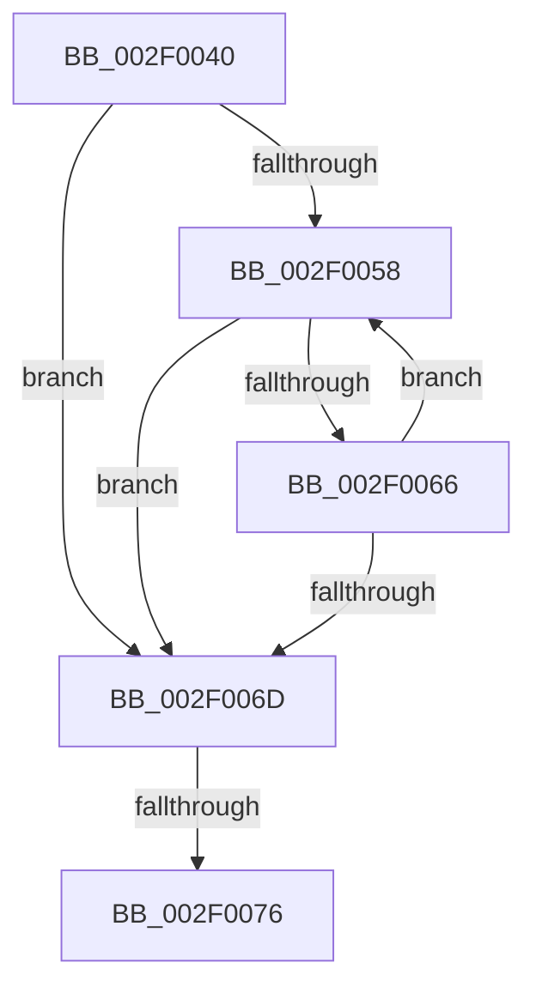

# ExReferenceCallBackBlock

- RVA: `0x002F0040`–`0x002F0082` (길이 `66` bytes)
- VA: `0x00000001402F0040`
- 실행 섹션: `.text`
- PDB 이름 있음: `예`; PDB Function 태그: `아니요`
- unwind 정보 RVA: `0x00071B70`
- 디코드: `20`개 명령, `66/66` bytes 표시
- 미해석 바이트: `0` (있으면 어셈블리에 `.byte`로 보존)

> 이 문서는 커널 이미지의 기계어와 PDB 기호를 분석해 생성했습니다. 4번과 5번은 함수 원형과 자료형을 바이너리 사용 방식에서 추정한 C 해석이며 원본 소스 복구 결과는 아닙니다.

## 1. Dependencies

- 직접 호출 지점: **0**; 고유 호출 대상: **0**
- 직접 호출자로 확인된 함수: **20**
- RIP 상대 이미지 참조: **0**

### Outgoing calls
- 직접 디코드된 call 명령이 없습니다.

### Direct callers
- [IoBoostThreadIoPriority](../21/IoBoostThreadIoPriority_function_00216110.md) at `0x00216216`
- [PoIssueCoalescingNotification](../44/PoIssueCoalescingNotification_function_0044D670.md) at `0x0044D6C4`
- [KiEnumerateCallback](../4D/KiEnumerateCallback_function_004DFE00.md) at `0x004DFE2B`
- [IoUnregisterPriorityCallback](../59/IoUnregisterPriorityCallback_function_00597D40.md) at `0x00597D93`
- [KeDeregisterBoundCallback](../5B/KeDeregisterBoundCallback_function_005B1770.md) at `0x005B17A4`
- [KiHandleBound](../5B/KiHandleBound_function_005B1FB0.md) at `0x005B1FD4`
- [DbgkLkmdRegisterCallback](../../page/71/DbgkLkmdRegisterCallback_function_00711570.md) at `0x007115BF`
- [DbgkLkmdUnregisterCallback](../../page/71/DbgkLkmdUnregisterCallback_function_00711660.md) at `0x00711691`
- [DbgkpLkmdFireCallbacks](../../page/71/DbgkpLkmdFireCallbacks_function_00711708.md) at `0x00711770`
- [PoUnregisterCoalescingCallback](../../page/75/PoUnregisterCoalescingCallback_function_0075C000.md) at `0x0075C02F`
- [PspInitializeThunkContext](../../page/8D/PspInitializeThunkContext_function_008D5418.md) at `0x008D5551`
- [sub_008D6C29](../../page/8D/Unknown_function_008D6C29.md) at `0x008D6D13`
- [KeUserModeCallback](../../page/8E/KeUserModeCallback_function_008E8A00.md) at `0x008E8D3C`
- [PspCallProcessNotifyRoutines](../../page/90/PspCallProcessNotifyRoutines_function_00904928.md) at `0x00904A40`
- [ExCallCallBack](../../page/90/ExCallCallBack_function_009054B4.md) at `0x009054D1`
- [PspCallThreadNotifyRoutines](../../page/90/PspCallThreadNotifyRoutines_function_00905530.md) at `0x0090559A`
- [PspCallThreadNotifyRoutines](../../page/90/PspCallThreadNotifyRoutines_function_00905530.md) at `0x0090560B`
- [PspCallThreadNotifyRoutines](../../page/90/PspCallThreadNotifyRoutines_function_00905530.md) at `0x00905675`
- [sub_009133FC](../../page/91/Unknown_function_009133FC.md) at `0x00913411`
- [PsRemoveCreateThreadNotifyRoutine](../../page/AA/PsRemoveCreateThreadNotifyRoutine_function_00AA3870.md) at `0x00AA38BA`
- [PspSetCreateProcessNotifyRoutine](../../page/AA/PspSetCreateProcessNotifyRoutine_function_00AA75EC.md) at `0x00AA764D`
- [PsRemoveLoadImageNotifyRoutine](../../page/AC/PsRemoveLoadImageNotifyRoutine_function_00AC30F0.md) at `0x00AC3136`

### Static image references
- 디코드된 RIP-relative 메모리 참조가 없습니다.

## 2. Other-region calls and transfers

- 다른 실행 섹션으로 향하는 call: **0**
- call이 아닌 외부 분기/꼬리 이동: **2**
  - `0x002F0070` → [sub_002F0118](Unknown_function_002F0118.md) (`tail-transfer`)
  - `0x002F007C` → [sub_002F016E](Unknown_function_002F016E.md) (`tail-transfer`)

## 3. Assembly (complete function range)

```asm
002F0040  48 89 5C 24 10                  mov qword ptr [rsp + 0x10], rbx
002F0045  57                              push rdi
002F0046  48 83 EC 20                     sub rsp, 0x20
002F004A  48 8B F9                        mov rdi, rcx
002F004D  0F 0D 09                        prefetchw byte ptr [rcx]
002F0050  48 8B 19                        mov rbx, qword ptr [rcx]
002F0053  F6 C3 0F                        test bl, 0xf
002F0056  74 15                           je 0x1402f006d
002F0058  48 8D 53 FF                     lea rdx, [rbx - 1]
002F005C  48 8B C3                        mov rax, rbx
002F005F  F0 48 0F B1 11                  lock cmpxchg qword ptr [rcx], rdx
002F0064  74 07                           je 0x1402f006d
002F0066  48 8B D8                        mov rbx, rax
002F0069  A8 0F                           test al, 0xf
002F006B  75 EB                           jne 0x1402f0058
002F006D  48 85 DB                        test rbx, rbx
002F0070  0F 84 A2 00 00 00               je 0x1402f0118
002F0076  48 8B C3                        mov rax, rbx
002F0079  83 E0 0F                        and eax, 0xf
002F007C  0F 85 EC 00 00 00               jne 0x1402f016e
```

## 4. C-style interpretation (structured pseudocode)

```c
__int64 __fastcall ExReferenceCallBackBlock(__int64 a1)
{
    __int64 result;
    __int64 v_rsp;
    unsigned __int64 v_stack_p10;

    v_stack_p10 = v_rbx;
    v_rsp = (v_rsp) - (32);
    if ((((unsigned __int8)(*(unsigned __int64 *)(a1))) & (15)) == 0) goto loc_002F006D;
loc_002F0058:
    if ((((unsigned __int8)(*(unsigned __int64 *)(a1))) & (15)) == 0) goto loc_002F006D;
    if ((((unsigned __int8)(*(unsigned __int64 *)(a1))) & (15)) != 0) goto loc_002F0058;
loc_002F006D:
    result = (unsigned int)((*(unsigned __int64 *)(a1)) & (15));
}
```

## 5. (Beta) C Style

```c
int64_t ExReferenceCallBackBlock(void *Arg1)
{
    uint8_t *arg1 = (uint8_t *)Arg1;

    int64_t result;
    int64_t local_rsp;
    uint64_t v_stack_p10;

    v_stack_p10 = local_rbx;
    local_rsp = (local_rsp) - (32);
    if ((((uint8_t)(*(uint64_t *)(arg1))) & (15)) == 0) goto loc_002F006D;
loc_002F0058:
    if ((((uint8_t)(*(uint64_t *)(arg1))) & (15)) == 0) goto loc_002F006D;
    if ((((uint8_t)(*(uint64_t *)(arg1))) & (15)) != 0) goto loc_002F0058;
loc_002F006D:
    result = (uint32_t)((*(uint64_t *)(arg1)) & (15));
}
```

### 관측된 메모리 오프셋

구조체 형식이 확인되지 않은 접근은 인자 기준의 오프셋으로만 기록했습니다.

| 기준 인자 | 오프셋 표현 | 폭 (bit) | 접근 |
|---|---:|---:|---|
| `Arg1` | `+ 0x0` | `8` | `R` |
| `Arg1` | `+ 0x0` | `64` | `R` |

## 6. Execution-region graph

[열기: 2D/3D 그래프와 함수 탐색 컨트롤 패널](../../../control-panel.html?section=text&rva=0x002F0040&view=graph)

- 2D 그래프는 위에서 아래로 흐르고, 3D 그래프는 빈 공간을 드래그해 회전합니다. Shift+드래그는 이동, 휠은 확대·축소, 함수 노드 선택은 대상 보고서 이동입니다.

### Static fallback


