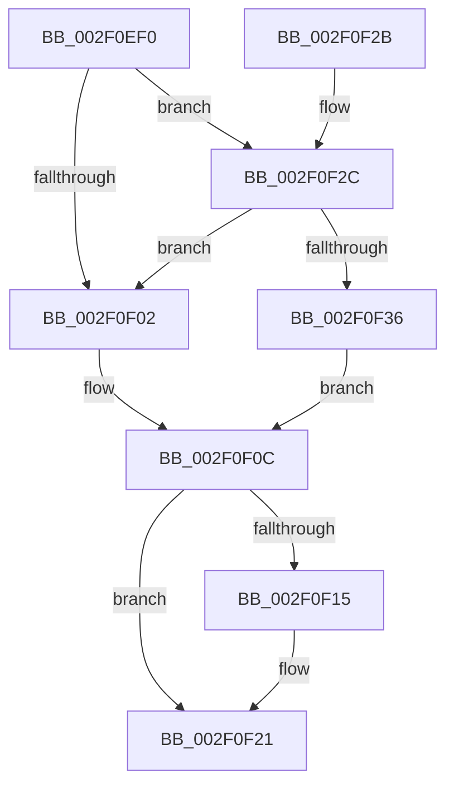

# ExReleaseSpinLockShared

- RVA: `0x002F0EF0`–`0x002F0F42` (길이 `82` bytes)
- VA: `0x00000001402F0EF0`
- 실행 섹션: `.text`
- PDB 이름 있음: `예`; PDB Function 태그: `아니요`
- unwind 정보 RVA: `0x00068804`
- 디코드: `23`개 명령, `82/82` bytes 표시
- 미해석 바이트: `0` (있으면 어셈블리에 `.byte`로 보존)

> 이 문서는 커널 이미지의 기계어와 PDB 기호를 분석해 생성했습니다. 4번과 5번은 함수 원형과 자료형을 바이너리 사용 방식에서 추정한 C 해석이며 원본 소스 복구 결과는 아닙니다.

## 1. Dependencies

- 직접 호출 지점: **2**; 고유 호출 대상: **2**
- 직접 호출자로 확인된 함수: **40**
- RIP 상대 이미지 참조: **3**

### Outgoing calls
- `0x002F0F1C` → [KiLowerIrqlProcessIrqlFlags](../4F/KiLowerIrqlProcessIrqlFlags_function_004F5698.md) (function, `0x004F5698`)
- `0x002F0F3B` → [ExpReleaseSpinLockSharedFromDpcLevelInstrumented](ExpReleaseSpinLockSharedFromDpcLevelInstrumented_function_002F0F48.md) (function, `0x002F0F48`)

### Direct callers
- [PopPepProcessEvent](../24/PopPepProcessEvent_function_0024B930.md) at `0x0024CC3E`
- [sub_0026F939](../26/Unknown_function_0026F939.md) at `0x0026F940`
- [PopFxLockDevice](../26/PopFxLockDevice_function_0026F950.md) at `0x0026F9B3`
- [IoPageReadEx](../29/IoPageReadEx_function_0029ABF0.md) at `0x0029AF1C`
- [IoPageReadEx](../29/IoPageReadEx_function_0029ABF0.md) at `0x0029AF85`
- [IoPageReadEx](../29/IoPageReadEx_function_0029ABF0.md) at `0x0029AFE4`
- [sub_0029BFC9](../29/Unknown_function_0029BFC9.md) at `0x0029C010`
- [PopPepComponentSetLatency](../2B/PopPepComponentSetLatency_function_002BF3D8.md) at `0x002BF5B4`
- [RtlpHpVaMgrCtxAlloc](../2E/RtlpHpVaMgrCtxAlloc_function_002EDA80.md) at `0x002EDB0D`
- [ExpAddTagForBigPages](../2E/ExpAddTagForBigPages_function_002EF570.md) at `0x002EF859`
- [ExpAddTagForBigPages](../2E/ExpAddTagForBigPages_function_002EF570.md) at `0x002EF93B`
- [SepGetSingletonEntryFromIndexNumber](SepGetSingletonEntryFromIndexNumber_function_002F095C.md) at `0x002F09A7`
- [RtlpCSparseBitmapUnlock](RtlpCSparseBitmapUnlock_function_002F0DD0.md) at `0x002F0DF4`
- [PsGetNextPartitionUnsafe](PsGetNextPartitionUnsafe_function_002F0E38.md) at `0x002F0E87`
- [InsertEventEntryInLookUpTable](InsertEventEntryInLookUpTable_function_002F1424.md) at `0x002F1709`
- [HalpBuddyAllocatorAllocateLogicalAddress](../30/HalpBuddyAllocatorAllocateLogicalAddress_function_00307EE0.md) at `0x0030807A`
- [HalpBuddyAllocatorAllocateLogicalAddress](../30/HalpBuddyAllocatorAllocateLogicalAddress_function_00307EE0.md) at `0x00308197`
- [HalpBuddyAllocatorAllocateLogicalAddress](../30/HalpBuddyAllocatorAllocateLogicalAddress_function_00307EE0.md) at `0x00308241`
- [RtlpHpReleaseLockShared](../32/RtlpHpReleaseLockShared_function_003245B0.md) at `0x003245E6`
- [IoQueueWorkItem](../35/IoQueueWorkItem_function_00357F80.md) at `0x003580C7`
- [IoQueueWorkItemEx](../35/IoQueueWorkItemEx_function_00358140.md) at `0x00358283`
- [sub_003A7C07](../3A/Unknown_function_003A7C07.md) at `0x003A7C33`
- [sub_003A7C07](../3A/Unknown_function_003A7C07.md) at `0x003A7C63`
- [SMKM_STORE_MGR&lt;SM_TRAITS&gt;::SmCompressManagerGetIdealProcessor](../3B/SMKM_STORE_MGR_SM_TRAITS_SmCompressManagerGetIdealProcessor_function_003B21CC.md) at `0x003B2279`
- [sub_003CB5DC](../3C/Unknown_function_003CB5DC.md) at `0x003CB615`
- [ExRemovePoolTag](../3F/ExRemovePoolTag_function_003F7CBC.md) at `0x003F7DBF`
- [PsGetWorkOnBehalfThread](../43/PsGetWorkOnBehalfThread_function_00439560.md) at `0x004395DA`
- [sub_0043CAB1](../43/Unknown_function_0043CAB1.md) at `0x0043CAE9`
- [PsGetEffectiveContainerId](../44/PsGetEffectiveContainerId_function_004497A0.md) at `0x004498C6`
- [PopPepGetDevicePlatformStateDependents](../49/PopPepGetDevicePlatformStateDependents_function_0049CAB4.md) at `0x0049CAE8`
- [PopPepGetMinimumDevicePowerState](../4A/PopPepGetMinimumDevicePowerState_function_004ABE50.md) at `0x004ABF03`
- [PopPepGetComponentVetoMasks](../4B/PopPepGetComponentVetoMasks_function_004B35F4.md) at `0x004B3632`
- [SMKM_STORE_MGR&lt;SM_TRAITS&gt;::SmCompressManagerUpdateMemoryCondition](../4C/SMKM_STORE_MGR_SM_TRAITS_SmCompressManagerUpdateMemoryCondition_function_004C0040.md) at `0x004C00EA`
- [PopPepGetDeviceVetoMasks](../4C/PopPepGetDeviceVetoMasks_function_004CC214.md) at `0x004CC262`
- [IommupHvFlushDomainTbs](../4D/IommupHvFlushDomainTbs_function_004DADB0.md) at `0x004DAED8`
- [SepValidateAndCopyGlobalEntry](../4F/SepValidateAndCopyGlobalEntry_function_004F825C.md) at `0x004F831F`
- [IommupDomainDetachPasidDevice](../54/IommupDomainDetachPasidDevice_function_0054FD50.md) at `0x0054FDB3`
- [HalpQueryNumaRangeTableInformation](../55/HalpQueryNumaRangeTableInformation_function_0055A0A0.md) at `0x0055A142`
- [PopPepPlatformStateRegistered](../5D/PopPepPlatformStateRegistered_function_005DCDB8.md) at `0x005DCE8E`
- [PopPepRegisterComponentPerfStates](../5D/PopPepRegisterComponentPerfStates_function_005DD000.md) at `0x005DD05C`
- [PspJobIoRateVolumeEntryReference](../5E/PspJobIoRateVolumeEntryReference_function_005E3AA8.md) at `0x005E3B41`
- [ViIrpDatabaseReleaseLockShared](../61/ViIrpDatabaseReleaseLockShared_function_00617740.md) at `0x0061774D`
- [MiNoPagesLastChance](../68/MiNoPagesLastChance_function_0068B22C.md) at `0x0068B37D`
- [sub_006E0B80](../6E/Unknown_function_006E0B80.md) at `0x006E0BB5`
- [sub_006F7E72](../6F/Unknown_function_006F7E72.md) at `0x006F7EAB`
- [sub_006F7E72](../6F/Unknown_function_006F7E72.md) at `0x006F7ED6`
- [ExQuerySystemLockInformation](../../pagelk/B7/ExQuerySystemLockInformation_function_00B793DC.md) at `0x00B79478`

### Static image references
- `0x002F0EF6` → RVA `0x00FC6B06` (`ALMOSTRO`; read)
- `0x002F0F0C` → RVA `0x00FC6D20` (`ALMOSTRO`; read)
- `0x002F0F2C` → RVA `0x00F0DE58` (`.data`; read)

## 2. Other-region calls and transfers

- 다른 실행 섹션으로 향하는 call: **0**
- 별도 외부 분기/꼬리 이동을 확인하지 못했습니다.

## 3. Assembly (complete function range)

```asm
002F0EF0  40 53                           push rbx
002F0EF2  48 83 EC 20                     sub rsp, 0x20
002F0EF6  F6 05 09 5C CD 00 01            test byte ptr [rip + 0xcd5c09], 1
002F0EFD  0F B6 DA                        movzx ebx, dl
002F0F00  75 2A                           jne 0x1402f0f2c
002F0F02  F0 81 21 FF FF FF BF            lock and dword ptr [rcx], 0xbfffffff
002F0F09  F0 FF 09                        lock dec dword ptr [rcx]
002F0F0C  83 3D 0D 5E CD 00 00            cmp dword ptr [rip + 0xcd5e0d], 0
002F0F13  74 0C                           je 0x1402f0f21
002F0F15  44 0F 20 C1                     mov rcx, cr8
002F0F19  0F B6 D3                        movzx edx, bl
002F0F1C  E8 77 47 20 00                  call 0x1404f5698
002F0F21  44 0F 22 C3                     mov cr8, rbx
002F0F25  48 83 C4 20                     add rsp, 0x20
002F0F29  5B                              pop rbx
002F0F2A  C3                              ret
002F0F2B  CC                              int3
002F0F2C  8B 05 26 CF C1 00               mov eax, dword ptr [rip + 0xc1cf26]
002F0F32  85 C0                           test eax, eax
002F0F34  75 CC                           jne 0x1402f0f02
002F0F36  48 8B 54 24 28                  mov rdx, qword ptr [rsp + 0x28]
002F0F3B  E8 08 00 00 00                  call 0x1402f0f48
002F0F40  EB CA                           jmp 0x1402f0f0c
```

## 4. C-style interpretation (structured pseudocode)

```c
__int64 __fastcall ExReleaseSpinLockShared(__int64 a1, unsigned __int8 a2)
{
    __int64 result;
    __int64 v_rsp;
    unsigned __int64 v_stack_p28;

    v_rsp = (v_rsp) - (32);
    if (((*(unsigned __int8 *)(v_rip + 13458441)) & (1)) != 0) goto loc_002F0F2C;
loc_002F0F02:
loc_002F0F0C:
    if ((*(unsigned int *)(v_rip + 13458957)) != 0) {
        a1 = v_cr8;
        a2 = a2;
        result = KiLowerIrqlProcessIrqlFlags(a1, a2, a3, a4);
    }
    v_rsp = (v_rsp) + (32);
    return result;
loc_002F0F2C:
    if ((unsigned int)((unsigned int)(*(unsigned int *)(v_rip + 12701478))) != 0) goto loc_002F0F02;
    result = ExpReleaseSpinLockSharedFromDpcLevelInstrumented(a1, v_stack_p28, a3, a4);
    goto loc_002F0F0C;
}
```

## 5. (Beta) C Style

```c
int64_t ExReleaseSpinLockShared(void *Arg1, uint8_t Arg2)
{
    uint8_t *arg1 = (uint8_t *)Arg1;

    int64_t result;
    int64_t local_rsp;
    uint64_t v_stack_p28;

    local_rsp = (local_rsp) - (32);
    if (((*(uint8_t *)(v_rip + 0xCD5C09)) & (1)) != 0) goto loc_002F0F2C;
loc_002F0F02:
loc_002F0F0C:
    if ((*(uint32_t *)(v_rip + 0xCD5E0D)) != 0) {
        Arg1 = v_cr8;
        Arg2 = Arg2;
        result = KiLowerIrqlProcessIrqlFlags(Arg1, Arg2, a3, a4);
    }
    local_rsp = (local_rsp) + (32);
    return result;
loc_002F0F2C:
    if ((uint32_t)((uint32_t)(*(uint32_t *)(v_rip + 0xC1CF26))) != 0) goto loc_002F0F02;
    result = ExpReleaseSpinLockSharedFromDpcLevelInstrumented(Arg1, v_stack_p28, a3, a4);
    goto loc_002F0F0C;
}
```

### 관측된 메모리 오프셋

구조체 형식이 확인되지 않은 접근은 인자 기준의 오프셋으로만 기록했습니다.

| 기준 인자 | 오프셋 표현 | 폭 (bit) | 접근 |
|---|---:|---:|---|
| `Arg1` | `+ 0x0` | `32` | `R/W` |

## 6. Execution-region graph

[열기: 2D/3D 그래프와 함수 탐색 컨트롤 패널](../../../control-panel.html?section=text&rva=0x002F0EF0&view=graph)

- 2D 그래프는 위에서 아래로 흐르고, 3D 그래프는 빈 공간을 드래그해 회전합니다. Shift+드래그는 이동, 휠은 확대·축소, 함수 노드 선택은 대상 보고서 이동입니다.

### Static fallback


