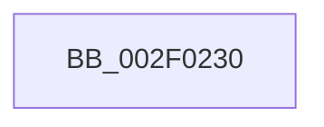

# ExReturnPoolQuota

- RVA: `0x002F0230`–`0x002F0254` (길이 `36` bytes)
- VA: `0x00000001402F0230`
- 실행 섹션: `.text`
- PDB 이름 있음: `예`; PDB Function 태그: `아니요`
- unwind 정보 RVA: `0x00071C18`
- 디코드: `12`개 명령, `36/36` bytes 표시
- 미해석 바이트: `0` (있으면 어셈블리에 `.byte`로 보존)

> 이 문서는 커널 이미지의 기계어와 PDB 기호를 분석해 생성했습니다. 4번과 5번은 함수 원형과 자료형을 바이너리 사용 방식에서 추정한 C 해석이며 원본 소스 복구 결과는 아닙니다.

## 1. Dependencies

- 직접 호출 지점: **0**; 고유 호출 대상: **0**
- 직접 호출자로 확인된 함수: **1**
- RIP 상대 이미지 참조: **1**

### Outgoing calls
- 직접 디코드된 call 명령이 없습니다.

### Direct callers
- [sub_009A831A](../../page/9A/Unknown_function_009A831A.md) at `0x009A833B`

### Static image references
- `0x002F023B` → RVA `0x00EFED20` (`.data`; read)

## 2. Other-region calls and transfers

- 다른 실행 섹션으로 향하는 call: **0**
- call이 아닌 외부 분기/꼬리 이동: **1**
  - `0x002F024E` → [sub_002F06CA](Unknown_function_002F06CA.md) (`tail-transfer`)

## 3. Assembly (complete function range)

```asm
002F0230  40 55                           push rbp
002F0232  56                              push rsi
002F0233  41 56                           push r14
002F0235  41 57                           push r15
002F0237  48 83 EC 58                     sub rsp, 0x58
002F023B  8B 05 DF EA C0 00               mov eax, dword ptr [rip + 0xc0eadf]
002F0241  33 ED                           xor ebp, ebp
002F0243  48 8B F1                        mov rsi, rcx
002F0246  44 8B F5                        mov r14d, ebp
002F0249  44 8B FD                        mov r15d, ebp
002F024C  85 C0                           test eax, eax
002F024E  0F 85 76 04 00 00               jne 0x1402f06ca
```

## 4. C-style interpretation (structured pseudocode)

```c
__int64 __fastcall ExReturnPoolQuota(__int64 a1)
{
    __int64 v_rbp;
    __int64 v_rsp;

    v_rsp = (v_rsp) - (88);
    v_rbp = 0;
}
```

## 5. (Beta) C Style

```c
int64_t ExReturnPoolQuota(int64_t Arg1)
{
    int64_t local_rbp;
    int64_t local_rsp;

    local_rsp = (local_rsp) - (88);
    local_rbp = 0;
}
```

## 6. Execution-region graph

[열기: 2D/3D 그래프와 함수 탐색 컨트롤 패널](../../../control-panel.html?section=text&rva=0x002F0230&view=graph)

- 2D 그래프는 위에서 아래로 흐르고, 3D 그래프는 빈 공간을 드래그해 회전합니다. Shift+드래그는 이동, 휠은 확대·축소, 함수 노드 선택은 대상 보고서 이동입니다.

### Static fallback


