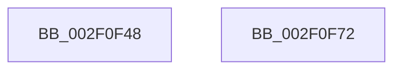

# ExpReleaseSpinLockSharedFromDpcLevelInstrumented

- RVA: `0x002F0F48`–`0x002F0F73` (길이 `43` bytes)
- VA: `0x00000001402F0F48`
- 실행 섹션: `.text`
- PDB 이름 있음: `예`; PDB Function 태그: `아니요`
- unwind 정보 RVA: `0x0005C788`
- 디코드: `13`개 명령, `43/43` bytes 표시
- 미해석 바이트: `0` (있으면 어셈블리에 `.byte`로 보존)

> 이 문서는 커널 이미지의 기계어와 PDB 기호를 분석해 생성했습니다. 4번과 5번은 함수 원형과 자료형을 바이너리 사용 방식에서 추정한 C 해석이며 원본 소스 복구 결과는 아닙니다.

## 1. Dependencies

- 직접 호출 지점: **1**; 고유 호출 대상: **1**
- 직접 호출자로 확인된 함수: **58**
- RIP 상대 이미지 참조: **0**

### Outgoing calls
- `0x002F0F68` → [PerfLogSpinLockRelease](../4C/PerfLogSpinLockRelease_function_004CD094.md) (function, `0x004CD094`)

### Direct callers
- [KiActivateWaiterQueueWithNoLocks](../20/KiActivateWaiterQueueWithNoLocks_function_0020CEB0.md) at `0x0020D093`
- [sub_00217146](../21/Unknown_function_00217146.md) at `0x00217194`
- [sub_00221B4E](../22/Unknown_function_00221B4E.md) at `0x00221B95`
- [sub_00221B4E](../22/Unknown_function_00221B4E.md) at `0x00221BB5`
- [sub_00221B4E](../22/Unknown_function_00221B4E.md) at `0x00221BD5`
- [sub_00221B4E](../22/Unknown_function_00221B4E.md) at `0x00221C29`
- [sub_00221B4E](../22/Unknown_function_00221B4E.md) at `0x00221C4D`
- [MiReacquireHigherPageTableLock](../23/MiReacquireHigherPageTableLock_function_00239650.md) at `0x00239CF8`
- [ExReleaseSpinLockRegardlessFromDpcLevel](../23/ExReleaseSpinLockRegardlessFromDpcLevel_function_0023A330.md) at `0x0023A3B7`
- [ExReleaseSpinLockSharedFromDpcLevel](../24/ExReleaseSpinLockSharedFromDpcLevel_function_0024A590.md) at `0x0024A5BC`
- [PopPepReleaseActivityLink](../24/PopPepReleaseActivityLink_function_0024CC90.md) at `0x0024CD91`
- [sub_0024DAD4](../24/Unknown_function_0024DAD4.md) at `0x0024DAF5`
- [sub_0024DCB7](../24/Unknown_function_0024DCB7.md) at `0x0024DCCD`
- [sub_0024E38F](../24/Unknown_function_0024E38F.md) at `0x0024E574`
- [sub_0024EAB1](../24/Unknown_function_0024EAB1.md) at `0x0024EC99`
- [KiAbEntryRemoveFromTree](../26/KiAbEntryRemoveFromTree_function_00262410.md) at `0x00262BDF`
- [MiDeleteVaDirect](../27/MiDeleteVaDirect_function_00277560.md) at `0x0027896F`
- [MiWalkPageTablesRecursively](../27/MiWalkPageTablesRecursively_function_002796C0.md) at `0x0027B757`
- [MiAcquirePageListLock](../27/MiAcquirePageListLock_function_0027C450.md) at `0x0027CB97`
- [MiReleaseFaultState](../27/MiReleaseFaultState_function_0027D290.md) at `0x0027D679`
- [sub_0027D81B](../27/Unknown_function_0027D81B.md) at `0x0027D82D`
- [sub_0027D81B](../27/Unknown_function_0027D81B.md) at `0x0027D846`
- [sub_0027D95C](../27/Unknown_function_0027D95C.md) at `0x0027DBE2`
- [MiAddWorkingSetEntries](../27/MiAddWorkingSetEntries_function_0027DC00.md) at `0x0027E45A`
- [MiCaptureDeleteHierarchy](../27/MiCaptureDeleteHierarchy_function_0027F5F0.md) at `0x0027FDA2`
- [MiMakeSystemAddressValid](../27/MiMakeSystemAddressValid_function_0027FF70.md) at `0x00280C48`
- [MiLockLowestValidPageTableEx](../28/MiLockLowestValidPageTableEx_function_00280D10.md) at `0x00281735`
- [sub_0028271E](../28/Unknown_function_0028271E.md) at `0x002827BE`
- [sub_0028271E](../28/Unknown_function_0028271E.md) at `0x002827EB`
- [sub_00287E84](../28/Unknown_function_00287E84.md) at `0x00287F8A`
- [MiSetVaAgeList](../29/MiSetVaAgeList_function_00290A20.md) at `0x0029184E`
- [MiUnlockWorkingSetCoreShared](../29/MiUnlockWorkingSetCoreShared_function_00292B00.md) at `0x00292B4B`
- [MiUnlockVadTree](../29/MiUnlockVadTree_function_00297020.md) at `0x0029711D`
- [MiUnlockVadTree](../29/MiUnlockVadTree_function_00297020.md) at `0x0029713F`
- [MmIsFileObjectAPagingFile](../29/MmIsFileObjectAPagingFile_function_0029BDAC.md) at `0x0029BF07`
- [MiFindLastSubsection](../2A/MiFindLastSubsection_function_002ACF20.md) at `0x002ACFC7`
- [MiReleasePageListLock](../2B/MiReleasePageListLock_function_002B1050.md) at `0x002B10F0`
- [MiComputeFaultNode](../2B/MiComputeFaultNode_function_002B60C0.md) at `0x002B61FD`
- [sub_002B674F](../2B/Unknown_function_002B674F.md) at `0x002B68B8`
- [MiInsertPageInList](../2B/MiInsertPageInList_function_002BA000.md) at `0x002BA8E6`
- [sub_002BC16C](../2B/Unknown_function_002BC16C.md) at `0x002BC182`
- [KiReleaseProcessLockShared](../2C/KiReleaseProcessLockShared_function_002CE7FC.md) at `0x002CE84A`
- [sub_002E0B15](../2E/Unknown_function_002E0B15.md) at `0x002E10B4`
- [ExpAddTagForBigPages](../2E/ExpAddTagForBigPages_function_002EF570.md) at `0x002EF87D`
- [sub_002F0187](Unknown_function_002F0187.md) at `0x002F01A1`
- [sub_002F0454](Unknown_function_002F0454.md) at `0x002F0628`
- [ExReleaseSpinLockShared](ExReleaseSpinLockShared_function_002F0EF0.md) at `0x002F0F3B`
- [MmUnlockLoadedModuleListShared](MmUnlockLoadedModuleListShared_function_002F2230.md) at `0x002F228F`
- [MiReturnLockedVadOrNextVa](../31/MiReturnLockedVadOrNextVa_function_00316980.md) at `0x00316DB4`
- [sub_0032DE99](../32/Unknown_function_0032DE99.md) at `0x0032DED2`
- [sub_0032DE99](../32/Unknown_function_0032DE99.md) at `0x0032DF0B`
- [sub_0032E327](../32/Unknown_function_0032E327.md) at `0x0032E46E`
- [sub_0032E327](../32/Unknown_function_0032E327.md) at `0x0032E492`
- [MiCheckVirtualAddress](../32/MiCheckVirtualAddress_function_0032E4F0.md) at `0x0032E8BB`
- [sub_0033DA89](../33/Unknown_function_0033DA89.md) at `0x0033DC96`
- [sub_0033EABD](../33/Unknown_function_0033EABD.md) at `0x0033ECA1`
- [MiReleaseSpinLockShared](../34/MiReleaseSpinLockShared_function_00348BF0.md) at `0x00348C5A`
- [MiReleaseSpinLockShared](../34/MiReleaseSpinLockShared_function_00348BF0.md) at `0x00348C70`
- [ExAllocateHeapPool](../35/ExAllocateHeapPool_function_0035BA30.md) at `0x0035DE58`
- [sub_00360968](../36/Unknown_function_00360968.md) at `0x00360CB1`
- [MiUpdateWorkingSetPrivateSize](../36/MiUpdateWorkingSetPrivateSize_function_00362250.md) at `0x00362366`
- [MiEndingOffsetWithLock](../40/MiEndingOffsetWithLock_function_00404718.md) at `0x00404862`
- [ExpRemoveTagForBigPages](../41/ExpRemoveTagForBigPages_function_00411980.md) at `0x00411B85`
- [KeQueryBasePriorityThread](../41/KeQueryBasePriorityThread_function_0041E500.md) at `0x0041E688`
- [sub_004348D5](../43/Unknown_function_004348D5.md) at `0x004348E7`
- [sub_00442D0C](../44/Unknown_function_00442D0C.md) at `0x00442D22`
- [ExpAllocatePoolWithQuotaTag](../../poolcode/B8/ExpAllocatePoolWithQuotaTag_function_00B82210.md) at `0x00B827D2`
- [ExpAllocatePoolWithQuotaTag](../../poolcode/B8/ExpAllocatePoolWithQuotaTag_function_00B82210.md) at `0x00B827F9`
- [sub_00B8371E](../../poolcode/B8/Unknown_function_00B8371E.md) at `0x00B83A6A`

### Static image references
- 디코드된 RIP-relative 메모리 참조가 없습니다.

## 2. Other-region calls and transfers

- 다른 실행 섹션으로 향하는 call: **0**
- 별도 외부 분기/꼬리 이동을 확인하지 못했습니다.

## 3. Assembly (complete function range)

```asm
002F0F48  48 83 EC 28                     sub rsp, 0x28
002F0F4C  4C 8B CA                        mov r9, rdx
002F0F4F  0F 31                           rdtsc
002F0F51  48 C1 E2 20                     shl rdx, 0x20
002F0F55  48 0B C2                        or rax, rdx
002F0F58  F0 81 21 FF FF FF BF            lock and dword ptr [rcx], 0xbfffffff
002F0F5F  F0 FF 09                        lock dec dword ptr [rcx]
002F0F62  4C 8B C0                        mov r8, rax
002F0F65  49 8B D1                        mov rdx, r9
002F0F68  E8 27 C1 1D 00                  call 0x1404cd094
002F0F6D  48 83 C4 28                     add rsp, 0x28
002F0F71  C3                              ret
002F0F72  CC                              int3
```

## 4. C-style interpretation (structured pseudocode)

```c
__int64 __fastcall ExpReleaseSpinLockSharedFromDpcLevelInstrumented(__int64 a1, __int64 a2)
{
    __int64 result;
    __int64 v_rsp;

    v_rsp = (v_rsp) - (40);
    a2 = (a2) << (32);
    result = (result) | (a2);
    result = PerfLogSpinLockRelease(a1, a2, result, a2);
    v_rsp = (v_rsp) + (40);
    return result;
}
```

## 5. (Beta) C Style

```c
int64_t ExpReleaseSpinLockSharedFromDpcLevelInstrumented(void *Arg1, int64_t Arg2)
{
    uint8_t *arg1 = (uint8_t *)Arg1;

    int64_t result;
    int64_t local_rsp;

    local_rsp = (local_rsp) - (40);
    Arg2 = (Arg2) << (32);
    result = (result) | (Arg2);
    result = PerfLogSpinLockRelease(Arg1, Arg2, result, Arg2);
    local_rsp = (local_rsp) + (40);
    return result;
}
```

### 관측된 메모리 오프셋

구조체 형식이 확인되지 않은 접근은 인자 기준의 오프셋으로만 기록했습니다.

| 기준 인자 | 오프셋 표현 | 폭 (bit) | 접근 |
|---|---:|---:|---|
| `Arg1` | `+ 0x0` | `32` | `R/W` |

## 6. Execution-region graph

[열기: 2D/3D 그래프와 함수 탐색 컨트롤 패널](../../../control-panel.html?section=text&rva=0x002F0F48&view=graph)

- 2D 그래프는 위에서 아래로 흐르고, 3D 그래프는 빈 공간을 드래그해 회전합니다. Shift+드래그는 이동, 휠은 확대·축소, 함수 노드 선택은 대상 보고서 이동입니다.

### Static fallback


