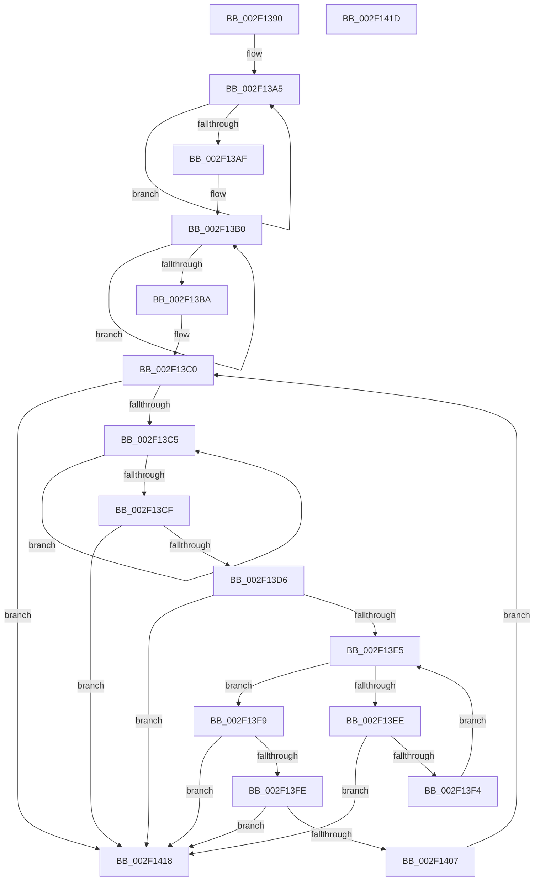

# ExtractAggregateFieldTypes

- RVA: `0x002F1390`–`0x002F141E` (길이 `142` bytes)
- VA: `0x00000001402F1390`
- 실행 섹션: `.text`
- PDB 이름 있음: `예`; PDB Function 태그: `예`
- unwind 정보 RVA: `0x000DB714`
- 디코드: `50`개 명령, `142/142` bytes 표시
- 미해석 바이트: `0` (있으면 어셈블리에 `.byte`로 보존)

> 이 문서는 커널 이미지의 기계어와 PDB 기호를 분석해 생성했습니다. 4번과 5번은 함수 원형과 자료형을 바이너리 사용 방식에서 추정한 C 해석이며 원본 소스 복구 결과는 아닙니다.

## 1. Dependencies

- 직접 호출 지점: **0**; 고유 호출 대상: **0**
- 직접 호출자로 확인된 함수: **4**
- RIP 상대 이미지 참조: **0**

### Outgoing calls
- 직접 디코드된 call 명령이 없습니다.

### Direct callers
- [TlgAggregateAbsorbEvent](TlgAggregateAbsorbEvent_function_002F1010.md) at `0x002F1046`
- [MiLogBadMapper](MiLogBadMapper_function_002F1140.md) at `0x002F12CF`
- [MiLogSlabEntryAllocateFailure](../3B/MiLogSlabEntryAllocateFailure_function_003BAA60.md) at `0x003BAD5D`
- [MiLogPeriodicTelemetryForSlabAllocator](../4B/MiLogPeriodicTelemetryForSlabAllocator_function_004B4AC0.md) at `0x004B4DC0`

### Static image references
- 디코드된 RIP-relative 메모리 참조가 없습니다.

## 2. Other-region calls and transfers

- 다른 실행 섹션으로 향하는 call: **0**
- 별도 외부 분기/꼬리 이동을 확인하지 못했습니다.

## 3. Assembly (complete function range)

```asm
002F1390  48 8B 42 10                     mov rax, qword ptr [rdx + 0x10]
002F1394  45 32 D2                        xor r10b, r10b
002F1397  44 8B 4A 18                     mov r9d, dword ptr [rdx + 0x18]
002F139B  4C 8B DA                        mov r11, rdx
002F139E  4C 03 C8                        add r9, rax
002F13A1  48 83 C0 02                     add rax, 2
002F13A5  0F B6 08                        movzx ecx, byte ptr [rax]
002F13A8  48 FF C0                        inc rax
002F13AB  84 C9                           test cl, cl
002F13AD  78 F6                           js 0x1402f13a5
002F13AF  90                              nop
002F13B0  0F B6 08                        movzx ecx, byte ptr [rax]
002F13B3  48 FF C0                        inc rax
002F13B6  84 C9                           test cl, cl
002F13B8  75 F6                           jne 0x1402f13b0
002F13BA  66 0F 1F 44 00 00               nop word ptr [rax + rax]
002F13C0  49 3B C1                        cmp rax, r9
002F13C3  73 53                           jae 0x1402f1418
002F13C5  0F B6 08                        movzx ecx, byte ptr [rax]
002F13C8  48 FF C0                        inc rax
002F13CB  84 C9                           test cl, cl
002F13CD  75 F6                           jne 0x1402f13c5
002F13CF  0F B6 10                        movzx edx, byte ptr [rax]
002F13D2  84 D2                           test dl, dl
002F13D4  79 42                           jns 0x1402f1418
002F13D6  0F B6 48 01                     movzx ecx, byte ptr [rax + 1]
002F13DA  80 E2 7F                        and dl, 0x7f
002F13DD  48 83 C0 02                     add rax, 2
002F13E1  84 C9                           test cl, cl
002F13E3  79 33                           jns 0x1402f1418
002F13E5  44 0F B6 00                     movzx r8d, byte ptr [rax]
002F13E9  45 84 C0                        test r8b, r8b
002F13EC  79 0B                           jns 0x1402f13f9
002F13EE  41 80 F8 80                     cmp r8b, 0x80
002F13F2  75 24                           jne 0x1402f1418
002F13F4  48 FF C0                        inc rax
002F13F7  EB EC                           jmp 0x1402f13e5
002F13F9  80 FA 09                        cmp dl, 9
002F13FC  75 1A                           jne 0x1402f1418
002F13FE  41 8D 48 8F                     lea ecx, [r8 - 0x71]
002F1402  80 F9 02                        cmp cl, 2
002F1405  77 11                           ja 0x1402f1418
002F1407  41 0F B6 CA                     movzx ecx, r10b
002F140B  48 03 C9                        add rcx, rcx
002F140E  41 FE C2                        inc r10b
002F1411  45 88 44 CB 2D                  mov byte ptr [r11 + rcx*8 + 0x2d], r8b
002F1416  EB A8                           jmp 0x1402f13c0
002F1418  41 0F B6 C2                     movzx eax, r10b
002F141C  C3                              ret
002F141D  CC                              int3
```

## 4. C-style interpretation (structured pseudocode)

```c
__int64 __fastcall ExtractAggregateFieldTypes(__int64 a1, __int64 a2)
{
    __int64 result;
    __int64 v_r10;

    v_r10 = 0;
    a4 = ((unsigned int)(*(unsigned int *)(a2 + 24))) + (*(unsigned __int64 *)(a2 + 16));
    result = (*(unsigned __int64 *)(a2 + 16)) + (2);
loc_002F13A5:
    result = (result) + 1;
    if (sign_flag) goto loc_002F13A5;
loc_002F13B0:
    result = (result) + 1;
    if ((unsigned __int8)(*(unsigned __int8 *)(result)) != 0) goto loc_002F13B0;
loc_002F13C0:
    if (result >= a4) goto loc_002F1418;
loc_002F13C5:
    result = (result) + 1;
    if ((unsigned __int8)(*(unsigned __int8 *)(result)) != 0) goto loc_002F13C5;
    if (!sign_flag) goto loc_002F1418;
    a2 = (unsigned __int8)((*(unsigned __int8 *)(result)) & (127));
    result = (result) + (2);
    if (!sign_flag) goto loc_002F1418;
loc_002F13E5:
    if (!sign_flag) goto loc_002F13F9;
    if (((unsigned __int8)(*(unsigned __int8 *)(result))) != 128) goto loc_002F1418;
    result = (result) + 1;
    goto loc_002F13E5;
loc_002F13F9:
    if (((unsigned __int8)(a2)) != 9) goto loc_002F1418;
    if (((unsigned __int8)(*(unsigned __int8 *)(result) - 113)) > 2) goto loc_002F1418;
    a1 = (0) + (0);
    v_r10 = (unsigned __int8)((v_r10) + 1);
    *(unsigned __int8 *)(a2 + a1 * 8 + 45) = (unsigned __int8)(*(unsigned __int8 *)(result));
    goto loc_002F13C0;
loc_002F1418:
    return (unsigned __int8)(v_r10);
}
```

## 5. (Beta) C Style

```c
int64_t ExtractAggregateFieldTypes(int64_t Arg1, void *Arg2)
{
    uint8_t *arg2 = (uint8_t *)Arg2;

    int64_t result;
    int64_t local_r10;

    local_r10 = 0;
    a4 = ((uint32_t)(*(uint32_t *)(arg2 + 0x18))) + (*(uint64_t *)(arg2 + 0x10));
    result = (*(uint64_t *)(arg2 + 0x10)) + (2);
loc_002F13A5:
    result = (result) + 1;
    if (sign_flag) goto loc_002F13A5;
loc_002F13B0:
    result = (result) + 1;
    if ((uint8_t)(*(uint8_t *)(result)) != 0) goto loc_002F13B0;
loc_002F13C0:
    if (result >= a4) goto loc_002F1418;
loc_002F13C5:
    result = (result) + 1;
    if ((uint8_t)(*(uint8_t *)(result)) != 0) goto loc_002F13C5;
    if (!sign_flag) goto loc_002F1418;
    Arg2 = (uint8_t)((*(uint8_t *)(result)) & (127));
    result = (result) + (2);
    if (!sign_flag) goto loc_002F1418;
loc_002F13E5:
    if (!sign_flag) goto loc_002F13F9;
    if (((uint8_t)(*(uint8_t *)(result))) != 128) goto loc_002F1418;
    result = (result) + 1;
    goto loc_002F13E5;
loc_002F13F9:
    if (((uint8_t)(Arg2)) != 9) goto loc_002F1418;
    if (((uint8_t)(*(uint8_t *)(result) - 113)) > 2) goto loc_002F1418;
    Arg1 = (0) + (0);
    local_r10 = (uint8_t)((local_r10) + 1);
    *(uint8_t *)(arg2 + Arg1 * 8 + 0x2D) = (uint8_t)(*(uint8_t *)(result));
    goto loc_002F13C0;
loc_002F1418:
    return (uint8_t)(local_r10);
}
```

### 관측된 메모리 오프셋

구조체 형식이 확인되지 않은 접근은 인자 기준의 오프셋으로만 기록했습니다.

| 기준 인자 | 오프셋 표현 | 폭 (bit) | 접근 |
|---|---:|---:|---|
| `Arg2` | `+ 0x10` | `64` | `R` |
| `Arg2` | `+ 0x18` | `32` | `R` |
| `Arg2` | `+ 0x2D + rcx*8` | `8` | `W` |

## 6. Execution-region graph

[열기: 2D/3D 그래프와 함수 탐색 컨트롤 패널](../../../control-panel.html?section=text&rva=0x002F1390&view=graph)

- 2D 그래프는 위에서 아래로 흐르고, 3D 그래프는 빈 공간을 드래그해 회전합니다. Shift+드래그는 이동, 휠은 확대·축소, 함수 노드 선택은 대상 보고서 이동입니다.

### Static fallback


