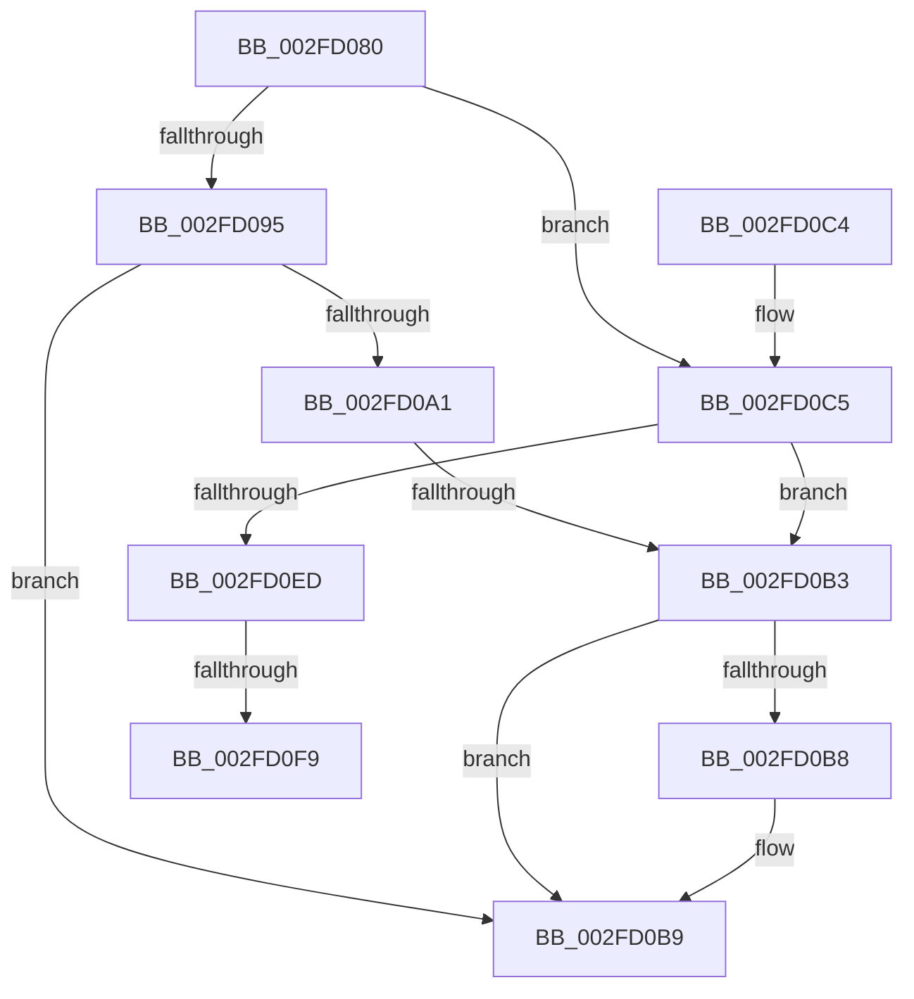

# HalpCollectPmcCounters

- RVA: `0x002FD080`–`0x002FD0FE` (길이 `126` bytes)
- VA: `0x00000001402FD080`
- 실행 섹션: `.text`
- PDB 이름 있음: `예`; PDB Function 태그: `예`
- unwind 정보 RVA: `0x00072BAC`
- 디코드: `36`개 명령, `126/126` bytes 표시
- 미해석 바이트: `0` (있으면 어셈블리에 `.byte`로 보존)

> 이 문서는 커널 이미지의 기계어와 PDB 기호를 분석해 생성했습니다. 4번과 5번은 함수 원형과 자료형을 바이너리 사용 방식에서 추정한 C 해석이며 원본 소스 복구 결과는 아닙니다.

## 1. Dependencies

- 직접 호출 지점: **2**; 고유 호출 대상: **1**
- 직접 호출자로 확인된 함수: **1**
- RIP 상대 이미지 참조: **2**

### Outgoing calls
- `0x002FD0A1` → [HalpDisableInterrupts](../25/HalpDisableInterrupts_function_002521A0.md) (function, `0x002521A0`)
- `0x002FD0DC` → [HalpDisableInterrupts](../25/HalpDisableInterrupts_function_002521A0.md) (function, `0x002521A0`)

### Direct callers
- [EtwpReserveWithPmcCounters](EtwpReserveWithPmcCounters_function_002FCED0.md) at `0x002FCFC1`

### Static image references
- `0x002FD095` → RVA `0x00FC2BE0` (`.data`; read)
- `0x002FD0D1` → RVA `0x00FC2C30` (`.data`; read)

## 2. Other-region calls and transfers

- 다른 실행 섹션으로 향하는 call: **0**
- call이 아닌 외부 분기/꼬리 이동: **3**
  - `0x002FD0B1` → [sub_002FD0FE](Unknown_function_002FD0FE.md) (`tail-transfer`)
  - `0x002FD0F3` → [sub_006DFCB1](../6D/Unknown_function_006DFCB1.md) (`tail-transfer`)
  - `0x002FD0F9` → [sub_006DFCB1 + 0x7A](../6D/Unknown_function_006DFCB1.md) (`tail-transfer`)

## 3. Assembly (complete function range)

```asm
002FD080  48 89 5C 24 10                  mov qword ptr [rsp + 0x10], rbx
002FD085  57                              push rdi
002FD086  48 83 EC 20                     sub rsp, 0x20
002FD08A  4C 8B CA                        mov r9, rdx
002FD08D  4C 8B C1                        mov r8, rcx
002FD090  48 85 C9                        test rcx, rcx
002FD093  74 30                           je 0x1402fd0c5
002FD095  48 8D 05 44 5B CC 00            lea rax, [rip + 0xcc5b44]
002FD09C  48 3B C8                        cmp rcx, rax
002FD09F  74 18                           je 0x1402fd0b9
002FD0A1  E8 FA 50 F5 FF                  call 0x1402521a0
002FD0A6  45 33 DB                        xor r11d, r11d
002FD0A9  44 0F B6 D0                     movzx r10d, al
002FD0AD  45 39 58 14                     cmp dword ptr [r8 + 0x14], r11d
002FD0B1  77 4B                           ja 0x1402fd0fe
002FD0B3  45 84 D2                        test r10b, r10b
002FD0B6  74 01                           je 0x1402fd0b9
002FD0B8  FB                              sti
002FD0B9  48 8B 5C 24 38                  mov rbx, qword ptr [rsp + 0x38]
002FD0BE  48 83 C4 20                     add rsp, 0x20
002FD0C2  5F                              pop rdi
002FD0C3  C3                              ret
002FD0C4  CC                              int3
002FD0C5  65 8B 04 25 A4 01 00 00         mov eax, dword ptr gs:[0x1a4]
002FD0CD  48 8D 14 40                     lea rdx, [rax + rax*2]
002FD0D1  48 8B 05 58 5B CC 00            mov rax, qword ptr [rip + 0xcc5b58]
002FD0D8  4C 8D 0C D0                     lea r9, [rax + rdx*8]
002FD0DC  E8 BF 50 F5 FF                  call 0x1402521a0
002FD0E1  4D 8B 01                        mov r8, qword ptr [r9]
002FD0E4  44 0F B6 D0                     movzx r10d, al
002FD0E8  4D 3B C1                        cmp r8, r9
002FD0EB  74 C6                           je 0x1402fd0b3
002FD0ED  33 FF                           xor edi, edi
002FD0EF  41 39 78 14                     cmp dword ptr [r8 + 0x14], edi
002FD0F3  0F 87 B8 2B 3E 00               ja 0x1406dfcb1
002FD0F9  E9 2D 2C 3E 00                  jmp 0x1406dfd2b
```

## 4. C-style interpretation (structured pseudocode)

```c
__int64 __fastcall HalpCollectPmcCounters(__int64 a1, __int64 a2)
{
    __int64 result;
    __int64 v_r11;
    __int64 v_rdi;
    __int64 v_rsp;
    unsigned __int64 v_stack_p10;

    v_stack_p10 = v_rbx;
    v_rsp = (v_rsp) - (32);
    if (a1 == 0) goto loc_002FD0C5;
    if (a1 == (v_rip + 13392708)) goto loc_002FD0B9;
    result = HalpDisableInterrupts(a1, a2, a1, a2);
    v_r11 = 0;
loc_002FD0B3:
    if ((unsigned __int8)((unsigned __int8)(result)) != 0) {
    }
    v_rsp = (v_rsp) + (32);
    return result;
loc_002FD0C5:
    result = HalpDisableInterrupts(a1, (unsigned int)(*(unsigned int *)(gs_base + (0 + 420))) + (unsigned int)(*(unsigned int *)(gs_base + (0 + 420))) * 2, a1, *(unsigned __int64 *)(v_rip + 13392728) + (unsigned int)(*(unsigned int *)(gs_base + (0 + 420))) + (unsigned int)(*(unsigned int *)(gs_base + (0 + 420))) * 2 * 8);
    if ((*(unsigned __int64 *)(*(unsigned __int64 *)(v_rip + 13392728) + (unsigned int)(*(unsigned int *)(gs_base + (0 + 420))) + (unsigned int)(*(unsigned int *)(gs_base + (0 + 420))) * 2 * 8)) == (*(unsigned __int64 *)(v_rip + 13392728) + (unsigned int)(*(unsigned int *)(gs_base + (0 + 420))) + (unsigned int)(*(unsigned int *)(gs_base + (0 + 420))) * 2 * 8)) goto loc_002FD0B3;
    v_rdi = 0;
}
```

## 5. (Beta) C Style

```c
int64_t HalpCollectPmcCounters(int64_t Arg1, int64_t Arg2)
{
    int64_t result;
    int64_t local_r11;
    int64_t local_rdi;
    int64_t local_rsp;
    uint64_t v_stack_p10;

    v_stack_p10 = local_rbx;
    local_rsp = (local_rsp) - (32);
    if (Arg1 == 0) goto loc_002FD0C5;
    if (Arg1 == (v_rip + 13392708)) goto loc_002FD0B9;
    result = HalpDisableInterrupts(Arg1, Arg2, Arg1, Arg2);
    local_r11 = 0;
loc_002FD0B3:
    if ((uint8_t)((uint8_t)(result)) != 0) {
    }
    local_rsp = (local_rsp) + (32);
    return result;
loc_002FD0C5:
    result = HalpDisableInterrupts(Arg1, (uint32_t)(*(uint32_t *)(gs_base + (0 + 0x1A4))) + (uint32_t)(*(uint32_t *)(gs_base + (0 + 0x1A4))) * 2, Arg1, *(uint64_t *)(v_rip + 0xCC5B58) + (uint32_t)(*(uint32_t *)(gs_base + (0 + 0x1A4))) + (uint32_t)(*(uint32_t *)(gs_base + (0 + 0x1A4))) * 2 * 8);
    if ((*(uint64_t *)(*(uint64_t *)(v_rip + 0xCC5B58) + (uint32_t)(*(uint32_t *)(gs_base + (0 + 0x1A4))) + (uint32_t)(*(uint32_t *)(gs_base + (0 + 0x1A4))) * 2 * 8)) == (*(uint64_t *)(v_rip + 0xCC5B58) + (uint32_t)(*(uint32_t *)(gs_base + (0 + 0x1A4))) + (uint32_t)(*(uint32_t *)(gs_base + (0 + 0x1A4))) * 2 * 8)) goto loc_002FD0B3;
    local_rdi = 0;
}
```

## 6. Execution-region graph

[열기: 2D/3D 그래프와 함수 탐색 컨트롤 패널](../../../control-panel.html?section=text&rva=0x002FD080&view=graph)

- 2D 그래프는 위에서 아래로 흐르고, 3D 그래프는 빈 공간을 드래그해 회전합니다. Shift+드래그는 이동, 휠은 확대·축소, 함수 노드 선택은 대상 보고서 이동입니다.

### Static fallback


