# InsertEventEntryInLookUpTable

- RVA: `0x002F1424`–`0x002F17AD` (길이 `905` bytes)
- VA: `0x00000001402F1424`
- 실행 섹션: `.text`
- PDB 이름 있음: `예`; PDB Function 태그: `예`
- unwind 정보 RVA: `0x00071DF4`
- 디코드: `214`개 명령, `905/905` bytes 표시
- 미해석 바이트: `0` (있으면 어셈블리에 `.byte`로 보존)

> 이 문서는 커널 이미지의 기계어와 PDB 기호를 분석해 생성했습니다. 4번과 5번은 함수 원형과 자료형을 바이너리 사용 방식에서 추정한 C 해석이며 원본 소스 복구 결과는 아닙니다.

## 1. Dependencies

- 직접 호출 지점: **14**; 고유 호출 대상: **13**
- 직접 호출자로 확인된 함수: **4**
- RIP 상대 이미지 참조: **0**

### Outgoing calls
- `0x002F1469` → [ComputeEventEntryHash](ComputeEventEntryHash_function_002F10A8.md) (function, `0x002F10A8`)
- `0x002F149B` → [ExAcquireSpinLockSharedAtDpcLevel](../24/ExAcquireSpinLockSharedAtDpcLevel_function_00248E30.md) (function, `0x00248E30`)
- `0x002F14D7` → [CompareEventEntry](CompareEventEntry_function_002F17B4.md) (function, `0x002F17B4`)
- `0x002F1568` → [ExfReleasePushLockShared](../26/ExfReleasePushLockShared_function_00263440.md) (function, `0x00263440`)
- `0x002F1574` → [KeAbPostRelease](../2E/KeAbPostRelease_function_002E1600.md) (function, `0x002E1600`)
- `0x002F15DB` → [ExReleaseSpinLockSharedFromDpcLevel](../24/ExReleaseSpinLockSharedFromDpcLevel_function_0024A590.md) (function, `0x0024A590`)
- `0x002F1604` → [KeAbPreAcquire](../21/KeAbPreAcquire_function_00210230.md) (function, `0x00210230`)
- `0x002F1623` → [ExfAcquirePushLockSharedEx](../21/ExfAcquirePushLockSharedEx_function_0021044C.md) (function, `0x0021044C`)
- `0x002F1680` → [CreateNewEventEntry](../47/CreateNewEventEntry_function_00473C00.md) (function, `0x00473C00`)
- `0x002F16D6` → [EnableFlushTimer](../45/EnableFlushTimer_function_0045B5B8.md) (function, `0x0045B5B8`)
- `0x002F1709` → [ExReleaseSpinLockShared](ExReleaseSpinLockShared_function_002F0EF0.md) (function, `0x002F0EF0`)
- `0x002F172E` → [KeBugCheckEx](../4F/KeBugCheckEx_function_004FD660.md) (function, `0x004FD660`)
- `0x002F1763` → [KeBugCheckEx](../4F/KeBugCheckEx_function_004FD660.md) (function, `0x004FD660`)
- `0x002F17A3` → [DestroyEventEntry](../4B/DestroyEventEntry_function_004B2838.md) (function, `0x004B2838`)

### Direct callers
- [TlgAggregateAbsorbEvent](TlgAggregateAbsorbEvent_function_002F1010.md) at `0x002F105F`
- [MiLogBadMapper](MiLogBadMapper_function_002F1140.md) at `0x002F12EB`
- [MiLogSlabEntryAllocateFailure](../3B/MiLogSlabEntryAllocateFailure_function_003BAA60.md) at `0x003BAD79`
- [MiLogPeriodicTelemetryForSlabAllocator](../4B/MiLogPeriodicTelemetryForSlabAllocator_function_004B4AC0.md) at `0x004B4DDC`

### Static image references
- 디코드된 RIP-relative 메모리 참조가 없습니다.

## 2. Other-region calls and transfers

- 다른 실행 섹션으로 향하는 call: **0**
- call이 아닌 외부 분기/꼬리 이동: **4**
  - `0x002F1742` → [sub_006DEF5A](../6D/Unknown_function_006DEF5A.md) (`tail-transfer`)
  - `0x002F176E` → [sub_006DEF5A + 0xB](../6D/Unknown_function_006DEF5A.md) (`tail-transfer`)
  - `0x002F1786` → [sub_006DEF5A + 0x16](../6D/Unknown_function_006DEF5A.md) (`tail-transfer`)
  - `0x002F1795` → [sub_006DEF5A + 0x1F](../6D/Unknown_function_006DEF5A.md) (`tail-transfer`)

## 3. Assembly (complete function range)

```asm
002F1424  48 8B C4                        mov rax, rsp
002F1427  48 89 58 18                     mov qword ptr [rax + 0x18], rbx
002F142B  4C 89 48 20                     mov qword ptr [rax + 0x20], r9
002F142F  48 89 50 10                     mov qword ptr [rax + 0x10], rdx
002F1433  55                              push rbp
002F1434  56                              push rsi
002F1435  57                              push rdi
002F1436  41 54                           push r12
002F1438  41 55                           push r13
002F143A  41 56                           push r14
002F143C  41 57                           push r15
002F143E  48 83 EC 60                     sub rsp, 0x60
002F1442  48 8B 59 30                     mov rbx, qword ptr [rcx + 0x30]
002F1446  45 8A E8                        mov r13b, r8b
002F1449  44 0F B6 A4 24 C0 00 00 00      movzx r12d, byte ptr [rsp + 0xc0]
002F1452  33 FF                           xor edi, edi
002F1454  41 8A D5                        mov dl, r13b
002F1457  48 89 78 08                     mov qword ptr [rax + 8], rdi
002F145B  41 8A CC                        mov cl, r12b
002F145E  48 89 5C 24 40                  mov qword ptr [rsp + 0x40], rbx
002F1463  4D 8B C1                        mov r8, r9
002F1466  44 8B FF                        mov r15d, edi
002F1469  E8 3A FC FF FF                  call 0x1402f10a8
002F146E  8B E8                           mov ebp, eax
002F1470  44 8B F0                        mov r14d, eax
002F1473  83 E5 1F                        and ebp, 0x1f
002F1476  44 0F 20 C0                     mov rax, cr8
002F147A  48 89 44 24 48                  mov qword ptr [rsp + 0x48], rax
002F147F  3C 02                           cmp al, 2
002F1481  0F 82 5B 01 00 00               jb 0x1402f15e2
002F1487  48 8D 8B 18 01 00 00            lea rcx, [rbx + 0x118]
002F148E  40 38 BB 75 01 00 00            cmp byte ptr [rbx + 0x175], dil
002F1495  0F 85 78 02 00 00               jne 0x1402f1713
002F149B  E8 90 79 F5 FF                  call 0x140248e30
002F14A0  33 D2                           xor edx, edx
002F14A2  40 B6 01                        mov sil, 1
002F14A5  48 8D 3C EB                     lea rdi, [rbx + rbp*8]
002F14A9  48 8B AC 24 A8 00 00 00         mov rbp, qword ptr [rsp + 0xa8]
002F14B1  48 39 17                        cmp qword ptr [rdi], rdx
002F14B4  0F 84 81 01 00 00               je 0x1402f163b
002F14BA  48 8B 3F                        mov rdi, qword ptr [rdi]
002F14BD  8B 4F 28                        mov ecx, dword ptr [rdi + 0x28]
002F14C0  44 3B F1                        cmp r14d, ecx
002F14C3  0F 85 F3 00 00 00               jne 0x1402f15bc
002F14C9  48 8B 94 24 B8 00 00 00         mov rdx, qword ptr [rsp + 0xb8]
002F14D1  4C 8B C7                        mov r8, rdi
002F14D4  41 8A CD                        mov cl, r13b
002F14D7  E8 D8 02 00 00                  call 0x1402f17b4
002F14DC  33 D2                           xor edx, edx
002F14DE  85 C0                           test eax, eax
002F14E0  0F 85 C0 00 00 00               jne 0x1402f15a6
002F14E6  48 85 FF                        test rdi, rdi
002F14E9  74 61                           je 0x1402f154c
002F14EB  45 8D 54 24 02                  lea r10d, [r12 + 2]
002F14F0  41 B0 02                        mov r8b, 2
002F14F3  41 83 FA 02                     cmp r10d, 2
002F14F7  76 53                           jbe 0x1402f154c
002F14F9  48 8B 9C 24 B8 00 00 00         mov rbx, qword ptr [rsp + 0xb8]
002F1501  41 0F B6 C8                     movzx ecx, r8b
002F1505  48 03 C9                        add rcx, rcx
002F1508  48 8B 04 CB                     mov rax, qword ptr [rbx + rcx*8]
002F150C  4C 8B 08                        mov r9, qword ptr [rax]
002F150F  48 8B 47 10                     mov rax, qword ptr [rdi + 0x10]
002F1513  44 0F B6 5C C8 0D               movzx r11d, byte ptr [rax + rcx*8 + 0xd]
002F1519  48 8B 14 C8                     mov rdx, qword ptr [rax + rcx*8]
002F151D  41 8B CB                        mov ecx, r11d
002F1520  83 E9 71                        sub ecx, 0x71
002F1523  0F 84 71 02 00 00               je 0x1402f179a
002F1529  83 E9 01                        sub ecx, 1
002F152C  0F 84 4D 02 00 00               je 0x1402f177f
002F1532  83 F9 01                        cmp ecx, 1
002F1535  0F 84 44 02 00 00               je 0x1402f177f
002F153B  41 FE C0                        inc r8b
002F153E  41 0F B6 C0                     movzx eax, r8b
002F1542  41 3B C2                        cmp eax, r10d
002F1545  72 BA                           jb 0x1402f1501
002F1547  48 8B 5C 24 40                  mov rbx, qword ptr [rsp + 0x40]
002F154C  33 FF                           xor edi, edi
002F154E  40 84 F6                        test sil, sil
002F1551  75 73                           jne 0x1402f15c6
002F1553  8D 47 11                        lea eax, [rdi + 0x11]
002F1556  F0 48 0F B1 BB 10 01 00 00      lock cmpxchg qword ptr [rbx + 0x110], rdi
002F155F  74 0C                           je 0x1402f156d
002F1561  48 8D 8B 10 01 00 00            lea rcx, [rbx + 0x110]
002F1568  E8 D3 1E F7 FF                  call 0x140263440
002F156D  48 8D 8B 10 01 00 00            lea rcx, [rbx + 0x110]
002F1574  E8 87 00 FF FF                  call 0x1402e1600
002F1579  48 8B 8C 24 A0 00 00 00         mov rcx, qword ptr [rsp + 0xa0]
002F1581  48 85 C9                        test rcx, rcx
002F1584  0F 85 19 02 00 00               jne 0x1402f17a3
002F158A  48 8B 9C 24 B0 00 00 00         mov rbx, qword ptr [rsp + 0xb0]
002F1592  41 8B C7                        mov eax, r15d
002F1595  48 83 C4 60                     add rsp, 0x60
002F1599  41 5F                           pop r15
002F159B  41 5E                           pop r14
002F159D  41 5D                           pop r13
002F159F  41 5C                           pop r12
002F15A1  5F                              pop rdi
002F15A2  5E                              pop rsi
002F15A3  5D                              pop rbp
002F15A4  C3                              ret
002F15A5  CC                              int3
002F15A6  48 98                           cdqe
002F15A8  48 83 C7 20                     add rdi, 0x20
002F15AC  48 C1 F8 3F                     sar rax, 0x3f
002F15B0  48 83 E0 F8                     and rax, 0xfffffffffffffff8
002F15B4  48 03 F8                        add rdi, rax
002F15B7  E9 F5 FE FF FF                  jmp 0x1402f14b1
002F15BC  41 8B C6                        mov eax, r14d
002F15BF  2B C1                           sub eax, ecx
002F15C1  E9 18 FF FF FF                  jmp 0x1402f14de
002F15C6  48 8B 54 24 48                  mov rdx, qword ptr [rsp + 0x48]
002F15CB  48 8D 8B 18 01 00 00            lea rcx, [rbx + 0x118]
002F15D2  80 FA 02                        cmp dl, 2
002F15D5  0F 82 2E 01 00 00               jb 0x1402f1709
002F15DB  E8 B0 8F F5 FF                  call 0x14024a590
002F15E0  EB 97                           jmp 0x1402f1579
002F15E2  65 8B 04 25 3C 3A 00 00         mov eax, dword ptr gs:[0x3a3c]
002F15EA  A9 01 00 01 00                  test eax, 0x10001
002F15EF  0F 85 3F 01 00 00               jne 0x1402f1734
002F15F5  48 8D BB 10 01 00 00            lea rdi, [rbx + 0x110]
002F15FC  45 33 C0                        xor r8d, r8d
002F15FF  48 8B CF                        mov rcx, rdi
002F1602  33 D2                           xor edx, edx
002F1604  E8 27 EC F1 FF                  call 0x140210230
002F1609  48 8B F0                        mov rsi, rax
002F160C  33 C0                           xor eax, eax
002F160E  8D 48 11                        lea ecx, [rax + 0x11]
002F1611  F0 48 0F B1 0F                  lock cmpxchg qword ptr [rdi], rcx
002F1616  74 10                           je 0x1402f1628
002F1618  4C 8B CF                        mov r9, rdi
002F161B  4C 8B C6                        mov r8, rsi
002F161E  33 D2                           xor edx, edx
002F1620  48 8B CF                        mov rcx, rdi
002F1623  E8 24 EE F1 FF                  call 0x14021044c
002F1628  33 D2                           xor edx, edx
002F162A  48 85 F6                        test rsi, rsi
002F162D  74 04                           je 0x1402f1633
002F162F  C6 46 0A 01                     mov byte ptr [rsi + 0xa], 1
002F1633  40 8A F2                        mov sil, dl
002F1636  E9 6A FE FF FF                  jmp 0x1402f14a5
002F163B  81 BB 00 01 00 00 00 04 00 00   cmp dword ptr [rbx + 0x100], 0x400
002F1645  0F 83 AD 00 00 00               jae 0x1402f16f8
002F164B  48 39 94 24 A0 00 00 00         cmp qword ptr [rsp + 0xa0], rdx
002F1653  75 43                           jne 0x1402f1698
002F1655  4C 8B 8C 24 B8 00 00 00         mov r9, qword ptr [rsp + 0xb8]
002F165D  48 8D 84 24 A0 00 00 00         lea rax, [rsp + 0xa0]
002F1665  8A 8B 75 01 00 00               mov cl, byte ptr [rbx + 0x175]
002F166B  45 8A C5                        mov r8b, r13b
002F166E  48 89 44 24 30                  mov qword ptr [rsp + 0x30], rax
002F1673  48 8B D5                        mov rdx, rbp
002F1676  44 89 74 24 28                  mov dword ptr [rsp + 0x28], r14d
002F167B  44 88 64 24 20                  mov byte ptr [rsp + 0x20], r12b
002F1680  E8 7B 25 18 00                  call 0x140473c00
002F1685  33 D2                           xor edx, edx
002F1687  44 8B F8                        mov r15d, eax
002F168A  48 39 94 24 A0 00 00 00         cmp qword ptr [rsp + 0xa0], rdx
002F1692  0F 84 D1 00 00 00               je 0x1402f1769
002F1698  48 8B 8C 24 A0 00 00 00         mov rcx, qword ptr [rsp + 0xa0]
002F16A0  33 C0                           xor eax, eax
002F16A2  F0 48 0F B1 0F                  lock cmpxchg qword ptr [rdi], rcx
002F16A7  0F 85 0D FE FF FF               jne 0x1402f14ba
002F16AD  48 89 94 24 A0 00 00 00         mov qword ptr [rsp + 0xa0], rdx
002F16B5  B8 01 00 00 00                  mov eax, 1
002F16BA  F0 0F C1 83 00 01 00 00         lock xadd dword ptr [rbx + 0x100], eax
002F16C2  FF C0                           inc eax
002F16C4  83 F8 01                        cmp eax, 1
002F16C7  75 12                           jne 0x1402f16db
002F16C9  8B 93 70 01 00 00               mov edx, dword ptr [rbx + 0x170]
002F16CF  48 8B 8B 68 01 00 00            mov rcx, qword ptr [rbx + 0x168]
002F16D6  E8 DD 9E 16 00                  call 0x14045b5b8
002F16DB  8B 83 00 01 00 00               mov eax, dword ptr [rbx + 0x100]
002F16E1  39 83 30 01 00 00               cmp dword ptr [rbx + 0x130], eax
002F16E7  0F 83 5F FE FF FF               jae 0x1402f154c
002F16ED  89 83 30 01 00 00               mov dword ptr [rbx + 0x130], eax
002F16F3  E9 54 FE FF FF                  jmp 0x1402f154c
002F16F8  FF 83 3C 01 00 00               inc dword ptr [rbx + 0x13c]
002F16FE  41 BF 23 00 00 C0               mov r15d, 0xc0000023
002F1704  E9 43 FE FF FF                  jmp 0x1402f154c
002F1709  E8 E2 F7 FF FF                  call 0x1402f0ef0
002F170E  E9 66 FE FF FF                  jmp 0x1402f1579
002F1713  44 0F 20 C0                     mov rax, cr8
002F1717  48 8B D1                        mov rdx, rcx
002F171A  44 0F B6 C0                     movzx r8d, al
002F171E  B9 D1 00 00 00                  mov ecx, 0xd1
002F1723  48 89 7C 24 20                  mov qword ptr [rsp + 0x20], rdi
002F1728  41 B9 01 00 00 00               mov r9d, 1
002F172E  E8 2D BF 20 00                  call 0x1404fd660
002F1733  CC                              int3
002F1734  48 8D 8B 18 01 00 00            lea rcx, [rbx + 0x118]
002F173B  40 38 BB 75 01 00 00            cmp byte ptr [rbx + 0x175], dil
002F1742  0F 84 12 D8 3E 00               je 0x1406def5a
002F1748  44 0F 20 C0                     mov rax, cr8
002F174C  48 8B D1                        mov rdx, rcx
002F174F  44 0F B6 C0                     movzx r8d, al
002F1753  B9 D1 00 00 00                  mov ecx, 0xd1
002F1758  48 89 7C 24 20                  mov qword ptr [rsp + 0x20], rdi
002F175D  41 B9 01 00 00 00               mov r9d, 1
002F1763  E8 F8 BE 20 00                  call 0x1404fd660
002F1768  CC                              int3
002F1769  3D 17 00 00 C0                  cmp eax, 0xc0000017
002F176E  0F 85 F1 D7 3E 00               jne 0x1406def65
002F1774  FF 83 40 01 00 00               inc dword ptr [rbx + 0x140]
002F177A  E9 CD FD FF FF                  jmp 0x1402f154c
002F177F  48 8B 02                        mov rax, qword ptr [rdx]
002F1782  41 83 FB 72                     cmp r11d, 0x72
002F1786  0F 85 E4 D7 3E 00               jne 0x1406def70
002F178C  4C 3B C8                        cmp r9, rax
002F178F  0F 8D A6 FD FF FF               jge 0x1402f153b
002F1795  E9 DF D7 3E 00                  jmp 0x1406def79
002F179A  F0 4C 01 0A                     lock add qword ptr [rdx], r9
002F179E  E9 98 FD FF FF                  jmp 0x1402f153b
002F17A3  E8 90 10 1C 00                  call 0x1404b2838
002F17A8  E9 DD FD FF FF                  jmp 0x1402f158a
```

## 4. C-style interpretation (structured pseudocode)

```c
__int64 __fastcall InsertEventEntryInLookUpTable(__int64 a1, __int64 a2, unsigned __int8 a3, __int64 a4, unsigned __int8 a5)
{
    __int64 result;
    __int64 v_rbp;
    __int64 v_rdi;
    __int64 v_rsp;
    unsigned __int64 v_stack_m50;
    unsigned __int64 v_stack_m58;
    unsigned __int64 v_stack_p10;
    unsigned __int64 v_stack_p18;
    unsigned __int64 v_stack_p20;
    unsigned int v_stack_p28;
    unsigned __int64 v_stack_p30;
    unsigned __int64 v_stack_p48;
    unsigned __int64 v_stack_p8;
    unsigned __int64 v_stack_pA0;
    unsigned __int64 v_stack_pB8;

    *(unsigned __int64 *)(v_rsp + 24) = v_rbx;
    *(unsigned __int64 *)(v_rsp + 32) = a4;
    *(unsigned __int64 *)(v_rsp + 16) = a2;
    v_rsp = (v_rsp) - (96);
    v_rdi = 0;
    *(unsigned __int64 *)(v_rsp + 8) = 0;
    v_stack_m58 = *(unsigned __int64 *)(a1 + 48);
    result = ComputeEventEntryHash(a5, a3, a4, a4);
    v_rbp = (unsigned int)(((unsigned int)((unsigned int)(result))) & (31));
    v_stack_m50 = v_cr8;
    if (((unsigned __int8)(v_cr8)) < 2) goto loc_002F15E2;
    if ((*(unsigned __int8 *)(*(unsigned __int64 *)(a1 + 48) + 373)) != 0) goto loc_002F1713;
    result = ExAcquireSpinLockSharedAtDpcLevel(*(unsigned __int64 *)(a1 + 48) + 280, a3, a4, a4);
    a2 = 0;
loc_002F14A5:
loc_002F14B1:
    if ((*(unsigned __int64 *)(*(unsigned __int64 *)(a1 + 48) + v_rbp * 8)) == 0) goto loc_002F163B;
loc_002F14BA:
    if (((unsigned int)((unsigned int)((unsigned int)(result)))) != ((unsigned int)((unsigned int)(*(unsigned int *)(*(unsigned __int64 *)(*(unsigned __int64 *)(a1 + 48) + v_rbp * 8) + 40))))) goto loc_002F15BC;
    result = CompareEventEntry(a3, v_stack_p20, *(unsigned __int64 *)(*(unsigned __int64 *)(a1 + 48) + v_rbp * 8), a4);
    a2 = 0;
loc_002F14DE:
    if ((unsigned int)(result) != 0) goto loc_002F15A6;
    if (*(unsigned __int64 *)(*(unsigned __int64 *)(a1 + 48) + v_rbp * 8) == 0) goto loc_002F154C;
    if (((unsigned int)(a5 + 2)) <= 2) goto loc_002F154C;
loc_002F1501:
    a1 = (2) + (2);
    a1 = (unsigned int)(((unsigned int)((unsigned int)(*(unsigned __int8 *)(*(unsigned __int64 *)(*(unsigned __int64 *)(*(unsigned __int64 *)(a1 + 48) + v_rbp * 8) + 16) + a1 * 8 + 13)))) - (113));
    if (condition_is_equal) goto loc_002F179A;
    a1 = (unsigned int)((a1) - (1));
    if (condition_is_equal) goto loc_002F177F;
    if (((unsigned int)(a1)) == 1) goto loc_002F177F;
loc_002F153B:
    a3 = (unsigned __int8)((2) + 1);
    if (a3 < ((unsigned int)(a5 + 2))) goto loc_002F1501;
loc_002F154C:
    v_rdi = 0;
    if (1 != 0) goto loc_002F15C6;
    result = v_rdi + 17;
    if (1 != 0) {
        a1 = v_stack_m58 + 272;
        result = ExfReleasePushLockShared(a1, *(unsigned __int64 *)(*(unsigned __int64 *)(*(unsigned __int64 *)(*(unsigned __int64 *)(a1 + 48) + v_rbp * 8) + 16) + a1 * 8), a3, *(unsigned __int64 *)(*(unsigned __int64 *)(v_stack_p20 + a1 * 8)));
    }
    result = KeAbPostRelease(v_stack_m58 + 272, *(unsigned __int64 *)(*(unsigned __int64 *)(*(unsigned __int64 *)(*(unsigned __int64 *)(a1 + 48) + v_rbp * 8) + 16) + a1 * 8), a3, *(unsigned __int64 *)(*(unsigned __int64 *)(v_stack_p20 + a1 * 8)));
loc_002F1579:
    if (v_stack_p8 != 0) goto loc_002F17A3;
loc_002F158A:
    v_rsp = (v_rsp) + (96);
    return 0;
loc_002F15A6:
    v_rdi = (v_rdi) + (32);
    result = (0) >> (63);
    result = (result) & (-8);
    v_rdi = (v_rdi) + (result);
    goto loc_002F14B1;
loc_002F15BC:
    result = (unsigned int)(((unsigned int)((unsigned int)((unsigned int)((unsigned int)(result))))) - ((unsigned int)(v_stack_p8)));
    goto loc_002F14DE;
loc_002F15C6:
    if (((unsigned __int8)(v_stack_p48)) < 2) goto loc_002F1709;
    result = ExReleaseSpinLockSharedFromDpcLevel(v_stack_p18 + 280, v_stack_p48, a3, *(unsigned __int64 *)(*(unsigned __int64 *)(v_stack_p20 + a1 * 8)));
    goto loc_002F1579;
loc_002F15E2:
    if ((((unsigned int)((unsigned int)(*(unsigned int *)(gs_base + (0 + 14908))))) & (0x10001ULL)) != 0) goto loc_002F1734;
    a3 = 0;
    a2 = 0;
    result = KeAbPreAcquire(v_stack_p18 + 272, a2, a3, *(unsigned __int64 *)(*(unsigned __int64 *)(v_stack_p20 + a1 * 8)));
    result = 0;
    if (!(condition_is_equal)) {
        a4 = v_stack_p18 + 272;
        a3 = 0;
        a2 = 0;
        a1 = v_stack_p18 + 272;
        result = ExfAcquirePushLockSharedEx(a1, a2, a3, a4);
    }
    a2 = 0;
    if (result != 0) {
        *(unsigned __int8 *)(result + 10) = 1;
    }
    goto loc_002F14A5;
loc_002F163B:
    if ((*(unsigned int *)(v_stack_p18 + 256)) >= 0x400ULL) goto loc_002F16F8;
    if (v_stack_pA0 != 0) goto loc_002F1698;
    v_stack_p30 = v_stack_pA0;
    v_stack_p28 = (unsigned int)((unsigned int)((unsigned int)(result)));
    v_stack_p20 = a5;
    result = CreateNewEventEntry(*(unsigned __int8 *)(v_stack_p18 + 373), v_stack_p10, a3, v_stack_pB8);
    a2 = 0;
    if (v_stack_pA0 == 0) goto loc_002F1769;
loc_002F1698:
    result = 0;
    if (condition_is_not_equal) goto loc_002F14BA;
    v_stack_pA0 = 0;
    result = (unsigned int)((1) + 1);
    if (((unsigned int)(result)) == 1) {
        a2 = *(unsigned int *)(v_stack_p18 + 368);
        a1 = *(unsigned __int64 *)(v_stack_p18 + 360);
        result = EnableFlushTimer(a1, a2, a3, v_stack_pB8);
    }
    if ((*(unsigned int *)(v_stack_p18 + 304)) >= ((unsigned int)((unsigned int)(*(unsigned int *)(v_stack_p18 + 256))))) goto loc_002F154C;
    *(unsigned int *)(v_stack_p18 + 304) = (unsigned int)((unsigned int)(*(unsigned int *)(v_stack_p18 + 256)));
    goto loc_002F154C;
loc_002F16F8:
    goto loc_002F154C;
loc_002F1709:
    result = ExReleaseSpinLockShared(a1, a2, a3, v_stack_pB8);
    goto loc_002F1579;
loc_002F1713:
    v_stack_p20 = v_stack_p18 + 272;
    result = KeBugCheckEx(209, a1, (unsigned __int8)(v_cr8), 1);
loc_002F1734:
    v_stack_p20 = v_stack_p18 + 272;
    result = KeBugCheckEx(209, v_stack_p18 + 280, (unsigned __int8)(v_cr8), 1);
loc_002F1769:
    goto loc_002F154C;
loc_002F177F:
    if (1 >= (*(unsigned __int64 *)(v_stack_p18 + 280))) goto loc_002F153B;
loc_002F179A:
    goto loc_002F153B;
loc_002F17A3:
    result = DestroyEventEntry(209, v_stack_p18 + 280, (unsigned __int8)(v_cr8), 1);
    goto loc_002F158A;
}
```

## 5. (Beta) C Style

```c
int64_t InsertEventEntryInLookUpTable(void *Arg1, int64_t Arg2, uint8_t Arg3, int64_t Arg4, void *Arg5)
{
    uint8_t *arg1 = (uint8_t *)Arg1;
    uint8_t *arg5 = (uint8_t *)Arg5;

    int64_t result;
    int64_t local_rbp;
    int64_t local_rdi;
    int64_t local_rsp;
    uint64_t v_stack_m50;
    uint64_t v_stack_m58;
    uint64_t v_stack_p10;
    uint64_t v_stack_p18;
    uint64_t v_stack_p20;
    uint32_t v_stack_p28;
    uint64_t v_stack_p30;
    uint64_t v_stack_p48;
    uint64_t v_stack_p8;
    uint64_t v_stack_pA0;
    uint64_t v_stack_pB8;

    *(uint64_t *)(local_rsp + 0x18) = local_rbx;
    *(uint64_t *)(local_rsp + 0x20) = Arg4;
    *(uint64_t *)(local_rsp + 0x10) = Arg2;
    local_rsp = (local_rsp) - (96);
    local_rdi = 0;
    *(uint64_t *)(local_rsp + 0x8) = 0;
    v_stack_m58 = *(uint64_t *)(arg1 + 0x30);
    result = ComputeEventEntryHash(Arg5, Arg3, Arg4, Arg4);
    local_rbp = (uint32_t)(((uint32_t)((uint32_t)(result))) & (31));
    v_stack_m50 = v_cr8;
    if (((uint8_t)(v_cr8)) < 2) goto loc_002F15E2;
    if ((*(uint8_t *)(*(uint64_t *)(arg1 + 0x30) + 0x175)) != 0) goto loc_002F1713;
    result = ExAcquireSpinLockSharedAtDpcLevel(*(uint64_t *)(arg1 + 0x30) + 280, Arg3, Arg4, Arg4);
    Arg2 = 0;
loc_002F14A5:
loc_002F14B1:
    if ((*(uint64_t *)(*(uint64_t *)(arg1 + 0x30) + local_rbp * 8)) == 0) goto loc_002F163B;
loc_002F14BA:
    if (((uint32_t)((uint32_t)((uint32_t)(result)))) != ((uint32_t)((uint32_t)(*(uint32_t *)(*(uint64_t *)(*(uint64_t *)(arg1 + 0x30) + local_rbp * 8) + 0x28))))) goto loc_002F15BC;
    result = CompareEventEntry(Arg3, v_stack_p20, *(uint64_t *)(*(uint64_t *)(arg1 + 0x30) + local_rbp * 8), Arg4);
    Arg2 = 0;
loc_002F14DE:
    if ((uint32_t)(result) != 0) goto loc_002F15A6;
    if (*(uint64_t *)(*(uint64_t *)(arg1 + 0x30) + local_rbp * 8) == 0) goto loc_002F154C;
    if (((uint32_t)(Arg5 + 2)) <= 2) goto loc_002F154C;
loc_002F1501:
    Arg1 = (2) + (2);
    Arg1 = (uint32_t)(((uint32_t)((uint32_t)(*(uint8_t *)(*(uint64_t *)(*(uint64_t *)(*(uint64_t *)(arg1 + 0x30) + local_rbp * 8) + 0x10) + arg1 * 8 + 0xD)))) - (113));
    if (condition_is_equal) goto loc_002F179A;
    Arg1 = (uint32_t)((Arg1) - (1));
    if (condition_is_equal) goto loc_002F177F;
    if (((uint32_t)(Arg1)) == 1) goto loc_002F177F;
loc_002F153B:
    Arg3 = (uint8_t)((2) + 1);
    if (Arg3 < ((uint32_t)(Arg5 + 2))) goto loc_002F1501;
loc_002F154C:
    local_rdi = 0;
    if (1 != 0) goto loc_002F15C6;
    result = local_rdi + 17;
    if (1 != 0) {
        Arg1 = v_stack_m58 + 272;
        result = ExfReleasePushLockShared(Arg1, *(uint64_t *)(*(uint64_t *)(*(uint64_t *)(*(uint64_t *)(arg1 + 0x30) + local_rbp * 8) + 0x10) + arg1 * 8), Arg3, *(uint64_t *)(*(uint64_t *)(v_stack_p20 + arg1 * 8)));
    }
    result = KeAbPostRelease(v_stack_m58 + 272, *(uint64_t *)(*(uint64_t *)(*(uint64_t *)(*(uint64_t *)(arg1 + 0x30) + local_rbp * 8) + 0x10) + arg1 * 8), Arg3, *(uint64_t *)(*(uint64_t *)(v_stack_p20 + arg1 * 8)));
loc_002F1579:
    if (v_stack_p8 != 0) goto loc_002F17A3;
loc_002F158A:
    local_rsp = (local_rsp) + (96);
    return 0;
loc_002F15A6:
    local_rdi = (local_rdi) + (32);
    result = (0) >> (63);
    result = (result) & (-8);
    local_rdi = (local_rdi) + (result);
    goto loc_002F14B1;
loc_002F15BC:
    result = (uint32_t)(((uint32_t)((uint32_t)((uint32_t)((uint32_t)(result))))) - ((uint32_t)(v_stack_p8)));
    goto loc_002F14DE;
loc_002F15C6:
    if (((uint8_t)(v_stack_p48)) < 2) goto loc_002F1709;
    result = ExReleaseSpinLockSharedFromDpcLevel(v_stack_p18 + 280, v_stack_p48, Arg3, *(uint64_t *)(*(uint64_t *)(v_stack_p20 + arg1 * 8)));
    goto loc_002F1579;
loc_002F15E2:
    if ((((uint32_t)((uint32_t)(*(uint32_t *)(gs_base + (0 + 0x3A3C))))) & (0x10001ULL)) != 0) goto loc_002F1734;
    Arg3 = 0;
    Arg2 = 0;
    result = KeAbPreAcquire(v_stack_p18 + 272, Arg2, Arg3, *(uint64_t *)(*(uint64_t *)(v_stack_p20 + arg1 * 8)));
    result = 0;
    if (!(condition_is_equal)) {
        Arg4 = v_stack_p18 + 272;
        Arg3 = 0;
        Arg2 = 0;
        Arg1 = v_stack_p18 + 272;
        result = ExfAcquirePushLockSharedEx(Arg1, Arg2, Arg3, Arg4);
    }
    Arg2 = 0;
    if (result != 0) {
        *(uint8_t *)(result + 0xA) = 1;
    }
    goto loc_002F14A5;
loc_002F163B:
    if ((*(uint32_t *)(v_stack_p18 + 0x100)) >= 0x400ULL) goto loc_002F16F8;
    if (v_stack_pA0 != 0) goto loc_002F1698;
    v_stack_p30 = v_stack_pA0;
    v_stack_p28 = (uint32_t)((uint32_t)((uint32_t)(result)));
    v_stack_p20 = Arg5;
    result = CreateNewEventEntry(*(uint8_t *)(v_stack_p18 + 0x175), v_stack_p10, Arg3, v_stack_pB8);
    Arg2 = 0;
    if (v_stack_pA0 == 0) goto loc_002F1769;
loc_002F1698:
    result = 0;
    if (condition_is_not_equal) goto loc_002F14BA;
    v_stack_pA0 = 0;
    result = (uint32_t)((1) + 1);
    if (((uint32_t)(result)) == 1) {
        Arg2 = *(uint32_t *)(v_stack_p18 + 0x170);
        Arg1 = *(uint64_t *)(v_stack_p18 + 0x168);
        result = EnableFlushTimer(Arg1, Arg2, Arg3, v_stack_pB8);
    }
    if ((*(uint32_t *)(v_stack_p18 + 0x130)) >= ((uint32_t)((uint32_t)(*(uint32_t *)(v_stack_p18 + 0x100))))) goto loc_002F154C;
    *(uint32_t *)(v_stack_p18 + 0x130) = (uint32_t)((uint32_t)(*(uint32_t *)(v_stack_p18 + 0x100)));
    goto loc_002F154C;
loc_002F16F8:
    goto loc_002F154C;
loc_002F1709:
    result = ExReleaseSpinLockShared(Arg1, Arg2, Arg3, v_stack_pB8);
    goto loc_002F1579;
loc_002F1713:
    v_stack_p20 = v_stack_p18 + 272;
    result = KeBugCheckEx(209, Arg1, (uint8_t)(v_cr8), 1);
loc_002F1734:
    v_stack_p20 = v_stack_p18 + 272;
    result = KeBugCheckEx(209, v_stack_p18 + 280, (uint8_t)(v_cr8), 1);
loc_002F1769:
    goto loc_002F154C;
loc_002F177F:
    if (1 >= (*(uint64_t *)(v_stack_p18 + 0x118))) goto loc_002F153B;
loc_002F179A:
    goto loc_002F153B;
loc_002F17A3:
    result = DestroyEventEntry(209, v_stack_p18 + 280, (uint8_t)(v_cr8), 1);
    goto loc_002F158A;
}
```

### 관측된 메모리 오프셋

구조체 형식이 확인되지 않은 접근은 인자 기준의 오프셋으로만 기록했습니다.

| 기준 인자 | 오프셋 표현 | 폭 (bit) | 접근 |
|---|---:|---:|---|
| `Arg1` | `+ 0x30` | `64` | `R` |
| `Arg5` | `+ 0x2` | `32` | `R` |

## 6. Execution-region graph

[열기: 2D/3D 그래프와 함수 탐색 컨트롤 패널](../../../control-panel.html?section=text&rva=0x002F1424&view=graph)

- 2D 그래프는 위에서 아래로 흐르고, 3D 그래프는 빈 공간을 드래그해 회전합니다. Shift+드래그는 이동, 휠은 확대·축소, 함수 노드 선택은 대상 보고서 이동입니다.

### Static fallback

```mermaid
flowchart TD
  bb_002F1424[BB_002F1424]
  bb_002F1487[BB_002F1487]
  bb_002F149B[BB_002F149B]
  bb_002F14A5[BB_002F14A5]
  bb_002F14B1[BB_002F14B1]
  bb_002F14BA[BB_002F14BA]
  bb_002F14C9[BB_002F14C9]
  bb_002F14DE[BB_002F14DE]
  bb_002F14E6[BB_002F14E6]
  bb_002F14EB[BB_002F14EB]
  bb_002F14F9[BB_002F14F9]
  bb_002F1501[BB_002F1501]
  bb_002F1529[BB_002F1529]
  bb_002F1532[BB_002F1532]
  bb_002F153B[BB_002F153B]
  bb_002F1547[BB_002F1547]
  bb_002F154C[BB_002F154C]
  bb_002F1553[BB_002F1553]
  bb_002F1561[BB_002F1561]
  bb_002F156D[BB_002F156D]
  bb_002F1579[BB_002F1579]
  bb_002F158A[BB_002F158A]
  bb_002F15A5[BB_002F15A5]
  bb_002F15A6[BB_002F15A6]
  bb_002F15BC[BB_002F15BC]
  bb_002F15C6[BB_002F15C6]
  bb_002F15DB[BB_002F15DB]
  bb_002F15E2[BB_002F15E2]
  bb_002F15F5[BB_002F15F5]
  bb_002F1618[BB_002F1618]
  bb_002F1628[BB_002F1628]
  bb_002F162F[BB_002F162F]
  bb_002F1633[BB_002F1633]
  bb_002F163B[BB_002F163B]
  bb_002F164B[BB_002F164B]
  bb_002F1655[BB_002F1655]
  bb_002F1698[BB_002F1698]
  bb_002F16AD[BB_002F16AD]
  bb_002F16C9[BB_002F16C9]
  bb_002F16DB[BB_002F16DB]
  bb_002F16ED[BB_002F16ED]
  bb_002F16F8[BB_002F16F8]
  bb_002F1709[BB_002F1709]
  bb_002F1713[BB_002F1713]
  bb_002F1734[BB_002F1734]
  bb_002F1748[BB_002F1748]
  bb_002F1769[BB_002F1769]
  bb_002F1774[BB_002F1774]
  bb_002F177F[BB_002F177F]
  bb_002F178C[BB_002F178C]
  bb_002F1795[BB_002F1795]
  bb_002F179A[BB_002F179A]
  bb_002F17A3[BB_002F17A3]
  bb_002F1424 -->|branch| bb_002F15E2
  bb_002F1424 -->|fallthrough| bb_002F1487
  bb_002F1487 -->|branch| bb_002F1713
  bb_002F1487 -->|fallthrough| bb_002F149B
  bb_002F149B -->|flow| bb_002F14A5
  bb_002F14A5 -->|flow| bb_002F14B1
  bb_002F14B1 -->|branch| bb_002F163B
  bb_002F14B1 -->|fallthrough| bb_002F14BA
  bb_002F14BA -->|branch| bb_002F15BC
  bb_002F14BA -->|fallthrough| bb_002F14C9
  bb_002F14C9 -->|flow| bb_002F14DE
  bb_002F14DE -->|branch| bb_002F15A6
  bb_002F14DE -->|fallthrough| bb_002F14E6
  bb_002F14E6 -->|branch| bb_002F154C
  bb_002F14E6 -->|fallthrough| bb_002F14EB
  bb_002F14EB -->|branch| bb_002F154C
  bb_002F14EB -->|fallthrough| bb_002F14F9
  bb_002F14F9 -->|flow| bb_002F1501
  bb_002F1501 -->|branch| bb_002F179A
  bb_002F1501 -->|fallthrough| bb_002F1529
  bb_002F1529 -->|branch| bb_002F177F
  bb_002F1529 -->|fallthrough| bb_002F1532
  bb_002F1532 -->|branch| bb_002F177F
  bb_002F1532 -->|fallthrough| bb_002F153B
  bb_002F153B -->|branch| bb_002F1501
  bb_002F153B -->|fallthrough| bb_002F1547
  bb_002F1547 -->|flow| bb_002F154C
  bb_002F154C -->|branch| bb_002F15C6
  bb_002F154C -->|fallthrough| bb_002F1553
  bb_002F1553 -->|branch| bb_002F156D
  bb_002F1553 -->|fallthrough| bb_002F1561
  bb_002F1561 -->|flow| bb_002F156D
  bb_002F156D -->|flow| bb_002F1579
  bb_002F1579 -->|branch| bb_002F17A3
  bb_002F1579 -->|fallthrough| bb_002F158A
  bb_002F15A5 -->|flow| bb_002F15A6
  bb_002F15A6 -->|branch| bb_002F14B1
  bb_002F15BC -->|branch| bb_002F14DE
  bb_002F15C6 -->|branch| bb_002F1709
  bb_002F15C6 -->|fallthrough| bb_002F15DB
  bb_002F15DB -->|branch| bb_002F1579
  bb_002F15E2 -->|branch| bb_002F1734
  bb_002F15E2 -->|fallthrough| bb_002F15F5
  bb_002F15F5 -->|branch| bb_002F1628
  bb_002F15F5 -->|fallthrough| bb_002F1618
  bb_002F1618 -->|flow| bb_002F1628
  bb_002F1628 -->|branch| bb_002F1633
  bb_002F1628 -->|fallthrough| bb_002F162F
  bb_002F162F -->|flow| bb_002F1633
  bb_002F1633 -->|branch| bb_002F14A5
  bb_002F163B -->|branch| bb_002F16F8
  bb_002F163B -->|fallthrough| bb_002F164B
  bb_002F164B -->|branch| bb_002F1698
  bb_002F164B -->|fallthrough| bb_002F1655
  bb_002F1655 -->|branch| bb_002F1769
  bb_002F1655 -->|fallthrough| bb_002F1698
  bb_002F1698 -->|branch| bb_002F14BA
  bb_002F1698 -->|fallthrough| bb_002F16AD
  bb_002F16AD -->|branch| bb_002F16DB
  bb_002F16AD -->|fallthrough| bb_002F16C9
  bb_002F16C9 -->|flow| bb_002F16DB
  bb_002F16DB -->|branch| bb_002F154C
  bb_002F16DB -->|fallthrough| bb_002F16ED
  bb_002F16ED -->|branch| bb_002F154C
  bb_002F16F8 -->|branch| bb_002F154C
  bb_002F1709 -->|branch| bb_002F1579
  bb_002F1713 -->|flow| bb_002F1734
  bb_002F1734 -->|fallthrough| bb_002F1748
  bb_002F1748 -->|flow| bb_002F1769
  bb_002F1769 -->|fallthrough| bb_002F1774
  bb_002F1774 -->|branch| bb_002F154C
  bb_002F177F -->|fallthrough| bb_002F178C
  bb_002F178C -->|branch| bb_002F153B
  bb_002F178C -->|fallthrough| bb_002F1795
  bb_002F179A -->|branch| bb_002F153B
  bb_002F17A3 -->|branch| bb_002F158A
```


