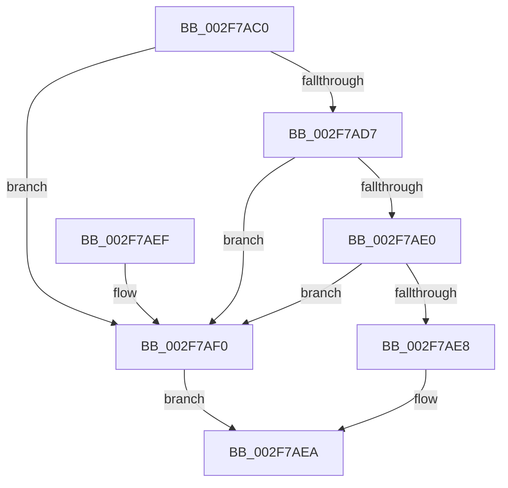

# KeAreAllApcsDisabled

- RVA: `0x002F7AC0`–`0x002F7AF4` (길이 `52` bytes)
- VA: `0x00000001402F7AC0`
- 실행 섹션: `.text`
- PDB 이름 있음: `예`; PDB Function 태그: `아니요`
- unwind 정보 RVA: `0x00069B1C`
- 디코드: `16`개 명령, `52/52` bytes 표시
- 미해석 바이트: `0` (있으면 어셈블리에 `.byte`로 보존)

> 이 문서는 커널 이미지의 기계어와 PDB 기호를 분석해 생성했습니다. 4번과 5번은 함수 원형과 자료형을 바이너리 사용 방식에서 추정한 C 해석이며 원본 소스 복구 결과는 아닙니다.

## 1. Dependencies

- 직접 호출 지점: **1**; 고유 호출 대상: **1**
- 직접 호출자로 확인된 함수: **13**
- RIP 상대 이미지 참조: **0**

### Outgoing calls
- `0x002F7AD7` → [KeAreInterruptsEnabled](KeAreInterruptsEnabled_function_002F8060.md) (function, `0x002F8060`)

### Direct callers
- [IopfCompleteRequest](../29/IopfCompleteRequest_function_0029B5F8.md) at `0x0029BB02`
- [IopfCompleteRequest](../29/IopfCompleteRequest_function_0029B5F8.md) at `0x0029BBAB`
- [ObpDereferenceNamedObject](../3A/ObpDereferenceNamedObject_function_003A0310.md) at `0x003A03F2`
- [ExpSetTimerObject2](../3A/ExpSetTimerObject2_function_003A0658.md) at `0x003A07A6`
- [NtSignalAndWaitForSingleObject](../3A/NtSignalAndWaitForSingleObject_function_003A11D0.md) at `0x003A15B8`
- [NtSignalAndWaitForSingleObject](../3A/NtSignalAndWaitForSingleObject_function_003A11D0.md) at `0x003A1606`
- [IopUnloadSafeCompletion](../3A/IopUnloadSafeCompletion_function_003A16A0.md) at `0x003A17CE`
- [EtwpTraceImageUnloadApc](../44/EtwpTraceImageUnloadApc_function_0044BF50.md) at `0x0044BF67`
- [IopCopyCompleteReadIrp](../4E/IopCopyCompleteReadIrp_function_004E83F0.md) at `0x004E848F`
- [sub_0050C0E0](../50/Unknown_function_0050C0E0.md) at `0x0051A856`
- [sub_0050C0E0](../50/Unknown_function_0050C0E0.md) at `0x0051A887`
- [sub_0050C0E0](../50/Unknown_function_0050C0E0.md) at `0x0051A8B8`
- [sub_0050C0E0](../50/Unknown_function_0050C0E0.md) at `0x0051ABCF`
- [sub_008D6C29](../../page/8D/Unknown_function_008D6C29.md) at `0x008D6C6D`
- [MmFlushVirtualMemory](../../page/9D/MmFlushVirtualMemory_function_009D6F5C.md) at `0x009D6FF2`
- [PerfLogImageUnload](../../page/A2/PerfLogImageUnload_function_00A2216C.md) at `0x00A223E2`
- [CcGetDeviceGuid](../../page/AA/CcGetDeviceGuid_function_00AAFABC.md) at `0x00AAFACC`
- [ViZwCheckApcRequirement](../../pagevrfy/BA/ViZwCheckApcRequirement_function_00BA4C18.md) at `0x00BA4C2D`

### Static image references
- 디코드된 RIP-relative 메모리 참조가 없습니다.

## 2. Other-region calls and transfers

- 다른 실행 섹션으로 향하는 call: **0**
- 별도 외부 분기/꼬리 이동을 확인하지 못했습니다.

## 3. Assembly (complete function range)

```asm
002F7AC0  48 83 EC 28                     sub rsp, 0x28
002F7AC4  65 48 8B 04 25 88 01 00 00      mov rax, qword ptr gs:[0x188]
002F7ACD  66 83 B8 E6 01 00 00 00         cmp word ptr [rax + 0x1e6], 0
002F7AD5  75 19                           jne 0x1402f7af0
002F7AD7  E8 84 05 00 00                  call 0x1402f8060
002F7ADC  84 C0                           test al, al
002F7ADE  74 10                           je 0x1402f7af0
002F7AE0  44 0F 20 C0                     mov rax, cr8
002F7AE4  3C 01                           cmp al, 1
002F7AE6  73 08                           jae 0x1402f7af0
002F7AE8  32 C0                           xor al, al
002F7AEA  48 83 C4 28                     add rsp, 0x28
002F7AEE  C3                              ret
002F7AEF  CC                              int3
002F7AF0  B0 01                           mov al, 1
002F7AF2  EB F6                           jmp 0x1402f7aea
```

## 4. C-style interpretation (structured pseudocode)

```c
__int64 __fastcall KeAreAllApcsDisabled(void)
{
    __int64 result;
    __int64 v_rsp;

    v_rsp = (v_rsp) - (40);
    if ((*(unsigned __int16 *)(*(unsigned __int64 *)(gs_base + (0 + 392)) + 486)) != 0) goto loc_002F7AF0;
    result = KeAreInterruptsEnabled(a1, a2, a3, a4);
    if ((unsigned __int8)(result) == 0) goto loc_002F7AF0;
    if (((unsigned __int8)(v_cr8)) >= 1) goto loc_002F7AF0;
    result = 0;
loc_002F7AEA:
    v_rsp = (v_rsp) + (40);
    return result;
loc_002F7AF0:
    goto loc_002F7AEA;
}
```

## 5. (Beta) C Style

```c
void KeAreAllApcsDisabled(void)
{
    int64_t result;
    int64_t local_rsp;

    local_rsp = (local_rsp) - (40);
    if ((*(uint16_t *)(*(uint64_t *)(gs_base + (0 + 0x188)) + 0x1E6)) != 0) goto loc_002F7AF0;
    result = KeAreInterruptsEnabled(a1, a2, a3, a4);
    if ((uint8_t)(result) == 0) goto loc_002F7AF0;
    if (((uint8_t)(v_cr8)) >= 1) goto loc_002F7AF0;
    result = 0;
loc_002F7AEA:
    local_rsp = (local_rsp) + (40);
    return result;
loc_002F7AF0:
    goto loc_002F7AEA;
}
```

## 6. Execution-region graph

[열기: 2D/3D 그래프와 함수 탐색 컨트롤 패널](../../../control-panel.html?section=text&rva=0x002F7AC0&view=graph)

- 2D 그래프는 위에서 아래로 흐르고, 3D 그래프는 빈 공간을 드래그해 회전합니다. Shift+드래그는 이동, 휠은 확대·축소, 함수 노드 선택은 대상 보고서 이동입니다.

### Static fallback


