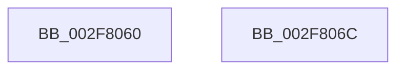

# KeAreInterruptsEnabled

- RVA: `0x002F8060`–`0x002F806D` (길이 `13` bytes)
- VA: `0x00000001402F8060`
- 실행 섹션: `.text`
- PDB 이름 있음: `예`; PDB Function 태그: `아니요`
- unwind 정보 RVA: `0x000635B8`
- 디코드: `7`개 명령, `13/13` bytes 표시
- 미해석 바이트: `0` (있으면 어셈블리에 `.byte`로 보존)

> 이 문서는 커널 이미지의 기계어와 PDB 기호를 분석해 생성했습니다. 4번과 5번은 함수 원형과 자료형을 바이너리 사용 방식에서 추정한 C 해석이며 원본 소스 복구 결과는 아닙니다.

## 1. Dependencies

- 직접 호출 지점: **0**; 고유 호출 대상: **0**
- 직접 호출자로 확인된 함수: **40**
- RIP 상대 이미지 참조: **0**

### Outgoing calls
- 직접 디코드된 call 명령이 없습니다.

### Direct callers
- [IoRemoveIoCompletion](../20/IoRemoveIoCompletion_function_0020B580.md) at `0x0020BB54`
- [IoRemoveIoCompletion](../20/IoRemoveIoCompletion_function_0020B580.md) at `0x0020BBDB`
- [IoRemoveIoCompletion](../20/IoRemoveIoCompletion_function_0020B580.md) at `0x0020BC62`
- [sub_00235EB4](../23/Unknown_function_00235EB4.md) at `0x00235ED0`
- [IopReleaseFileObjectLock](../25/IopReleaseFileObjectLock_function_00250A90.md) at `0x00250DB6`
- [EtwpLogKernelEvent](../25/EtwpLogKernelEvent_function_0025CC00.md) at `0x0025CC69`
- [EtwpLogKernelEvent](../25/EtwpLogKernelEvent_function_0025CC00.md) at `0x0025D2CB`
- [NtSetInformationFile](../29/NtSetInformationFile_function_0029C5E0.md) at `0x0029D174`
- [EtwpOpenLogger](EtwpOpenLogger_function_002F77F0.md) at `0x002F7811`
- [ObfDereferenceObjectWithTag](ObfDereferenceObjectWithTag_function_002F78E0.md) at `0x002F79B0`
- [KeAreAllApcsDisabled](KeAreAllApcsDisabled_function_002F7AC0.md) at `0x002F7AD7`
- [sub_002F7CFF](Unknown_function_002F7CFF.md) at `0x002F7D12`
- [sub_002F7D3D](Unknown_function_002F7D3D.md) at `0x002F7D68`
- [KeGetEffectiveIrql](KeGetEffectiveIrql_function_002F8030.md) at `0x002F8034`
- [sub_002F80EA](Unknown_function_002F80EA.md) at `0x002F811D`
- [MmCanThreadFault](MmCanThreadFault_function_002F86B0.md) at `0x002F86B4`
- [sub_002F8E26](Unknown_function_002F8E26.md) at `0x002F8E89`
- [sub_002F90AE](Unknown_function_002F90AE.md) at `0x002F9129`
- [ObfDereferenceObject](ObfDereferenceObject_function_002F9350.md) at `0x002F9423`
- [sub_002FA4E0](Unknown_function_002FA4E0.md) at `0x002FA53C`
- [NtTraceEvent](NtTraceEvent_function_002FA6C0.md) at `0x002FADB7`
- [EtwpTraceMessageVa](EtwpTraceMessageVa_function_002FB2B0.md) at `0x002FB3D3`
- [PfSnGetFileInformation](../34/PfSnGetFileInformation_function_00343210.md) at `0x00343603`
- [sub_00343D34](../34/Unknown_function_00343D34.md) at `0x00343D4B`
- [IopFreeWaitCompletionPacket](../35/IopFreeWaitCompletionPacket_function_00351A50.md) at `0x00351D36`
- [IopFreeWaitCompletionPacket](../35/IopFreeWaitCompletionPacket_function_00351A50.md) at `0x00351DB3`
- [IopFreeWaitCompletionPacket](../35/IopFreeWaitCompletionPacket_function_00351A50.md) at `0x00351E31`
- [sub_0038C58B](../38/Unknown_function_0038C58B.md) at `0x0038C747`
- [sub_00393FDE](../39/Unknown_function_00393FDE.md) at `0x00394027`
- [sub_00393FDE](../39/Unknown_function_00393FDE.md) at `0x003940A5`
- [NtWaitForWorkViaWorkerFactory](../39/NtWaitForWorkViaWorkerFactory_function_00394270.md) at `0x00394DAF`
- [sub_003ED675](../3E/Unknown_function_003ED675.md) at `0x003ED6F0`
- [EtwpExpandStackAndWalkFrameChain](../44/EtwpExpandStackAndWalkFrameChain_function_00443F80.md) at `0x00443FA9`
- [MiRetryNonPagedAllocation](../48/MiRetryNonPagedAllocation_function_0048C100.md) at `0x0048C145`
- [KeCanUseHaltOnAddress](../4F/KeCanUseHaltOnAddress_function_004FC22C.md) at `0x004FC23D`
- [KiScheduleBugcheckRecovery](../5C/KiScheduleBugcheckRecovery_function_005C7B20.md) at `0x005C7B2A`
- [EtwpEnumerateAddressSpace](../../page/8A/EtwpEnumerateAddressSpace_function_008A7590.md) at `0x008A77CF`
- [VfAfterCallDriver](../../pagevrfy/B9/VfAfterCallDriver_function_00B9DA84.md) at `0x00B9DAA4`
- [VfBeforeCallDriver](../../pagevrfy/B9/VfBeforeCallDriver_function_00B9DC58.md) at `0x00B9DCAB`
- [VfMiscKeAcquireInStackQueuedSpinLockAtDpcLevel_Entry](../../pagevrfy/BA/VfMiscKeAcquireInStackQueuedSpinLockAtDpcLevel_Entry_function_00BADBD0.md) at `0x00BADC09`
- [VfMiscKeReleaseInStackQueuedSpinLockForDpc_Entry](../../pagevrfy/BA/VfMiscKeReleaseInStackQueuedSpinLockForDpc_Entry_function_00BADDD0.md) at `0x00BADDE6`
- [VfMiscKeTryToAcquireSpinLockAtDpcLevel_Entry](../../pagevrfy/BA/VfMiscKeTryToAcquireSpinLockAtDpcLevel_Entry_function_00BADFC0.md) at `0x00BADFE8`
- [ViDeadlockCanProceed](../../pagevrfy/BB/ViDeadlockCanProceed_function_00BB7B84.md) at `0x00BB7BB3`
- [ViKeIrqlLogAndTrimMemory](../../pagevrfy/BB/ViKeIrqlLogAndTrimMemory_function_00BB7F58.md) at `0x00BB7F84`
- [VfFastIoCheckState](../../pagevrfy/BB/VfFastIoCheckState_function_00BB9440.md) at `0x00BB945A`
- [VfFastIoSnapState](../../pagevrfy/BB/VfFastIoSnapState_function_00BB97BC.md) at `0x00BB97D8`

### Static image references
- 디코드된 RIP-relative 메모리 참조가 없습니다.

## 2. Other-region calls and transfers

- 다른 실행 섹션으로 향하는 call: **0**
- 별도 외부 분기/꼬리 이동을 확인하지 못했습니다.

## 3. Assembly (complete function range)

```asm
002F8060  48 9C                           pushfq
002F8062  8B 04 24                        mov eax, dword ptr [rsp]
002F8065  C1 E8 09                        shr eax, 9
002F8068  24 01                           and al, 1
002F806A  59                              pop rcx
002F806B  C3                              ret
002F806C  CC                              int3
```

## 4. C-style interpretation (structured pseudocode)

```c
__int64 __fastcall KeAreInterruptsEnabled(void)
{
    __int64 result;
    unsigned int v_stack_m8;

    result = (unsigned int)(((unsigned int)(v_stack_m8)) >> (9));
    result = (unsigned __int8)((result) & (1));
    return result;
}
```

## 5. (Beta) C Style

```c
void KeAreInterruptsEnabled(void)
{
    int64_t result;
    uint32_t v_stack_m8;

    result = (uint32_t)(((uint32_t)(v_stack_m8)) >> (9));
    result = (uint8_t)((result) & (1));
    return result;
}
```

## 6. Execution-region graph

[열기: 2D/3D 그래프와 함수 탐색 컨트롤 패널](../../../control-panel.html?section=text&rva=0x002F8060&view=graph)

- 2D 그래프는 위에서 아래로 흐르고, 3D 그래프는 빈 공간을 드래그해 회전합니다. Shift+드래그는 이동, 휠은 확대·축소, 함수 노드 선택은 대상 보고서 이동입니다.

### Static fallback


