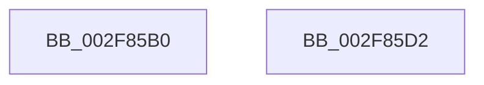

# KeExpandKernelStackAndCalloutEx

- RVA: `0x002F85B0`–`0x002F85D3` (길이 `35` bytes)
- VA: `0x00000001402F85B0`
- 실행 섹션: `.text`
- PDB 이름 있음: `예`; PDB Function 태그: `아니요`
- unwind 정보 RVA: `0x0005D2F4`
- 디코드: `10`개 명령, `35/35` bytes 표시
- 미해석 바이트: `0` (있으면 어셈블리에 `.byte`로 보존)

> 이 문서는 커널 이미지의 기계어와 PDB 기호를 분석해 생성했습니다. 4번과 5번은 함수 원형과 자료형을 바이너리 사용 방식에서 추정한 C 해석이며 원본 소스 복구 결과는 아닙니다.

## 1. Dependencies

- 직접 호출 지점: **1**; 고유 호출 대상: **1**
- 직접 호출자로 확인된 함수: **5**
- RIP 상대 이미지 참조: **0**

### Outgoing calls
- `0x002F85C8` → [KeExpandKernelStackAndCalloutInternal](KeExpandKernelStackAndCalloutInternal_function_002F8450.md) (function, `0x002F8450`)

### Direct callers
- [sub_003AA889](../3A/Unknown_function_003AA889.md) at `0x003AA8EA`
- [IopIssueSystemEnvironmentRequest](../../page/72/IopIssueSystemEnvironmentRequest_function_00722878.md) at `0x00722941`
- [sub_00A179B0](../../page/A1/Unknown_function_00A179B0.md) at `0x00A17B56`
- [ViPtCaptureStackTrace](../../pagevrfy/BB/ViPtCaptureStackTrace_function_00BB7314.md) at `0x00BB735A`
- [KiVerifyScopes](../../init/C3/KiVerifyScopes_function_00C3A5E8.md) at `0x00C3A604`

### Static image references
- 디코드된 RIP-relative 메모리 참조가 없습니다.

## 2. Other-region calls and transfers

- 다른 실행 섹션으로 향하는 call: **0**
- 별도 외부 분기/꼬리 이동을 확인하지 못했습니다.

## 3. Assembly (complete function range)

```asm
002F85B0  48 83 EC 38                     sub rsp, 0x38
002F85B4  48 8B 44 24 60                  mov rax, qword ptr [rsp + 0x60]
002F85B9  41 F6 D9                        neg r9b
002F85BC  48 89 44 24 20                  mov qword ptr [rsp + 0x20], rax
002F85C1  45 1B C9                        sbb r9d, r9d
002F85C4  41 83 E1 02                     and r9d, 2
002F85C8  E8 83 FE FF FF                  call 0x1402f8450
002F85CD  48 83 C4 38                     add rsp, 0x38
002F85D1  C3                              ret
002F85D2  CC                              int3
```

## 4. C-style interpretation (structured pseudocode)

```c
__int64 __fastcall KeExpandKernelStackAndCalloutEx(__int64 a1, __int64 a2, __int64 a3, unsigned __int8 a4, __int64 a5)
{
    __int64 result;
    __int64 v_rsp;
    unsigned __int64 v_stack_m18;

    v_rsp = (v_rsp) - (56);
    a4 = (unsigned __int8)(-(a4));
    v_stack_m18 = a5;
    a4 = (unsigned int)((a4) & (2));
    result = KeExpandKernelStackAndCalloutInternal(a1, a2, a3, a4);
    v_rsp = (v_rsp) + (56);
    return result;
}
```

## 5. (Beta) C Style

```c
int64_t KeExpandKernelStackAndCalloutEx(int64_t Arg1, int64_t Arg2, int64_t Arg3, uint8_t Arg4, int64_t Arg5)
{
    int64_t result;
    int64_t local_rsp;
    uint64_t v_stack_m18;

    local_rsp = (local_rsp) - (56);
    Arg4 = (uint8_t)(-(Arg4));
    v_stack_m18 = Arg5;
    Arg4 = (uint32_t)((Arg4) & (2));
    result = KeExpandKernelStackAndCalloutInternal(Arg1, Arg2, Arg3, Arg4);
    local_rsp = (local_rsp) + (56);
    return result;
}
```

## 6. Execution-region graph

[열기: 2D/3D 그래프와 함수 탐색 컨트롤 패널](../../../control-panel.html?section=text&rva=0x002F85B0&view=graph)

- 2D 그래프는 위에서 아래로 흐르고, 3D 그래프는 빈 공간을 드래그해 회전합니다. Shift+드래그는 이동, 휠은 확대·축소, 함수 노드 선택은 대상 보고서 이동입니다.

### Static fallback


