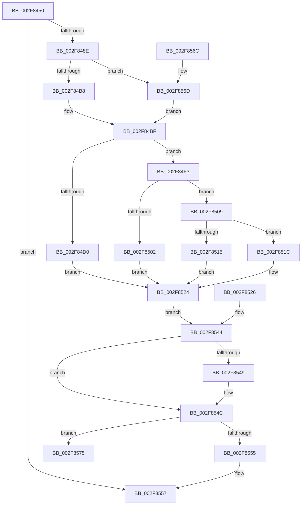

# KeExpandKernelStackAndCalloutInternal

- RVA: `0x002F8450`–`0x002F85A9` (길이 `345` bytes)
- VA: `0x00000001402F8450`
- 실행 섹션: `.text`
- PDB 이름 있음: `예`; PDB Function 태그: `아니요`
- unwind 정보 RVA: `0x00072618`
- 디코드: `91`개 명령, `345/345` bytes 표시
- 미해석 바이트: `0` (있으면 어셈블리에 `.byte`로 보존)

> 이 문서는 커널 이미지의 기계어와 PDB 기호를 분석해 생성했습니다. 4번과 5번은 함수 원형과 자료형을 바이너리 사용 방식에서 추정한 C 해석이며 원본 소스 복구 결과는 아닙니다.

## 1. Dependencies

- 직접 호출 지점: **6**; 고유 호출 대상: **6**
- 직접 호출자로 확인된 함수: **7**
- RIP 상대 이미지 참조: **3**

### Outgoing calls
- `0x002F847E` → [KiExpandKernelStackAndCalloutSwitchStack](KiExpandKernelStackAndCalloutSwitchStack_function_002F8080.md) (function, `0x002F8080`)
- `0x002F84E7` → [RtlWalkFrameChain](RtlWalkFrameChain_function_002F85E0.md) (function, `0x002F85E0`)
- `0x002F8502` → [SMKM_STORE<SM_TRAITS>::SmStDirectReadCallout](SMKM_STORE_SM_TRAITS_SmStDirectReadCallout_function_002FA3E0.md) (function, `0x002FA3E0`)
- `0x002F8515` → [CmOpenKeyCallout](../../page/87/CmOpenKeyCallout_function_00876310.md) (function, `0x00876310`)
- `0x002F851F` → [guard_dispatch_icall](../6B/guard_dispatch_icall_function_006BAAD0.md) (function, `0x006BAAD0`)
- `0x002F85A3` → [KeBugCheckEx](../4F/KeBugCheckEx_function_004FD660.md) (function, `0x004FD660`)

### Direct callers
- [KeExpandKernelStackAndCalloutEx](KeExpandKernelStackAndCalloutEx_function_002F85B0.md) at `0x002F85C8`
- [sub_002F8E26](Unknown_function_002F8E26.md) at `0x002F8F0F`
- [sub_002F90AE](Unknown_function_002F90AE.md) at `0x002F91B0`
- [EtwpExpandStackAndWalkFrameChain](../44/EtwpExpandStackAndWalkFrameChain_function_00443F80.md) at `0x00444017`
- [KeExpandKernelStackAndCallout](../46/KeExpandKernelStackAndCallout_function_004675F0.md) at `0x00467600`
- [MiDoStackCopy](../48/MiDoStackCopy_function_0048BA30.md) at `0x0048BBF8`
- [sub_006DAAE6](../6D/Unknown_function_006DAAE6.md) at `0x006DACC4`

### Static image references
- `0x002F84C4` → RVA `0x00453680` (`EtwpExpandedStackWalk`; read)
- `0x002F84F3` → RVA `0x002FA3E0` (`SMKM_STORE<SM_TRAITS>::SmStDirectReadCallout`; read)
- `0x002F8509` → RVA `0x00876310` (`CmOpenKeyCallout`; read)

## 2. Other-region calls and transfers

- 다른 실행 섹션으로 향하는 call: **1**
  - `0x002F8515` → [CmOpenKeyCallout](../../page/87/CmOpenKeyCallout_function_00876310.md) (`.text` → `PAGE`)
- 별도 외부 분기/꼬리 이동을 확인하지 못했습니다.

## 3. Assembly (complete function range)

```asm
002F8450  48 89 5C 24 18                  mov qword ptr [rsp + 0x18], rbx
002F8455  48 89 54 24 10                  mov qword ptr [rsp + 0x10], rdx
002F845A  48 89 4C 24 08                  mov qword ptr [rsp + 8], rcx
002F845F  56                              push rsi
002F8460  57                              push rdi
002F8461  41 54                           push r12
002F8463  41 56                           push r14
002F8465  41 57                           push r15
002F8467  48 83 EC 40                     sub rsp, 0x40
002F846B  4C 8B E2                        mov r12, rdx
002F846E  4C 8B F1                        mov r14, rcx
002F8471  48 8B 84 24 90 00 00 00         mov rax, qword ptr [rsp + 0x90]
002F8479  48 89 44 24 20                  mov qword ptr [rsp + 0x20], rax
002F847E  E8 FD FB FF FF                  call 0x1402f8080
002F8483  3D 8B 04 00 C0                  cmp eax, 0xc000048b
002F8488  0F 85 C9 00 00 00               jne 0x1402f8557
002F848E  44 0F 20 C6                     mov rsi, cr8
002F8492  40 0F B6 FE                     movzx edi, sil
002F8496  40 88 74 24 31                  mov byte ptr [rsp + 0x31], sil
002F849B  65 48 8B 1C 25 88 01 00 00      mov rbx, qword ptr gs:[0x188]
002F84A4  48 83 C3 7D                     add rbx, 0x7d
002F84A8  48 89 5C 24 38                  mov qword ptr [rsp + 0x38], rbx
002F84AD  0F B6 03                        movzx eax, byte ptr [rbx]
002F84B0  A8 01                           test al, 1
002F84B2  0F 85 B5 00 00 00               jne 0x1402f856d
002F84B8  0C 01                           or al, 1
002F84BA  88 03                           mov byte ptr [rbx], al
002F84BC  45 32 FF                        xor r15b, r15b
002F84BF  44 88 7C 24 30                  mov byte ptr [rsp + 0x30], r15b
002F84C4  48 8D 05 B5 B1 15 00            lea rax, [rip + 0x15b1b5]
002F84CB  4C 3B F0                        cmp r14, rax
002F84CE  75 23                           jne 0x1402f84f3
002F84D0  49 8B 44 24 08                  mov rax, qword ptr [r12 + 8]
002F84D5  0F B6 48 07                     movzx ecx, byte ptr [rax + 7]
002F84D9  45 8B 44 24 1C                  mov r8d, dword ptr [r12 + 0x1c]
002F84DE  41 8B 54 24 18                  mov edx, dword ptr [r12 + 0x18]
002F84E3  49 8B 0C 24                     mov rcx, qword ptr [r12]
002F84E7  E8 F4 00 00 00                  call 0x1402f85e0
002F84EC  41 89 44 24 20                  mov dword ptr [r12 + 0x20], eax
002F84F1  EB 31                           jmp 0x1402f8524
002F84F3  48 8D 05 E6 1E 00 00            lea rax, [rip + 0x1ee6]
002F84FA  49 8B CC                        mov rcx, r12
002F84FD  4C 3B F0                        cmp r14, rax
002F8500  75 07                           jne 0x1402f8509
002F8502  E8 D9 1E 00 00                  call 0x1402fa3e0
002F8507  EB 1B                           jmp 0x1402f8524
002F8509  48 8D 05 00 DE 57 00            lea rax, [rip + 0x57de00]
002F8510  4C 3B F0                        cmp r14, rax
002F8513  75 07                           jne 0x1402f851c
002F8515  E8 F6 DD 57 00                  call 0x140876310
002F851A  EB 08                           jmp 0x1402f8524
002F851C  49 8B C6                        mov rax, r14
002F851F  E8 AC 25 3C 00                  call 0x1406baad0
002F8524  EB 1E                           jmp 0x1402f8544
002F8526  4C 8B 64 24 78                  mov r12, qword ptr [rsp + 0x78]
002F852B  4C 8B 74 24 70                  mov r14, qword ptr [rsp + 0x70]
002F8530  0F B6 7C 24 31                  movzx edi, byte ptr [rsp + 0x31]
002F8535  44 0F B6 7C 24 30               movzx r15d, byte ptr [rsp + 0x30]
002F853B  48 8B 5C 24 38                  mov rbx, qword ptr [rsp + 0x38]
002F8540  40 0F B6 F7                     movzx esi, dil
002F8544  45 84 FF                        test r15b, r15b
002F8547  75 03                           jne 0x1402f854c
002F8549  80 23 FE                        and byte ptr [rbx], 0xfe
002F854C  44 0F 20 C0                     mov rax, cr8
002F8550  40 3A C7                        cmp al, dil
002F8553  75 20                           jne 0x1402f8575
002F8555  33 C0                           xor eax, eax
002F8557  48 8B 9C 24 80 00 00 00         mov rbx, qword ptr [rsp + 0x80]
002F855F  48 83 C4 40                     add rsp, 0x40
002F8563  41 5F                           pop r15
002F8565  41 5E                           pop r14
002F8567  41 5C                           pop r12
002F8569  5F                              pop rdi
002F856A  5E                              pop rsi
002F856B  C3                              ret
002F856C  CC                              int3
002F856D  41 B7 01                        mov r15b, 1
002F8570  E9 4A FF FF FF                  jmp 0x1402f84bf
002F8575  44 0F 20 C0                     mov rax, cr8
002F8579  0F B6 D0                        movzx edx, al
002F857C  48 C1 E2 08                     shl rdx, 8
002F8580  40 0F B6 C6                     movzx eax, sil
002F8584  48 0B D0                        or rdx, rax
002F8587  48 C1 E2 08                     shl rdx, 8
002F858B  48 83 CA 02                     or rdx, 2
002F858F  48 C7 44 24 20 00 00 00 00      mov qword ptr [rsp + 0x20], 0
002F8598  4D 8B CC                        mov r9, r12
002F859B  4D 8B C6                        mov r8, r14
002F859E  B9 C8 00 00 00                  mov ecx, 0xc8
002F85A3  E8 B8 50 20 00                  call 0x1404fd660
002F85A8  90                              nop
```

## 4. C-style interpretation (structured pseudocode)

```c
__int64 __fastcall KeExpandKernelStackAndCalloutInternal(__int64 a1, __int64 a2, __int64 a3, __int64 a4, __int64 a5)
{
    __int64 result;
    __int64 v_r15;
    __int64 v_rbx;
    __int64 v_rsp;
    unsigned __int64 v_stack_m30;
    unsigned __int8 v_stack_m37;
    unsigned __int8 v_stack_m38;
    unsigned __int64 v_stack_m48;
    unsigned __int64 v_stack_p10;
    unsigned __int64 v_stack_p18;
    unsigned __int64 v_stack_p20;
    unsigned __int64 v_stack_p8;

    v_stack_p18 = v_rbx;
    v_stack_p10 = a2;
    v_stack_p8 = a1;
    v_rsp = (v_rsp) - (64);
    v_stack_m48 = a5;
    result = KiExpandKernelStackAndCalloutSwitchStack(a1, a2, a3, a4);
    if (((unsigned int)(result)) != 0xC000048BULL) goto loc_002F8557;
    v_stack_m37 = (unsigned __int8)(v_cr8);
    v_rbx = (*(unsigned __int64 *)(gs_base + (0 + 392))) + (125);
    v_stack_m30 = v_rbx;
    if ((((unsigned __int8)(*(unsigned __int8 *)(v_rbx))) & (1)) != 0) goto loc_002F856D;
    result = (unsigned __int8)((*(unsigned __int8 *)(v_rbx)) | (1));
    *(unsigned __int8 *)(v_rbx) = (unsigned __int8)(result);
    v_r15 = 0;
loc_002F84BF:
    v_stack_m38 = 0;
    if (a1 != (v_rip + 1421749)) goto loc_002F84F3;
    result = RtlWalkFrameChain(*(unsigned __int64 *)(a2), (unsigned int)(*(unsigned int *)(a2 + 24)), (unsigned int)(*(unsigned int *)(a2 + 28)), a4);
    *(unsigned int *)(a2 + 32) = (unsigned int)(result);
    goto loc_002F8524;
loc_002F84F3:
    if (a1 != (v_rip + 7910)) goto loc_002F8509;
    result = SMKM_STORE_SM_TRAITS___SmStDirectReadCallout(a2, (unsigned int)(*(unsigned int *)(a2 + 24)), (unsigned int)(*(unsigned int *)(a2 + 28)), a4);
    goto loc_002F8524;
loc_002F8509:
    if (a1 != (v_rip + 5758464)) goto loc_002F851C;
    result = CmOpenKeyCallout(a2, (unsigned int)(*(unsigned int *)(a2 + 24)), (unsigned int)(*(unsigned int *)(a2 + 28)), a4);
    goto loc_002F8524;
loc_002F851C:
    result = guard_dispatch_icall(a2, (unsigned int)(*(unsigned int *)(a2 + 24)), (unsigned int)(*(unsigned int *)(a2 + 28)), a4);
loc_002F8524:
    goto loc_002F8544;
loc_002F8544:
    if (0 == 0) {
    }
    if (((unsigned __int8)(v_cr8)) != ((unsigned __int8)((unsigned __int8)(v_cr8)))) goto loc_002F8575;
    result = 0;
loc_002F8557:
    v_rsp = (v_rsp) + (64);
    return result;
loc_002F856D:
    goto loc_002F84BF;
loc_002F8575:
    a2 = ((unsigned __int8)(v_cr8)) << (8);
    a2 = (a2) | ((unsigned __int8)(v_cr8));
    a2 = (a2) << (8);
    a2 = (a2) | (2);
    v_stack_p20 = 0;
    result = KeBugCheckEx(200, a2, a1, a2);
    return result;
}
```

## 5. (Beta) C Style

```c
int64_t KeExpandKernelStackAndCalloutInternal(int64_t Arg1, void *Arg2, int64_t Arg3, int64_t Arg4, int64_t Arg5)
{
    uint8_t *arg2 = (uint8_t *)Arg2;

    int64_t result;
    int64_t local_r15;
    int64_t local_rbx;
    int64_t local_rsp;
    uint64_t v_stack_m30;
    uint8_t v_stack_m37;
    uint8_t v_stack_m38;
    uint64_t v_stack_m48;
    uint64_t v_stack_p10;
    uint64_t v_stack_p18;
    uint64_t v_stack_p20;
    uint64_t v_stack_p8;

    v_stack_p18 = local_rbx;
    v_stack_p10 = Arg2;
    v_stack_p8 = Arg1;
    local_rsp = (local_rsp) - (64);
    v_stack_m48 = Arg5;
    result = KiExpandKernelStackAndCalloutSwitchStack(Arg1, Arg2, Arg3, Arg4);
    if (((uint32_t)(result)) != 0xC000048BULL) goto loc_002F8557;
    v_stack_m37 = (uint8_t)(v_cr8);
    local_rbx = (*(uint64_t *)(gs_base + (0 + 0x188))) + (125);
    v_stack_m30 = local_rbx;
    if ((((uint8_t)(*(uint8_t *)(local_rbx))) & (1)) != 0) goto loc_002F856D;
    result = (uint8_t)((*(uint8_t *)(local_rbx)) | (1));
    *(uint8_t *)(local_rbx) = (uint8_t)(result);
    local_r15 = 0;
loc_002F84BF:
    v_stack_m38 = 0;
    if (Arg1 != (v_rip + 1421749)) goto loc_002F84F3;
    result = RtlWalkFrameChain(*(uint64_t *)(arg2), (uint32_t)(*(uint32_t *)(arg2 + 0x18)), (uint32_t)(*(uint32_t *)(arg2 + 0x1C)), Arg4);
    *(uint32_t *)(arg2 + 0x20) = (uint32_t)(result);
    goto loc_002F8524;
loc_002F84F3:
    if (Arg1 != (v_rip + 7910)) goto loc_002F8509;
    result = SMKM_STORE_SM_TRAITS___SmStDirectReadCallout(Arg2, (uint32_t)(*(uint32_t *)(arg2 + 0x18)), (uint32_t)(*(uint32_t *)(arg2 + 0x1C)), Arg4);
    goto loc_002F8524;
loc_002F8509:
    if (Arg1 != (v_rip + 5758464)) goto loc_002F851C;
    result = CmOpenKeyCallout(Arg2, (uint32_t)(*(uint32_t *)(arg2 + 0x18)), (uint32_t)(*(uint32_t *)(arg2 + 0x1C)), Arg4);
    goto loc_002F8524;
loc_002F851C:
    result = guard_dispatch_icall(Arg2, (uint32_t)(*(uint32_t *)(arg2 + 0x18)), (uint32_t)(*(uint32_t *)(arg2 + 0x1C)), Arg4);
loc_002F8524:
    goto loc_002F8544;
loc_002F8544:
    if (0 == 0) {
    }
    if (((uint8_t)(v_cr8)) != ((uint8_t)((uint8_t)(v_cr8)))) goto loc_002F8575;
    result = 0;
loc_002F8557:
    local_rsp = (local_rsp) + (64);
    return result;
loc_002F856D:
    goto loc_002F84BF;
loc_002F8575:
    Arg2 = ((uint8_t)(v_cr8)) << (8);
    Arg2 = (Arg2) | ((uint8_t)(v_cr8));
    Arg2 = (Arg2) << (8);
    Arg2 = (Arg2) | (2);
    v_stack_p20 = 0;
    result = KeBugCheckEx(200, Arg2, Arg1, Arg2);
    return result;
}
```

### 관측된 메모리 오프셋

구조체 형식이 확인되지 않은 접근은 인자 기준의 오프셋으로만 기록했습니다.

| 기준 인자 | 오프셋 표현 | 폭 (bit) | 접근 |
|---|---:|---:|---|
| `Arg2` | `+ 0x0` | `64` | `R` |
| `Arg2` | `+ 0x8` | `64` | `R` |
| `Arg2` | `+ 0x18` | `32` | `R` |
| `Arg2` | `+ 0x1C` | `32` | `R` |
| `Arg2` | `+ 0x20` | `32` | `W` |

## 6. Execution-region graph

[열기: 2D/3D 그래프와 함수 탐색 컨트롤 패널](../../../control-panel.html?section=text&rva=0x002F8450&view=graph)

- 2D 그래프는 위에서 아래로 흐르고, 3D 그래프는 빈 공간을 드래그해 회전합니다. Shift+드래그는 이동, 휠은 확대·축소, 함수 노드 선택은 대상 보고서 이동입니다.

### Static fallback


