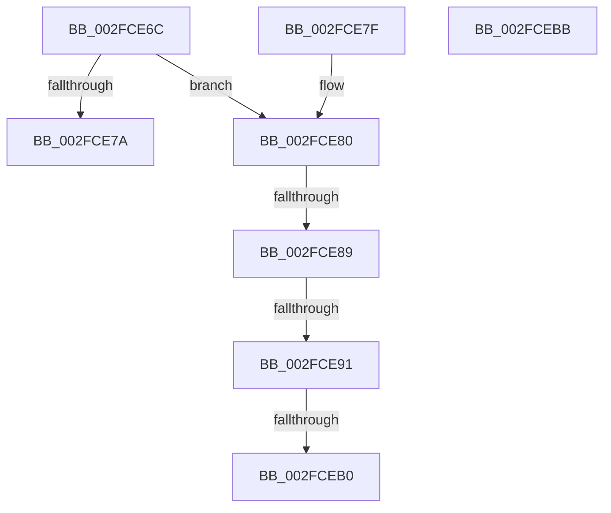

# KeIsTraceCallbackAllowed

- RVA: `0x002FCE6C`–`0x002FCEBC` (길이 `80` bytes)
- VA: `0x00000001402FCE6C`
- 실행 섹션: `.text`
- PDB 이름 있음: `예`; PDB Function 태그: `예`
- unwind 정보 RVA: `0x000DB714`
- 디코드: `21`개 명령, `80/80` bytes 표시
- 미해석 바이트: `0` (있으면 어셈블리에 `.byte`로 보존)

> 이 문서는 커널 이미지의 기계어와 PDB 기호를 분석해 생성했습니다. 4번과 5번은 함수 원형과 자료형을 바이너리 사용 방식에서 추정한 C 해석이며 원본 소스 복구 결과는 아닙니다.

## 1. Dependencies

- 직접 호출 지점: **0**; 고유 호출 대상: **0**
- 직접 호출자로 확인된 함수: **5**
- RIP 상대 이미지 참조: **1**

### Outgoing calls
- 직접 디코드된 call 명령이 없습니다.

### Direct callers
- [EtwpLogKernelEvent](../25/EtwpLogKernelEvent_function_0025CC00.md) at `0x0025D45B`
- [EtwpTraceMessageVa](EtwpTraceMessageVa_function_002FB2B0.md) at `0x002FBA1D`
- [EtwpLogSystemEventUnsafe](EtwpLogSystemEventUnsafe_function_002FBF10.md) at `0x002FC2D1`
- [EtwpInvokeEventCallback](../4B/EtwpInvokeEventCallback_function_004B6F0C.md) at `0x004B6F43`
- [KiTrackSystemCallEntry](../../page/74/KiTrackSystemCallEntry_function_00747D40.md) at `0x00747D73`

### Static image references
- `0x002FCE6C` → RVA `0x00FC6C10` (`ALMOSTRO`; read)

## 2. Other-region calls and transfers

- 다른 실행 섹션으로 향하는 call: **0**
- call이 아닌 외부 분기/꼬리 이동: **3**
  - `0x002FCE83` → `0x006DFC06` (`tail-transfer`)
  - `0x002FCE8B` → `0x006DFC06` (`tail-transfer`)
  - `0x002FCEAA` → `0x006DFC06` (`tail-transfer`)

## 3. Assembly (complete function range)

```asm
002FCE6C  8B 15 9E 9D CC 00               mov edx, dword ptr [rip + 0xcc9d9e]
002FCE72  45 33 C0                        xor r8d, r8d
002FCE75  F6 C2 02                        test dl, 2
002FCE78  74 06                           je 0x1402fce80
002FCE7A  41 8D 40 01                     lea eax, [r8 + 1]
002FCE7E  C3                              ret
002FCE7F  CC                              int3
002FCE80  F6 C2 01                        test dl, 1
002FCE83  0F 84 7D 2D 3E 00               je 0x1406dfc06
002FCE89  84 C9                           test cl, cl
002FCE8B  0F 84 75 2D 3E 00               je 0x1406dfc06
002FCE91  65 48 8B 0C 25 88 01 00 00      mov rcx, qword ptr gs:[0x188]
002FCE9A  48 8B 91 20 02 00 00            mov rdx, qword ptr [rcx + 0x220]
002FCEA1  48 8B 82 70 01 00 00            mov rax, qword ptr [rdx + 0x170]
002FCEA8  A8 01                           test al, 1
002FCEAA  0F 85 56 2D 3E 00               jne 0x1406dfc06
002FCEB0  48 85 C0                        test rax, rax
002FCEB3  41 0F 94 C0                     sete r8b
002FCEB7  41 8B C0                        mov eax, r8d
002FCEBA  C3                              ret
002FCEBB  CC                              int3
```

## 4. C-style interpretation (structured pseudocode)

```c
__int64 __fastcall KeIsTraceCallbackAllowed(unsigned __int8 a1, __int64 a2, int a3)
{
    a3 = 0;
    if ((((unsigned __int8)((unsigned int)(*(unsigned int *)(v_rip + 13409694)))) & (2)) == 0) goto loc_002FCE80;
    return a3 + 1;
loc_002FCE80:
    a3 = (*(unsigned __int64 *)(*(unsigned __int64 *)(*(unsigned __int64 *)(gs_base + (0 + 392)) + 544) + 368) == 0) ? 1 : 0;
    return (unsigned int)(a3);
}
```

## 5. (Beta) C Style

```c
int64_t KeIsTraceCallbackAllowed(uint8_t Arg1, int64_t Arg2, int32_t Arg3)
{
    Arg3 = 0;
    if ((((uint8_t)((uint32_t)(*(uint32_t *)(v_rip + 0xCC9D9E)))) & (2)) == 0) goto loc_002FCE80;
    return Arg3 + 1;
loc_002FCE80:
    Arg3 = (*(uint64_t *)(*(uint64_t *)(*(uint64_t *)(gs_base + (0 + 0x188)) + 0x220) + 0x170) == 0) ? 1 : 0;
    return (uint32_t)(Arg3);
}
```

## 6. Execution-region graph

[열기: 2D/3D 그래프와 함수 탐색 컨트롤 패널](../../../control-panel.html?section=text&rva=0x002FCE6C&view=graph)

- 2D 그래프는 위에서 아래로 흐르고, 3D 그래프는 빈 공간을 드래그해 회전합니다. Shift+드래그는 이동, 휠은 확대·축소, 함수 노드 선택은 대상 보고서 이동입니다.

### Static fallback


