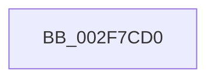

# KeQueryCurrentStackInformationEx

- RVA: `0x002F7CD0`–`0x002F7CFF` (길이 `47` bytes)
- VA: `0x00000001402F7CD0`
- 실행 섹션: `.text`
- PDB 이름 있음: `예`; PDB Function 태그: `아니요`
- unwind 정보 RVA: `0x0007243C`
- 디코드: `13`개 명령, `47/47` bytes 표시
- 미해석 바이트: `0` (있으면 어셈블리에 `.byte`로 보존)

> 이 문서는 커널 이미지의 기계어와 PDB 기호를 분석해 생성했습니다. 4번과 5번은 함수 원형과 자료형을 바이너리 사용 방식에서 추정한 C 해석이며 원본 소스 복구 결과는 아닙니다.

## 1. Dependencies

- 직접 호출 지점: **0**; 고유 호출 대상: **0**
- 직접 호출자로 확인된 함수: **17**
- RIP 상대 이미지 참조: **2**

### Outgoing calls
- 직접 디코드된 call 명령이 없습니다.

### Direct callers
- [EtwpLogKernelEvent](../25/EtwpLogKernelEvent_function_0025CC00.md) at `0x0025D7B6`
- [RtlDispatchException](RtlDispatchException_function_002F22A0.md) at `0x002F2358`
- [RtlUnwindEx](RtlUnwindEx_function_002F2830.md) at `0x002F28E6`
- [RtlpWalkFrameChain](RtlpWalkFrameChain_function_002F3ED0.md) at `0x002F4627`
- [RtlpGetStackLimits](RtlpGetStackLimits_function_002F5F50.md) at `0x002F5F73`
- [EtwpTraceLastBranchRecord](EtwpTraceLastBranchRecord_function_002F7B00.md) at `0x002F7B9C`
- [KeQueryCurrentStackInformation](KeQueryCurrentStackInformation_function_002F7C80.md) at `0x002F7CA9`
- [sub_002F819C](Unknown_function_002F819C.md) at `0x002F81C0`
- [sub_002F8911](Unknown_function_002F8911.md) at `0x002F8AD4`
- [EtwpTraceStackWalk](EtwpTraceStackWalk_function_002F8D60.md) at `0x002F8DC5`
- [EtwpLogSystemEventUnsafe](EtwpLogSystemEventUnsafe_function_002FBF10.md) at `0x002FC7B6`
- [RtlpIsFrameInBoundsEx](../41/RtlpIsFrameInBoundsEx_function_00415510.md) at `0x004155A0`
- [KeCheckStackAndTargetAddress](../43/KeCheckStackAndTargetAddress_function_0043E580.md) at `0x0043E5B3`
- [RtlpGetStackLimitsEx](../45/RtlpGetStackLimitsEx_function_0045D2E0.md) at `0x0045D300`
- [KasanHibernationGetStackLow](../5A/KasanHibernationGetStackLow_function_005AAC30.md) at `0x005AAC6E`
- [WheaIsAltContextAllocPossible](../65/WheaIsAltContextAllocPossible_function_0065F320.md) at `0x0065F36D`
- [sub_006F13AA](../6F/Unknown_function_006F13AA.md) at `0x006F13AF`
- [sub_006F13AA](../6F/Unknown_function_006F13AA.md) at `0x006F14DE`

### Static image references
- `0x002F7CDD` → RVA `0x00F4754C` (`.data`; read)
- `0x002F7CEC` → RVA `0x00F10908` (`.data`; read)

## 2. Other-region calls and transfers

- 다른 실행 섹션으로 향하는 call: **0**
- call이 아닌 외부 분기/꼬리 이동: **1**
  - `0x002F7CF9` → [sub_002F7DF3 + 0x1](Unknown_function_002F7DF3.md) (`tail-transfer`)

## 3. Assembly (complete function range)

```asm
002F7CD0  48 89 5C 24 18                  mov qword ptr [rsp + 0x18], rbx
002F7CD5  56                              push rsi
002F7CD6  57                              push rdi
002F7CD7  41 56                           push r14
002F7CD9  48 83 EC 20                     sub rsp, 0x20
002F7CDD  8B 05 69 F8 C4 00               mov eax, dword ptr [rip + 0xc4f869]
002F7CE3  49 8B F9                        mov rdi, r9
002F7CE6  83 E0 03                        and eax, 3
002F7CE9  4D 8B F0                        mov r14, r8
002F7CEC  80 3D 15 8C C1 00 00            cmp byte ptr [rip + 0xc18c15], 0
002F7CF3  48 8B F2                        mov rsi, rdx
002F7CF6  48 8B D9                        mov rbx, rcx
002F7CF9  0F 84 F5 00 00 00               je 0x1402f7df4
```

## 4. C-style interpretation (structured pseudocode)

```c
__int64 __fastcall KeQueryCurrentStackInformationEx(__int64 a1, __int64 a2, __int64 a3, __int64 a4)
{
    __int64 result;
    __int64 v_rsp;
    unsigned __int64 v_stack_p18;

    v_stack_p18 = v_rbx;
    v_rsp = (v_rsp) - (32);
    result = (unsigned int)(((unsigned int)(*(unsigned int *)(v_rip + 12908649))) & (3));
}
```

## 5. (Beta) C Style

```c
int64_t KeQueryCurrentStackInformationEx(int64_t Arg1, int64_t Arg2, int64_t Arg3, int64_t Arg4)
{
    int64_t result;
    int64_t local_rsp;
    uint64_t v_stack_p18;

    v_stack_p18 = local_rbx;
    local_rsp = (local_rsp) - (32);
    result = (uint32_t)(((uint32_t)(*(uint32_t *)(v_rip + 0xC4F869))) & (3));
}
```

## 6. Execution-region graph

[열기: 2D/3D 그래프와 함수 탐색 컨트롤 패널](../../../control-panel.html?section=text&rva=0x002F7CD0&view=graph)

- 2D 그래프는 위에서 아래로 흐르고, 3D 그래프는 빈 공간을 드래그해 회전합니다. Shift+드래그는 이동, 휠은 확대·축소, 함수 노드 선택은 대상 보고서 이동입니다.

### Static fallback


